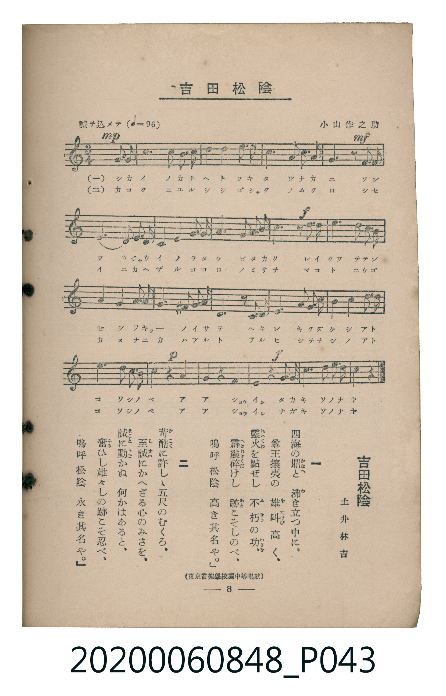

# 吉田松陰

> Re:Shōka 使用 AI 協助辨識與重建樂譜，可能會有錯誤。歡迎回報。

- **鋼琴伴奏版**：<br><audio controls src="yoshida_shoin.mp3"></audio>

- 詞：土井林吉（土井晩翠）
- 曲：小山作之助
- 出處：東京音樂學校編《中等唱歌》
- 臺灣教育會公認《新定兒童唱歌》高等科男子用（2020.006.0848）

## 說明

原書資訊與歌詞全文（對應 P043.jpg，書頁 p. 8，高一第一學期第 8 首）：
調性與拍號：ハ長調（無升降記號）、3/4 拍（誠ヲ込メテ ♩=96，弱起第 3 拍進入）
出處註記：（東京音樂學校編中等唱歌）


## 歌詞

```text
一　四海（しかい）の鼎（かなへ）と　沸（わ）き立（た）つ中（なか）に、
尊王攘夷（そんわうじゃうい）の　雄叫（をたけび）高（たか）く、
靈火（れいくゎ）を點（てん）ぜし　不朽（ふきゅう）の功（いさを）、
霹靂（へきれき）碎（くだ）けし　跡（あと）こそしのべ、
嗚呼（ああ）　松陰（しょういん）　高（たか）き其名（そのな）や。

二　苛酷（かこく）に許（ゆる）しゝ五尺（ごしゃく）のむくろ、
至誠（しせい）にかへざる心（こころ）のみさを、
誠（まこと）に動（うご）かぬ　何（なに）かはあると、
奮（ふる）ひし雄々（をを）しの跡（あと）こそ忍（しの）べ、
嗚呼（ああ）　松陰（しょういん）　永（なが）き其名（そのな）や。
```

## ABC

<div class="abc-score" data-abc-src="yoshida_shoin.abc" aria-label="五線譜載入中"></div>

[下載 ABC 原始檔](yoshida_shoin.abc)

## TMD 檔案連結

- [主旋律 TMD 檔案](yoshida_shoin.tmd) [[在 TMD Studio 編輯](https://tmdlang.github.io/Tmd-TS/#tmd=s7IKdvYPcrWy4qpTUCpJTLdSSM7PyUlNLsnMz7MqzsjMK0nNjM_KTMmPL87Iz05Ugisry88pzU21ys4vyY9Pyq8sjjcyMDKINzAwizewMLFAqCvOLy1KTrUqTs7Iz8-JL0mtKEnKz89Gl48vSExPtQowMDFGyBQU5Zel5iXmAXUXFIEckgLWjlCQWpaZkgqSLk5OzIsvSy3KTMtMTUFyYmpRMdgbECtKihLzipOLMgtAfkOoyi8qychPL0osyKi0ysgsLskvykxOzInPTsxD8m1JRirQsxDpSmS9memZeVa5qZlZmUh-09JSeDqh8_mUDc_m7ns5c4OClhaXoq2CpRmXva2CM5eNsb6JHciIFyvnvd8z6-mc-U92TX02bzpQy_s9HVDuzJXP9y94v6cTbNez2ZtACjf0P9248cneOU92dj_tWgmWedq-68XMqUDJZ3M3Ptm15uX8zc9WND1du-PZgoXPt6943ND1ZMfa52s7n07Z-Gxtz-OGbrCmF-27njcufjZ15oumTc_mND9tXfNiVS9Q7bNpG56um_W0ddLz1UvhOl6ungE04Pnyic-nbH-6dsLzKSuAjgTFtR4wrvVAcQ12JZe-loIttQCXgoLC0775z2bveLG5_cWKrhcd7UDHAIPraeuKZ9PaQaG0ofdZe6cCKMHoZRWkv9_TA1T8ckGjQoGeAtBBPUBXP9nR8HzNGiAJCo4584FsBQuFl8umAZ0LDC-QFS9W7X_WsBxkeHfvi5nzgaKPm_tfTt0OFAda8bxl4dPe9pcze1-smAGW7Xzc0AiMOgWgaqD0i1ULHjdverFvz-PmhY-b2xQezVxpa2kGtPrpno0vtm4HWWcMUvqyYdPT1qVA3WBPgaPrxYrdQDOB1gGNwRpvyJEG0gnSCvTI44aGp7NnP9u6HajvceP0x43djxtbQO5qXPdyTx9YECiy6nHjDrAgMPobnm0CsjseN_WDRXqfr-4GKwP7pnEJ0B4wF6gFKA4UWQ30ItidG7qe93U_mzLj6RKIZXMfN00GmvK4se1x44zHTc1gBtRuoDUvZ7c87V8NtmkS0PTHjRMfN24GygKjAWIfzIJ-qAUv53Y8b4Ro6AEaBJJoAvqgE6j_5W5grgDqWQa0EqxnDsivDQ1PdvQ-m7MXLLUV6JXHTa1AR0Bc8LQL6CGgONCcqUATIFEFtmbOzpdzm8ByO8B6gJYBI6_z-SJIcAE9BMpkYPeC7HixfSFYvAkYemDxySCvg4J63ePGnbDAmT7r6cQ9MHVA04G2NUByOjRimtoh4QP1ATB80MOh92nrtqcTQOkIbAHQ9FVg37c8bmiCRPcuYOZreNE9-2UrJAaAMQt0DCQeV79YsREcdm2PmyDmAe2c-2TXlKcbdoEVTwGLAGMJon7d46YGcBADcznYCy_aNwPTLywZzYZF5WqwNcCQmgY09-n-ZrACoK3AqAeFGtid-yFhDDMIaso-sDpImK1-2g0skYCCwCCYAhYBGroGFIN7IeLA5AaMeoj4elAgNgEZwNQKCd2l66BxDPXaJqAbgenrcUMrNH1BIhgcKVjj6-l-SLiCFIAFKYi4ZxvA-QfkZFBOJBBxQDsoL_ygQEFLn4srMh9YBackBmfkA2uZgMzEvHyHGl3DmmqQTQo2hmZadmAWtrJXAVL4vVjYo6ABKZIUDEHlkYK2ggkwf_c_X9-gAy8_NbHoB9oPMrtGwUBBFwxhdHVuQa2CKZhpCpQ2jIOKgyCYYw5j1CgYwSThDGMIA0ihaTWD6QIxa6AWIGyuzk2rBZaoYL0KNWCn-RjWKMRDlcDox03bofRqoCGPm5YgGfO4uQ8qA2J3gR34uHkGXLYDzloPNWMt2Iz9KGa0wHXDbWnuRlIBcsnjpr1Q1ZthbjXC5laQS0A0UBWQhNgKswdk5uPmZWASpA6kAuI3hC9BrC0wkcfNi7EYA_Zy8wKoovVg567FcC4s0HYDnYs_Se3qAScpU9LSECTiINAIiEF8EA1MA1BRmApEwgIlCBg0gcuA0gZKugEnDmDagKYwIAW0DlkBWAKqxRwp6cCiGRaQ4KBu2gEKRhgXOQVBghLC2gTVsh-sYiOyMc2ToTKwGEaPEnCAN6-Byi-ByD9uXodiCMgCUKsCwkNOROhJGpxMoEkalJRBKrbBZSEJDJLEYDR6CoClkflQFVvBKiBeRHbyPBQTYJkF2RWgIIMkSUKpaEcnOakIliJgZQOEj15amMSrw9WA5EDpDAZBiQWS4ozQUiXILIgeYFKpAZdhUA6EgZS8ECmoaQ8sBBAZsnkqVGTt4-al4KCCKUIKbGgk4g5sSKkELYGgqQVmFSjyYGnqcXMDShpELhkWQVV0oCQfeJJo7oGzoKUZMBqRVUDE-lHMgpR3yJEPcS_U01D5SSjuBbkInmeANEpJhshVKO7Fm3yArWBw8jEjsRDCUyogIhpezQFrOViCQyQwmCyoQILIwBIRXB-wLMJRO4LthLoCXE5hWAqjkdMYJOfCAglUscDLa2DggYJ7JlQWUbFAghJSGsDYSFXk4-blsNwKLeRAhQy6MtQybC2mM6BxB0o_IGfACib0eg459Q2UZ-AV9hqKPVPLxaVrp4DcNFMA8pW5AA)]
- [鋼琴伴奏 TMD 檔案](yoshida_shoin_piano.tmd) [[在 TMD Studio 編輯](https://tmdlang.github.io/Tmd-TS/#tmd=s7IKdvYPcrWy4qpTUCpJTLdSSM7PyUlNLsnMz7MqzsjMK0nNjM_KTMmPL87Iz05Ugisry88pzU21ys4vyY9Pyq8sjjcyMDKINzAwizewMLFAqCvOLy1KTrUqTs7Iz8-JL0mtKEnKz89Gl48vSExPtQowMDFGyBQU5Zel5iXmAXUXFIEckgLWjlCQWpaZkgqSLk5OzIsvSy3KTMtMTUFyYmpRMdgbECtKihLzipOLMgtAfkOoyi8qychPL0osyKi0ysgsLskvykxOzInPTsxD8m1iEVBzempual6JVUFmYl5-fGJycn5uQWJeJkgMobAkA6gIak4lsiWZ6Zl5VrmpmVmZSIGgpaXwdELn8ykbns3d93Lmhvd7Ol5273k-YcuTPVueLu1_3tnxfk-ngpYWl6KtgqUZl72tgjOXjbG-iR3I3Bcr573fM-vpnPlPdk19Nm860Bygdih35srn-xcA9YId8Gz2JpDCDf1PN258snfOk53dT7tWgmWetu96MXMqUPLZ3I1Pdq15OX_zsxVNT9fueLZg4fPtKx43dD3Zsfb52s6nUzY-W9vzuKEbrOlF-67njYufTZ35omnTsznNT1vXvFjVC1T7bNqGp-tmPW2d9Hz1UriOl6tnAA14vnzi8ynbn66d8HzKCqAjQSlFD5hS9EApBexKrsh8YFpLSQzOyAeGUgAogIM8HGp0DWuquRSAwMbQTMsOzNLXUni-Zs2THQ0vFvYoaOmDxWoUDBR0wRBGV-cW1CqYgpmmQGnDOKg4CII55jBGjYIRTBLOMIYwgBSaVjOYLhCzBmoBwubq3LRaBWOIXoUasNN8DGsU4qFKYPTjpu1QejXQkMdNS5CMedzcB5UBsbvADnzcPAMu2wFnrYeasRZsxn4UM1rguuG2NHcjqQC55HHTXqjqzTC3GmFzK8glIBqoCkhCbIXZAzLzcfMyMAlSB1IB8RvClyDWFpjI4-bFWIwBe7l5AVTRerBz12I4FxZou4HORU4Ku3pQkgIk_CHQCIhBfBANjEqoKEwFIn2A4hUGTeAyoChGiX5wHAOjGJpQgBTQOmQFYAmoFnOkFACLLVh4gEOsaQcoNGBc5IQACREIaxNUy36wio3IxjRPhsrAIgo9ZMHh1rwGKr8EIv-4eR2KISALHje3QXnIaQE9ZYJjG5oyQSkSpGIbXBaSTiApBUajRyQsqudDVWwFq4B4EdnJ81BMgKV5ZFeAggySslATw45OlMQAi1hYToXw0fOuSbw6XA1IDpRcYBAU55CEY4SWuEBmQfQAY7wGXKJAORAGUipBJISmPTCPILJH81SoyNrHzUvBPoYpQgozaFzgDjNIGQEtD6CRDrMKFAewpPG4uQElKSHn00VQFR0oqQAes809cBa0bAHGBrIKiFg_ilmQ0gc5DiHuhXoaKj8Jxb0gF8GTPpBGKVcQmQPFvUip4Ons2ahFAp48iogveN0BrDpg6QaRTmCyoOIBIgNLC3B9wJIBR5UDthPqCnCpgWEpjEZOKpB8BPMrqLSGF4LAMACF2kyoLKK0hoQIJG_C2Ej1zuPm5bC8Ay1yQFkeXRlqibIW0xnQKAAlA5AzYMUEeuWBnIgGyjPwWnANxZ6pxdZM8UFpppggWilP92x8sXW7gjb25goIApNBvEK0YSwYA1NaPJBnGg_jmgB5JiAeiIArBerCV_lBVYGMQjMdZhyKFJIbwOL4ilKQAUB1QApYQALZRiC3gQgkl8PMM4vPjQUxoFLYjEfPo-guN4DYBGYhCaK7GC4Kih1dOwXkCIr2AarCEDMCiylzAQA)]

## 分析

```text
================================================================================
📊 TMD Song Profile: [ 吉田松陰 ]
================================================================================
⏱  Duration:       0:37 (37.5s), 20 measures total
🎼 Key & Tempo:    首調基準 C, != 96.0 BPM, <3/4>
   - 分析範圍：      由實際發聲的音符與和弦推測調性；播放脈絡另行呈現
🎤 人聲音域:    F#3 (MIDI 54) – E5 (MIDI 76) [跨度: 22 個半音 / 1.8 個八度, 難度: difficult]
   - 最低音:  F#3 in [YoshidaShoin #1 @ m.12, 0:21]
   - 最高音: E5 in [YoshidaShoin #1 @ m.3, 0:05]
   - 適合: mezzo-soprano, contralto, baritone, bass
🏛  結構:      YoshidaShoin (37.5s)
⚡ 編曲密度:        Peak 1 軌道同時演奏
🗝  調性診斷：       C 大調（純淨自然大調，未偵測到可信轉調）
   - 風格氣質:    純淨自然大調（陽光明朗、易唱易記，無明顯調外色彩）
   - 轉調歷程:    全曲維持單一推測調性（未偵測到可信轉調）
   - 核心骨幹音:  C, E, G, D, A
   - 調性數值:    C 大調 [相關度: 0.90, 穩定度: High, 自然音純度: 99.1%]
   - 候選調性 (K-S): C 大調 (0.90), G 大調 (0.71), E 小調 (0.67)
   - 五度圈歷程:   +0
   - 各段落調性細節:
     • [YoshidaShoin #1]: C 大調 (r: 0.89, 自然音純度: 99.1%, 調外音: F#)

  [ 五度圈游移軌跡 ]
              [C ]*
         F            G  
      Bb               D  
      Eb               A  
         Ab           E  
            Db       B  
               F# 
     (* = active key center)

  [ 十二半音累積音高分佈 ]
     C  : ████████████████████████  26.1%
     C# :                            0.0%
     D  : ██████████████            15.6%
     D# :                            0.0%
     E  : ███████████████████       20.6%
     F  : ███                        2.8%
     F# : █                          0.9%
     G  : █████████████████         18.8%
     G# :                            0.0%
     A  : ███████████               11.5%
     A# :                            0.0%
     B  : ███                        3.7%
--------------------------------------------------------------------------------
Assignment 軌道音域：
  - Piano         : F#3 – E5 (22 個半音 / 1.8 個八度, 71 個音符)
================================================================================
```


## 原書掃描頁




