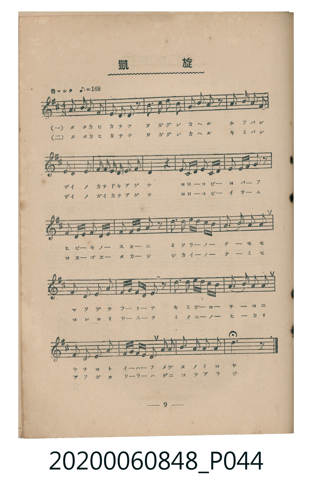
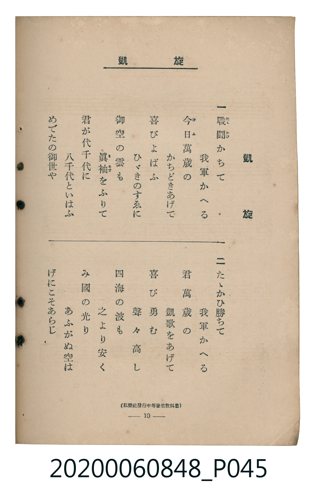

# 凱旋

> Re:Shōka 使用 AI 協助辨識與重建樂譜，可能會有錯誤。歡迎回報。

- **鋼琴伴奏版**：<br><audio controls src="gaisen.mp3"></audio>

- 出處：弘樂社發行《中等音樂教科書》
- 臺灣教育會公認《新定兒童唱歌》高等科男子用（2020.006.0848）

## 說明

原書資訊與歌詞全文（對應 P044.jpg – P045.jpg，書頁 pp. 9–10，高一第一學期第 9 首）：
調性與拍號：ニ長調（2 升記號）、4/8 拍（勇マシク ♪=168，相當於 ♩=84）
出處註記：（弘樂社發行中等音樂教科書）


## 歌詞

```text
一　戰鬪（たたかひ）かちて　我軍（わがぐん）かへる
今日（けふ）萬歲（ばんざい）の　かちどきあげて
喜（よろこ）びよばふ　ひゞきのすゑに
御空（みそら）の雲（くも）も　眞袖（まそで）をふりて
君（きみ）が代（よ）千代（ちよ）に　八千代（やちよ）といはふ
めでたの御世（みよ）や

二　たゝかひ勝（か）ちて　我軍（わがぐん）かへる
君（きみ）萬歲（ばんざい）の　凱歌（がいか）をあげて
喜（よろこ）び勇（いさ）む　聲々（こゑごゑ）高（たか）し
四海（しかい）の波（なみ）も　之（これ）より安（やす）く
み國（くに）の光（ひか）り　あふがぬ空（そら）は
げにこそあらじ
```

## ABC

<div class="abc-score" data-abc-src="gaisen.abc" aria-label="五線譜載入中"></div>

[下載 ABC 原始檔](gaisen.abc)

## TMD 檔案連結

- [主旋律 TMD 檔案](gaisen.tmd) [[在 TMD Studio 編輯](https://tmdlang.github.io/Tmd-TS/#tmd=s7IKdvYPcrWy4qpTUCpJTLdSSM7PyUlNLsnMz7MqzsjMK0nNjM_KTMmPL87Iz05Ugisry88pzU21ys4vyY9Pyq8sjjcyMDKINzAwizewMLFAqCvOLy1KTrUqTs7Iz8-JL0mtKEnKz89Gl48vSExPtQowMDHBKWOKkCkoyi9LzUvMA5pbUARyYgrYYISC1LLMlFSQdHFyYl58WWpRZlpmagqS41OLisEehFhRUpSYV5xclFkA8jVCVX5RSUZ-elFiQUalVUZmcUl-UWZyYk58dmIeUjiUZKQCgyE3MyezJLGoEllzZnpmnlVJYiYw4ECBV54Yn5uYmZeTmAd0iJaWwtP2jc-mdytoaXEp2ipYmHDZ2yq4cNmY6FvYgcx42r7rxcyp7_fMerpnxrMVTc-X7Hs-c8-LhT2PG7qe7Fj7fG3ny_mbgeLPps58vnzis9k7Hjd0g-1-0b7reeNioPCLpk3P5jQ_bV3zYlUvUNOzaRuerpv1tHXS89VLn07Z-Gwt0KTul6tnAE0CGvB8yvanayc8n7Li_Z4OUDzqAeNRDxSP7_d0KnFx6Wsp2FILcCkoKDztmw908ovN7S9WdL3oaAc65sXKeU9bVzyb1g50wNMNvc_aOxVAiUEvqyBd4VHDZBDHFMR5v6cHqPPlgkaFggI9BUuglKEBUAzokSc7Gp6vWQMkn67d8WzOfCBbwVLh5bJpQB8AQxFk64tV-581LAfZ1937YuZ8oOjj5u6XU7cDxUHeVnjaC3TPDLBM5-OGRmBMKABVghzU3f64ed7jpu2Pm9YrPJq5ytbQDBgwPc9n73g-dduzaXuAYittLUyA2sCeA8fcixW7gYYB7QDpR41CrPEH0gzSDfTA44aGZx0bXq5ZBdT6uHE-GHU_btwEchaIsfBx4zKwmokvdoOc97ip_3Fjz-PGCY-bJsPU7Hjc1A02bnfXs-lLwQZNfNy4FSj9YsKaZ2uBZgFFNgA1PG6c9rixBaxtHdBQmAUrHzf2Pm5setw4CWgZ2FfT5oCtAiKgBMSezSAu0JTGrWCdmx43zQNrW_e4cebjJqB9q8E69y18vnIX2ML9jxvnPm4CxgfItpezIa7of9zUBBJpagKa8nzOvBeLgHEGFN8HUty4HCwFdMXWx01dMLdMmA1WAbQKGHNAs3qe7F4McR2Q-7S3GcoFegQsAnQI0OinrasRUk0tSLIrgCHwuHE90A6Q6Y-bGoHWgkN9HdDtT3ZAnLMfqrqpBRJPu4AZCOjp-Y-bgK4ERc_T7rlghd1gM0mJJDT_4I8hULGxtgcsCzQO6G6wfaAQIhRbwGQM1gbUAyxYgHpAKe0FMNoaWsHik8FxNgVIAmWBOQqW_CAemg42d_bsZ1u3gyWmg70AddezzYvAgqugMQKOyyc7gToh5gLdCxQEuqbr6Tpg9EPCfyZYbz84zBv3P50DUQ0MptUQQ5-2gpUCHQj1Yxc4xIHe3Ar2-xpYsoKnqfUQs4ChsBpkLSj9NAHlHjfOAElQXnZBgYKWPheXO7BgT82zCshMzMt3qDGoqQZZoWBjaKZlB2ZhKzMVICUUsAxQ0DBVeLqh__n6Bh14QaeJRQPQJpBhNQqmCrpAaAamjYG4RsEISBpCsQFYxAysxlzBMA6sFCRkAmWBtEEUYRgEtsDHsAaY8PeD5UD046bVIFbzJLAeGK8RTLYByXiIePN6qI41QLwBLLsZRccMMAliQ3U0bYToaJ4KxBMQOiCuMKKXK9ZCXTEfzRX4o25XDzlRB4soEASxa4DhbgxkGYJ5oFiogcuD4ggEIbrM46GKwAyImBFQPShWwbGJFHfbwCGwBKr_cXMfPARAIfa4uRPs68dNi6BhtQkccqBQBEFQuEDsfdy8AqwfqLZ5D1AdKFweN08G8xCyEyCywFiEhilS_OFyCSh2lkBdtIlyl4BteNy0FeqSBXCXEMh-neA4NCEtDkE5BRQVMBoiAooJRM4CZzugdJyCURyINAfmMtT8BsJIcQZO1zAfQdIkKLRg_tsJ5m-E-q8b5j9wqoWE3F4geyVUHqEPmhvAoqAwhpDIMQQJSajJTVuQeLD8B4klkOx2hL1gNlQOFJOo9jZ3IdkLciHMXrzxAaxRyI8PSH4Chyo4Loyh2YXc-JgHDVWQ29vB5CZoiINKK5C_VkFppNIHuSwBpXGw_Ap4qIBKK1ioQNIzKCYxY2MNmISoWAW1FRrGwJQAoUExi54G1oNNRI8LUMqC2gotA8FmEirfplAzLkAlHEjEFF41gdgwNdDYQRR7yBEBztrQgh4SJB3QwIYlu34oDSqAHjcvBEcYUuUBDgpIIgTph5kJg-hFFiSbgM0CRiGI3QO1D5TFQPbAslk_WA2w-AIGOizyoFkRaspKqM4dGPbVcnHp2ilAGg4KQJYyFwA)]
- [鋼琴伴奏 TMD 檔案](gaisen_piano.tmd) [[在 TMD Studio 編輯](https://tmdlang.github.io/Tmd-TS/#tmd=s7IKdvYPcrWy4qpTUCpJTLdSSM7PyUlNLsnMz7MqzsjMK0nNjM_KTMmPL87Iz05Ugisry88pzU21ys4vyY9Pyq8sjjcyMDKINzAwizewMLFAqCvOLy1KTrUqTs7Iz8-JL0mtKEnKz89Gl48vSExPtQowMDHBKWOKkCkoyi9LzUvMA5pbUARyYgrYYISC1LLMlFSQdHFyYl58WWpRZlpmagqS41OLisEehFhRUpSYV5xclFkA8jVCVX5RSUZ-elFiQUalVUZmcUl-UWZyYk58dmIeUjgkFgE1p6fmpuaVWBVkJublxycmJ-fnFiTmZYLEEApLMoCKrHIzczJLEosqkW3JTM_MsypJzASGMCiUyxPjcxMz83IS84Au1tJSeNq-8dn07vd7Ol5273k-YcuTPVueLu1_3tnxfk-ngpYWl6KtgoUJl72tgguXjYm-hR3I4Kftu17MnPp-z6yne2Y8W9H0fMm-5zP3vFjY87ih68mOtc_Xdr6cvxko_mzqzOfLJz6bveNxQzfYQS_adz1vXAwUftG06dmc5qeta16s6gVqejZtw9N1s562Tnq-eunTKRufrQWa1P1y9QygSUADnk_Z_nTthOdTVgDdCEoFesBUoAdKBUAXKnFxuQN9lppnFQAKnCAPhxqDmmouBSCwMTTTsgOz9LUUnq9Z82RHA9CJClr6YLEaBVMFXSA0A9PGQFyjYAQkDaHYACxiBlZjrmAYB1YKEjKBskDaIIowDAJb4GNYo_C4aT9YDkQ_bloNYjVPAuuB8RrBZBuQjIeIN6-H6lgDxBvAsptRdMwAkyA2VEfTRoiO5qlAPAGhA-IKI3q5Yi3UFfPRXIEcA7t6UGIAFt4gCGLXAIPPGMgyBPNAgVkDlwcFNQhCdJnHQxWBGRAxI6B6UOSAIwUpCraBPbIEqv9xcx_cIyCPP27uBDv-cdMiqJc3gQMAFBggCPIexN7HzSvA-oFqm_cA1YG897h5MpiHkJ0AkQVGBjRokKIBl0tAgbwE6qJNlLsEbMPjpq1QlyyAuwQlM3SiRAUo3YJCFEZDREABikjn4EwAlI5TMIoDkebANI-a-kEYKejBqQzmMEgKAXka5sydYP5GqDO7Yc4EpyFIAOwFsldC5RH6oGkTLAoKKgiJHNCQAIGa3LQFiQfLDZDABsluR9gLZkPlQBGCam9zF5K9IBfC7EUK1qezZ2MJVkjqBgcOOEiNoYmX3GCdBw0ckBPaweQmaMCBigCQ81ZBaaQsjZxBQSkOLL8C7jlQEQDzHCR1gSIEM1DXgEmIilVQW6FBBYxQCA2KIPSoXA82ET1IQQkEaiu0YAGbiVpoTCEqSEHFBkjEFF5sg9gwNdBARpQlyOEJzi_QQhDisw5omMESQT-UBuXqx80LweGOVLCCfQRJEiD9MDNhEL0cgCRasFnAmACxe6D2gRI8yB5You8HqwGWCcCwg8UBNGNATVkJ1bkDw75a1KrRB7lqtMBbMxrGK0QbxsIoYFqMhwsYgGpAIM8kFkZBlAMZIFUgaTTd-CoAJIOjTeNhZgEFwBIoItCqFiaOpABFDOgAfMUcus-QrMPlMxxeQc_pOB1OhtnoSR672SAWaoxgWg4JOXBa0LVTgCSHaB-gIBLPCMxT5gIA)]

## 分析

```text
================================================================================
📊 TMD Song Profile: [ 凱旋 ]
================================================================================
⏱  Duration:       0:31 (31.4s), 22 measures total
🎼 Key & Tempo:    首調基準 D, != 84.0 BPM, <4/8>
   - 分析範圍：      由實際發聲的音符與和弦推測調性；播放脈絡另行呈現
🎤 人聲音域:    C#4 (MIDI 61) – E5 (MIDI 76) [跨度: 15 個半音 / 1.2 個八度, 難度: moderate]
   - 最低音:  C#4 in [Gaisen #1 @ m.9, 0:11]
   - 最高音: E5 in [Gaisen #1 @ m.13, 0:17]
   - 適合: soprano, mezzo-soprano, contralto, tenor, baritone, bass
🏛  結構:      Gaisen (31.4s)
⚡ 編曲密度:        Peak 1 軌道同時演奏
🗝  調性診斷：       D 大調（純淨自然大調，未偵測到可信轉調）
   - 風格氣質:    純淨自然大調（陽光明朗、易唱易記，無明顯調外色彩）
   - 轉調歷程:    全曲維持單一推測調性（未偵測到可信轉調）
   - 核心骨幹音:  D, A, E, F#, B
   - 調性數值:    D 大調 [相關度: 0.92, 穩定度: High, 自然音純度: 100.0%]
   - 候選調性 (K-S): D 大調 (0.92), A 大調 (0.80), F# 小調 (0.57)
   - 五度圈歷程:   +2
   - 各段落調性細節:
     • [Gaisen #1]: D 大調 (r: 0.92, 自然音純度: 100.0%)

  [ 五度圈游移軌跡 ]
               C  
         F            G  
      Bb              [D ]*
      Eb               A  
         Ab           E  
            Db       B  
               F# 
     (* = active key center)

  [ 十二半音累積音高分佈 ]
     C  :                            0.0%
     C# : ███                        3.1%
     D  : ████████████████████████  26.2%
     D# :                            0.0%
     E  : ████████████████          17.5%
     F  :                            0.0%
     F# : █████████████             14.4%
     G  : ████                       4.4%
     G# :                            0.0%
     A  : ██████████████████████    24.4%
     A# :                            0.0%
     B  : █████████                 10.0%
--------------------------------------------------------------------------------
Assignment 軌道音域：
  - Piano         : C#4 – E5 (15 個半音 / 1.2 個八度, 93 個音符)
================================================================================
```


## 原書掃描頁






