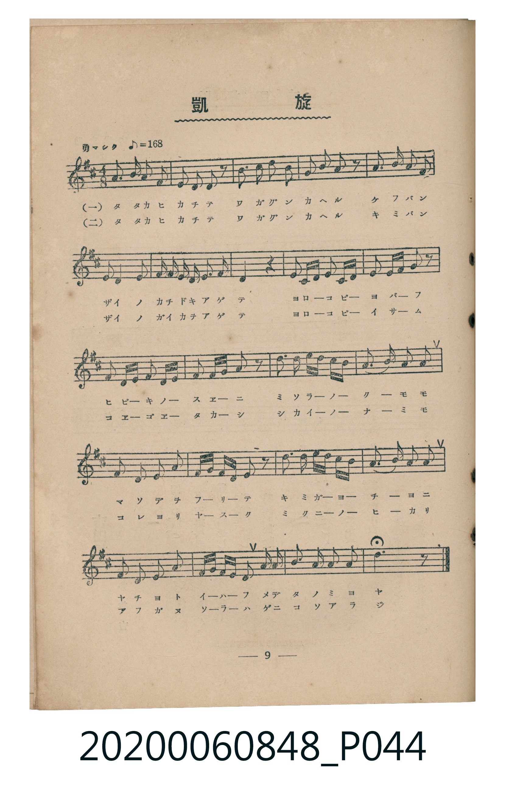
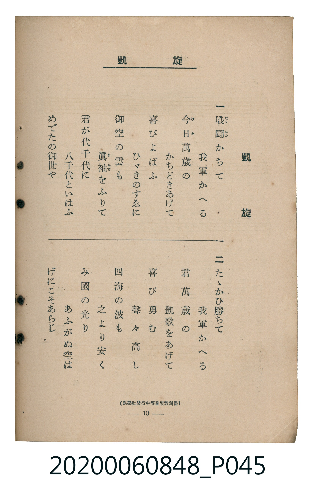

# 凱旋

<audio controls src="gaisen.mp3"></audio>

- 出處：弘樂社發行《中等音樂教科書》
- 臺灣教育會公認《新定兒童唱歌》高等科男子用（2020.006.0848）

## 說明

原書資訊與歌詞全文（對應 P044.jpg – P045.jpg，書頁 pp. 9–10，高一第一學期第 9 首）：
調性與拍號：ト長調（1 升記號）、4/8 拍（勇マシク ♪=168，相當於 ♩=84）
出處註記：（弘樂社發行中等音樂教科書）

## 歌詞

```text
一　戰鬪（たたかひ）かちて　我軍（わがぐん）かへる
今日（けふ）萬歲（ばんざい）の　かちどきあげて
喜（よろこ）びよばふ　ひゞきのすゑに
御空（みそら）の雲（くも）も　眞袖（まそで）をふりて
君（きみ）が代（よ）千代（ちよ）に　八千代（やちよ）といはふ
めでたの御世（みよ）や

二　たゝかひ勝（か）ちて　我軍（わがぐん）かへる
君（きみ）萬歲（ばんざい）の　凱歌（がいか）をあげて
喜（よろこ）び勇（いさ）む　聲々（こゑごゑ）高（たか）し
四海（しかい）の波（なみ）も　之（これ）より安（やす）く
み國（くに）の光（ひか）り　あふがぬ空（そら）は
げにこそあらじ
```

## ABC

```abc
X:1
T:凱旋
M:4/8
L:1/16
Q:1/8=168
K:G
V:V1 name="Piano" snm="Pia"
[V:V1]
D2 D3 E F2 | G2 A2 B2 z2 | d3 e d2 B2 | c2 B2 A2 z2 |
B3 A G2 B2 | A4 F2 D2 | E2 F G A2 G F | d4 z4 |
F2 G A B2 A G | A2 B c d2 z2 | G2 A B c2 B A | G2 F E D2 z2 |
d3 e d c B A | G3 A B2 c2 | d2 B2 G2 E2 | D G B A G2 z2 |
d3 e d c B A | G3 A B2 c2 | d2 B2 G2 E2 | D G B A G2 D2 |
G3 A B2 c B | G6 z2 |
```

## TMD 檔案連結

- [主旋律 TMD 檔案](gaisen.tmd) [[在 TMD Studio 編輯](https://tmdlang.github.io/Tmd-TS/#tmd=s7IKdvYPcrWy4tLSUnjavvHZ9G4FLS0uRVsFCxMue1sFdy4bE30LO646BaWn7btezJz6fs-sp3tmPFvR9HzJvucz97xY2PO4oevJjrXP13a-nL8ZKP5s6sznyyc-m73jcUO3Ekjfi_ZdzxsXA4VfNG16Nqf5aeuaF6t6gZqeTdvwdN2sp62Tnq9e-nTKxmdrgSZ1v1w9A2gS0IDnU7Y_XTvh-ZQV7_d0GBkYGegZGJjpGViYWLzf06nExaWvpWBLLcCloKDwtG8-0MkvNre_WNH1oqMd6JgXK-c9bV3xbFo70AFPN_Q-a-9UCDAwMdHLKkhXeNQwGcQxBXHe7-kB6ny5oFGhoEBPwRIoZWgAFAN65MmOhudr1gDJp2t3PJszH8hWsFR4uWwa0AfAUATZ-mLV_mcNy0H2dfe-mDkfKPq4uePl1O1AcaCthgpPe4HumQGW6Xzc0AiMCQWgSpCDutsfN8973LT9cdN6hUczV9kamgEDpuf57B3Pp257Nm0PUGylrYUJUBvYc-CYe7FiN9AwoB0g_ahRiDX-QJpBuoEeeNzQ8Kxjw8s1q4BaHzfOB6Pux42bQM4CMRY-blwGVjPxxW6Q8x439T9u7HncOOFx02SYmh2Pm7rBxu3uejZ9KdigiY8btwKlX0xY82wt0CygyAaghseN0x43toC1rQMaCrNg5ePG3seNTY8bJwEtA_tq2hywVUAElIDYsxnEBZrSuBWsc9PjpnlgbeseN8583AS0bzVY576Fz1fuAlu4_3Hj3MdNwPgA2fZyNsQV_Y-bmkAiTU1AU57PmfdiETDOgOL7QIobl4OlgK7Y-ripC-aWCbPBKoBWAWMOaFbPk92LIa4Dcp_2NkO5QI-ARYAOARr9tHU1QqqpBUl2BTAEHjeuB9oBMv1xUyPQWnCorwO6_ckOiHP2Q1U3tUDiaRcwAwE9Pf9xE9CVoOh52j0XrLAbbCYpkYTmH_wxBCo21vaAZYHGAd0Ntg8UQoRiC5iMwdqAeoAFC1APKKW9AEZbQytYfDI4zqYASaAsMEfBkh_EQ9PB5s6e_WzrdrDEdLAXoO56tnkRWHAVNEbAcflkJ1AnxFyge4GCQNd0PV0HjH5I-M8E6-0Hh3nj_qdzIKqBwbQaYujTVrBSoAOhfuwChzjQm1vBfl8DS1bwNLUeYhYwFFaDrAWlnyag3OPGGSAJyssuKFDQ0ufi8k3MzLMKyEzMy3eoMahRqAbZoGBjaKZlB2YBi0xIcQTM8EBHOiUWFSsYAosrU6BDQfpBamoUTOMVdCGEroJZvII5iFWjYAgkjYDYGIgNQCIw1RB1YBokV6NgAmWBVCOrBImBREEmgVWC0yzMUbt6kBxlBi1DkVwFMg0Ewc4Bu64G5DqwgCFY1hDERHUWxAEgWAPRCFIJcZshXCnEVyZgLRD3ogRWJ3JggULLEFSoIhwGCRiQASBjjKAiQNuArgO7E3tomSAphhigCzYCxXZg0ka23RRkO6j6Q4osaGCCjAEHBzj-DMGGg8QosPzJrinIloPqNSMjkiyHRBNSOCHsMoaLIOKphquWi0vXTgGUihWAtDIXFwA)]
- [鋼琴伴奏 TMD 檔案](gaisen_piano.tmd) [[在 TMD Studio 編輯](https://tmdlang.github.io/Tmd-TS/#tmd=s7IKdvYPcrWy4tLSUnjavvHZ9O73ezpedu95PmHLkz1bni7tf97Z8X5Pp4KWFpeirYKFCZe9rYI7l42JvoUdV52C0tP2XS9mTn2_Z9bTPTOerWh6vmTf85l7XizsedzQ9WTH2udrO1_O3wwUfzZ15vPlE5_N3vG4oVsJpO9F-67njYuBwi-aNj2b0_y0dc2LVb1ATc-mbXi6btbT1knPVy99OmXjs7VAk7pfrp4BNAlowPMp25-unfB8ygqgG40MjAz0DAzM9AwsTCyALlTi4vJNzMyzCshMzMsP8nCoMahRqOZSAAIbQzMtOzBLX0vh-Zo1T3Y0AF2ooKUPFqtRMI1X0IUQugpm8QrmIFaNgiGQNAJiYyA2AInAVEPUgWmQXI2CCZQFUo2sEiQGEgWZBFbJheyIXT0ojgBpBkGw7WDH1IAcAxYwBMsagpioroDYB4I1EI0glRCnGMKVQjxhAtYCcR5KWHSiOAPia5BykCYjqAjQbKBbwK7CHhQmSIohBuiCjUCx6-ns2ajhDg0XkCawV8FRYQg2CiRGgVVPdk0hySpIgCOFAcJkY7gIIsRruGqRU5sPSmqzIJDY4hWiTeNjEQyg8UCWYSyIMkA4AiJmDKGAiQzIMIFqw6kKXwLDZrERkGUEZMFoeGjDlIA9i-BCrcNQBnMUvoQF0QrzBlwAq38wwwabD9HTE1SpGUizWXwuSDeyy8m0BT0pUW4LCIOUAdOQrp0CKBkpAGllLi4A)]

## 分析

```text
================================================================================
📊 TMD Song Profile: [ 凱旋 ]
================================================================================
⏱  Duration:       0:31 (31.4s), 22 measures total
🎼 Key & Tempo:    首調基準 G, != 84.0 BPM, <4/8>
   - 分析範圍：      由實際發聲的音符與和弦推測調性；播放脈絡另行呈現
🎤 人聲音域:    D4 (MIDI 62) – E5 (MIDI 76) [跨度: 14 個半音 / 1.2 個八度, 難度: moderate]
   - 最低音:  D4 in [Main #1 @ m.1, 0:00]
   - 最高音: E5 in [Main #1 @ m.3, 0:03]
   - 適合: soprano, mezzo-soprano, contralto, tenor, baritone, bass
🏛  結構:      Main (31.4s)
⚡ 編曲密度:        Peak 1 軌道同時演奏
🗝  調性診斷：       G 大調（純淨自然大調，未偵測到可信轉調）
   - 風格氣質:    純淨自然大調（陽光明朗、易唱易記，無明顯調外色彩）
   - 轉調歷程:    全曲維持單一推測調性（未偵測到可信轉調）
   - 核心骨幹音:  G, D, B, A, C
   - 調性數值:    G 大調 [相關度: 0.93, 穩定度: High, 自然音純度: 100.0%]
   - 候選調性 (K-S): G 大調 (0.93), D 大調 (0.77), B 小調 (0.70)
   - 五度圈歷程:   +1
   - 各段落調性細節:
     • [Main #1]: G 大調 (r: 0.93, 自然音純度: 100.0%)

  [ 五度圈游移軌跡 ]
               C  
         F           [G ]*
      Bb               D  
      Eb               A  
         Ab           E  
            Db       B  
               F# 
     (* = active key center)

  [ 十二半音累積音高分佈 ]
     C  : ████████                   7.5%
     C# :                            0.0%
     D  : ███████████████████████   22.5%
     D# :                            0.0%
     E  : ███████                    6.9%
     F  :                            0.0%
     F# : ██████                     5.6%
     G  : ████████████████████████  23.1%
     G# :                            0.0%
     A  : ████████████████          15.0%
     A# :                            0.0%
     B  : ████████████████████      19.4%
--------------------------------------------------------------------------------
Assignment 軌道音域：
  - Piano         : D4 – E5 (14 個半音 / 1.2 個八度, 93 個音符)
================================================================================
```


## 原書掃描頁






