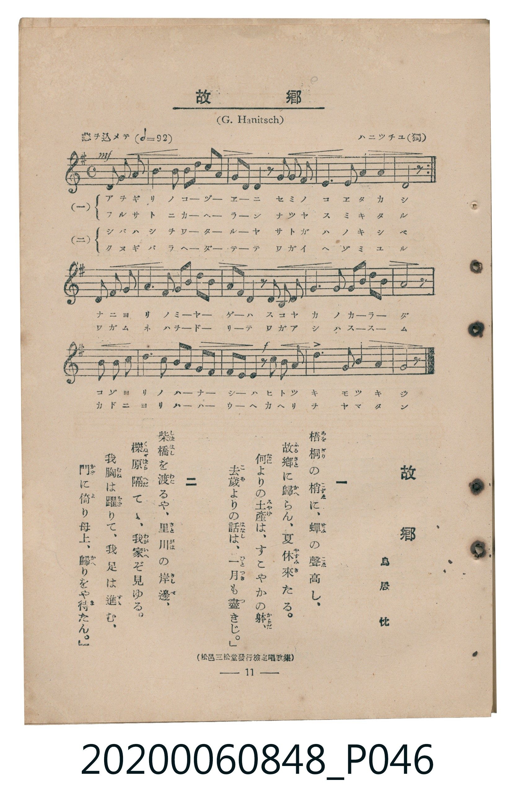

# 故郷

> Re:Shōka 使用 AI 協助辨識與重建樂譜，可能會有錯誤。歡迎回報。

- **鋼琴伴奏版**：<br><audio controls src="kokyo.mp3"></audio>

- 詞：鳥居忱
- 曲：G. Hanitsch（ハニツチユ）
- 臺灣教育會公認《新定兒童唱歌》高等科男子用（2020.006.0848）

## 說明

原書資訊與歌詞全文（對應 P046.jpg，書頁 p. 11，高一第一學期第 10 首）：
調性與拍號：ト長調（1 升記號）、4/4 拍（情ヲ込メテ ♩=92，弱起 3 個八分音符進入，第一行反覆）
出處註記：（松邑三松堂發行檢定唱歌集）


## 歌詞

```text
一　梧桐（あをぎり）の梢（こずゑ）に、蟬（せみ）の聲（こゑ）高（たか）し、
故郷（ふるさと）に歸（かへ）らん、夏休（なつやすみ）來（き）たる。
何（なに）よりの土産（みやげ）は、すこやかの躰（からだ）、
去歲（こぞ）よりの話（はなし）は、一月（ひとつき）も盡（つ）きじ。

二　柴橋（しばはし）を渡（わた）るや、里川（さとがは）の岸邊（きしべ）、
櫟原（くぬぎばら）隔（へだ）てゝ、我家（わがいへ）ぞ見（み）ゆる。
我胸（わがむね）は躍（をど）りて、我足（わがあし）は進（すす）む、
門（かど）に倚（よ）り母上（ははうへ）、歸（かへ）りをや待（ま）たん。
```

## ABC

<div class="abc-score" data-abc-src="kokyo.abc" aria-label="五線譜載入中"></div>

[下載 ABC 原始檔](kokyo.abc)

## TMD 檔案連結

- [主旋律 TMD 檔案](kokyo.tmd) [[在 TMD Studio 編輯](https://tmdlang.github.io/Tmd-TS/#tmd=s7IKdvYPcrWy4qpTUCpJTLdSSM7PyUlNLsnMz7MqzsjMK0nNjM_KTMmPL87Iz05Ugisry88pzU21ys4vyY9Pyq8sjjcyMDKINzAwizewMLFAqCvOLy1KTrUqTs7Iz8-JL0mtKEnKz89Gl48vSExPtQowMDFDyBQU5Zel5iXmAXUXFIEckgLWjlCQWpaZkgqSLk5OzIsvSy3KTMtMTUFyYmpRMdgbECtKihLzipOLMgtAfkOoyi8qychPL0osyKi0ysgsLskvykxOzInPTsxD8m1JRirQs3mJJaVFqchaM9Mz86xyUzOzMrF4DSpdnlpcklqUF5-bmpOfUqnEpaWl8Gxq68vm7QpaWlyKtgqWRlz2tgruXDYm-iZ2IM0vVs57v2fWy81Ln25sfbp_I9jAZ7M3AcXc9RQ8EvMyS4Ch-X5Px-Pm_sfN3Y-bWx43Nz5uXvZ-TydY6Yv2Xc8bFz-bOvNF06Znc5qftq55sar3cUPXs2kbnq6b9bR10vPVS59O2fhsbc_jhu6Xq2c8X9v5fPnE51O2P1074fmUFUCDQVGpB4xKPVBUgo3l0tdSsKUW4FJQUHjaN__Z7B0vNre_WNH1oqMd6Bigr5-2rng2rR3ogKcbep-1dyqA0oNeVkH6-z09QMUvFzQqFOgpGBoCuUBnP9nR8HzNGiD5dO2OZ3PmA9kKhgYKL5dNAzoYGFQgS16s2v-sYTnI-O7eFzPnA0UfN3e8nLodKA60xFDhaS_Q-hlgmc7HDY3A8FcAqgRKPWtufdy86cW-PY-bFz5ublN4NHOlraUR0N6neza-2LpdwVjhaUP309bVTzvaXs7f_HzNspcNm562LgUqgDjpxcKep_29L5a1AQ0G-7Z914uZU1-s2A20DugKkA1z971smvhkRyeQ8XRB0_OZe4B6nq1aBIohcNy8nA3WDNINNPBxQ8OzRcufLZwAivbGpsdNkx439j1u6gI5vHHds0WLwOKTHzfOetw0ESy4GuihF_PXgMVnP24Eehik8kUjMBmBVYKVAYMRzJ3_uLEbrGA6UBfISkgCBcttfdzU_bhx6uNGYMoAmfts7Q6wOFAQyOh83AREk4Hani7pf7IHaChQatXjxiWPm1oeN86EWPxkH9AvQHFg0AJNmA8ysKEJ7LO9U2EaVoPN6gD6CejMp8D4nLIYLLUfbNAksM71QGvAhgKdDxQEumDdi10boK4BuqNxASQiIQls97O1MM82AjMUwvQXKzeCxdeDLZ4ONxoYzs_mdIClNgG9C_IExMlNTc9nLwSLLwEr7n3cOAPkA7AXdgGzUcOz-VuerQQGIVDJ9MeNG8Bmgw1umvRsB1hrUz_Q52ARoFNbgLa9bO95un0uWAsocB839gB1QWLp6aYdL0FxCwoysIE7Ef56tno-MO-A5YAmrgElA6B9TcAk3_ly1hSw-A5oQDQue9w0F6jtWcfEp-u2wRwBtAYYduCoa5z3YhnE0eDk0dSGiBmgnhfN4IiG6GlqeNy4FhJSL3aBsgg4Ca4EawOG6TKINS-2bUaypgkeuMDsAbYGGHUzwVqACRrsm5fTGmCJCWxW4-qnDaDsAYwriNHP1vc-2QEJCmCQAlEb1O1A-9ATYhfITU0tT_e1gsX3wVIbMHWC_UR5yQUFClr6XFze-dmV-VYBmYl5-Q41uoY11SArFGwMzbTswCxsJaYCvHiAMF429ipoQMsUbQUThacb-p-vb9CBF3yaWIwA2g0yvkbBQEEXA1fnptUqmMYDWYZAbATENcDCShcOQWwQNgViE7gKkFqwJjABgiCzQKIgbA4SrFEwg8mBIJgD0gyCMLoGoR8GQeagOgfseB_DGgWQKDp-3LQIRDZvArPXgc183LwKycDHzX1guc1g9h4w2Qpng1RvRJLphuqCmL0bLDYfbgpQNdgchNlgvU37Yfym1XCfPW7ajuY1sJnNU8EkSN3jpq0I_xnh8h_IlMfNE8BkPxaToX5vXo_wBdg9CP-B7YL6bwmK_0D2Ays4MHsNVDXIDvSwWwv3H8xmkMqZ2PzXBHFHD5gNjg9woUcgcUPqPhB3Vw84iZOYsgdFigUbAjINkWQhgYsITlDygiQSWITMgLNBqlciycASGiTZdIHJFjAJikRQMtiJYjY4mSJFFSxRwpIAZlKEmAl2U_MKhLuBSRGS4BBmQ9yFcOvj5gYUd7chyYDYCDvAyQGcuB43Qd0NNgdudtM-uOshdi0j6G4kM5sXgN2NP4nt6gEmMZLTFCzKQRAetbCEBaIhSsBSKIkKzDGCC0PSHgzCUhymQehpCpaOQWkYOUVhKdygRRQii8NjpglSOEBkYFkbklFBqQdWLMJSFHJ4wzI_cmpFpE-QS0BpACN2ICZCYxU9VfWimA9yD6z4gpjfiWI-yKeEUxWoAsAsFMFmQ_wILRQRbJDZoHSD6XaIXyGuAOULgoVXJzkpCxTvMAiKXVAsg1IAUkkEpsAlELxMAtfWwMoaWQeqWbB0BYKIAgs59cHMQcaE0hYkliCxACkxYGkLUjVhSVvNk8AkuGIBl1kg1WtRzIZU2yA5MB8uC1K5A83F6JUicooCpTCEqZAUg-xiBBtkMqhsQS550WMeUsKBTAGZDUqZCLMh-Woe3MXI5StyowC7i2u5uHTtFMBNQAUgQ5kLAA)]
- [鋼琴伴奏 TMD 檔案](kokyo_piano.tmd) [[在 TMD Studio 編輯](https://tmdlang.github.io/Tmd-TS/#tmd=s7IKdvYPcrWy4qpTUCpJTLdSSM7PyUlNLsnMz7MqzsjMK0nNjM_KTMmPL87Iz05Ugisry88pzU21ys4vyY9Pyq8sjjcyMDKINzAwizewMLFAqCvOLy1KTrUqTs7Iz8-JL0mtKEnKz89Gl48vSExPtQowMDFDyBQU5Zel5iXmAXUXFIEckgLWjlCQWpaZkgqSLk5OzIsvSy3KTMtMTUFyYmpRMdgbECtKihLzipOLMgtAfkOoyi8qychPL0osyKi0ysgsLskvykxOzInPTsxD8m1iEVBzempual6JVUFmYl5-fGJycn5uQWJeJkgMobAkA6jIKi-xpLQoFdmOzPTMPKvc1MysTCxhAJUuTy0uSS3Ki89NzclPqVTi0tJSeDa19WXz9vd7Ol5273k-YcuTPVueLu1_3tnxfk-ngpYWl6KtgqURl72tgjuXjYm-iR3IxBcr573fM-vl5qVPN7Y-3b8RbMuz2ZuAYu56Ch5AB5cA4wJo4uPm_sfN3Y-bWx43Nz5uXgY0Eaz0Rfuu542Ln02d-aJp07M5zU9b17xY1fu4oevZtA1P18162jrp-eqlT6dsfLa253FD98vVM56v7Xy-fOLzKdufrp3wfMoKoMGghKAHTAh6oIQANpbLOz-7Mt8qABRwQR4ONbqGNdVcCkBgY2imZQdm6WspPF-z5smOhhcLe4BmQNgvG3vBHtUHK6lRMFDQxcDVuWm1CqbxQJYhEBsBcY2CMZCEQRAbhE2B2ASuAqQWrAlMgCDILJAoCJuDBGsUzGByIAjmgDSDIIyuQeiHQZA5qM4BO97HsEYBJIqOHzctApHNm8DsdWAzHzevQjLwcXMfWG4zmL0HTLbC2SDVG5FkuqG6IGbvBovNh5sCVA02B2E2WG_Tfhi_aTXcZ4-btqN5DWxm81QwCVL3uGkrwn9GuPwHMuVx8wQw2Y_FZKjfm9cjfAF2D8J_YLug_luC4j-Q_Y-bO8DsNVDVIDvQw24t3H8wm0EqZ2LzXxPEHT1gNjg-uLAl0Kf9vS-WtYFEdvWgJ9NBkfzAhoBMQ6Q_SEghwgaUViAxDgvdGXA2SPVKJBlYqoGkgS4w2QImQTECitOdKGaD0xxSuMNSGCw-MdMVxEywm5pXINwNTFeQ1IMwG-IuhFsfNzeguLsNSQbERtgBjltwSnncBHU32By42U374K6H2LWMoLuRzGxeAHY3cnrZ1QNML4ikAYs5EITHECx9gGiIErAUStoAc4zgwpAkBIOwhINpEHrSgCVHUFJEThhYChxosYHIdvAAboJkWIgMLLtBMg8oEcCKKljCQA42WIZETnSIZAZyCSgqMQIZYiI0ctATRy-K-SD3wIoUiPmdKOaDfEo4cYAKZcyCCmw2xI_QggrBBpkNin5Mt0P8CnEFKHmjFSidKAkEFH0wCIokUGSBIhKpXABT4PIAXkKAK0JgPYisA9UsWPIAQUTxgZyIYOYgY0JJBBLYkMCE5F9YEoGU-liSSPMkMAkus8ElCEj1WhSzITUiSA7Mh8uCVO5AczF6fYOcMEAJBWEqJOKRXYxgg0wG5XTkchA9AiHlDcgUkNmgBIYwG5I95sFdjFzaIde32F1ci9JA8kFpIJkg2kdP92x8sXW7gjZRDSUIBMZwvEK0YSyYMo2PhQqAWFAJYDEBZJjF58aCGUZgNabxUEVgM0iu_6htJ1oZClcJNw4uAmegOAJVDRY_oWZBdJ0mQIYJUCOIRjEb0zaI2cD41LVTAEdptA9QFMExAnOUuQA)]

## 分析

```text
================================================================================
📊 TMD Song Profile: [ 故郷 ]
================================================================================
⏱  Duration:       0:41 (41.7s), 16 measures total
🎼 Key & Tempo:    首調基準 G, != 92.0 BPM, <4/4>
   - 分析範圍：      由實際發聲的音符與和弦推測調性；播放脈絡另行呈現
🎤 人聲音域:    A3 (MIDI 57) – D5 (MIDI 74) [跨度: 17 個半音 / 1.4 個八度, 難度: challenging]
   - 最低音:  A3 in [Kokyo #1 @ m.11, 0:28]
   - 最高音: D5 in [Kokyo #1 @ m.2, 0:04]
   - 適合: soprano, mezzo-soprano, contralto, tenor, baritone, bass
🏛  結構:      Kokyo (41.7s)
⚡ 編曲密度:        Peak 1 軌道同時演奏
🗝  調性診斷：       D 大調（純淨自然大調，未偵測到可信轉調）
   - 風格氣質:    純淨自然大調（陽光明朗、易唱易記，無明顯調外色彩）
   - 轉調歷程:    全曲維持單一推測調性（未偵測到可信轉調）
   - 核心骨幹音:  D, A, G, B, E
   - 調性數值:    D 大調 [相關度: 0.90, 穩定度: Moderate, 自然音純度: 95.8%]
   - 候選調性 (K-S): D 大調 (0.90), G 大調 (0.80), B 小調 (0.67)
   - 五度圈歷程:   +2
   - 各段落調性細節:
     • [Kokyo #1]: D 大調 (r: 0.91, 自然音純度: 95.7%, 調外音: C)

  [ 五度圈游移軌跡 ]
               C  
         F            G  
      Bb              [D ]*
      Eb               A  
         Ab           E  
            Db       B  
               F# 
     (* = active key center)

  [ 十二半音累積音高分佈 ]
     C  : ████                       4.2%
     C# :                            0.0%
     D  : ████████████████████████  25.8%
     D# :                            0.0%
     E  : █████████                  9.2%
     F  :                            0.0%
     F# : █████                      5.8%
     G  : ████████████████          17.5%
     G# :                            0.0%
     A  : ███████████████████       20.8%
     A# :                            0.0%
     B  : ███████████████           16.7%
--------------------------------------------------------------------------------
Assignment 軌道音域：
  - Piano         : A3 – D5 (17 個半音 / 1.4 個八度, 82 個音符)
================================================================================
```


## 原書掃描頁




