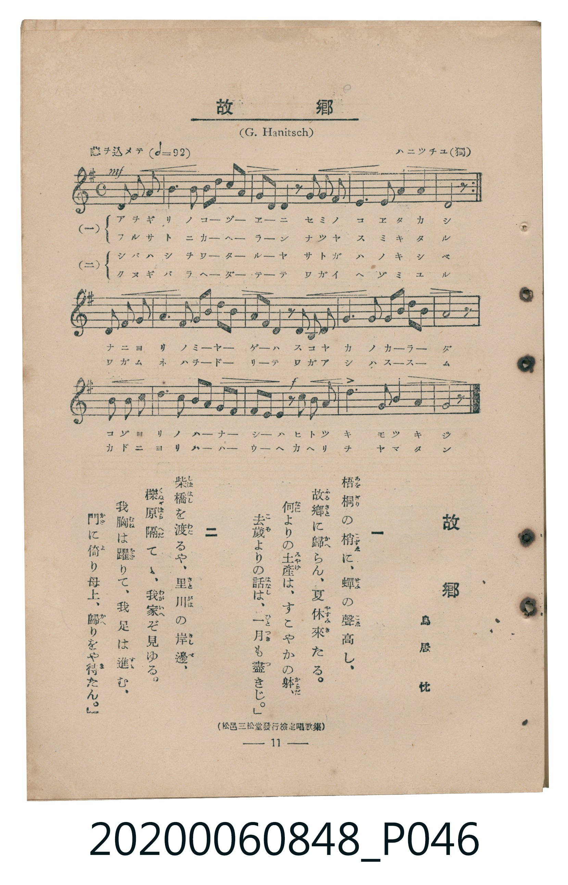

# 故郷

<audio controls src="kokyo.mp3"></audio>

- 詞：鳥居忱
- 曲：G. Hanitsch（ハニツチユ）
- 臺灣教育會公認《新定兒童唱歌》高等科男子用（2020.006.0848）

## 說明

原書資訊與歌詞全文（對應 P046.jpg，書頁 p. 11，高一第一學期第 10 首）：
調性與拍號：ト長調（1 升記號）、4/4 拍（情ヲ込メテ ♩=92，弱起第 3 拍進入，第一行反覆）
出處註記：（松邑三松堂發行檢定唱歌集）

## 歌詞

```text
一　梧桐（あをぎり）の梢（こずゑ）に、蟬（せみ）の聲（こゑ）高（たか）し、
故郷（ふるさと）に歸（かへ）らん、夏休（なつやすみ）來（き）たる。
何（なに）よりの土産（みやげ）は、すこやかの躰（からだ）、
去歲（こぞ）よりの話（はなし）は、一月（ひとつき）も盡（つ）きじ。

二　柴橋（しばはし）を渡（わた）るや、里川（さとがは）の岸邊（きしべ）、
櫟原（くぬぎばら）隔（へだ）てゝ、我家（わがいへ）ぞ見（み）ゆる。
我胸（わがむね）は躍（をど）りて、我足（わがあし）は進（すす）む、
門（かど）に倚（よ）り母上（ははうへ）、歸（かへ）りをや待（ま）たん。
```

## ABC

```abc
X:1
T:故郷
C:曲：G. Hanitsch（ハニツチユ）
M:4/4
L:1/16
Q:1/4=92
K:G
V:V1 name="Piano" snm="Pia"
[V:V1]
!mf! z4 z4 D4 G2 B2 | G4 B4 d3 e d2 c2 | B2 A2 G2 z2 B2 A2 G4 | D6 E2 F4 A4 |
G6 z2 D4 G2 B2 | G4 B4 d3 e d2 c2 | B2 A2 G2 z2 B2 A2 G4 | D6 E2 F4 A4 |
G6 z2 F4 G2 A2 | B4 G4 B3 d c2 B2 | A2 G2 F2 z2 D2 E2 F4 | G6 A2 B4 ^c4 |
d6 z2 D4 G2 B2 | G4 B4 d3 e d2 c2 | !f! B2 A2 G2 z2 c2 B2 A4 | d6 B2 G4 B2 A2 |
G6 z2 z4 z4 |
```

## TMD 檔案連結

- [主旋律 TMD 檔案](kokyo.tmd) [[在 TMD Studio 編輯](https://tmdlang.github.io/Tmd-TS/#tmd=s7IKdvYPcrWy4qpTUCpJTLdSSM7PyUlNLsnMz7MqzsjMK0nNjM_KTMmPL87Iz05Ugisry88pzU21ys4vyY9Pyq8sjjcyMDKINzAwizewMLFAqCvOLy1KTrUqTs7Iz8-JL0mtKEnKz89GyBcU5Zel5iXmAdUUFIGsSwErQihILctMSQVJp6ZkluQXZSbmIDkitagY7FCwJfElRYl5xclFmQUg1yNUlWSkAl2al1hSWpSqxKWlpfBsauvL5u0KWlpcirYKlkZc9rYK7lw2JvomdiA9L1bOe79n1svNS59ubH26fyPYnGezNwHF3PUUPBLzMkuAnnm_p-Nxc__j5u7HzS2PmxsfNy97v6cTrPRF-67njYufTZ35omnTsznNT1vXvFjV-7ih69m0DU_XzXraOun56qVPp2x8trbncUP3y9Uznq_tfL584vMp25-unfB8ygqgwaCQ1AOGpB4oJMHGculrKdhSC3ApKCg87Zv_bPaOF5vbX6zoetHRDnQM0NdPW1c8m9YOdMDTDb3P2jsVAgxMzPSyCtLf7-kBKn65oFGhQE_B0BDIBTr7yY6G52vWAMmna3c8mzMfyFYwNFB4uWwa0MHAoAJZ8mLV_mcNy0HGd_e-mDkfKPq4uePl1O1AcaAlhgpPe4HWzwDLdD5uaASGvwJQJVDqWXPr4-ZNL_btedy88HFzm8KjmSttLY2A9j7ds_HF1u0gu4xBSl82bHrauhQoDnHJi4U9T_t7XyxrA5oH9mT7rhczp75YsRtoC9BykMFz971smvhkRyeQ8XRB0_OZe4B6nq1aBIoYcJS8nA3WDNINNPBxQ8OzRcufLZwAiu3GpsdNkx439j1u6gK5t3Hds0WLwOKTHzfOetw0ESy4GuiPF_PXgMVnP24E-hOk8kUjMPWAVYKVAUMPzJ3_uLEbrGA6UBfISki6BMttfdzU_bhx6uNGYIIAmfts7Q6wOFAQyOh83AREk4Hani7pf7IHaChQatXjxiWPm1oeN86EWPxkH9AvQHFgiAJNmA8ysKEJ7LO9U2EaVoPN6gD6CejMp8BonLIYLLUfbNAksM71QGvAhgKdDxQEumDdi10boK4BuqNxAST-IOlq97O1MM82AvMRwvQXKzeCxdeDLZ4ONxoYzs_mdIClNgG9C_IExMlNTc9nLwSLLwEr7n3cOAPkA7AXdgFzT8Oz-VuerQQGIVDJ9MeNG8Bmgw1umvRsB1hrUz_Q52ARoFNbgLa9bO95un0uWAsocB839gB1QWLp6aYdL0FxCwoysIE7Ef56tno-MMuA5YAmrgElA6B9TcCU3vly1hSw-A5oQDQue9w0F6jtWcfEp-u2wRwBtAYYduCoa5z3YhnE0eDk0dSGiBmgnhfN4IiG6GlqeNy4FhJSL3aBcgY4Ca4EawOG6TKINS-2bUaypgkeuMDsAbYGGHUzwVqACRrsm5fTGmCJCWxW4-qnDaDsAYwriNHP1vc-2QEJCmCQAlEb1O1A-9ATYhfITU0tT_e1gsX3wVIbMHWC_UR5gQUFClr6XFy-iZl5VgGZiXn5DjUGNQrVIBsUbAzNtOzALGA5CSkjnm7of74e5EuMwqITZA5IbY2CgYIuGMLo6ty0WgXTeCjPEIiNgbgGnOJARsOLGYi5QPZLUFKdBSkkIEUCvAyA5HtgXofEB8JWkLkgCDIbBE3BpBmYNgHbB1EHkjeCugPkQmQ-CMLUwR0MNgbEMYeJgJQjK4VphXmaSL9CSlWQyK4eqI_BJRWkXEIri4DFDqS0GayehisESYAUo3p6Vw_E006JRcUKlo8aJhsCax4kn8B8gOojU7AvIEEIUQdzNdg6eGCjOhWbE0H6YHaYqKN7G80vhCKwE8kvhsYgz5hRJVqqgRkF5mH08EZ2I0ge2Q5IcGOPF_TcWMNVy8Wla6cAyvIKQFqZiwsA)]
- [鋼琴伴奏 TMD 檔案](kokyo_piano.tmd) [[在 TMD Studio 編輯](https://tmdlang.github.io/Tmd-TS/#tmd=s7IKdvYPcrWy4tLSUng2tfVl8_b3ezpedu95PmHLkz1bni7tf97Z8X5Pp4KWFpeirYKlEZe9rYI7l42JvokdV52C0ouV897vmfVy89KnG1uf7t-oBBJ7NnsTUMxdT8EjMS-zpDg5A2ji4-b-x83dj5tbHjc3Pm5eBjQRrPRF-67njYufTZ35omnTsznNT1vXvFjV-7ih69m0DU_XzXraOun56qVPp2x8trbncUP3y9Uznq_tfL584vMp25-unfB8ygqgwUYGRgZ6BgZmegYWJhZgY7l8EzPzrAIyE_PygzwcagxqFKq5FIDAxtBMyw7M0tdSeLpn44ut259u6H--vkFBSx8sXKNgoKALhjC6OjetVsE0HsozBGJjIK7hgpnyfM2aJzsaXizsAToEwn7Z2AsOLZiJID0gCNIHgqZg0gxMm4DNgqgDyRtB7QDZjswHQZg6uGPAxoA45jARkHJkpTCtMA8R6Y-n_b0vlrWBRHb1DGLfwBWCJECKUX2zqwfoG4TDYQ5G9YAp2NGQoICogzkSbDo80FBdhs1FIH0wO0zU0X2J5nRCEdGJ4nRyw7wamHRh3kMPTGQXgeSR7YCEJfZAR88fNVy1yNnNByW7mRDObRBIUn6KV4g2jIVRoBSETcA0PhbBgGvCbRfeNE9VG9HSJVbDsZtlBhIxA4sYAVlGQBYWD6GlHRxuN0E3HJfTgdGra6cAimEFIK3MxQUA)]

## 分析

```text
================================================================================
📊 TMD Song Profile: [ 故郷 ]
================================================================================
⏱  Duration:       0:44 (44.3s), 17 measures total
🎼 Key & Tempo:    首調基準 G, != 92.0 BPM, <4/4>
   - 分析範圍：      由實際發聲的音符與和弦推測調性；播放脈絡另行呈現
🎤 人聲音域:    D4 (MIDI 62) – E5 (MIDI 76) [跨度: 14 個半音 / 1.2 個八度, 難度: moderate]
   - 最低音:  D4 in [Main #1 @ m.1, 0:01]
   - 最高音: E5 in [Main #1 @ m.2, 0:04]
   - 適合: soprano, mezzo-soprano, contralto, tenor, baritone, bass
🏛  結構:      Main (44.3s)
⚡ 編曲密度:        Peak 1 軌道同時演奏
🗝  調性診斷：       G 大調（純淨自然大調，未偵測到可信轉調）
   - 風格氣質:    純淨自然大調（陽光明朗、易唱易記，無明顯調外色彩）
   - 轉調歷程:    全曲維持單一推測調性（未偵測到可信轉調）
   - 核心骨幹音:  G, D, B, A, F#
   - 調性數值:    G 大調 [相關度: 0.92, 穩定度: High, 自然音純度: 98.3%]
   - 候選調性 (K-S): G 大調 (0.92), D 大調 (0.74), B 小調 (0.71)
   - 五度圈歷程:   +1
   - 各段落調性細節:
     • [Main #1]: G 大調 (r: 0.92, 自然音純度: 98.3%, 調外音: C#)

  [ 五度圈游移軌跡 ]
               C  
         F           [G ]*
      Bb               D  
      Eb               A  
         Ab           E  
            Db       B  
               F# 
     (* = active key center)

  [ 十二半音累積音高分佈 ]
     C  : ████                       4.2%
     C# : █                          1.7%
     D  : ███████████████████       22.5%
     D# :                            0.0%
     E  : ███                        3.7%
     F  :                            0.0%
     F# : ██████                     7.5%
     G  : ████████████████████████  28.3%
     G# :                            0.0%
     A  : ███████████               12.5%
     A# :                            0.0%
     B  : █████████████████         19.6%
--------------------------------------------------------------------------------
Assignment 軌道音域：
  - Piano         : D4 – E5 (14 個半音 / 1.2 個八度, 81 個音符)
================================================================================
```


## 原書掃描頁




