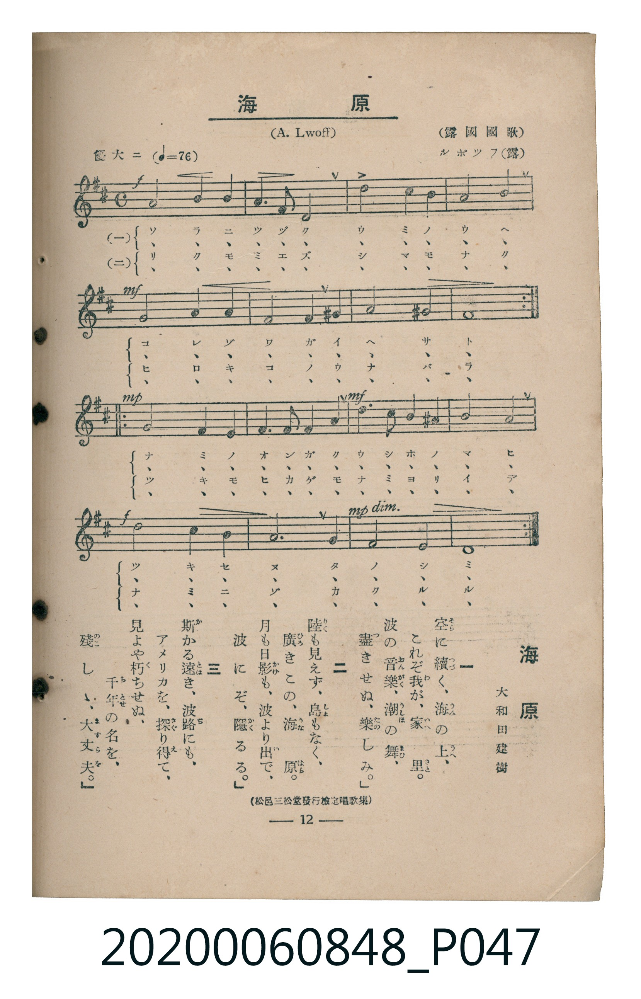

# 海原

> Re:Shoka 使用 AI 協助辨識與重建樂譜，可能會有錯誤。歡迎回報。

<audio controls src="unabara.mp3"></audio>

- 詞：大和田建樹（松邑三松堂發行檢定唱歌集）
- 曲：A. Lwoff（ルボツフ／露國國歌）
- 臺灣教育會公認《新定兒童唱歌》高等科男子用（2020.006.0848）

## 說明

原書資訊與歌詞全文（對應 P047.jpg，書頁 p. 12，高一第二學期第 1 首）：
調性與拍號：ニ長調（2 升記號）、4/4 拍（優大ニ ♩=76）

## 跨冊／重複收錄參照

> 同曲（《新定兒童唱歌》高等科男、女共用教材）

- **[同曲]** 《新定兒童唱歌》高等科女子用（2020.006.0849）：[**〈海原〉**](../../koto_girls_2020.006.0849/1_2_01_unabara/index.md)（`D` / `4/4` — [原始 TMD](../../koto_girls_2020.006.0849/1_2_01_unabara/unabara.tmd)）
- 總表：[跨冊重複與同名歌曲總索引](../../../duplicate_songs.md)

## 歌詞

```text
一
空（そら）に續（つづ）く、海（うみ）の上（うへ）、
これぞ我（わ）が、家（いへ）里（さと）。
波（なみ）の音樂（おんがく）、潮（うしほ）の舞（まひ）、
盡（つ）きせぬ、樂（たの）しみ。」

二
陸（りく）も見（み）えず、島（しま）もなく、
廣（ひろ）きこの、海原（うなばら）。
月（つき）も日影（ひかげ）も、波（なみ）より出（い）で、
波（なみ）にぞ、隱（かく）るる。」

三
斯（か）かる遠（とほ）き、波路（なみぢ）にも、
アメリカを、探（さぐ）り得（え）て、
見（み）よや朽（く）ちせぬ、千年（ちとせ）の名（な）を、
殘（のこ）しゝ、大丈夫（ますらを）。」
```

## ABC

```abc
X:1
T:海原
C:曲：A. Lwoff（ルボツフ／露國國歌）
M:4/4
L:1/16
Q:1/4=76
K:D
V:V1 name="Piano" snm="Pia"
[V:V1]
!f! A8 B4 A4 | F6 D2 A8 | G8 F4 E4 | D8 A8 |
!mf! F8 G4 A4 | G6 E2 A4 ^G4 | A8 ^G8 | A16 |
!mp! F8 E4 F4 | G4 F4 E4 D4 | !mf! B4 A4 ^G4 A4 | d8 G8 |
!f! B8 A4 G4 | F6 D2 A8 | !mp! G6 F2 E8 | D16 |
!f! A8 B4 A4 | F6 D2 A8 | G8 F4 E4 | D8 A8 |
!mf! F8 G4 A4 | G6 E2 A4 ^G4 | A8 ^G8 | A16 |
!mp! F8 E4 F4 | G4 F4 E4 D4 | !mf! B4 A4 ^G4 A4 | d8 G8 |
!f! B8 A4 G4 | F6 D2 A8 | !mp! G6 F2 E8 | D16 |
!f! A8 B4 A4 | F6 D2 A8 | G8 F4 E4 | D8 A8 |
!mf! F8 G4 A4 | G6 E2 A4 ^G4 | A8 ^G8 | A16 |
!mp! F8 E4 F4 | G4 F4 E4 D4 | !mf! B4 A4 ^G4 A4 | d8 G8 |
!f! B8 A4 G4 | F6 D2 A8 | !mp! G6 F2 E8 | D16 |
```

## TMD 檔案連結

- [主旋律 TMD 檔案](unabara.tmd) [[在 TMD Studio 編輯](https://tmdlang.github.io/Tmd-TS/#tmd=s7IKdvYPcrWy4qpTUCpJTLdSSM7PyUlNLsnMz7MqzsjMK0nNjM_KTMmPL87Iz05Ugisry88pzU21ys4vyY9Pyq8sjjcyMDKINzAwizewMLFAqCvOLy1KTrUqTs7Iz8-JL0mtKEnKz89GyBcU5Zel5iXmAdUUFIGsSwErQihILctMSQVJp6ZkluQXZSbmIDkitagY7FCwJfElRYl5xclFmQUg1yNUlWSkAl2al1hSWpSKLlqeWJJapMSlpaXwbOv2p33zFbS0uBRtFczNuOxtFVy4bEz0TexAWl6snPd-z6ynS5Y_ndTzfMqGp7t3PVux8_2ejmdz971smvhkRyeQ8XRB0_OZe14s7Hm2atHTdbOeTtn4bG3Py9lt7_d0gq19NnsT0AxHPQWf8vy0NKDmx82rHzfPedzc8rh56vs9_S_nbHo6pxuIgNpgel6073reuPjZ1JkvmjY9m9P8tHXNi1W9jxu6nk3bALKiddLz1UshFj1u6H65esbztZ3Pl098PmX707UTnk9ZAbQEFC96wHjRA8UL2FgufS0FW2oBLgUFBWC4PZu948Xm9hcrul50tAMdAwyup60rnk1rBzrg6YbeZ-2dCgEGJuZ6WQXp7_f0ABW_XNCoUKCnYGgE5AKd_WRHw_M1a57s6nm6dsezOfOBbAVDhZfLpgHdCwwykB0vVu1_1rAcZHp374uZ84Gij5u7X07dDhQHeVLhaS_Q9hlgmc7HDY3AeFMAqgRZ37IKGG1AxQqPZq60NTcDynOBDARaCaKer9wFionGuY-bgFZ1Pm5c_XwXMPSBIkseNy4Fi_QDzQOmDrBg2-NGoH1AwXVPdnTBRHZA7AQZ97hx8uOmnseN8551TARJN_WDVQNjp_Hpum1gDS0QDS_bIdZMfdwIjCag_iaQ_mebF4FFV8HteTl_87MVTWDBrsdNk0FmNYINBTpq7zqYE6Y_btwNUf-iA5hSgYL7HjcCkxvMXc9nL4R4Cqyo93Hj7MeNa0BGQI2eD9QJlgIatB_olscNvZBQ2tUDol7OBDoZ6JsuqN1NTS-WdYM1QlwJZMwCeXEzxItAQ_ZBlIF9AgpAcDrZvRgsvelxEzBmIO4AemgdJHyBqQjmG6CeDdD4gAbLnA5YnIB1NjU9m7706d6NUOMaux83ToJaCDQLLQybQA5_2g6J5xawxcuhLsII7tXAqAPKvZwFMRpoLsS_3SCEFCw7OsHap62HKAPrBal52bgALLICFh_AzApy0IvtEJUgix43Ai0F2wV2LjjZNC163LzwcfOqx01A0UkgPX0QlwGTxwSwC7qe7psOFgGGBFDzMqhOlHgA-bTl2Zy9YBFIylsIj-qnvc1Pd24BSwEFgQ6cDUkwTyeAsgnQaWATQHaDvbZuBlh0HTCKoAmjaS7IlCXLn-zoeLpkNSyRzQRGFFAbJK5A4QPUTHmxAgUKWvpcXL6JmXlWAZmJefkONQY1CtUgGxRsLLTswAxgYQYqOnY0AAteBQ0Thacb-p-vb9CBlzeaIDNACoE602oVTBV0wdAMiEHsGgVjMN8QLlOjYAJlgWSMwCKGUBG4GnAqgNm9q4cIu3OBlkOs0gVbALEcYpURmGeiDhaC2QHmQhwEE4JBVOt3dBJjfQHCepCfQGyI9TBfgvwIdScscMBOgDjUMA7J7RhueDp7NnHBDzIZFpAgk7AFP9itEGuMwS6DCMPiABEItVxcunYKoOShgIVW5uICAA)]
- [鋼琴伴奏 TMD 檔案](unabara_piano.tmd) [[在 TMD Studio 編輯](https://tmdlang.github.io/Tmd-TS/#tmd=s7IKdvYPcrWy4tLSUni2dfvTvvnv93S87N7zfMKWJ3u2PF3a_7yz4_2eTgUtLS5FWwVzMy57WwUXLhsTfRM7rjoFpRcr573fM-vpkuVPJ_U8n7Lh6e5dz1bsBJrwbO6-l00Tn-zoBDKeLmh6PnPPi4U9z1Yterpu1tMpG5-t7Xk5uw1orBLIjGezNwHNcNRT8CnPT0sDan7cvPpx85zHzS2Pm6e-39P_cs6mp3O6gQioDabnRfuu542Ln02d-aJp07M5zU9b17xY1fu4oevZtA0gK1onPV-9FGLR44bul6tnPF_b-Xz5xOdTtj9dO-H5lBVAS4wMjAz0DAzM9AwsTCzAxnL5JmbmWQVkJublB3k41BjUKFRzKQCBjYWWHZihr6XwfM2aJzsagH5R0NIHiwEVpdUqmCrogqEZEIPYNQrGYL4hXKZGwQTKAskYgUUMoSJwNVzI1uzqQbUmF2gPxFRdsFkQeyCmGoF5JupgIZhxYC7EbpgQDKLatKMTzaYChE0gl4LYEJtgbge5HOokmJfBtkHcZBiH5EwM657Ono0RfiBDYCEB0oQt_MDOgphoDHYERBgWiAiv1SLHpA9KTJrgjUnDeKD-aLP43FiFaMNYVAGQVUZgLlAm2jQeIQ1iE4g7iEIjhMEQk4whOhVM47FxsZmLFlMIB0CMNYkHM0AGQASM4QZDfAGzGYvZ6NECNAvqWRMkz6KFBdQcqCRQMTT8de0UQFGggIVW5uICAA)]

## 分析

```text
================================================================================
📊 TMD Song Profile: [ 海原 ]
================================================================================
⏱  Duration:       2:31 (151.6s), 48 measures total
🎼 Key & Tempo:    首調基準 D, != 76.0 BPM, <4/4>
   - 分析範圍：      由實際發聲的音符與和弦推測調性；播放脈絡另行呈現
🎤 人聲音域:    D4 (MIDI 62) – D5 (MIDI 74) [跨度: 12 個半音 / 1.0 個八度, 難度: easy]
   - 最低音:  D4 in [Main #1 @ m.2, 0:04]
   - 最高音: D5 in [Main #1 @ m.12, 0:34]
   - 適合: soprano, mezzo-soprano, contralto, tenor, baritone, bass
🏛  結構:      Main (50.5s) -> Main (50.5s) -> Main (50.5s)
⚡ 編曲密度:        Peak 1 軌道同時演奏
🗝  調性診斷：       D 大調（流行色彩大調，未偵測到可信轉調）
   - 風格氣質:    流行大調（略帶和弦色彩音與裝飾副屬和弦）
   - 轉調歷程:    全曲維持單一推測調性（未偵測到可信轉調）
   - 核心骨幹音:  A, F#, D, G, E
   - 調性數值:    D 大調 [相關度: 0.83, 穩定度: High, 自然音純度: 93.8%]
   - 候選調性 (K-S): D 大調 (0.83), A 大調 (0.66), F# 小調 (0.60)
   - 五度圈歷程:   +2 -> +2 -> +2
   - 各段落調性細節:
     • [Main #1]: D 大調 (r: 0.83, 自然音純度: 93.8%, 調外音: G#)
     • [Main #2]: D 大調 (r: 0.83, 自然音純度: 93.8%, 調外音: G#)
     • [Main #3]: D 大調 (r: 0.83, 自然音純度: 93.8%, 調外音: G#)

  [ 五度圈游移軌跡 ]
               C  
         F            G  
      Bb              [D ]*
      Eb               A  
         Ab           E  
            Db       B  
               F# 
     (* = active key center)

  [ 十二半音累積音高分佈 ]
     C  :                            0.0%
     C# :                            0.0%
     D  : ████████████              15.6%
     D# :                            0.0%
     E  : ███████                    8.6%
     F  :                            0.0%
     F# : █████████████             16.4%
     G  : ████████████              15.6%
     G# : █████                      6.2%
     A  : ████████████████████████  31.2%
     A# :                            0.0%
     B  : █████                      6.2%
--------------------------------------------------------------------------------
Assignment 軌道音域：
  - Piano         : D4 – D5 (12 個半音 / 1.0 個八度, 132 個音符)
================================================================================
```


## 原書掃描頁




