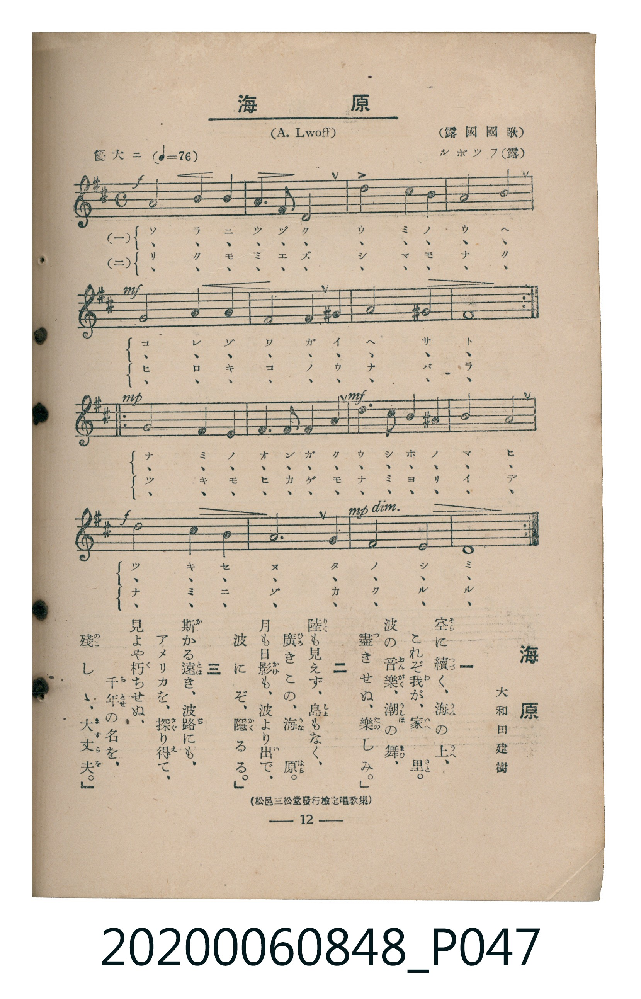

# 海原

> Re:Shōka 使用 AI 協助辨識與重建樂譜，可能會有錯誤。歡迎回報。

- **鋼琴伴奏版**：<br><audio controls src="unabara.mp3"></audio>

- 詞：大和田建樹（松邑三松堂發行檢定唱歌集）
- 曲：A. Lwoff（ルボツフ／露國國歌）
- 臺灣教育會公認《新定兒童唱歌》高等科男子用（2020.006.0848）

## 說明

原書資訊與歌詞全文（對應 P047.jpg，書頁 p. 12，高一第二學期第 1 首）：
調性與拍號：ニ長調（2 升記號）、4/4 拍（優大ニ ♩=76）


## 歌詞

```text
一
空（そら）に續（つづ）く、海（うみ）の上（うへ）、
これぞ我（わ）が、家（いへ）里（さと）。
波（なみ）の音樂（おんがく）、潮（うしほ）の舞（まひ）、
盡（つ）きせぬ、樂（たの）しみ。」

二
陸（りく）も見（み）えず、島（しま）もなく、
廣（ひろ）きこの、海原（うなばら）。
月（つき）も日影（ひかげ）も、波（なみ）より出（い）で、
波（なみ）にぞ、隱（かく）るる。」

三
斯（か）かる遠（とほ）き、波路（なみぢ）にも、
アメリカを、探（さぐ）り得（え）て、
見（み）よや朽（く）ちせぬ、千年（ちとせ）の名（な）を、
殘（のこ）しゝ、大丈夫（ますらを）。」
```

## ABC

<div class="abc-score" data-abc-src="unabara.abc" aria-label="五線譜載入中"></div>

[下載 ABC 原始檔](unabara.abc)

## TMD 檔案連結

- [主旋律 TMD 檔案](unabara.tmd) [[在 TMD Studio 編輯](https://tmdlang.github.io/Tmd-TS/#tmd=s7IKdvYPcrWy4qpTUCpJTLdSSM7PyUlNLsnMz7MqzsjMK0nNjM_KTMmPL87Iz05Ugisry88pzU21ys4vyY9Pyq8sjjcyMDKINzAwizewMLFAqCvOLy1KTrUqTs7Iz8-JL0mtKEnKz89Gl48vSExPtQowMDFHyBQU5Zel5iXmAXUXFIEckgLWjlCQWpaZkgqSLk5OzIsvSy3KTMtMTUFyYmpRMdgbECtKihLzipOLMgtAfkOoyi8qychPL0osyKi0ysgsLskvykxOzInPTsxD8m1JRirQs3mJJaVFqeii5YklqUXI5mWmZ-ZZ5aZmZmVi8S9Uujy1GKgrLz43NSc_pVKJS0tL4dnW7U_75itoaXEp2iqYm3HZ2yq4cNmY6JvYgTS_WDnv_Z5ZT5csfzqp5_mUDU9373q2Yuf7PR3P5u572TTxyY5OIOPpgqbnM_e8WNjzbNWip-tmPZ2y8dnanpez297v6QQ74NnsTUAzHPUUfMrz09KAmh83r37cPOdxc8vj5qnv9_S_nLPp6ZxuIAJqg-l50b7reePiZ1Nnvmja9GxO89PWNS9W9T5u6Ho2bQPIitZJz1cvhVj0uKH75eoZz9d2Pl8-8fmU7U_XTng-ZQXQElDC0AMmDD1QwgAby6WvpWBLLcCloKAADLdns3e82Nz-YkXXi452oGOAwfW0dcWzae1ABzzd0PusvVMBlLr0sgrS3-_pASp-uaBRoUBPwdAIyAU6-8mOhudr1jzZ1fN07Y5nc-YD2QqGCi-XTQO6FxhkIDterNr_rGE5yPTu3hcz5wNFHzd3v5y6HSgO8qTC016g7TPAMp2PGxqB8aYAVAmyvmUVMNqAihUezVxpa24GlOcCGQi0EkQ9X7kLFBONcx83Aa3qfNy4-vkuYOgDRZY8blwKFukHmgdMHWDBtseNQPuAguue7OiCieyA2Aky7nHj5MdNPY8b5z3rmAiSbuoHqwbGTuPTddvAGlogGl62Q6yZ-rgRGE1A_U0g_c82LwKLroLb83L-5mcrmsCCXY-bJoPMagQbCnTU3nUwJ0x_3Lgbov5FBzClAgX3PW4EJjeYu57PXgjxFFhR7-PG2Y8b14CMgBo9H6gTLAU0aD_QLY8beiGhtKsHRL2cCXQy0DddULubml4s6wZrhLgSyJgF8uJmiBeBhuyDKAP7BBSA4HSyezFYetPjJmDMQNwB9NA6SPgCUxHMN0A9G6DxAQ2WOR2wOAHrbGp6Nn3p070bocY1dj9unAS1EGgWWhg2gRz-tB0Szy1gi5dDXYQR3KuBUQeUezkLYjTQXIh_u0EIKVh2dIK1T1sPUQbWC1LzsnEBWGQFLD6AmRXkoBfbISpBFj1uBFoKtgvsXHCyaVr0uHnh4-ZVj5uAopNAevogLgMmjwlgF3Q93TcdLAIMCaDmZVCdKPEA8mnLszl7wSKQlLcQHtVPe5uf7twClgIKAh04G5Jgnk4AZROg08AmgOwGe23dDLDoOmAUQRNG01yQKUuWP9nR8XTJalgimwmMKKA2SFyBwgeomfJiBQoUtPS5uHwTgSV2QGZiXr5DjUFNNcgCBRsLLTswA1iWgUqOHQ3AcldBw0Th6Yb-5-sbdODFjSbICJDCGoXqtFoFUwVdMDSD4hoFEzDfGFjeQGRqFAzjoExzuCJkbWBFYCN9DGuAMbcXKva4eSWY7AbrAJbqUNFWoJr1cMMfNy2Dq58PJvswxGeg2mIEMm0VTBZs1uPmRVBbQGaARFcA8S4kW7bDTZuHor4LxRwkW4xBulbDZUEsYP0E1dUBNWs2UGYtwhaEaVC_NEHFQWEAEQfZC7EFObp29RARXbnA-ILEji44AkC4BhhTEBEQbaIOFoLFDpgLcRpMFQwiR9hmuOPWgL26D-poWIA8boKIL4GKw6LjcdNWJK9DggTDBnBkTYLbAAosSJCh2gyKdEiUowbjBCQbQMkJiw3giIIFK7DUAJOg5IESgc2b4C4GiW-Ai8MSEkh0xePmNgxLULJVJzHxVICIJ1C4G4FNh8SAMZiGxBw4QqGZyxyclUwh8QfLVbB4RIosjBQGyy0Qbzxu3gyPLlD0IfIRKAeA0iuSHnBOgOiCRRBypEHyKyy6EDkGohYUtI-bwIGKlpdALnvcvAIeuCA3gJIORK4d1SZQ5EHzLEgWogua0KA58nFzI5C9G8zqgdrUCJXpgMvA_IQIH5DbMGLw6ezZxBWMyHEAikzULASJUnBMw4RBQpB0BCs50dIpOPrQAhXseJA4yGMw-LhpP1QU5ClY5MFMRwQXmvngSENPHtDCF5ynEeZDizF4kQcp2GDmw9ho5oOjCuEiUN6FuAu5eIWYBkpYINGdiEyLFB9A9h4MK2q5uHTtFEBVmwKQVuYCAA)]
- [鋼琴伴奏 TMD 檔案](unabara_piano.tmd) [[在 TMD Studio 編輯](https://tmdlang.github.io/Tmd-TS/#tmd=s7IKdvYPcrWy4qpTUCpJTLdSSM7PyUlNLsnMz7MqzsjMK0nNjM_KTMmPL87Iz05Ugisry88pzU21ys4vyY9Pyq8sjjcyMDKINzAwizewMLFAqCvOLy1KTrUqTs7Iz8-JL0mtKEnKz89Gl48vSExPtQowMDFHyBQU5Zel5iXmAXUXFIEckgLWjlCQWpaZkgqSLk5OzIsvSy3KTMtMTUFyYmpRMdgbECtKihLzipOLMgtAfkOoyi8qychPL0osyKi0ysgsLskvykxOzInPTsxD8m1iEVBzempual6JVUFmYl5-fGJycn5uQWJeJkgMobAkA6jIKi-xpLQoFV20PLEktQjZ4sz0zDyr3NTMrEwsAQOVLk8tBurKi89NzclPqVTi0tJSeLZ1-9O--e_3dLzs3vN8wpYne7Y8Xdr_vLPj_Z5OBS0tLkVbBXMzLntbBRcuGxN9EzuQiS9Wznu_Z9bTJcufTup5PmXD0927nq3YCTTh2dx9L5smPtnRCWQ8XdD0fOaeFwt7nq1a9HTdrKdTNj5b2_NydhvQWLCrns3eBDTDUU_Bpzw_LQ2o-XHz6sfNcx43tzxunvp-T__LOZuezukGIqA2mJ4X7bueNy5-NnXmi6ZNz-Y0P21d82JV7-OGrmfTNoCsaJ30fPVSiEWPG7pfrp7xfG3n8-UTn0_Z_nTthOdTVgAtASUrPWCy0gMlK7CxXL6JwHAJAMVCkIdDjUFNNZcCENhYaNmBGfpaCs_XrHmyowHoFQUtfbBYjUJ1Wq2CqYIuGJpBcY2CCZhvrGAIlalRMIyDMs3hipC1gRWBjfQxrFF43LQXKva4eSWY7AbrAIYJVLQVqGY93PDHTcvg6ueDyT4M8RmothiBTFsFkwWb9bh5EdQWkBkg0RVAvAvJlu1w0-ahqO9CMQfJFmOQrtVwWRALGLtQXR1Qs2YDZdYibEGYBvVLE1QcFAYQcZC9EFuQY2ZXD2rM5AKjBhIRuuCwBuEaYKRAREC0iTpYCBYRYC7EFTBVMIgcN5vh7lgD9tU-qPtgfn_cBBFfAhWHhfzjpq1IvoT4HsMGcLxMgtsAChdI6KDaDIpfSOyihtgEJBtAKQeLDeA4gYXg4-aFYBKUElDiqnkT3MUg8Q1wcViaAYmueNzchmEJSmbpRIuSAkSUgILYCGwQJLCNwTQkksBxB80y5uAMYgqJKlhegUUZUrxgpBtYHoC4-HHzZnjMgGIKkTtA6RqUCpH0gNM3RBcsLpDjB5ILYTGDyAcQtaBQfNwEDj-0HAJy2ePmFfBwBLkBlEogcu2oNoHiCZoTQbIQXdA0Bc1nj5sbgezdYFYP1KZGqEwHXAbmJ0T4gNyGEVlPZ8_GKNmQgxsUb6gZAxJ74EiFCYOEIKkDVvShpT5wTKGFH9idIHGQH2DwcdN-qCjI_bB4gpmOCBk088Hxg54SoKUnOKcizIeWQ_AyC1IywcyHsdHMB8cKwkWgHAlxF3L5CDENlIZAojsRWREp6IHsPRhW1CLXQj7ItZAJ3lrIMB6oPdosPjcWbLQJmGsI4RiBOabxEB6qSnzlp2k8pilGMBuMwVxjqKFmEKVYTUUrAqCmojoHxQ4TVEMhcvgSKopvIQaiGo_NMlBQ69opgEJbAUgrcwEA)]

## 分析

```text
================================================================================
📊 TMD Song Profile: [ 海原 ]
================================================================================
⏱  Duration:       0:50 (50.5s), 16 measures total
🎼 Key & Tempo:    首調基準 D, != 76.0 BPM, <4/4>
   - 分析範圍：      由實際發聲的音符與和弦推測調性；播放脈絡另行呈現
🎤 人聲音域:    D4 (MIDI 62) – D5 (MIDI 74) [跨度: 12 個半音 / 1.0 個八度, 難度: easy]
   - 最低音:  D4 in [Main #1 @ m.2, 0:04]
   - 最高音: D5 in [Main #1 @ m.3, 0:06]
   - 適合: soprano, mezzo-soprano, contralto, tenor, baritone, bass
🏛  結構:      Main (50.5s)
⚡ 編曲密度:        Peak 1 軌道同時演奏
🗝  調性診斷：       D 調性不明確（流行色彩大調，未偵測到可信轉調）
   - 風格氣質:    流行大調（略帶和弦色彩音與裝飾副屬和弦）
   - 轉調歷程:    全曲維持單一推測調性（未偵測到可信轉調）
   - 核心骨幹音:  F#, A, B, D, G
   - 調性數值:    D 調性不明確 [相關度: 0.79, 穩定度: Ambiguous, 自然音純度: 93.8%]
   - 候選調性 (K-S): D 大調 (0.79), F# 小調 (0.76), B 小調 (0.71)
   - 五度圈歷程:   +2
   - 各段落調性細節:
     • [Main #1]: D 調性不明確 (r: 0.79, 自然音純度: 93.8%, 調外音: G#, A#)

  [ 五度圈游移軌跡 ]
               C  
         F            G  
      Bb              [D ]*
      Eb               A  
         Ab           E  
            Db       B  
               F# 
     (* = active key center)

  [ 十二半音累積音高分佈 ]
     C  :                            0.0%
     C# : ██                         2.3%
     D  : ██████████████            14.8%
     D# :                            0.0%
     E  : ██████                     6.2%
     F  :                            0.0%
     F# : ████████████████████████  25.8%
     G  : █████████                 10.2%
     G# : ████                       4.7%
     A  : █████████████████         18.7%
     A# : █                          1.6%
     B  : ███████████████           15.6%
--------------------------------------------------------------------------------
Assignment 軌道音域：
  - Piano         : D4 – D5 (12 個半音 / 1.0 個八度, 41 個音符)
================================================================================
```


## 原書掃描頁




