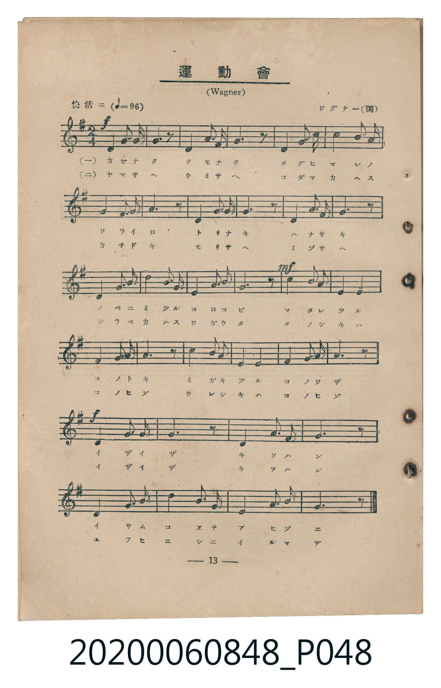
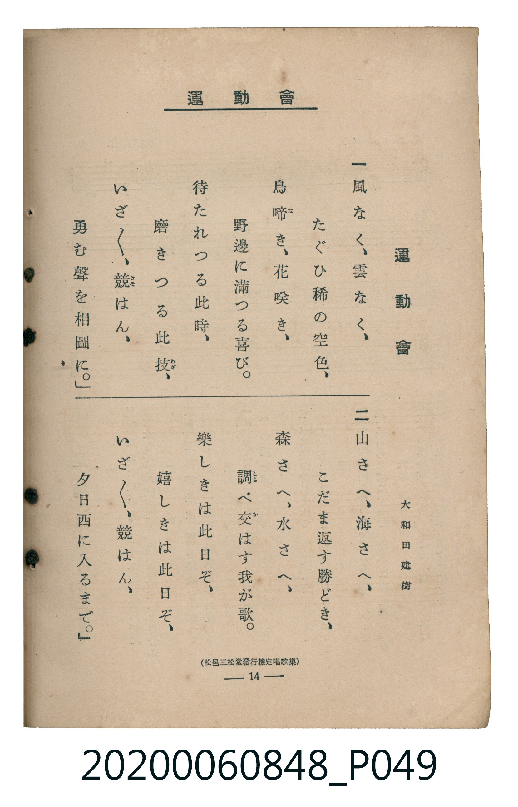

# 運動會

> Re:Shōka 使用 AI 協助辨識與重建樂譜，可能會有錯誤。歡迎回報。

- **鋼琴伴奏版**：<br><audio controls src="undokai.mp3"></audio>

- 詞：大和田建樹（松邑三松堂發行檢定唱歌集）
- 曲：R. Wagner（ワグナー）
- 臺灣教育會公認《新定兒童唱歌》高等科男子用（2020.006.0848）

## 說明

原書資訊與歌詞全文（對應 P048.jpg – P049.jpg，書頁 pp. 13–14，高一第二學期第 2 首）：
調性與拍號：ト長調（1 升記號）、2/4 拍（快活ニ ♩=96）


## 歌詞

```text
一
風（かぜ）なく、雲（くも）なく、たぐひ稀（まれ）の空色（そらいろ）、
鳥（とり）啼（な）き、花（はな）咲（さ）き、野邊（のべ）に滿（み）つる喜（よろこ）び。
待（ま）たれつる此時（このとき）、磨（みが）きつる此技（このわざ）、
いざ／＼、競（きそ）はん、勇（いさ）む聲（こゑ）を相圖（あいづ）に。」

二
山（やま）さへ、海（うみ）さへ、こだま返（かへ）す勝（かち）どき、
森（もり）さへ、水（みづ）さへ、調（しら）べ交（か）はす我（わ）が歌（うた）。
樂（たの）しきは此日（このひ）ぞ、嬉（うれ）しきは此日（このひ）ぞ、
いざ／＼、競（きそ）はん、夕日（ゆふひ）西（にし）に入（い）るまで。」
```

## ABC

<div class="abc-score" data-abc-src="undokai.abc" aria-label="五線譜載入中"></div>

[下載 ABC 原始檔](undokai.abc)

## TMD 檔案連結

- [主旋律 TMD 檔案](undokai.tmd) [[在 TMD Studio 編輯](https://tmdlang.github.io/Tmd-TS/#tmd=s7IKdvYPcrWy4qpTUCpJTLdSSM7PyUlNLsnMz7MqzsjMK0nNjM_KTMmPL87Iz05Ugisry88pzU21ys4vyY9Pyq8sjjcyMDKINzAwizewMLFAqCvOLy1KTrUqTs7Iz8-JL0mtKEnKz89GyBcU5Zel5iXmAdUUFIGsSwErQihILctMSQVJp6ZkluQXZSbmIDkitagY7FCwJfElRYl5xclFmQUg1yNUlWSkAl1aXJBfhGQs0KT0zDyr3NTMrEwszoJKl6cWl6QW5cXnpubkp1QqcWlpKbxs7H7aPfXZnGYFLS0uRVsFSzMue1sFdy4bI30TO5D-Fyvnvd8z6-mS5U8n9TyfsuHp7l3PVux8v6fj2dx9L5smPtnRCWQ8XdD0fOaeFwt7nq1a9HTdrKdTNj5b2_Nydtv7PZ1gNzybvQloRpCeQnhiel5qEVD34-b1j5s2PG7uety8B6bqRfuu542Ln02d-aJpE9BBT1vXvFjV-7ih69m0DSBDWyc9X70UYvTjhu6Xq2c8X9v5fPnE51O2P1074fmUFUBTQZGmB4w0PVCkgY3l0tdSsKUW4FJQUHjaN__Z7B0vNre_WNH1oqMd6BhgAD1tXfFsWjvQAU839D5r71QIMDCx0MsqSFd41DAZxLEEcd7v6QHqfLmgUaGgQE_B0BgoZ2gCFAT65MmOhudr1jzZ1fN07Y5nc-YD2QpGCi-XTQN6ARhuIGtfrNr_rGE5yMLu3hcz5wNFHzd3vJy6HSgOtNZQ4Wkv0EEzwDKdjxsagZGnAFQJctH-1c-27H7c3K3waOZKW0szoDwXyECglSDq5SJQuD1u7H7cOAektXHV48Z-oAEvQTEGFO9_3NSELP64cf7jxgmPGzc9X9EAVrDvcVMPWMG65yt3veiE6Jr7uAko0vK4CegCkHPANm1eCpZb8bipCyj6dCow3oHcVWDNwGhufNG1ESyyHiL4dBLErKlwBS_b-16C9AIF1z1uBKZBoPjqZ7tBAfC4EUgCuUseN3U_nQb0ScfjJiDqfdw4GSy--XFDEzj29rVCXA0WnQ90O0TPs7VLns0EehQoNRls-gqglRC3P18MCaH9jxshHgUaCtPSBQkDsJam_seNoAiDehfkfRC___2ePSBTVm8DKwVqngs2BZj8JwPFn3aDkg1YMdijTQ0vGiH-nvy4aSJYZNLz2TuezgEaBRRsAqsEBiTI60A_PW7ohcTmrh6w9zaCg7AJqAbiw6mPG3cAbXm2dTtYexssnKDiYKcvACp-sX8KLBnsACuY-bQb6E6IyEKwyEpIJICsebZ4HdiaJkhUIqzZsAUWVBAnQsUhifRx43RgsgCL73yyawnEdGhYNM581gH0LdBMYHgBRXqA-QrmYkiSBkffsxWQOAKmQaALgOqmg0N0PSgupkOSFyT6gEEIlJ0HCuA1QCvBBkHTKWEtpETfkqlQU5qALt0KMeXFUoh3VwMtg8TU01aITS3gCAUG6b7Hjcuh0Qe0jPKSCQoUtPS5uHwTgSV9QGZiXr5DjUGNQjXIBgUbQzMtOzALWCCCypodDcDiWkHDTOHphv7n6xt04GWWJsgQkEKg1rRaBdN4BV0wNASTRkBhY6gICBoAcQ1CkRGYNAYKmaArgpoJVwoxxQQkBOWBNINsqQEnaZhDd_UQdqgZzFCIrSBHmsOEsLgSj1fQXYnPQyjB2UnYlTi8jhAxxLQZ6I0aqHsxXVmdC4ogDCPQQgPNqU9nzybsVIjlYOtBFNBRWFwBNx_JqXC74eEPcyxMO8KdMEuwh-iuKWBnmtAvgSIHUutawrZTMT5rubh07RRAOVcBSCtzcQEA)]
- [鋼琴伴奏 TMD 檔案](undokai_piano.tmd) [[在 TMD Studio 編輯](https://tmdlang.github.io/Tmd-TS/#tmd=s7IKdvYPcrWy4tLSUnjZ2P20e-qzOc3v93S87N7zfMKWJ3u2PF3a_7yz4_2eTgUtLS5FWwVLMy57WwV3LhsjfRM7rjoFpRcr573fM-vpkuVPJ_U8n7Lh6e5dz1bsBJrwbO6-l00Tn-zoBDKeLmh6PnPPi4U9z1Yterpu1tMpG5-t7Xk5uw1orBLIjGezNwHNCNJTCE9Mz0stAup-3Lz-cdOGx81dj5v3wFS9aN_1vHHxs6kzXzRtArryaeuaF6t6Hzd0PZu2AWRo66Tnq5dCjH7c0P1y9YznazufL5_4fMr2p2snPJ-yAmiqkYGRgZ6BgZmegYWJBdhYLt_EzDyrgMzEvPwgD4cagxqFai4FILAxNNOyA7P0tRSer1nzZEcD0PkKWvpgMaCqtFoF03gFXTA0BJNGQGFjqAgIGgBxDUKREZg0BgqZoCuCmglXCjHFBCQE5YE0g2yp4UJ2064eFDeZwfRDLAC5xxwmhMVBeFyN7iB8bkcJpE4UB-HwEELEENMSoItroE7DdFB1LijYMYxA8ziaq57Ono3iKog9YJtAFNB-LBbCjUJyFdwaeKjC3AXTjnASzBLs4bRrCg0TE7LXW9fSKkJqkbOOD0rWMcGbcwzjFaINY5EZpvFAlmk8TMwExMKlGF_6NwGqMYrPxWIkqhGwsMBiK57ETMjdBpiOBjkIw1z05IjNqUZwITOQLMRT6KYjNOJLW0QGN55EQ4zHgalB104BlCAUkGhlLi4A)]

## 分析

```text
================================================================================
📊 TMD Song Profile: [ 運動會 ]
================================================================================
⏱  Duration:       0:40 (40.0s), 32 measures total
🎼 Key & Tempo:    首調基準 G, != 96.0 BPM, <2/4>
   - 分析範圍：      由實際發聲的音符與和弦推測調性；播放脈絡另行呈現
🎤 人聲音域:    D4 (MIDI 62) – D5 (MIDI 74) [跨度: 12 個半音 / 1.0 個八度, 難度: easy]
   - 最低音:  D4 in [Main #1 @ m.1, 0:00]
   - 最高音: D5 in [Main #1 @ m.6, 0:06]
   - 適合: soprano, mezzo-soprano, contralto, tenor, baritone, bass
🏛  結構:      Main (40.0s)
⚡ 編曲密度:        Peak 1 軌道同時演奏
🗝  調性診斷：       G 大調（純淨自然大調，未偵測到可信轉調）
   - 風格氣質:    純淨自然大調（陽光明朗、易唱易記，無明顯調外色彩）
   - 轉調歷程:    全曲維持單一推測調性（未偵測到可信轉調）
   - 核心骨幹音:  D, B, G, A, C
   - 調性數值:    G 大調 [相關度: 0.85, 穩定度: Moderate, 自然音純度: 100.0%]
   - 候選調性 (K-S): G 大調 (0.85), D 大調 (0.77), B 小調 (0.70)
   - 五度圈歷程:   +1
   - 各段落調性細節:
     • [Main #1]: G 大調 (r: 0.85, 自然音純度: 100.0%)

  [ 五度圈游移軌跡 ]
               C  
         F           [G ]*
      Bb               D  
      Eb               A  
         Ab           E  
            Db       B  
               F# 
     (* = active key center)

  [ 十二半音累積音高分佈 ]
     C  : █████████████             13.7%
     C# :                            0.0%
     D  : ████████████████████████  25.2%
     D# :                            0.0%
     E  : █████                      5.1%
     F  :                            0.0%
     F# : ███████                    6.8%
     G  : ███████████████           15.8%
     G# :                            0.0%
     A  : ██████████████            14.5%
     A# :                            0.0%
     B  : ██████████████████        18.8%
--------------------------------------------------------------------------------
Assignment 軌道音域：
  - Piano         : D4 – D5 (12 個半音 / 1.0 個八度, 73 個音符)
================================================================================
```


## 原書掃描頁






