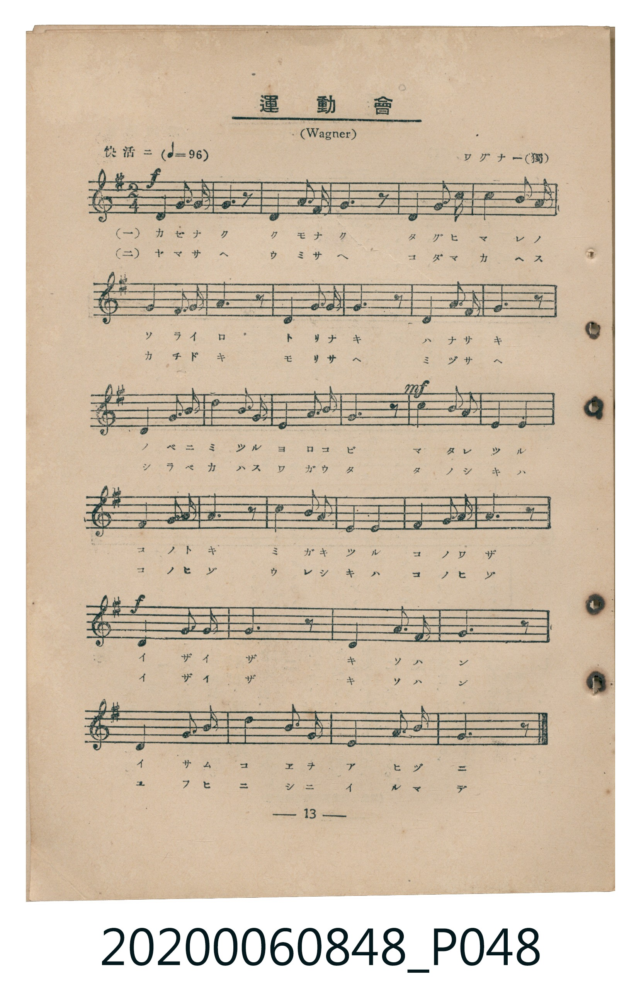
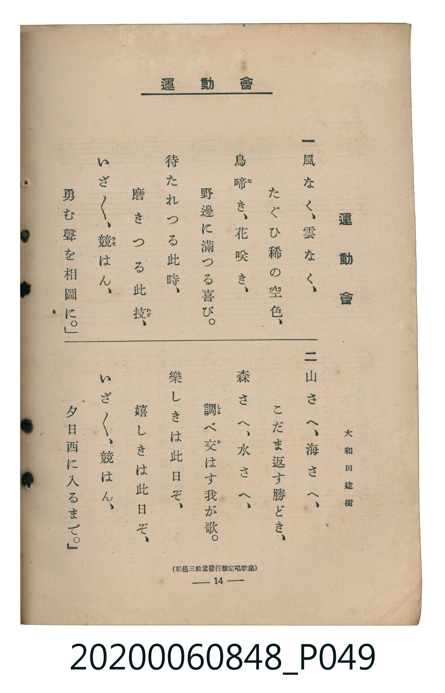

# 運動會

<audio controls src="undokai.mp3"></audio>

- 詞：大和田建樹（松邑三松堂發行檢定唱歌集）
- 曲：R. Wagner（ワグナー）
- 臺灣教育會公認《新定兒童唱歌》高等科男子用（2020.006.0848）

## 說明

原書資訊與歌詞全文（對應 P048.jpg – P049.jpg，書頁 pp. 13–14，高一第二學期第 2 首）：
調性與拍號：ト長調（1 升記號）、2/4 拍（快活ニ ♩=96）

## 跨冊／重複收錄參照

> 同曲＋同名異曲（《公學校唱歌》第三學年與《新定兒童唱歌》三年級為同曲；《新定兒童唱歌》高等科男子用為同名異曲）

- **[同名異曲]** 《公學校唱歌》第三學年（昭和10年／1935）：[**〈うんどうくわい（運動會）〉**](../../../kogakko_shoka/grade_3/10_undokai/index.md)（`C` / `2/4` — [原始 TMD](../../../kogakko_shoka/grade_3/10_undokai/undokai.tmd)）
- **[同名異曲]** 《新定兒童唱歌》尋常科第三學年用（2020.006.0847.0003）：[**〈運動會〉**](../../grade_3_2020.006.0847.0003/2_08_undokai/index.md)（`C` / `2/4` — [原始 TMD](../../grade_3_2020.006.0847.0003/2_08_undokai/undokai.tmd)）
- 總表：[跨冊重複與同名歌曲總索引](../../../duplicate_songs.md)

## 歌詞

```text
一
風（かぜ）なく、雲（くも）なく、たぐひ稀（まれ）の空色（そらいろ）、
鳥（とり）啼（な）き、花（はな）咲（さ）き、野邊（のべ）に滿（み）つる喜（よろこ）び。
待（ま）たれつる此時（このとき）、磨（みが）きつる此技（このわざ）、
いざ／＼、競（きそ）はん、勇（いさ）む聲（こゑ）を相圖（あいづ）に。」

二
山（やま）さへ、海（うみ）さへ、こだま返（かへ）す勝（かち）どき、
森（もり）さへ、水（みづ）さへ、調（しら）べ交（か）はす我（わ）が歌（うた）。
樂（たの）しきは此日（このひ）ぞ、嬉（うれ）しきは此日（このひ）ぞ、
いざ／＼、競（きそ）はん、夕日（ゆふひ）西（にし）に入（い）るまで。」
```

## ABC

```abc
X:1
T:運動會
C:曲：R. Wagner（ワグナー）
M:2/4
L:1/16
Q:1/4=96
K:G
V:V1 name="Piano" snm="Pia"
[V:V1]
!f! D4 G3 A | B6 z2 | D4 A3 B | c6 z2 |
D4 B3 c | d2 B2 A2 G2 | E4 c3 A | F6 z2 |
D4 G3 A | B6 z2 | D4 A3 B | c6 z2 |
D4 B3 c | d4 B3 G | D4 A3 F | G6 z2 |
!mf! d4 B3 G | E4 c4 | A4 F3 D | G6 z2 |
c4 A3 F | E4 F4 | G4 B3 G | A6 z2 |
!f! D4 G3 A | B6 z2 | D4 A3 B | c6 z2 |
D4 B3 c | d4 B3 G | D4 A3 F | G6 z2 |
!f! D4 G3 A | B6 z2 | D4 A3 B | c6 z2 |
D4 B3 c | d2 B2 A2 G2 | E4 c3 A | F6 z2 |
D4 G3 A | B6 z2 | D4 A3 B | c6 z2 |
D4 B3 c | d4 B3 G | D4 A3 F | G6 z2 |
!mf! d4 B3 G | E4 c4 | A4 F3 D | G6 z2 |
c4 A3 F | E4 F4 | G4 B3 G | A6 z2 |
!f! D4 G3 A | B6 z2 | D4 A3 B | c6 z2 |
D4 B3 c | d4 B3 G | D4 A3 F | G6 z2 |
```

## TMD 檔案連結

- [主旋律 TMD 檔案](undokai.tmd) [[在 TMD Studio 編輯](https://tmdlang.github.io/Tmd-TS/#tmd=s7IKdvYPcrWy4qpTUCpJTLdSSM7PyUlNLsnMz7MqzsjMK0nNjM_KTMmPL87Iz05Ugisry88pzU21ys4vyY9Pyq8sjjcyMDKINzAwizewMLFAqCvOLy1KTrUqTs7Iz8-JL0mtKEnKz89GyBcU5Zel5iXmAdUUFIGsSwErQihILctMSQVJp6ZkluQXZSbmIDkitagY7FCwJfElRYl5xclFmQUg1yNUlWSkAl1aXJBfBDRWS0vhZWP30-6pz-Y0K2hpcSnaKliacdnbKrhz2Rjpm9iBdL1YOe_9nllPlyx_Oqnn-ZQNT3fverZi5_s9Hc_m7nvZNPHJjk4g4-mCpucz97xY2PNs1aKn62Y9nbLx2dqel7Pb3u_pBNv8bPYmoBlBegrhiel5qUVA3Y-b1z9u2vC4uetx8x6Yqhftu543Ln42deaLpk1ABz1tXfNiVe_jhq5n0zaADG2d9Hz1UojRjxu6X66e8Xxt5_PlE59P2f507YTnU1YATQUFux4w2PVAwQ42lktfS8GWWoBLQUHhad_8Z7N3vNjc_mJF14uOdqBjgAH0tHXFs2ntQAc83dD7rL1TIcDAxEIvqyBd4VHDZBDHEsR5v6cHqPPlgkaFggI9BUNjoJyhCVAQ6JMnOxqer1nzZFfP07U7ns2ZD2QrGCm8XDYN6AVguIGsfbFq_7OG5SALu3tfzJwPFH3c3PFy6nagONBaQ4WnvUAHzQDLdD5uaARGngJQJchF-1c_27L7cXO3wqOZK20tzYDyXCADgVaCqJeLQOH2uLH7ceMckNbGVY8b-4EGvATFGFC8_3FTE7L448b5jxsnPG7c9HxFA1jBvsdNPWAF656v3PWiE6Jr7uMmoEjL4yagC0DOAdu0eSlYbsXjpi6g6NOpwHgHcleBNQOjufFF10awyHqI4NNJELOmwhW8bO97CdILFFz3uBGYBoHiq5_tBgXA40YgCeQuedzU_XQa0Ccdj5uAqPdx42Sw-ObHDU3g2NvXCnE1WHQ-0O0QPc_WLnk2E-hRoNRksOkrgFZC3P58MSSE9j9uhHgUaChMSxckDMBamvofN4IiDOpdkPdB_P73e_aATFm9DawUqHku2BRg8p8MFH_aDUo2YMVgjzY1vGiE-Hvy46aJYJFJz2fveDoHaBRQsAmsEhiQIK8D_fS4oRcSm7t6wN7bCA7CJqAaiA-nPm7cAbTl2dbtYO1tsHCCioOdvgCo-MX-KbBksAOsYObTbqA7ISILwSIrIZEAsubZ4nVga5ogUYmwZsMWWFBBnAgVhyTSx43TgckCLL7zya4lENOhYdE481kH0LdAM4HhBRTpAeYrmIshSRocfc9WQOIImAaBLgCqmw4O0fWguJgOSV6Q6AMGIVB2HiiA1wCtBBsETaeEtZASfUumQk1pArp0K8SUF0sh3l0NtAwSU09bITa1gCMUGKT7Hjcuh0Yf0DLKSyYoUNDS5-LyTczMswrITMzLd6gxqFGoBtmgYGNopmUHZgELRFBZs6MBWFwraJgpPN3Q_3x9gw68zNIEGQJSCNSaVqtgGq-gC4aGYNIIKGwMFQFBAyCuQSgyApPGQCETdEVQM-FKIaaYgISgPJBmkC014CQNc-iuHsIONYMZCrEV5EhzmBAWV-LxCror8XkIJTg7CbsSh9cRIoaYNgO9UQN1L6Yrq3NBEYRhBFpooDn16ezZhJ0KsRxsPYgCOgqLK-DmIzkVbjc8_GGOhWlHuBNmCfYQ3TUF7EwT-iVQ5EBqXUvYdirGZy0Xl66dAijnKiDRylxcAA)]
- [鋼琴伴奏 TMD 檔案](undokai_piano.tmd) [[在 TMD Studio 編輯](https://tmdlang.github.io/Tmd-TS/#tmd=s7IKdvYPcrWy4tLSUnjZ2P20e-qzOc3v93S87N7zfMKWJ3u2PF3a_7yz4_2eTgUtLS5FWwVLMy57WwV3LhsjfRM7rjoFpRcr573fM-vpkuVPJ_U8n7Lh6e5dz1bsBJrwbO6-l00Tn-zoBDKeLmh6PnPPi4U9z1Yterpu1tMpG5-t7Xk5uw1orBLIjGezNwHNCNJTCE9Mz0stAup-3Lz-cdOGx81dj5v3wFS9aN_1vHHxs6kzXzRtArryaeuaF6t6Hzd0PZu2AWRo66Tnq5dCjH7c0P1y9YznazufL5_4fMr2p2snPJ-yAmiqkYGRgZ6BgZmegYWJBdhYLt_EzDyrgMzEvPwgD4cagxqFai4FILAxNNOyA7P0tRSer1nzZEcD0PkKWvpgMaCqtFoF03gFXTA0BJNGQGFjqAgIGgBxDUKREZg0BgqZoCuCmglXCjHFBCQE5YE0g2yp4UJ2064eFDeZwfRDLAC5xxwmhMVBeFyN7iB8bkcJpE4UB-HwEELEENMSoItroE7DdFB1LijYMYxA8ziaq57Ono3iKog9YJtAFNB-LBbCjUJyFdwaeKjC3AXTjnASzBLs4bRrCg0TE7LXW9fSKkJqkbOOD0rWMcGbcwzjFaINY5EZpvFAlmk8TMwExMKlGF_6NwGqMYrPxWIkqhGwsMBiK57ETMjdBpiOBjkIw1z05IjNqUZwITOQLMRT6KYjNOJLW0QGN55EQ4zHgalB104BlCAUkGhlLi4A)]

## 分析

```text
================================================================================
📊 TMD Song Profile: [ 運動會 ]
================================================================================
⏱  Duration:       1:20 (80.0s), 64 measures total
🎼 Key & Tempo:    首調基準 G, != 96.0 BPM, <2/4>
   - 分析範圍：      由實際發聲的音符與和弦推測調性；播放脈絡另行呈現
🎤 人聲音域:    D4 (MIDI 62) – D5 (MIDI 74) [跨度: 12 個半音 / 1.0 個八度, 難度: easy]
   - 最低音:  D4 in [Main #1 @ m.1, 0:00]
   - 最高音: D5 in [Main #1 @ m.6, 0:06]
   - 適合: soprano, mezzo-soprano, contralto, tenor, baritone, bass
🏛  結構:      Main (40.0s) -> Main (40.0s)
⚡ 編曲密度:        Peak 1 軌道同時演奏
🗝  調性診斷：       G 大調（純淨自然大調，未偵測到可信轉調）
   - 風格氣質:    純淨自然大調（陽光明朗、易唱易記，無明顯調外色彩）
   - 轉調歷程:    全曲維持單一推測調性（未偵測到可信轉調）
   - 核心骨幹音:  D, B, G, A, C
   - 調性數值:    G 大調 [相關度: 0.85, 穩定度: Moderate, 自然音純度: 100.0%]
   - 候選調性 (K-S): G 大調 (0.85), D 大調 (0.77), B 小調 (0.70)
   - 五度圈歷程:   +1 -> +1
   - 各段落調性細節:
     • [Main #1]: G 大調 (r: 0.85, 自然音純度: 100.0%)
     • [Main #2]: G 大調 (r: 0.85, 自然音純度: 100.0%)

  [ 五度圈游移軌跡 ]
               C  
         F           [G ]*
      Bb               D  
      Eb               A  
         Ab           E  
            Db       B  
               F# 
     (* = active key center)

  [ 十二半音累積音高分佈 ]
     C  : █████████████             13.7%
     C# :                            0.0%
     D  : ████████████████████████  25.2%
     D# :                            0.0%
     E  : █████                      5.1%
     F  :                            0.0%
     F# : ███████                    6.8%
     G  : ███████████████           15.8%
     G# :                            0.0%
     A  : ██████████████            14.5%
     A# :                            0.0%
     B  : ██████████████████        18.8%
--------------------------------------------------------------------------------
Assignment 軌道音域：
  - Piano         : D4 – D5 (12 個半音 / 1.0 個八度, 146 個音符)
================================================================================
```


## 原書掃描頁






