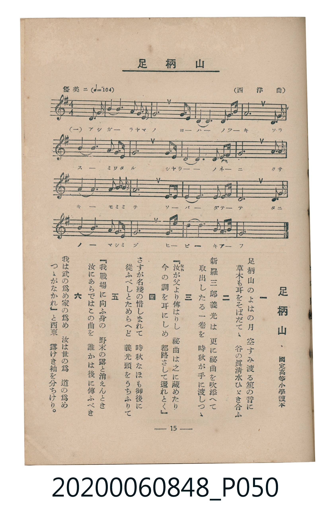

# 足柄山

> Re:Shōka 使用 AI 協助辨識與重建樂譜，可能會有錯誤。歡迎回報。

<audio controls src="ashigarayama.mp3"></audio>

- 詞：國定高等小學讀本
- 曲：西洋曲
- 臺灣教育會公認《新定兒童唱歌》高等科男子用（2020.006.0848）

## 說明

原書資訊與歌詞全文（對應 P050.jpg，書頁 p. 15，高一第二學期第 3 首）：
調性與拍號：ト長調（1 升記號）、4/4 拍（優美ニ ♩=104，弱起第 4 拍進入）


## 歌詞

```text
一
足柄山のよはの月　空すみ渡る笙の音に
草木も耳をそばだてゝ　谷の眞清水ひゞき合ふ

二
新羅三郎義光は　更に祕曲を吹添へて
取出したる一卷を　時秋が手に渡しつゝ

三
『汝（なれ）が父より傳はりし　祕曲は之に藏めたり
今の調を耳にしめ　都路さして還れとく』

四
さすが名殘の惜しまれて　時秋なほも御後に
從ふべしとためらへど　義光頭をうちふりて

五
『我戰場に向ふ身の　野末の露と消えんとき
汝にあらではこの曲を　誰かは後に傳ふべき

六
我は武の爲め家の爲め　汝は世の爲道の爲め
つゝがなかれ』と西東　露けき袖を分ちけり。
```

## ABC

```abc
X:1
T:足柄山
C:曲：西洋曲
M:4/4
L:1/16
Q:1/4=104
K:G
V:V1 name="Piano" snm="Pia"
[V:V1]
!mf! z4 z4 z4 D3 G | B4 B8 G3 A | B4 G8 B3 G | E6 D2 E4 A3 d |
A12 A3 B | d4 d6 B2 A3 G | A12 B3 G | E6 D2 E4 G3 B |
G12 D3 G | B4 B6 G2 B3 G | A12 F3 G | A6 F2 D4 E3 F |
G12 A3 B | d4 d6 B2 G3 E | G12 B3 d | e6 d2 B4 E3 F |
G12 z4 |
```

## TMD 檔案連結

- [主旋律 TMD 檔案](ashigarayama.tmd) [[在 TMD Studio 編輯](https://tmdlang.github.io/Tmd-TS/#tmd=s7IKdvYPcrWy4qpTUCpJTLdSSM7PyUlNLsnMz7MqzsjMK0nNjM_KTMmPL87Iz05Ugisry88pzU21ys4vyY9Pyq8sjjcyMDKINzAwizewMLFAqCvOLy1KTrUqTs7Iz8-JL0mtKEnKz89GyBcU5Zel5iXmAdUUFIGsSwErQihILctMSQVJp6ZkluQXZSbmIDkitagY7FCwJfElRYl5xclFmQUg1yNUlWSkAl2al1hSWpSKLgrUUpaKZCJEtCAnMRlJKdDW9Mw8q9z8vKRSYDBgSJSnFpekFuXF56bm5KdUKnFpaSm82Lb52fyWpxs3KmhpcSnaKhgamHDZ2yq4c9mY6JvYgQx4sXLe-z2zns7pfrpu1svVM56v7Xy6of_p2h0v1jU8m7MGbMez2ZuASl4s3f9sSzeQDRZ70b7reePiZ1Nnvmja9GxO89PWNS9W9T5u6Ho2bQPQoKetk56vXvp0ysZna3seN3RDzH2-fOLzKdufrp3wfMqK93s6QBGlB4woPVBEvd_TqcTFpa-lYEstwKWgoPC0b_6z2TtebG5_saLrRUc70DFA3z5tXfFsWjvQAU839D5r71QIMDA10MsqSH-_pweo-OWCRoUCPQVDUyAX6OwnOxqer1nzZFcPMESezZkPZCsYK7xcNg3oXmCQgOx4sWr_s4blINO7e1_MnA8Ufdzc8XLqdqA40A5Dhae9QNtngGU6Hzc0AoNdAagSZH3Lquf7-h43dys8mrnSFhgxQBuf7tn4Yut2kC1gVS8bNj1tXQrUyAWyCegWsIWwKH3cuO5xU8fjxvVAxrM5HY8bGp6v3PW4cebjxv3Pdix83NT9fA2Qve7l_M2PG1eDdfZ2Ppuz4nFT04uGzY-bJj1unPu4ccPjxgWPG5c9bpoL1P9iw3aghudz5j3b0fpsw5bHjZseN8173Nj7dALQmq0QR-zqAVHAaH6-r_XJjs6XzX3P96182toJckdDw7PZQF2rny-dCkwnQCueTtj5bPvux407gFaAI6R_2tN2oBunP26cD3Qg0EdPe7eDnALUObPp-fLux409zzqB5GqQD0DKlgBdBvV9J4h63ND3bONcYPA9blz1uKkHFKiNPc87toFCoqnraRPQr-uBDJBeYHhA3NG4_slOkJkvpvc_bmoEW90FNnI3UN06YEQBXQAKksbVIG1AFQ0NL5v3vtgODNipYEcse9nUArTsceOKx439jxv6wQ56Ons22EEgNcBw7nk6offZuhmguGieA9a1D6xlGZLfVj1u3A0M_qf7Fj7dB5QCR8rTfcAQ3vq4cSdYD9ACoOsaHzcBvQUMtJUgT4CD9-WCteAoa3vcCAyYrWAvLoPGyBRYwHRMfNax4ekCUBQ8nTARqOzFLqCX1oH80973bA6I_XIOMDxWPNsGDD9ggE0G29gLjtGNwNQAVNEEtns5OFkBpddBIhKUOFYB0wrQE-shbgcHNcTdvZDwaF0LNqcDaPH6Z2uXgVJSB1Bv49N12-BsUGCALFr_ZMc0iOBLsC0QWUh4gqIcGJ7g4OoGhWFDP9CZoOJn7kaQV0A-ANrR-2LRNFAS64AEyURQkDQ0gYygvPCAAgUtfS4u30Rg0RqQmZiX71BjUKNQDbJBwcbQTMsOzAKWWZBcCyw2n69vUNB42tkLLCOAuffJnonP1i4C5mq0_KwJMhaktUbBQEEXDNHp6ty0WgXTeDDbUKEGHL4gm0Bl0Y6GFwt7FDRMFCAW6sALMCRzjaHmwGgYNASTRkgqICIICBEH2QkxyQziCAgEuwguYgQRAyqCsDAhRNwYzQO7egh7wBRmI5rTICYCnYfTThI8APE70HkYoYCiHksUdJIXBSBr4O7D6QNzhKUQo5AVgiWhzoJ7BSiI2w9YIwFYeJEfCRCbgHbjthTiS2DagMUCkhzIOFioEOMBWKao4arl4tK1UwBlSAUgrczFBQA)]
- [鋼琴伴奏 TMD 檔案](ashigarayama_piano.tmd) [[在 TMD Studio 編輯](https://tmdlang.github.io/Tmd-TS/#tmd=s7IKdvYPcrWy4tLSUnixbfOz-S1PN258v6fjZfee5xO2PNmz5enS_uedHe_3dCpoaXEp2ioYGphw2dsquHPZmOib2HHVKSi9WDnv_Z5ZT-d0P1036-XqGc_Xdj7d0P907Y4X6xqezVmjBFLybPYmoJIXS_c_29INZIPFXrTvet64-NnUmS-aNj2b0_y0dc2LVb2PG7qeTdsANOhp66Tnq5c-nbLx2dqexw3dEHOfL5_4fMr2p2snPJ-yAuhGIwMjAz0DAzM9AwsTC6ALlbi4fBMz86wCMhPz8oM8HGoMahSquRSAwMbQTMsOzNLXUni6Z-OLrduBbny-vkFBSx8sXKNgoKALhuh0dW5arYJpPJhtqFDDBTPl-Zo1T3Y0vFjYgzDCGKoFRsOgIZg0QlIBEUFAiDjIeIhJZhD7IBBsOVzECCIGVARhYUKIuDGaW3f1oLjVFGY4misgmoEuwWk8CW6FeBPoEgwPo6jHErCdBAMWZCLcKTgda44wH2IUskKwJNQFcFcDBXE7F2vQPp09m6ighRgKtAa3-RAPASMXFrZIciDjYAFAjFthCbiGqxY5X_ig5AsTwtkCAvEmfMN4hWjDWBiFwYeqMgFyTeJjwbRRfC5IoWk8kG0KFAMx0C1BS7HolsD14rAGLo-sFcMjqAkNpx0Iw2CRjCmD2xr0FEJaeOG0ARivunYKoKhVQKKVubgA)]

## 分析

```text
================================================================================
📊 TMD Song Profile: [ 足柄山 ]
================================================================================
⏱  Duration:       0:39 (39.2s), 17 measures total
🎼 Key & Tempo:    首調基準 G, != 104.0 BPM, <4/4>
   - 分析範圍：      由實際發聲的音符與和弦推測調性；播放脈絡另行呈現
🎤 人聲音域:    D4 (MIDI 62) – E5 (MIDI 76) [跨度: 14 個半音 / 1.2 個八度, 難度: moderate]
   - 最低音:  D4 in [Main #1 @ m.1, 0:01]
   - 最高音: E5 in [Main #1 @ m.16, 0:34]
   - 適合: soprano, mezzo-soprano, contralto, tenor, baritone, bass
🏛  結構:      Main (39.2s)
⚡ 編曲密度:        Peak 1 軌道同時演奏
🗝  調性診斷：       G 大調（純淨自然大調，未偵測到可信轉調）
   - 風格氣質:    純淨自然大調（陽光明朗、易唱易記，無明顯調外色彩）
   - 轉調歷程:    全曲維持單一推測調性（未偵測到可信轉調）
   - 核心骨幹音:  G, A, B, D, E
   - 調性數值:    G 大調 [相關度: 0.82, 穩定度: High, 自然音純度: 100.0%]
   - 候選調性 (K-S): G 大調 (0.82), D 大調 (0.67), E 小調 (0.66)
   - 五度圈歷程:   +1
   - 各段落調性細節:
     • [Main #1]: G 大調 (r: 0.82, 自然音純度: 100.0%)

  [ 五度圈游移軌跡 ]
               C  
         F           [G ]*
      Bb               D  
      Eb               A  
         Ab           E  
            Db       B  
               F# 
     (* = active key center)

  [ 十二半音累積音高分佈 ]
     C  :                            0.0%
     C# :                            0.0%
     D  : ████████████              14.8%
     D# :                            0.0%
     E  : ███████████               12.9%
     F  :                            0.0%
     F# : ██                         2.7%
     G  : ████████████████████████  28.9%
     G# :                            0.0%
     A  : ██████████████████        21.5%
     A# :                            0.0%
     B  : ████████████████          19.1%
--------------------------------------------------------------------------------
Assignment 軌道音域：
  - Piano         : D4 – E5 (14 個半音 / 1.2 個八度, 64 個音符)
================================================================================
```


## 原書掃描頁




