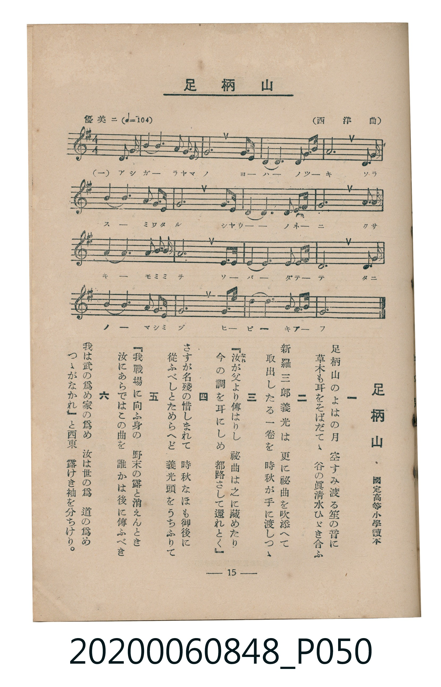

# 足柄山

<audio controls src="ashigarayama.mp3"></audio>

- 詞：國定高等小學讀本
- 曲：西洋曲
- 臺灣教育會公認《新定兒童唱歌》高等科男子用（2020.006.0848）

## 說明

原書資訊與歌詞全文（對應 P050.jpg，書頁 p. 15，高一第二學期第 3 首）：
調性與拍號：ト長調（1 升記號）、4/4 拍（優美ニ ♩=104，弱起第 4 拍進入）

## 跨冊／重複收錄參照

> 同曲（《新定兒童唱歌》高等科男、女共用教材）

- **[同曲]** 《新定兒童唱歌》高等科女子用（2020.006.0849）：[**〈足柄山〉**](../../koto_girls_2020.006.0849/1_2_03_ashigarayama/index.md)（`G` / `4/4` — [原始 TMD](../../koto_girls_2020.006.0849/1_2_03_ashigarayama/ashigarayama.tmd)）
- 總表：[跨冊重複與同名歌曲總索引](../../../duplicate_songs.md)

## 歌詞

```text
一
足柄山のよはの月　空すみ渡る笙の音に
草木も耳をそばだてゝ　谷の眞清水ひゞき合ふ

二
新羅三郎義光は　更に祕曲を吹添へて
取出したる一卷を　時秋が手に渡しつゝ

三
『汝（なれ）が父より傳はりし　祕曲は之に藏めたり
今の調を耳にしめ　都路さして還れとく』

四
さすが名殘の惜しまれて　時秋なほも御後に
從ふべしとためらへど　義光頭をうちふりて

五
『我戰場に向ふ身の　野末の露と消えんとき
汝にあらではこの曲を　誰かは後に傳ふべき

六
我は武の爲め家の爲め　汝は世の爲道の爲め
つゝがなかれ』と西東　露けき袖を分ちけり。
```

## ABC

```abc
X:1
T:足柄山
C:曲：西洋曲
M:4/4
L:1/16
Q:1/4=104
K:G
V:V1 name="Piano" snm="Pia"
[V:V1]
!mf! z4 z4 z4 D3 G | B4 B8 G3 A | B4 G8 B3 G | E6 D2 E4 A3 d |
A12 A3 B | d4 d6 B2 A3 G | A12 B3 G | E6 D2 E4 G3 B |
G12 D3 G | B4 B6 G2 B3 G | A12 F3 G | A6 F2 D4 E3 F |
G12 A3 B | d4 d6 B2 G3 E | G12 B3 d | e6 d2 B4 E3 F |
G12 z4 | !mf! z4 z4 z4 D3 G | B4 B8 G3 A | B4 G8 B3 G |
E6 D2 E4 A3 d | A12 A3 B | d4 d6 B2 A3 G | A12 B3 G |
E6 D2 E4 G3 B | G12 D3 G | B4 B6 G2 B3 G | A12 F3 G |
A6 F2 D4 E3 F | G12 A3 B | d4 d6 B2 G3 E | G12 B3 d |
e6 d2 B4 E3 F | G12 z4 |
```

## TMD 檔案連結

- [主旋律 TMD 檔案](ashigarayama.tmd) [[在 TMD Studio 編輯](https://tmdlang.github.io/Tmd-TS/#tmd=s7IKdvYPcrWy4tLSUnixbfOz-S1PN25U0NLiUrRVMDQw4bK3VXDnsjHRN7HjqlNQerFy3vs9s57O6X66btbL1TOer-18uqH_6dodL9Y1PJuzRgmk5NnsTUAlL5buf7alG8gGi71o3_W8cfGzqTNfNG16Nqf5aeuaF6t6Hzd0PZu2AWjQ09ZJz1cvfTpl47O1PY8buiHmPl8-8fmU7U_XTng-ZcX7PR1GBkYGegYGZnoGFiYW7_d0KnFx6Wsp2FILcCkoKDztm_9s9o4Xm9tfrOh60dEOdAzQt09bVzyb1g50wNMNvc_aOxUCDEwN9LIK0t_v6QEqfrmgUaFAT8HQFMgFOvvJjobna9Y82dUDDJFnc-YD2QrGCi-XTQO6FxgkIDterNr_rGE5yPTu3hcz5wNFHzd3vJy6HSgOtMNQ4Wkv0PYZYJnOxw2NwGBXAKoEWd-y6vm-vsfN3QqPZq60BUYM0Maneza-2LodZAtY1cuGTU9blwI1coFsAroFbCEsSh83rnvc1PG4cT2Q8WxOx-OGhucrdz1unPm4cf-zHQsfN3U_XwNkr3s5f_PjxtVgnb2dz-aseNzU9KJh8-OmSY8b5z5u3PC4ccHjxmWPm-YC9b_YsB2o4fmcec92tD7bsOVx46bHTfMeN_Y-nQC0ZivEEbt6QBQwmp_va32yo_Nlc9_zfSuftnaC3NHQ8Gw2UNfq50unAtMJ0IqnE3Y-2777ceMOoBXgCOmf9rQd6MbpjxvnAx0I9NHT3u0gpwB1zmx6vrz7cWPPs04guRrkA5CyJUCXQX3fCaIeN_Q92zgXGHyPG1c9buoBBWpjz_OObaCQaOp62gT063ogA6QXGB4QdzSuf7ITZOaL6f2PmxrBVneBjdwNVLcOGFFAF4CCpHE1SBtQRUPDy-a9L7YDA3Yq2BHLXja1AC173LjicWP_44Z-sIOezp4NdhBIDTCce55O6H22bgYoLprngHXtA2tZhuS3VY8bdwOD_-m-hU_3AaXAkfJ0HzCEtz5u3AnWA7QA6LrGx01AbwEDbSXIE-DgfblgLTjK2h43AgNmK9iLy6AxMgUWMB0Tn3VseLoAFAVPJ0wEKnuxC-ildSD_tPc9mwNiv5wDDI8Vz7YBww8YYJPBNvaCY3QjMDUAVTSB7V4OTlZA6XWQiAQljlXAtAL0xHqI28FBDXF3LyQ8WteCzekAWrz-2dploJTUAdTb-HTdNjgbFBggi9Y_2TENIvgSbAtEFhKeoCgHhic4uLpBYdjQD3QmqPiZuxHkFZAPgHb0vlg0DZTEOiBBMhEUJA1NICMoLzygQEFLn4vLNzEzzyogMzEv36HGoEahGmSDgo2hmZYdmAUssyC5FlhsPl_foKDxtLMXWEYAc--TPROfrV0EzNVo-VkTZCxIa42CgYIuGKLT1blptQqm8WC2oUINOHxBNoHKoh0NLxb2KGiYKEAs1IEXYEjmGkPNgdEwaAgmjZBUQEQQECIOshNikhnEERAIdhFcxAgiBlQEYWFCiLgxmgd29RD2gCnMRjSnQUwEOg-nnSR4AOJ3oPMwQgFFPZYo6CQvCkDWwN2H0wfmCEshRiErBEtCnQX3ClAQtx-wRgKw8CI_EiA2Ae3GbSnEl8C0AYsFJDmQcbBQIcYDsExRw1XLxaVrpwDKkApItDIXFwA)]
- [鋼琴伴奏 TMD 檔案](ashigarayama_piano.tmd) [[在 TMD Studio 編輯](https://tmdlang.github.io/Tmd-TS/#tmd=s7IKdvYPcrWy4tLSUnixbfOz-S1PN258v6fjZfee5xO2PNmz5enS_uedHe_3dCpoaXEp2ioYGphw2dsquHPZmOib2HHVKSi9WDnv_Z5ZT-d0P1036-XqGc_Xdj7d0P907Y4X6xqezVmjBFLybPYmoJIXS_c_29INZIPFXrTvet64-NnUmS-aNj2b0_y0dc2LVb2PG7qeTdsANOhp66Tnq5c-nbLx2dqexw3dEHOfL5_4fMr2p2snPJ-yAuhGIwMjAz0DAzM9AwsTC6ALlbi4fBMz86wCMhPz8oM8HGoMahSquRSAwMbQTMsOzNLXUni6Z-OLrduBbny-vkFBSx8sXKNgoKALhuh0dW5arYJpPJhtqFDDBTPl-Zo1T3Y0vFjYgzDCGKoFRsOgIZg0QlIBEUFAiDjIeIhJZhD7IBBsOVzECCIGVARhYUKIuDGaW3f1oLjVFGY4misgmoEuwWk8CW6FeBPoEgwPo6jHErCdBAMWZCLcKTgda44wH2IUskKwJNQFcFcDBXE7F2vQPp09m6ighRgKtAa3-RAPASMXFrZIciDjYAFAjFthCbiGqxY5X_ig5AsTwtkCAvEmfMN4hWjDWBiFwYeqMgFyTeJjwbRRfC5IoWk8kG0KFAMx0C1BS7HolsD14rAGLo-sFcMjqAkNpx0Iw2CRjCmD2xr0FEJaeOG0ARivunYKoKhVQKKVubgA)]

## 分析

```text
================================================================================
📊 TMD Song Profile: [ 足柄山 ]
================================================================================
⏱  Duration:       1:18 (78.5s), 34 measures total
🎼 Key & Tempo:    首調基準 G, != 104.0 BPM, <4/4>
   - 分析範圍：      由實際發聲的音符與和弦推測調性；播放脈絡另行呈現
🎤 人聲音域:    D4 (MIDI 62) – E5 (MIDI 76) [跨度: 14 個半音 / 1.2 個八度, 難度: moderate]
   - 最低音:  D4 in [Main #1 @ m.1, 0:01]
   - 最高音: E5 in [Main #1 @ m.16, 0:34]
   - 適合: soprano, mezzo-soprano, contralto, tenor, baritone, bass
🏛  結構:      Main (39.2s) -> Main (39.2s)
⚡ 編曲密度:        Peak 1 軌道同時演奏
🗝  調性診斷：       G 大調（純淨自然大調，未偵測到可信轉調）
   - 風格氣質:    純淨自然大調（陽光明朗、易唱易記，無明顯調外色彩）
   - 轉調歷程:    全曲維持單一推測調性（未偵測到可信轉調）
   - 核心骨幹音:  G, A, B, D, E
   - 調性數值:    G 大調 [相關度: 0.82, 穩定度: High, 自然音純度: 100.0%]
   - 候選調性 (K-S): G 大調 (0.82), D 大調 (0.67), E 小調 (0.66)
   - 五度圈歷程:   +1 -> +1
   - 各段落調性細節:
     • [Main #1]: G 大調 (r: 0.82, 自然音純度: 100.0%)
     • [Main #2]: G 大調 (r: 0.82, 自然音純度: 100.0%)

  [ 五度圈游移軌跡 ]
               C  
         F           [G ]*
      Bb               D  
      Eb               A  
         Ab           E  
            Db       B  
               F# 
     (* = active key center)

  [ 十二半音累積音高分佈 ]
     C  :                            0.0%
     C# :                            0.0%
     D  : ████████████              14.8%
     D# :                            0.0%
     E  : ███████████               12.9%
     F  :                            0.0%
     F# : ██                         2.7%
     G  : ████████████████████████  28.9%
     G# :                            0.0%
     A  : ██████████████████        21.5%
     A# :                            0.0%
     B  : ████████████████          19.1%
--------------------------------------------------------------------------------
Assignment 軌道音域：
  - Piano         : D4 – E5 (14 個半音 / 1.2 個八度, 128 個音符)
================================================================================
```


## 原書掃描頁




