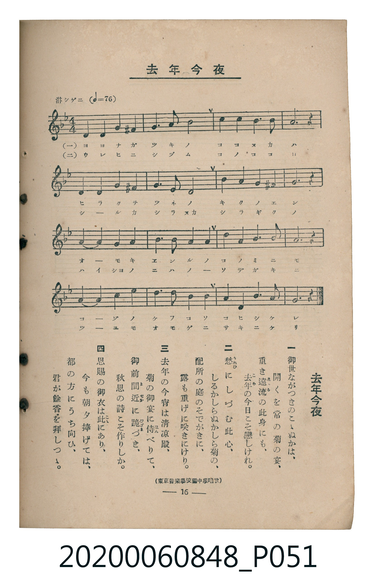

# 去年今夜

<audio controls src="kyonen_konya.mp3"></audio>

- 出處：東京音樂學校編《中學唱歌》
- 臺灣教育會公認《新定兒童唱歌》高等科男子用（2020.006.0848）

## 說明

原書資訊與歌詞全文（對應 P051.jpg，書頁 p. 16，高一第二學期第 4 首）：
調性與拍號：ニ短調（1 降記號）、4/4 拍（淋シゲニ ♩=76）

## 歌詞

```text
一
御世（みよ）ながつきのこゝぬかは、
開（ひら）くを常（つね）の菊（きく）の宴（えん）、
重（おも）き遠流（ゑんる）の此身（このみ）にも、
去年（こぞ）の今日（けふ）こそ戀（こひ）しけれ。

二
愁（うれひ）にしづむ此心（このこころ）、
しるかしらぬかしら菊（ぎく）の、
配所（はいしょ）の庭（には）のそでがきに、
露（つゆ）も重（おも）げに咲（さ）きにけり。

三
去年（こぞ）の今宵（こよひ）は清涼殿（せいりゃうでん）、
菊（きく）の御宴（ぎょえん）に侍（はん）べりて、
御前（ごぜん）間近（まぢか）に跪（ひざま）づき、
秋思（しうし）の詩（し）こそ作（つく）りしか。

四
恩賜（おんし）の御衣（ぎょい）は此（ここ）にあり、
今（いま）も朝夕（あさゆふ）捧（ささ）げては、
都（みやこ）の方（かた）にうち向（むか）ひ、
君（きみ）が餘香（よかう）を拜（はい）しつゝ。
```

## ABC

```abc
X:1
T:去年今夜
C:TMD (Chen, Chih-Han / aguai)
M:4/4
L:1/16
Q:1/4=76
K:Dm
V:V1 name="Piano" snm="Pia"
[V:V1]
!mp! d4 f4 e4 ^c4 | g6 a2 f8 | a4 a4 g4 f4 | a12 z4 |
d4 f4 e4 ^c4 | g6 f2 e8 | b4 a4 g4 ^g4 | a12 z4 |
!mf! a4 a4 d4 c4 | b6 a2 g8 | g4 g4 c4 b4 | a12 z4 |
!mp! d4 f4 e4 ^c4 | g6 a2 b8 | a4 d4 f6 e2 | d12 z4 |
!mp! d4 f4 e4 ^c4 | g6 a2 f8 | a4 a4 g4 f4 | a12 z4 |
d4 f4 e4 ^c4 | g6 f2 e8 | b4 a4 g4 ^g4 | a12 z4 |
!mf! a4 a4 d4 c4 | b6 a2 g8 | g4 g4 c4 b4 | a12 z4 |
!mp! d4 f4 e4 ^c4 | g6 a2 b8 | a4 d4 f6 e2 | d12 z4 |
```

## TMD 檔案連結

- [主旋律 TMD 檔案](kyonen_konya.tmd)
- [鋼琴伴奏 TMD 檔案](kyonen_konya_piano.tmd)

## 分析

```text
================================================================================
📊 TMD Song Profile: [ 去年今夜 ]
================================================================================
⏱  Duration:       1:41 (101.1s), 32 measures total
🎼 Key & Tempo:    首調基準 F, != 76.0 BPM, <4/4>
   - 分析範圍：      由實際發聲的音符與和弦推測調性；播放脈絡另行呈現
🎤 人聲音域:    C#4 (MIDI 61) – D5 (MIDI 74) [跨度: 13 個半音 / 1.1 個八度, 難度: moderate]
   - 最低音:  C#4 in [Main #1 @ m.1, 0:02]
   - 最高音: D5 in [Main #1 @ m.9, 0:26]
   - 適合: soprano, mezzo-soprano, contralto, tenor, baritone, bass
🏛  結構:      Main (50.5s) -> Main (50.5s)
⚡ 編曲密度:        Peak 1 軌道同時演奏
🗝  調性診斷：       D 小調（流行色彩小調，未偵測到可信轉調）
   - 風格氣質:    流行小調（略帶和弦色彩音與裝飾副屬和弦）
   - 轉調歷程:    全曲維持單一推測調性（未偵測到可信轉調）
   - 核心骨幹音:  A, G, D, F, E
   - 調性數值:    D 小調 [相關度: 0.69, 穩定度: Moderate, 自然音純度: 93.3%]
   - 候選調性 (K-S): D 小調 (0.69), A 小調 (0.59), F 大調 (0.52)
   - 五度圈歷程:   +2 -> +2
   - 各段落調性細節:
     • [Main #1]: D 小調 (r: 0.69, 自然音純度: 93.3%, 調外音: C#, G#)
     • [Main #2]: D 小調 (r: 0.69, 自然音純度: 93.3%, 調外音: C#, G#)

  [ 五度圈游移軌跡 ]
               C  
         F            G  
      Bb              [D ]*
      Eb               A  
         Ab           E  
            Db       B  
               F# 
     (* = active key center)

  [ 十二半音累積音高分佈 ]
     C  : ███                        3.3%
     C# : ████                       5.0%
     D  : ████████████              13.3%
     D# :                            0.0%
     E  : ████████                   9.2%
     F  : ████████████              13.3%
     F# :                            0.0%
     G  : ███████████████           17.5%
     G# : █                          1.7%
     A  : ████████████████████████  27.5%
     A# : ████████                   9.2%
     B  :                            0.0%
--------------------------------------------------------------------------------
Assignment 軌道音域：
  - Piano         : C#4 – D5 (13 個半音 / 1.1 個八度, 96 個音符)
================================================================================
```


## 原書掃描頁




