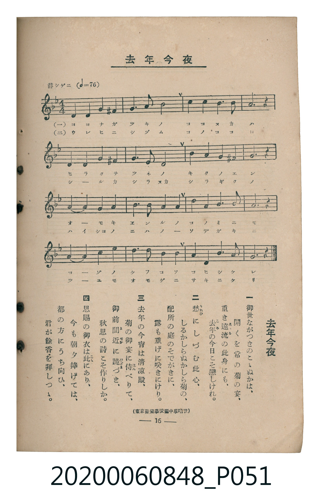

# 去年今夜

> Re:Shōka 使用 AI 協助辨識與重建樂譜，可能會有錯誤。歡迎回報。

- **鋼琴伴奏版**：<br><audio controls src="kyonen_konya.mp3"></audio>

- 出處：東京音樂學校編《中學唱歌》
- 臺灣教育會公認《新定兒童唱歌》高等科男子用（2020.006.0848）

## 說明

原書資訊與歌詞全文（對應 P051.jpg，書頁 p. 16，高一第二學期第 4 首）：
調性與拍號：ニ短調（1 降記號）、4/4 拍（淋シゲニ ♩=76）


## 歌詞

```text
一
御世（みよ）ながつきのこゝぬかは、
開（ひら）くを常（つね）の菊（きく）の宴（えん）、
重（おも）き遠流（ゑんる）の此身（このみ）にも、
去年（こぞ）の今日（けふ）こそ戀（こひ）しけれ。

二
愁（うれひ）にしづむ此心（このこころ）、
しるかしらぬかしら菊（ぎく）の、
配所（はいしょ）の庭（には）のそでがきに、
露（つゆ）も重（おも）げに咲（さ）きにけり。

三
去年（こぞ）の今宵（こよひ）は清涼殿（せいりゃうでん）、
菊（きく）の御宴（ぎょえん）に侍（はん）べりて、
御前（ごぜん）間近（まぢか）に跪（ひざま）づき、
秋思（しうし）の詩（し）こそ作（つく）りしか。

四
恩賜（おんし）の御衣（ぎょい）は此（ここ）にあり、
今（いま）も朝夕（あさゆふ）捧（ささ）げては、
都（みやこ）の方（かた）にうち向（むか）ひ、
君（きみ）が餘香（よかう）を拜（はい）しつゝ。
```

## ABC

<div class="abc-score" data-abc-src="kyonen_konya.abc" aria-label="五線譜載入中"></div>

[下載 ABC 原始檔](kyonen_konya.abc)

## TMD 檔案連結

- [主旋律 TMD 檔案](kyonen_konya.tmd) [[在 TMD Studio 編輯](https://tmdlang.github.io/Tmd-TS/#tmd=s7IKdvYPcrWy4qpTUCpJTLdSSM7PyUlNLsnMz7MqzsjMK0nNjM_KTMmPL87Iz05Ugisry88pzU21ys4vyY9Pyq8sjjcyMDKINzAwizewMLFAqCvOLy1KTrUqTs7Iz8-JL0mtKEnKz89GyBcU5Zel5iXmAdUUFIGsSwErQihILctMSQVJp6ZkluQXZSbmIDkitagY7FCwJfElRYl5xclFmQUg1yNUlWSkAl1akpmbGp-fFp-SWIkuVZyaWJyfV4wQBlqTnplnlZuamZWJ5GYtLYWnfbuf7tzyZHfX0yVzFLS0uBRtFczNuOxtFdy4slMrbRVccrlsTPRN7EBGPW3f9WLm1Pd7Zj2bu_HJrjUv529-tqLp6dodzxYsfL59xeOGric71gK5T6dsfLa253FDN9j-F-27njcufjZ15oumTc_mND9tXfNiVS9Q7bNpG56um_W0ddLz1UvhOl6unvF8befz5ROfT9n-dO2E51NWvN_TAYoIPWBE6IEi4v2eTiUuLn0tBVtqAS4FBWAozH82e8eLze0vVnS96GgHOubFynlPW1c8m9YOdMDTDb3P2jsVAgxMDfWyCtLf7-kBKn65oFGhQE_B0AzIBTr7yY6G52vWPNnVAwqPOfOBbAUThZfLpgHdCwwwkB0vVu1_1rAcZHp374uZ84Gij5u7n89fCxQH2mGo8HJm74sVM8AynY8bGoGBrgBUCZR6tr37cdP2x02bgOoVHs1caWsOtLOTC2Qm0Faw8_ctfLIDaFXH48b9j5s6QAY0rnrc2PO4ccnjxt7HjeseN05-3DT3ceOax43djxvXA40HaXs5rRusZ9PjJqAjgXr6HzdNerpjB1gQqHMtWHDdi_4usAjQoH6IyNN1W8AiHY-bJkNcCzauHeTax41dj5uawOp6XzYueLa1ESTYNBGo9HET0D6Q_mdrl7zYtRqseDLYdcAQAIqvBmqEmgVJljAV8yDagKn02fSlYMGJjxu3ggWBsnOfdTTAVG4CC04HKWgCJqgmSCjt6gFRz1rATmlsA0lBVa4GK176uKkB6Kan-5uR3AQkgS4GegnmP5DSJmDwARGQAdQMCU0QGxZEffAggoVJa--zTojr1j9ubAGrBiYpcCDuAoYvUBzohPVQPY3AKFoOjjdgWK-GGTEH6FRwhDS1gdQ1NWEE9CSg6qeTIMqA-RMU9GBzgYHQBQ-EHZ34AvbpOmB4ggWbQCkCLL7-2Y7WZ9v2PFsHSqCPG2eDPAA0sKkZFIZAhyJHPpZEsm8hLJ30AT2NSC2Nq5_sg3hgPUxkJ8jcxmWwyAfq7ISomPK4cQ5E0ctpk1_snwgW3Pe4cREw6CFmvdi-CpqIG6cBpcCCS0HugJj1fHn3s4a5YBXAiAY6ezo0Ua9cCRGEp6Ine-fAEj7YByAXAbV0wwLw6ezZ4FTUuPLFZohKYFAANUINBDr6xcLFSN5tgYbh2iWw0Ib6_nFjEzhewO4DBj1YGpg0wG5vano2Z-7TJcBYBAo2AaMTGOuQtP6sdzkkgmFxDIz1ZUiZuXkvrAAAmgWxat2zaTvBgsBkCi5WQJYDjVv4dAI4JJsaYMG4CRb0E2bDohGSJ3teLpnxctlMsGqIQZBEOOlZNyQQQMkalumASXQuKLiABlFeLkOBgpY-F5dvIrD2CshMzMt3qDGoqQZZoGBjoWUHZgArA1DRu6PhxcIeBQ0Thacb-p-vb9CBl9eaICNACmsUqnMLahXM4hV0FQyB2BzEMFUHkTUKRkBSV8EYLAGCNUA2iK8LlgGJQkRg0AAkAk4YMAfs6iHsAHx2G0IEIZabIFlupE6E7Ts6ifF-Wi3cW2YgB8DtAolBnAFzEAiD5EGyBCwHZg2qhD3EITDr4GrBqqFhh-qGWi4uXTsFUOpQANLKXAA)]
- [鋼琴伴奏 TMD 檔案](kyonen_konya_piano.tmd) [[在 TMD Studio 編輯](https://tmdlang.github.io/Tmd-TS/#tmd=s7IKdvYPcrWy4tLSUnjat_vpzi1Pdnc9XTLn_Z6Ol917nk_Y8mTPlqdL-593drzf06mgpcWlaKtgbsZlb6vgxpWdWmmr4JLLZWOib2LHVaeg9LR914uZU9_vmfVs7sYnu9a8nL_52Yqmp2t3PFuw8Pn2FY8bup7sWAvkPp2y8dnanscN3UogTS_adz1vXPxs6swXTZuezWl-2rrmxapeoNpn0zY8XTfraeuk56uXwnW8XD3j-drO58snPp-y_enaCc-nrAA61MjAyEDPwMBMz8DCxALoTCUuLt_EzDyrgMzEvPwgD4cag5pqLgUgsLHQsgMz9LUUnq9Z82RHw4uFPQpa-mCxGoXq3IJaBbN4BV0FQyA2BzFM1UFkjYIRkNRVMAZLgGANkA3i64JlQKIQERg0AIlwIdu1qwfFLnzWGEIEIfaYINljpE6ERTs60TyVVgt3rBnILrixIDGIjTC7QRgkD5IlYM_T2bNJDTyInTCT4WrBqqEhgmpdLXJE-iBHpAneiDSLB5kVbRwfC7EfzDOLz4VwjcFcI1QuSK0BoSjDYqp5fK65rilExCQeaos5UCVQJhav6WjxBFEIdyTEdLgjTSF2m0LtNsRlKnqsYHWzCZQHtBJiIYgBUgJXDxYFGQ2MAV07BVAkKCDRylwA)]

## 分析

```text
================================================================================
📊 TMD Song Profile: [ 去年今夜 ]
================================================================================
⏱  Duration:       0:50 (50.5s), 16 measures total
🎼 Key & Tempo:    首調基準 F, != 76.0 BPM, <4/4>
   - 分析範圍：      由實際發聲的音符與和弦推測調性；播放脈絡另行呈現
🎤 人聲音域:    C#4 (MIDI 61) – D5 (MIDI 74) [跨度: 13 個半音 / 1.1 個八度, 難度: moderate]
   - 最低音:  C#4 in [Main #1 @ m.1, 0:02]
   - 最高音: D5 in [Main #1 @ m.9, 0:26]
   - 適合: soprano, mezzo-soprano, contralto, tenor, baritone, bass
🏛  結構:      Main (50.5s)
⚡ 編曲密度:        Peak 1 軌道同時演奏
🗝  調性診斷：       D 小調（流行色彩小調，未偵測到可信轉調）
   - 風格氣質:    流行小調（略帶和弦色彩音與裝飾副屬和弦）
   - 轉調歷程:    全曲維持單一推測調性（未偵測到可信轉調）
   - 核心骨幹音:  A, G, D, F, E
   - 調性數值:    D 小調 [相關度: 0.69, 穩定度: Moderate, 自然音純度: 93.3%]
   - 候選調性 (K-S): D 小調 (0.69), A 小調 (0.59), F 大調 (0.52)
   - 五度圈歷程:   +2
   - 各段落調性細節:
     • [Main #1]: D 小調 (r: 0.69, 自然音純度: 93.3%, 調外音: C#, G#)

  [ 五度圈游移軌跡 ]
               C  
         F            G  
      Bb              [D ]*
      Eb               A  
         Ab           E  
            Db       B  
               F# 
     (* = active key center)

  [ 十二半音累積音高分佈 ]
     C  : ███                        3.3%
     C# : ████                       5.0%
     D  : ████████████              13.3%
     D# :                            0.0%
     E  : ████████                   9.2%
     F  : ████████████              13.3%
     F# :                            0.0%
     G  : ███████████████           17.5%
     G# : █                          1.7%
     A  : ████████████████████████  27.5%
     A# : ████████                   9.2%
     B  :                            0.0%
--------------------------------------------------------------------------------
Assignment 軌道音域：
  - Piano         : C#4 – D5 (13 個半音 / 1.1 個八度, 48 個音符)
================================================================================
```


## 原書掃描頁




