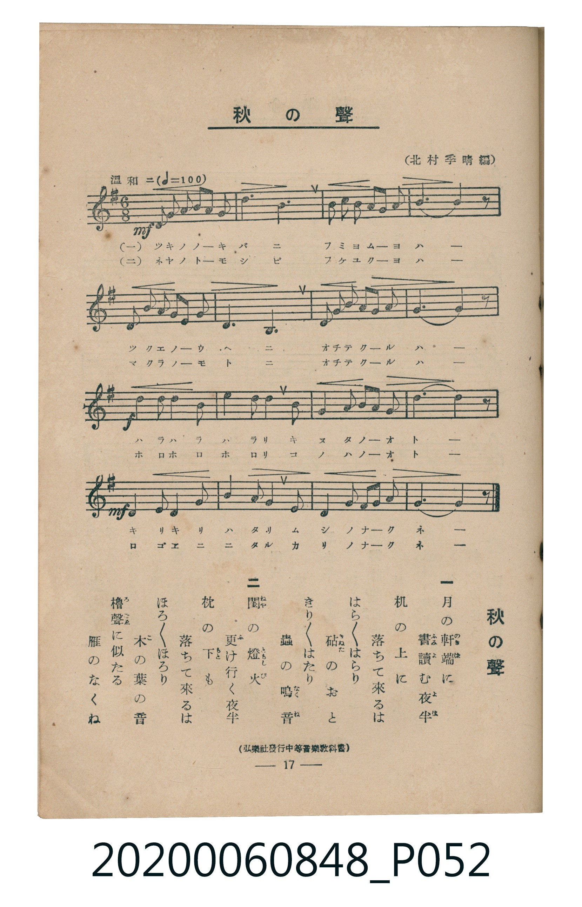

# 秋の聲

> Re:Shōka 使用 AI 協助辨識與重建樂譜，可能會有錯誤。歡迎回報。

- **鋼琴伴奏版**：<br><audio controls src="aki_no_koe.mp3"></audio>
- **NEUTRINO 歌聲合成版**：<br><audio controls src="aki_no_koe_neutrino.mp3"></audio>

- 編：北村季晴（弘樂社發行中等音樂教科書）
- 臺灣教育會公認《新定兒童唱歌》高等科男子用（2020.006.0848）

## 說明

原書資訊與歌詞全文（對應 P052.jpg，書頁 p. 17，高一第二學期第 5 首）：
調性與拍號：ト長調（1 升記號）、6/8 拍（溫和ニ ♪=100）
出處註記：（北村季晴編）（弘樂社發行中等音樂教科書）


## 歌詞

```text
一
月（つき）の軒端（のきば）に　書（ふみ）讀（よ）む夜半（よは）
机（つくゑ）の上（うへ）に　落（お）ちて來（く）るは
はら／＼はらり　砧（きぬた）のおと
きり／＼はたり　蟲（むし）の鳴音（なくね）

二
閨（ねや）の燈火（ともしび）　更（ふ）け行（ゆ）く夜半（よは）
枕（まくら）の下（もと）に　落（お）ちて來（く）るは
ほろ／＼ほろり　木（こ）の葉（は）の音（おと）
櫓聲（ろごゑ）に似（に）たる　雁（かり）のなくね
```

## ABC

<div class="abc-score" data-abc-src="aki_no_koe.abc" aria-label="五線譜載入中"></div>

[下載 ABC 原始檔](aki_no_koe.abc)

## TMD 檔案連結

- [主旋律 TMD 檔案](aki_no_koe.tmd) [[在 TMD Studio 編輯](https://tmdlang.github.io/Tmd-TS/#tmd=s7IKdvYPcrWy4qpTUCpJTLdSSM7PyUlNLsnMz7MqzsjMK0nNjM_KTMmPL87Iz05Ugisry88pzU21ys4vyY9Pyq8sjjcyMDKINzAwizewMLFAqCvOLy1KTrUqTs7Iz8-JL0mtKEnKz89Gl48vSExPtQowMDVCyBQU5Zel5iXmAXUXFIEckgLWjlCQWpaZkgqSLk5OzIsvSy3KTMtMTUFyYmpRMdgbECtKihLzipOLMgtAfkOoyi8qychPL0osyKi0ysgsLskvykxOzInPTsxD8m1JRirQs8WpicX5ecXIejPTM_OsShIzgaEDCqHyxPjcxMy8nMQ8oDu0tBSeL-9-3LjuReMmBS0tLkVbBUMDAy57WwV3LhszfQs7kDnPt694v2fW057pz-ZOfLp28bOZW97v6Xi6Z8azFU3Pl-x7PnPPi4U9T3asfb628-X8zUDBZ1NnPl8-8dnsHe_3dIId8qJ91_PGxUDhF02bns1pftq65sWq3scNXc-mbXi6btbT1knPVy99OmXjs7U9jxu6X66eATQJaMDzKdufrp3wfArQ8g5QzOkBY04PFHNgY7n0tRRsqQW4FBQUnvbNBzr5xeb2Fyu6XnS0Ax3zYuW8p60rnk1rB3l3Q--z9k4FUPTrZRWkv9_TA1T8ckGjQoGegqE5kAt09pMdDc_XrHmyq-fp2h3P5swHshVMFV4umwZ0LzD8QHa8WLX_WcNykOndvS9mzgeKPm7ueDl1O1AcaIehwtNeoO0zwDKdjxsagRGgAFQJlHq2a_XTST2Pm7sVHs1cZQuMIqACsKPbd72YOfXFit1AbUDTQA5FiiZwxAHtJjayuEBGAn0Bop7N6QBqfNy45HEj0AGdoCSyGxhP68GC64CCjxs3gMVXP25oAGsHim993Aj0SOeLdQ0gbhPQhM7HTQ1Pl8x52tsFEXncCDQB7PRnc3bBLOh_3DQRYseTHWB1jW2PG0EOgpj-YsJesCBQCiiy8HHjsif72sAi_WALgOl3PchEIPW4CehdoOgeCPtxUxdQ__MFy8GqgU5e87gRHLYgH3Q9blwB0dYLVIfQ1jgfou3F_E1gNzc8bpwO0fNy8xZgoIHNWgVydeNaeKDt6gFRL6eBEitQ_HFTC0TL8_aO542rwYIrHjc1AY163Ag0ARi7wEAD5SNgoIFVTgTGC9g6oM-A3H4cgTZvKljPPnCgAf0KCbRusDqg6aD4JjXQdj9uAsYwxPcgNsT3z-ZAvDIZGvkTQekI4hBQSECDARSGMKetngwsRMAOAQb0FFiUrn6yZw9YKTAQgFxg2HYDTX85uxEs2A0OeUh8QIMUZBblORoKFLT0ubgcszP98r3zgYV3ZmJevkONQU01yBIFGwstOzADW1GiAMrKOxqAsaKgYaLwdEP_8_UNOvD8r4lFA9AqkGE1CtW5abUKpvEKZvEKhgpGQAxk1ACLAl0gNAaTNUDaFIhBkkZgHkgUBA0UasCm-BjWKDxublF43LQWSPeBsS6YBxKfAFYLKg4gpj1ungrE84F4BRAvAMutAIv3w00GugFishFIvBeIl0BN7gCrXwRS37QdavJkZJObNgLpZUB6PU6T8Yfjrh5ywhEYhJAgAgckmA8OQggF5hsiBaIhnkBcD8SgoIEE4jKwB2agB2LTKiCvEYjb4F5djTcQ50FMbl4JMxkSiOAAJcdkAomxk6zECEqLQPNNwaQxUMQMhQcKNSNoKMISKWYYgtwJ8SeMhSq6Cilx9oDZ--GhvQopTDDDcDbYDFAih7FQRSEmbwaLQsK4H6_JeMPw6ezZlGRoXVBKBNOgsAJlWlCogUWhqdNQwRyS6XEmR2AggTwBTBBwFjwowYEG9jAwD8NyIySPdoHl14PV9uIISrB5TVvASR2S_ECioEQIMXk1mAVJeBBb8Jtcy8Wla6cAKz0VgGxlLgA)]
- [鋼琴伴奏 TMD 檔案](aki_no_koe_piano.tmd) [[在 TMD Studio 編輯](https://tmdlang.github.io/Tmd-TS/#tmd=s7IKdvYPcrWy4qpTUCpJTLdSSM7PyUlNLsnMz7MqzsjMK0nNjM_KTMmPL87Iz05Ugisry88pzU21ys4vyY9Pyq8sjjcyMDKINzAwizewMLFAqCvOLy1KTrUqTs7Iz8-JL0mtKEnKz89Gl48vSExPtQowMDVCyBQU5Zel5iXmAXUXFIEckgLWjlCQWpaZkgqSLk5OzIsvSy3KTMtMTUFyYmpRMdgbECtKihLzipOLMgtAfkOoyi8qychPL0osyKi0ysgsLskvykxOzInPTsxD8m1iEVBzempual6JVUFmYl5-fGJycn5uQWJeJkgMobAkA6jIqjg1sTg_rxjZksz0zDyrksRMYDCCgrI8MT43MTMvJzEP6GAtLYXny7sfN6570bjp_Z6Ol917nk_Y8mTPlqdL-593drzf06mgpcWlaKtgaGDAZW-r4M5lY6ZvYQcy_Pn2Fe_3zHraM_3Z3IlP1y5-NnMLUP_TPTOerWh6vmTf85l7XizsebJj7fO1nS_nbwYKPps68_nyic9m7wAaCnbdi_ZdzxsXA4VfNG16Nqf5aeuaF6t6Hzd0PZu24em6WU9bJz1fvfTplI3P1vY8buh-uXoG0CSgAc-nbH-6dsLzKUDLO0DxrgeMdz1QvION5XLMzvTL984HRigoqII8HGoMaqq5FIDAxkLLDszQ11KwRQcKz9esebKjAehkBQ0Thacb-p-vb9BRACUKvayCdE0sGrT0wYbVKFTnptUqmMYrmMUrGCoYATGQUaNgqqALhMZgsgZImwIxSNIIzAOJgqCBQg3YFB_DGoXHzS0Kj5vWAuk-MNYF80DiE8BqHzd3Q0173DwViOcD8QogXgCWWwEW74ebDHQDxGQjkHgvEC-BmtwBVr8IpL5pO9TkycgmN20E0suA9HqcJuMPx1095IQjMAghQQQOSDAfHIQQCsw3RApEQzyBuB6IQUEDCcRlYA_MQA_EplVAXiMQt8G9uhpvIM6DmNy8EmYyJBDBAUqOyQQSYydZiRGUFoHmm4JJY6CIGQoPFGpG0FCEJVLMMAS5E-JPGAtVdBVS4uwBs_fDQ3sVUphghuFssBmgRA5joYpCTN4MFoWEcT9ek_GG4dPZsynJ0LqglAimQWEFyrSgUAOLQlOnoYI5JNPjTI7AQAJ5Apgg4Cx4UIIDDexhYB6G5UZIHu0Cy68Hq-3FEZRg85q2gJM6JPmBREGJEGLyajALkvAgtuA3uRa98PTBUXgiikp4kBlCMmm0YXwsmIFPxDQ-PhcmZhwPFQQywIKgwEO2B1KUYNhjhmQG0DxUM1AEgQzsTkK3CZLf8PjIBGYkPk-i24tmCzRFEhFuWH2I1zPA-NO1U4BFYbSPIVACmW8E5itzAQA)]

## 分析

```text
================================================================================
📊 TMD Song Profile: [ 秋の聲 ]
================================================================================
⏱  Duration:       0:28 (28.8s), 16 measures total
🎼 Key & Tempo:    首調基準 G, != 100.0 BPM, <6/8>
   - 分析範圍：      由實際發聲的音符與和弦推測調性；播放脈絡另行呈現
🎤 人聲音域:    B3 (MIDI 59) – E5 (MIDI 76) [跨度: 17 個半音 / 1.4 個八度, 難度: challenging]
   - 最低音:  B3 in [AkiNoKoe #1 @ m.6, 0:09]
   - 最高音: E5 in [AkiNoKoe #1 @ m.10, 0:16]
   - 適合: soprano, mezzo-soprano, contralto, tenor, baritone, bass
🏛  結構:      AkiNoKoe (28.8s)
⚡ 編曲密度:        Peak 1 軌道同時演奏
🗝  調性診斷：       G 大調（純淨自然大調，未偵測到可信轉調）
   - 風格氣質:    純淨自然大調（陽光明朗、易唱易記，無明顯調外色彩）
   - 轉調歷程:    全曲維持單一推測調性（未偵測到可信轉調）
   - 核心骨幹音:  D, G, B, A, E
   - 調性數值:    G 大調 [相關度: 0.88, 穩定度: High, 自然音純度: 100.0%]
   - 候選調性 (K-S): G 大調 (0.88), D 大調 (0.76), B 小調 (0.72)
   - 五度圈歷程:   +1
   - 各段落調性細節:
     • [AkiNoKoe #1]: G 大調 (r: 0.88, 自然音純度: 100.0%)

  [ 五度圈游移軌跡 ]
               C  
         F           [G ]*
      Bb               D  
      Eb               A  
         Ab           E  
            Db       B  
               F# 
     (* = active key center)

  [ 十二半音累積音高分佈 ]
     C  :                            0.0%
     C# :                            0.0%
     D  : ████████████████████████  31.5%
     D# :                            0.0%
     E  : ██████                     7.6%
     F  :                            0.0%
     F# : █                          1.1%
     G  : █████████████████████     27.2%
     G# :                            0.0%
     A  : ████████                  10.9%
     A# :                            0.0%
     B  : █████████████████         21.7%
--------------------------------------------------------------------------------
Assignment 軌道音域：
  - Piano         : B3 – E5 (17 個半音 / 1.4 個八度, 58 個音符)
================================================================================
```


## 原書掃描頁




