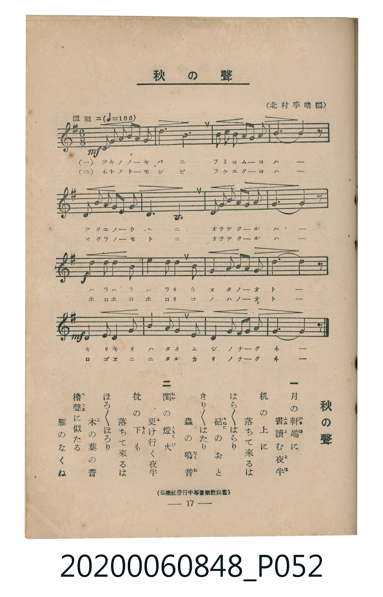

# 秋の聲

> Re:Shoka 使用 AI 協助辨識與重建樂譜，可能會有錯誤。歡迎回報。

<audio controls src="aki_no_koe.mp3"></audio>

- 編：北村季晴（弘樂社發行中等音樂教科書）
- 臺灣教育會公認《新定兒童唱歌》高等科男子用（2020.006.0848）

## 說明

原書資訊與歌詞全文（對應 P052.jpg，書頁 p. 17，高一第二學期第 5 首）：
調性與拍號：ホ短調（1 升記號）、6/8 拍（溫和ニ ♩=100）

## 跨冊／重複收錄參照

> 同曲（《新定兒童唱歌》高等科男、女共用教材）

- **[同曲]** 《新定兒童唱歌》高等科女子用（2020.006.0849）：[**〈秋の聲〉**](../../koto_girls_2020.006.0849/1_2_04_aki_no_koe/index.md)（`G` / `6/8` — [原始 TMD](../../koto_girls_2020.006.0849/1_2_04_aki_no_koe/aki_no_koe.tmd)）
- 總表：[跨冊重複與同名歌曲總索引](../../../duplicate_songs.md)

## 歌詞

```text
一
月（つき）の軒端（のきば）に　書（ふみ）讀（よ）む夜半（よは）
机（つくゑ）の上（うへ）に　落（お）ちて來（く）るは
はら／＼はらり　砧（きぬた）のおと
きり／＼はたり　蟲（むし）の鳴音（なくね）

二
閨（ねや）の燈火（ともしび）　更（ふ）け行（ゆ）く夜半（よは）
枕（まくら）の下（もと）に　落（お）ちて來（く）るは
ほろ／＼ほろり　木（こ）の葉（は）の音（おと）
櫓聲（ろごゑ）に似（に）たる　雁（かり）のなくね
```

## ABC

```abc
X:1
T:秋の聲
M:6/8
L:1/16
Q:3/8=67
K:Em
V:V1 name="Piano" snm="Pia"
[V:V1]
!mf! E2 G2 B2 B4 B2 | c6 B6 | A2 G2 A2 B4 c2 | B10 z2 |
E2 G2 B2 B4 E2 | F6 B,6 | E2 F2 G2 A4 G2 | F10 z2 |
!f! B2 A2 B2 c4 B2 | e6 d4 B2 | A2 G2 A2 B4 e2 | B10 z2 |
!mf! E2 F2 G2 A4 B2 | c6 B4 E2 | B2 A2 G2 F4 G2 | E10 z2 |
!mf! E2 G2 B2 B4 B2 | c6 B6 | A2 G2 A2 B4 c2 | B10 z2 |
E2 G2 B2 B4 E2 | F6 B,6 | E2 F2 G2 A4 G2 | F10 z2 |
!f! B2 A2 B2 c4 B2 | e6 d4 B2 | A2 G2 A2 B4 e2 | B10 z2 |
!mf! E2 F2 G2 A4 B2 | c6 B4 E2 | B2 A2 G2 F4 G2 | E10 z2 |
```

## TMD 檔案連結

- [主旋律 TMD 檔案](aki_no_koe.tmd) [[在 TMD Studio 編輯](https://tmdlang.github.io/Tmd-TS/#tmd=s7IKdvYPcrWy4qpTUCpJTLdSSM7PyUlNLsnMz7MqzsjMK0nNjM_KTMmPL87Iz05Ugisry88pzU21ys4vyY9Pyq8sjjcyMDKINzAwizewMLFAqCvOLy1KTrUqTs7Iz8-JL0mtKEnKz89GyBcU5Zel5iXmAdUUFIGsSwErQihILctMSQVJp6ZkluQXZSbmIDkitagY7FCwJfElRYl5xclFmQUg1yNUlWSkAl1anJpYnJ9XjFNYS0vh-fLux43rXjRuUtDS4lK0VTA0MOCyt1Vw58pOrbRVcM3lsjHTt7ADGfB8-4r3e2Y97Zn-bO7Ep2sXP5u55f2ejqd7Zjxb0fR8yb7nM_e8WNjzZMfa52s7X87fDBR8NnXm8-UTn83e8X5PJ9gFL9p3PW9cDBR-0bTp2Zzmp61rXqzqfdzQ9WzahqfrZj1tnfR89dKnUzY-W9vzuKH75eoZQJOABjyfsv3p2gnPpwAt7wCFtx4wvPVA4Q02lktfS8GWWoBLQUHhad98oJNfbG5_saLrRUc70DEvVs572rri2bR2kHc39D5r71QIMDA10ssqSH-_pweo-OWCRoUCPQVDcyAX6OwnOxqer1nzZFfP07U7ns2ZD2QrmCq8XDYN6F5g-IHseLFq_7OG5SDTu3tfzJwPFH3cPPv5_LVAcaAdhgpPe4G2zwDLdD5uaARGgAJQJVDq2a7VTyf1PG7uVng0c6UtMKqACrhAJgLtBFHP5nQAVT1uXPK4Eai8ExSxu4Ghuh4suA4o-LhxA1h89eOGBnDMAMW3Pm4EWtv5Yl0DiNsENKHzcVPD0yVznvZ2QUQeNwJN6IRYsAtmQf_jpokQO57sAKtrbHvcCIpriOkvJuwFCwKlgCILHzcue7KvDSzSD7YAmOrWg0wEUo-bgAEDFN0DYT9u6gLqf75gOVg10MlrHjeCQwLkg67HjSsg2nqB6hDaGudDtL2Yvwns5obHjdMhel5u3gJMj2CzVoFc3bgWHmi7ekDUy2mgpAUUf9zUAtHyvL3jeeNqsOCKx01NQKMeNwJNAMYFMNBAqR4YaGCVE4FJHmwd0GdAbj-OQJs3FaxnHzjQgH6FBFo3WB3QdKD1JAfa7sdNwBiG-B7Ehvj-2RyIVyZDI38i0DKoQ0AhAQ0GUBjCnLZ6MjDrgx0CDOgpsChd_WTPHrBSYCAAucCw7Qaa_nJ2I1iwGxzykPiABinILMrzHxQoaOlzcfkmZuZZBWQm5uU71BjUKFSDbFCwsdCyAzOAuR6Ux3Y0ACNAQcNE4emG_ufrG3TgGVMTZAZIIVBnblqtglm8gqGCMRDqAnGNggmQBrFAZI2CEVDOCMwzAfIgoiBooFADTicw23b1ELYNySIgs0bBPB5iFYQCywOFQPbpAkm4PDbrdnQS4Tmg34zBjgd5CeQ1M7BZplAewmtm-Lz2dPZs4gMS7n7UkAR7F-QWQ4inQL4DiiHbWMvFpWunAIpZBSRamYsLAA)]
- [鋼琴伴奏 TMD 檔案](aki_no_koe_piano.tmd) [[在 TMD Studio 編輯](https://tmdlang.github.io/Tmd-TS/#tmd=s7IKdvYPcrWy4tLSUni-vPtx47oXjZve7-l42b3n-YQtT_Zsebq0_3lnx_s9nQpaWlyKtgqGBgZc9rYK7lzZqZW2Cq65XDZm-hZ2XHUKSs-3r3i_Z9bTnunP5k58unbxs5lbgOY83TPj2Yqm50v2PZ-558XCnic71j5f2_ly_mag4LOpM58vn_hs9g6g4UogA16073reuBgo_KJp07M5zU9b17xY1fu4oevZtA1P18162jrp-eqlT6dsfLa253FD98vVM4AmAQ14PmX707UTnk8BWt5hZGBkoGdgYKZnYGFiATaWyzcxM88qIDMxLz_Iw6HGoEahmksBCGwstOzADH2gv9esebKjAeg6BS19sBhQUW5arYJZvIKhgjEQ6gJxjYIJkAaxQGSNghFQzgjMMwHyIKIgaKBQw4Vs8K4eFIORzAQyaxTM4yGmQiiwPFAIZLQukITLYzN5Ryeqk4EuNgY7CeRQkIPNwNpMoTyEg83wOfjp7NlYQwLuKtSgAHsCZK0hxKkgNwPFkA2vRY4EHxIiwSweYlC0WXxuLDR8TDCFjDCFoMEZbRwPEiEYJYQMgEQMVMiIWGvQ4gefbwxhAqYE3UIgurA5E0uY4fEfVBU05nTtFECRp4BEK3NxAQA)]

## 分析

```text
================================================================================
📊 TMD Song Profile: [ 秋の聲 ]
================================================================================
⏱  Duration:       0:57 (57.6s), 32 measures total
🎼 Key & Tempo:    首調基準 G, != 100.0 BPM, <6/8>
   - 分析範圍：      由實際發聲的音符與和弦推測調性；播放脈絡另行呈現
🎤 人聲音域:    B3 (MIDI 59) – E5 (MIDI 76) [跨度: 17 個半音 / 1.4 個八度, 難度: challenging]
   - 最低音:  B3 in [Main #1 @ m.6, 0:09]
   - 最高音: E5 in [Main #1 @ m.10, 0:16]
   - 適合: soprano, mezzo-soprano, contralto, tenor, baritone, bass
🏛  結構:      Main (28.8s) -> Main (28.8s)
⚡ 編曲密度:        Peak 1 軌道同時演奏
🗝  調性診斷：       B 小調（流行色彩小調，未偵測到可信轉調）
   - 風格氣質:    流行小調（略帶和弦色彩音與裝飾副屬和弦）
   - 轉調歷程:    全曲維持單一推測調性（未偵測到可信轉調）
   - 核心骨幹音:  B, E, F#, A, C
   - 調性數值:    B 小調 [相關度: 0.69, 穩定度: Moderate, 自然音純度: 90.2%]
   - 候選調性 (K-S): B 小調 (0.69), E 小調 (0.65), B 大調 (0.64)
   - 五度圈歷程:   +5 -> +5
   - 各段落調性細節:
     • [Main #1]: B 小調 (r: 0.69, 自然音純度: 90.2%, 調外音: C)
     • [Main #2]: B 小調 (r: 0.69, 自然音純度: 90.2%, 調外音: C)

  [ 五度圈游移軌跡 ]
               C  
         F            G  
      Bb               D  
      Eb               A  
         Ab           E  
            Db      [B ]*
               F# 
     (* = active key center)

  [ 十二半音累積音高分佈 ]
     C  : ██████                     9.8%
     C# :                            0.0%
     D  : █                          2.2%
     D# :                            0.0%
     E  : ██████████                16.3%
     F  :                            0.0%
     F# : ████████                  13.0%
     G  : ██████                     9.8%
     G# :                            0.0%
     A  : ███████                   10.9%
     A# :                            0.0%
     B  : ████████████████████████  38.0%
--------------------------------------------------------------------------------
Assignment 軌道音域：
  - Piano         : B3 – E5 (17 個半音 / 1.4 個八度, 108 個音符)
================================================================================
```


## 原書掃描頁




