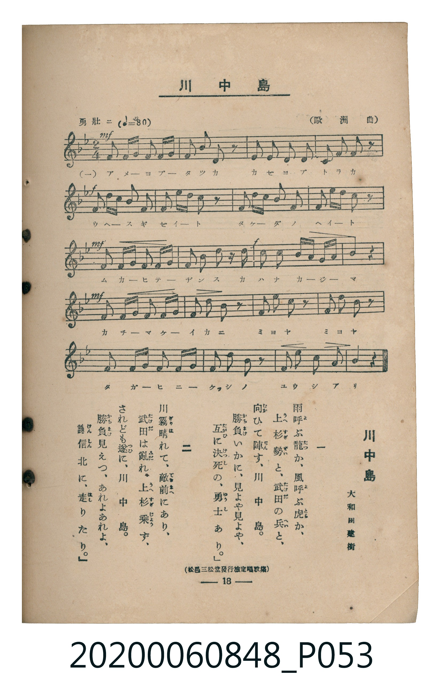

# 川中島

> Re:Shōka 使用 AI 協助辨識與重建樂譜，可能會有錯誤。歡迎回報。

- **鋼琴伴奏版**：<br><audio controls src="kawanakajima.mp3"></audio>

- 詞：大和田建樹（松邑三松堂發行檢定唱歌集）
- 曲：歐洲曲
- 臺灣教育會公認《新定兒童唱歌》高等科男子用（2020.006.0848）

## 說明

原書資訊與歌詞全文（對應 P053.jpg，書頁 p. 18，高一第二學期第 6 首）：
調性與拍號：變ロ長調（2 降記號）、2/4 拍（勇壯ニ ♩=80）


## 歌詞

```text
一
雨（あめ）呼（よ）ぶ龍（たつ）か、風（かぜ）呼（よ）ぶ虎（とら）か、
上杉勢（うへすぎぜい）と、武田（たけだ）の兵（へい）と、
向（むか）ひて陣（ぢん）す、川中島（かはなかじま）。
勝負（かちまけ）いかに、見（み）よや見（み）よや、
互（たがひ）に決死（けっし）の、勇士（ゆうし）あり。」

二
川霧（かはぎり）晴（は）れて、敵前（てきまへ）にあり、
武田（たけだ）は亂（みだ）れ、上杉（うへすぎ）乘（じょう）ず、
されども遂（つひ）に、川中島（かはなかじま）。
勝負（かちまけ）見（み）えつ、あれよあれよ、
謙信（けんしん）北（きた）に、走（はし）りたり。」
```

## ABC

<div class="abc-score" data-abc-src="kawanakajima.abc" aria-label="五線譜載入中"></div>

[下載 ABC 原始檔](kawanakajima.abc)

## TMD 檔案連結

- [主旋律 TMD 檔案](kawanakajima.tmd) [[在 TMD Studio 編輯](https://tmdlang.github.io/Tmd-TS/#tmd=s7IKdvYPcrWy4qpTUCpJTLdSSM7PyUlNLsnMz7MqzsjMK0nNjM_KTMmPL87Iz05Ugisry88pzU21ys4vyY9Pyq8sjjcyMDKINzAwizewMLFAqCvOLy1KTrUqTs7Iz8-JL0mtKEnKz89Gl48vSExPtQowMDVGyBQU5Zel5iXmAXUXFIEckgLWjlCQWpaZkgqSLk5OzIsvSy3KTMtMTUFyYmpRMdgbECtKihLzipOLMgtAfkOoyi8qychPL0osyKi0ysgsLskvykxOzInPTsxD8m1JRirQs7mZOZkliUWV6OIQbUjCQDPSM_OsclMzszKx-BkqXZ5aXJJalBefm5qTnwLUraWl8HT73Cc71j7dvE1BS4tL0VbBwoDL3lbBKYnLxkjfxA5kwIuV897vmfV0yfKnk3qeT9nwdPeuZyt2vt_T8WzuvpdNE5_s6AQyni5oej5zz4uFPc9WLXq6btbTKRufre15Obvt_Z5OsCOezd4ENOPZ2gnPtmwCssFiL9p3PW9c_GzqzBdNm57NaX7auubFqt7HDV3Ppm0AGdE66fnqpRCDHjd0v1w94_nazufLJz6fsv3p2gnPp6wAugCUAPSACUAPlADAVnHpaynYUgtwKSgoPO2b_2z2jheb21-s6HrR0Q50DDA4nraueDatHeiApxt6n7V3KoBSkV5WQfr7PT1AxS8XNCoU6CkYAl3UA3T2kx0Nz9esebKr5-naHc_mzAeyFcwUXi6bBnQvMEhAdrxYtf9Zw3KQ6d29L2bOB4q-WNf1uHnty6nbgVIgfyq8nNn7YsUMsGTn44ZGYNQoABWDXNDd_nTx-sfN3QqPZq60tTAAynOBzATaCqJezgaF0-PGpsdNjUCppxP3gLhNHSBjGre93Acy4nHj_MeNS8Ai3UCzXy6CaOl-3DgHU8uLmX1g2RWPm4DOh2qBWNj1bG7n0-5FYOm2x407HjfOfNzYBzTlcWMLWOkKoNJna5cB0xDM1omPGxeApdY9bd0KFgTqQigGR8CEiWD7G4BWgSU2PW5c9nLmYrDqRY-bJoMFZwJVw1MyzPnrHzeuAjNmPG7cBw64JrCJ3XNfbAJaC1G0ECgHdAjYlBawyGqgWS-WAS0DKgCGfifQ74-bWjBFYB7fNQnmnR6g68AGrX62cdeztbvB4kA_Ln7cOB3iTZAzQTG2GuwnYCgBEUQKGENdQAc-buiFxN-uHrBbt899OWc5kof6gMqA6p_N3AIWXA92DdDeZaCwnbr1aSckRpc9buwFe2wHxD0w88EuxhEH65_saoJ4ESoCNLehERKvaJEKlH2ycwZYcMbjpnagFNiEWVALHjdOBTtq5eOmppeNEEOXwMOGClGFEhmNYNMbGsF-7AHFDZwBcc6LNTOf7F8IjYymycAQhySbpz3AoAcKAkMKnK8gMb8VEjJAF4EjBhhqwFCCxw3QOMoLFihQ0NLn4vJOLAeW-9mJWZm5iVYBmYl5-Q41BjXVIIsUbAzNtOzALGzFmgKoWNnRACx0FTRMFJ5u6H--vkEHXhZpYtEAtA9kWI1CdW5arYJpvIIuiDCLR2bWQDiGQGwMYhgAcY2CCYgJJsCCYKJGwQiqDUqAlYJt8DGsUXjctAjIf9y8EIj3APEKMG8amAeS3Q_mt4DIptVAEmIkhP24aQ9YFqYHLNPcAeatRNUBsc8IrrO5H2Jf0zowbxXMPqA4iL8GTLYh7AOzHzetBYvPA5MzoDLdYBmIL1bB7cMfH7t6yIoPWHQYKxiBgx7MgUaFCVgUFhPEKUOKhWVQP0FCZSfYT6CwAcmBQ7lpCTSGQOELiwVw7DRthMo0gM3og4YLKHyw6EKKCWy6QeEP0j0fzGuAyoHiA2YnPpfueNy8HCywDCq9i8gI2dFJwwwCDm5Q5BmDcgOQB8KGUA1gtSBlIAiKFRBEipnmBWAPrYaGxCRoyoSl1yYwfzNYDSgs4sFqESm5C1l30w64PlAaBkGQI5FsBMfLVrDONVAbO8G8RXCd4LwIdQco7ZNvI94oeTp7Nm2iBBQdoPBGyigm0DhByTtIqpDyCaT0aISGDbgkgKZgkOwSqN8RYYOcmiHlFEgNXnGMsgqHbRDdTRDdoFiB5RBIWQQpw0CyeMUJlVRTyIkFciPAHOJUPNkBWmjAEicsGcIiYOPj5mawgu1gCVBZBAtrcLkBKT0gsuDwAMmASm1ceWEj2JzN0NQMMRXCA8mC6wNoHYUc3-CcAFUNMh2iBrtdtVxcunYKyBW8ApCvzAUA)]
- [鋼琴伴奏 TMD 檔案](kawanakajima_piano.tmd) [[在 TMD Studio 編輯](https://tmdlang.github.io/Tmd-TS/#tmd=s7IKdvYPcrWy4qpTUCpJTLdSSM7PyUlNLsnMz7MqzsjMK0nNjM_KTMmPL87Iz05Ugisry88pzU21ys4vyY9Pyq8sjjcyMDKINzAwizewMLFAqCvOLy1KTrUqTs7Iz8-JL0mtKEnKz89Gl48vSExPtQowMDVGyBQU5Zel5iXmAXUXFIEckgLWjlCQWpaZkgqSLk5OzIsvSy3KTMtMTUFyYmpRMdgbECtKihLzipOLMgtAfkOoyi8qychPL0osyKi0ysgsLskvykxOzInPTsxD8m1iEVBzempual6JVUFmYl5-fGJycn5uQWJeJkgMobAkA6jIKjczJ7MksagSXRxiPpIw0LL0zDyr3NTMrEwsgQOVLk8tLkktyovPTc3JTwHq1tJSeLp97pMda59u3vZ-T8fL7j3PJ2x5smfL06X9zzs73u_pVNDS4lK0VbAw4LK3VXBK4rIx0jexA5n6YuW893tmPV2y_OmknudTNjzdvevZip1AI57N3feyaeKTHZ1AxtMFTc9n7nmxsOfZqkVP1816OmXjs7U9L2e3Ac0Fu-zZ7E1AM56tnfBsyyYgGyz2on3X88bFz6bOfNG06dmc5qeta16s6n3c0PVs2gaQEa2Tnq9eCjHocUP3y9Uznq_tfL584vMp25-unfB8ygqgC0DJRw-YfPRAyQdsFZd3YjkwErITszJzE60CQKEe5OFQY1BTzaUABDaGZlp2YJa-lsLzNWue7GgAullBSx8sVqNQnZtWq2Aar6ALIszikZk1EI4hEBuDGAZAXKNgAmKCCbAgmKhRMIJqgxJgpWAbfAxrFB43LQLyHzcvBOI9QLwCzJsG5oFk94P5LSCyaTWQhBgJYT9u2gOWhekByzR3gHkrUXVA7DOC62zuh9jXtA7MWwWzDygO4q8Bk20I-8Dsx01rweLzwOQMqEw3WAbii1Vw-5CDdVcParDCQtVYwQgcgmAONERNwKKwACVOGVJgLoM6DeK5nWCngbwIkgMHVtMSaECDggkWmOBAbtoIlWkAm9EH9R7Im1h0IQUoNt2gYATpng_mNUDlQMEKsxOfS3c8bl4OFlgGld6FNVx3dJKTXMGhBooDY1DaBPJA2BCqAawWpAwEQYELgkgB3LwA7K7VUA9NgqYTWOppAvM3g9WAvBQPVotIV13Iupt2wPWBUhQIghyJZCM4eLeCda6B2tgJ5i2C6wTnDKg7QCmRfBuRQvbp7NkkhiwoVEHBhpRsTaBBi5KSkVQhpVpIlmyEehGcvaDpCSS7BOoFhBeR0xYk84PU4BXHKABw2AbR3QTRDQpcWHqFZHBIwQCSxSuOmv2noAQmueFoDrERT-KE5kRYUoElClg4bnzc3AxWsB0sAcrgsCADZ0ZIloTIgr0FkgGVaLhS5kawOZuhaQtiKoQHkgWXldDyGznawOkSqhpkOkQNdrtqsVVhPshVmAneGswwXiHaMBaZAaydIAzTeCDLNB7IxFdWw_UhlGMTw1csYboB1SwD_HmPkHawGL70Roz9wHDWtVNADupoH6BSDDEjsJgyFwA)]

## 分析

```text
================================================================================
📊 TMD Song Profile: [ 川中島 ]
================================================================================
⏱  Duration:       0:30 (30.0s), 20 measures total
🎼 Key & Tempo:    首調基準 B,, != 80.0 BPM, <2/4>
   - 分析範圍：      由實際發聲的音符與和弦推測調性；播放脈絡另行呈現
🎤 人聲音域:    C4 (MIDI 60) – D#5 (MIDI 75) [跨度: 15 個半音 / 1.2 個八度, 難度: moderate]
   - 最低音:  C4 in [Kawanakajima #1 @ m.4, 0:04]
   - 最高音: D#5 in [Kawanakajima #1 @ m.6, 0:07]
   - 適合: soprano, mezzo-soprano, contralto, tenor, baritone, bass
🏛  結構:      Kawanakajima (30.0s)
⚡ 編曲密度:        Peak 1 軌道同時演奏
🗝  調性診斷：       F 大調（流行色彩大調，未偵測到可信轉調）
   - 風格氣質:    流行大調（略帶和弦色彩音與裝飾副屬和弦）
   - 轉調歷程:    全曲維持單一推測調性（未偵測到可信轉調）
   - 核心骨幹音:  F, A#, D, C, D#
   - 調性數值:    F 大調 [相關度: 0.82, 穩定度: Moderate, 自然音純度: 92.6%]
   - 候選調性 (K-S): F 大調 (0.82), A# 大調 (0.78), D 小調 (0.62)
   - 五度圈歷程:   -1
   - 各段落調性細節:
     • [Kawanakajima #1]: F 大調 (r: 0.82, 自然音純度: 92.6%, 調外音: D#)

  [ 五度圈游移軌跡 ]
               C  
        [F ]*          G  
      Bb               D  
      Eb               A  
         Ab           E  
            Db       B  
               F# 
     (* = active key center)

  [ 十二半音累積音高分佈 ]
     C  : ███████                   11.9%
     C# :                            0.0%
     D  : ████████                  14.1%
     D# : ████                       7.4%
     E  :                            0.0%
     F  : ████████████████████████  40.7%
     F# :                            0.0%
     G  : ████                       7.4%
     G# :                            0.0%
     A  : █                          1.5%
     A# : ██████████                17.0%
     B  :                            0.0%
--------------------------------------------------------------------------------
Assignment 軌道音域：
  - Piano         : C4 – D#5 (15 個半音 / 1.2 個八度, 80 個音符)
================================================================================
```


## 原書掃描頁




