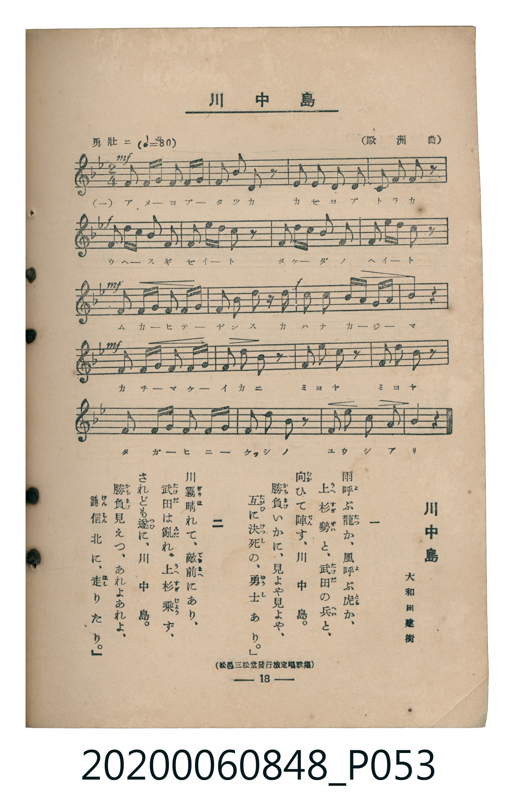

# 川中島

<audio controls src="kawanakajima.mp3"></audio>

- 詞：大和田建樹（松邑三松堂發行檢定唱歌集）
- 曲：歐洲曲
- 臺灣教育會公認《新定兒童唱歌》高等科男子用（2020.006.0848）

## 說明

原書資訊與歌詞全文（對應 P053.jpg，書頁 p. 18，高一第二學期第 6 首）：
調性與拍號：ヘ長調（1 降記號）、2/4 拍（勇壯ニ ♩=80，弱起後半拍進入）

## 歌詞

```text
一
雨（あめ）呼（よ）ぶ龍（たつ）か、風（かぜ）呼（よ）ぶ虎（とら）か、
上杉勢（うへすぎぜい）と、武田（たけだ）の兵（へい）と、
向（むか）ひて陣（ぢん）す、川中島（かはなかじま）。
勝負（かちまけ）いかに、見（み）よや見（み）よや、
互（たがひ）に決死（けっし）の、勇士（ゆうし）あり。」

二
川霧（かはぎり）晴（は）れて、敵前（てきぜん）にあり、
武田（たけだ）は亂（みだ）れ、上杉（うへすぎ）乘（じょう）ず、
されども遂（つひ）に、川中島（かはなかじま）。
勝負（かちまけ）見（み）えつ、あれよあれよ、
謙信（けんしん）北（きた）に、走（はし）りたり。」
```

## ABC

```abc
X:1
T:川中島
C:曲：歐洲曲
M:2/4
L:1/16
Q:1/4=80
K:F
V:V1 name="Piano" snm="Pia"
[V:V1]
!mf! z2 z2 z2 C2 | F3 G A2 B c | d2 c2 A2 z2 | G2 G2 G2 c2 |
!f! A2 F2 G2 D2 | D3 F G2 B2 | A2 G F G2 z2 | A2 A B c2 A2 |
!mf! G2 A G F2 C2 | F3 G A2 B c | !f! c2 B2 A2 A2 | B2 c2 d3 c |
!mf! c2 B2 A2 C2 | G3 A B2 A G | F2 d2 c2 z2 | d2 d2 d2 z2 |
c2 c2 c2 C2 | F3 G A2 B c | d c B2 A2 z2 | G3 G A3 G |
F4 z4 | !mf! z2 z2 z2 C2 | F3 G A2 B c | d2 c2 A2 z2 |
G2 G2 G2 c2 | !f! A2 F2 G2 D2 | D3 F G2 B2 | A2 G F G2 z2 |
A2 A B c2 A2 | !mf! G2 A G F2 C2 | F3 G A2 B c | !f! c2 B2 A2 A2 |
B2 c2 d3 c | !mf! c2 B2 A2 C2 | G3 A B2 A G | F2 d2 c2 z2 |
d2 d2 d2 z2 | c2 c2 c2 C2 | F3 G A2 B c | d c B2 A2 z2 |
G3 G A3 G | F4 z4 |
```

## TMD 檔案連結

- [主旋律 TMD 檔案](kawanakajima.tmd) [[在 TMD Studio 編輯](https://tmdlang.github.io/Tmd-TS/#tmd=s7IKdvYPcrWy4qpTUCpJTLdSSM7PyUlNLsnMz7MqzsjMK0nNjM_KTMmPL87Iz05Ugisry88pzU21ys4vyY9Pyq8sjjcyMDKINzAwizewMLFAqCvOLy1KTrUqTs7Iz8-JL0mtKEnKz89GyBcU5Zel5iXmAdUUFIGsSwErQihILctMSQVJp6ZkluQXZSbmIDkitagY7FCwJfElRYl5xclFmQUg1yNUlWSkAl2am5mTWZJYVIkunpFZDDQWKKylpfB0-9wnO9Y-3bxNQUuLS9FWwcKAy95WwY3LxkjfxA6k78XKee_3zHq6ZPnTST3Pp2x4unvXsxU73-_peDZ338umiU92dAIZTxc0PZ-558XCnmerFj1dN-vplI3P1va8nN32fk8n2O5nszcBzXi2dsKzLZuAbLDYi_ZdzxsXP5s680XTpmdzmp-2rnmxqvdxQ9ezaRtARrROer56KcSgxw3dL1fPeL628_nyic-nbH-6dsLzKSuALgAFvx4w-PVAwQ-2iktfS8GWWoBLQUHhad_8Z7N3vNjc_mJF14uOdqBjgMHxtHXFs2ntQAc83dD7rL1TIcDA1FgvqyD9_Z4eoOKXCxoVCvQUDIEu6gE6-8mOhudr1jzZ1fN07Y5nc-YD2QpmCi-XTQO6FxgkIDterNr_rGE5yPTu3hcz5wNFHzfPeDl1O1AcaIehwsuZvS9WzADLdD5uaATGiwJQJcj67vani9c_bu5WeDRzpa2FAdDCp3s2vti6_em-nqe9XUBFLxs2PW1dCtTHBbII6BQQ9XI2KPAeNzY9bmoESj2duAfEbeoAGd-47eU-kNGPG-c_blwCFukG2vlyEURL9-PGOZhaXszsA8uueNwE9BNUC8TCrmdzO592LwJLtz1u3PG4cebjxj6gKY8bW8BKVwCVPlu7DJiwYLZOfNy4ACy17mnrVrAgUBdCMThWJkwE298AtAosselx47KXMxeDVS963DQZLDgTqBqeumHOX_-4cRWYMeNx4z5wgDaBTeye-2IT0FqIooVAOaBDwKa0gEVWA816sQxoGVABMFY6gX5_3NSCKQLz-K5JMO_0AF0HNmj1s427nq3dDRYH-nHx48bpEG-CnAmKydVgPwFDCYggUsAY6gI68HFDLyT-dvWA3bp97ss5y5E81AdUBlT_bOYWsOB6sGuA9i4Dhe3UrU87ITG67HFjLyjkocGzGmY-2MU44mD9k11NEC9CRYDmNjRC4hUtUoGyT3bOAAvOeNzUDpQCmzALasHjxqlgR6183NT0shFi6BJ42FAhqlAioxFsekMj2I89oLiBMyDOebFm5pP9C6GR0TQZGOKQcHnaAwx6oCAwpMD5DRLzWyEhA3QROGKAoQYMJXjcAI2jvLSBAgUtfS4u38TMPKuAzMS8fIcagxqFapANCjaGZlp2YBawkIPm8w39z9c3gLSAhGsUDBR04bg6N61WwTQeyKoBJx6QLlBBtKMBWEwraJgoQDTrwEsvTYQ5hkBdugpGCsZA0kTBFChiBmSZAjFIBGR6DVSlEVgdBIPka8AqQPpBItVAJ5hhOmFXD2EngLWBTAKZYwI32QgqguwGkLgx2J0Q90FcZQxWiyccOskJB5AdINeAREC-A9sHVQ0SB8mDwgrEQlON3R1PZ88m7A6QfyB-hPgL4jJYnCCHBUgMhsHiYBVwjCUuppCXHEzhHkNPDjCVIBqmF6IKBGu4arm4dO0UQElcAYlW5uICAA)]
- [鋼琴伴奏 TMD 檔案](kawanakajima_piano.tmd) [[在 TMD Studio 編輯](https://tmdlang.github.io/Tmd-TS/#tmd=s7IKdvYPcrWy4tLSUni6fe6THWufbt72fk_Hy-49zydsebJny9Ol_c87O97v6VTQ0uJStFWwMOCyt1Vw47Ix0jex46pTUHqxct77PbOeLln-dFLP8ykbnu7e9WzFTqAJz-bue9k08cmOTiDj6YKm5zP3vFjY82zVoqfrZj2dsvHZ2p6Xs9uAxiqBzHg2exPQjGdrJzzbsgnIBou9aN_1vHHxs6kzXzRtejan-Wnrmhereh83dD2btgFkROuk56uXQgx63ND9cvWM52s7ny-f-HzK9qdrJzyfsgLoAiMDIwM9AwMzPQMLEwuwVVy-iZl5VgGZiXn5QR4ONQY1CtVcCkBgY2imZQdm6QODYc_GF1u3P93Q_3x9g4KWPli4RsFAQReOq3PTahVM44GsGi6Yrudr1jzZ0QD0IkKLIVCBroKRgjGQNFEwBYqYAVmmQAwSARlUA1VpBFYHwSD5GrAKkH6QSDXQNjNM23b1oNgGVgHSBNJiAjfECCqCbB1I3BjsJIhTIA4wBqvF47tOAr4DGQeyGCQCcjPYaKhqkDhIHhQCIBaaauxWPp09G8VKkCshLoe4FuIIWKAi-xAkBsNgcbAKOMYSmFMIRp0p3LnoUQdTCaJheiGqQLCGqxY54fmgJDwTwunOgEAqi1eINowFBTGUARU3jQfyTeNBMiAlYBa-9GMEVGQUnwtSj9CKbgdYBmwJvpSBqRqaCIBcE7CLsJqDHt1oPsBtEBa_oUUnUWEECmhgVOnaKYBiSwGJVubiAgA)]

## 分析

```text
================================================================================
📊 TMD Song Profile: [ 川中島 ]
================================================================================
⏱  Duration:       1:03 (63.0s), 42 measures total
🎼 Key & Tempo:    首調基準 F, != 80.0 BPM, <2/4>
   - 分析範圍：      由實際發聲的音符與和弦推測調性；播放脈絡另行呈現
🎤 人聲音域:    C4 (MIDI 60) – D5 (MIDI 74) [跨度: 14 個半音 / 1.2 個八度, 難度: moderate]
   - 最低音:  C4 in [Main #1 @ m.1, 0:01]
   - 最高音: D5 in [Main #1 @ m.3, 0:03]
   - 適合: soprano, mezzo-soprano, contralto, tenor, baritone, bass
🏛  結構:      Main (31.5s) -> Main (31.5s)
⚡ 編曲密度:        Peak 1 軌道同時演奏
🗝  調性診斷：       F 大調（純淨自然大調，未偵測到可信轉調）
   - 風格氣質:    純淨自然大調（陽光明朗、易唱易記，無明顯調外色彩）
   - 轉調歷程:    全曲維持單一推測調性（未偵測到可信轉調）
   - 核心骨幹音:  C, A, G, F, D
   - 調性數值:    F 大調 [相關度: 0.79, 穩定度: Moderate, 自然音純度: 100.0%]
   - 候選調性 (K-S): F 大調 (0.79), C 大調 (0.71), A 小調 (0.62)
   - 五度圈歷程:   -1 -> -1
   - 各段落調性細節:
     • [Main #1]: F 大調 (r: 0.79, 自然音純度: 100.0%)
     • [Main #2]: F 大調 (r: 0.79, 自然音純度: 100.0%)

  [ 五度圈游移軌跡 ]
               C  
        [F ]*          G  
      Bb               D  
      Eb               A  
         Ab           E  
            Db       B  
               F# 
     (* = active key center)

  [ 十二半音累積音高分佈 ]
     C  : ████████████████████████  22.3%
     C# :                            0.0%
     D  : ██████████████            12.8%
     D# :                            0.0%
     E  :                            0.0%
     F  : ███████████████           14.2%
     F# :                            0.0%
     G  : ████████████████████      18.9%
     G# :                            0.0%
     A  : ███████████████████████   20.9%
     A# : ████████████              10.8%
     B  :                            0.0%
--------------------------------------------------------------------------------
Assignment 軌道音域：
  - Piano         : C4 – D5 (14 個半音 / 1.2 個八度, 162 個音符)
================================================================================
```


## 原書掃描頁




