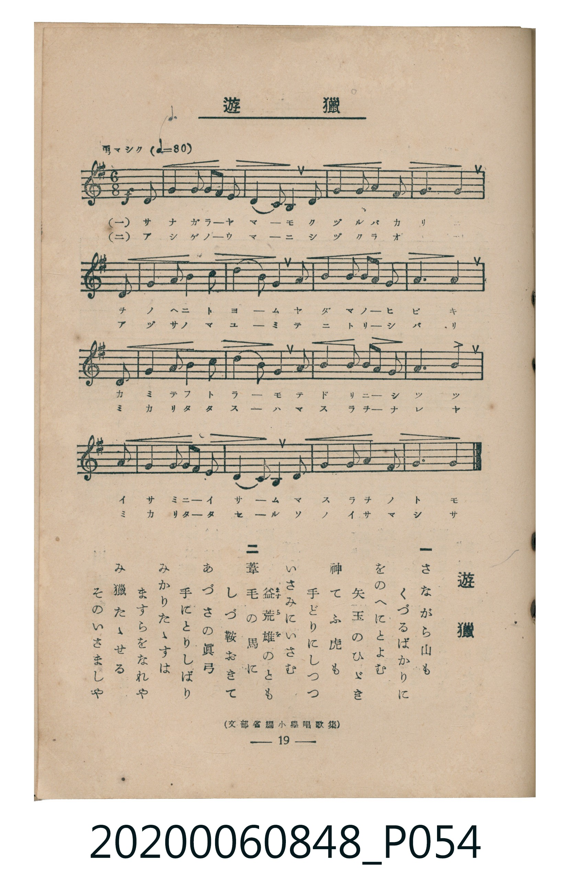

# 遊獵

<audio controls src="yuryo.mp3"></audio>

- 出處：文部省編《小學唱歌集》
- 臺灣教育會公認《新定兒童唱歌》高等科男子用（2020.006.0848）

## 說明

原書資訊與歌詞全文（對應 P054.jpg，書頁 p. 19，高一第二學期第 7 首）：
調性與拍號：ト長調（1 升記號）、6/8 拍（勇マシク ♩.=80，弱起第 6 拍進入）

## 歌詞

```text
一
さながら山も　くづるばかりに
をのへにとよむ　矢玉のひゞき
神てふ虎も　手どりにしつつ
いさみにいさむ　益荒雄（ますらを）のとも

二
葦毛（あしげ）の馬に　しづ鞍おきて
あづさの眞弓　手にとりしばり
みかりたゝすは　ますらをなれや
み獵たゝせる　そのいさましや
```

## ABC

```abc
X:1
T:遊獵
C:TMD (Chen, Chih-Han / aguai)
M:6/8
L:1/16
Q:3/8=80
K:G
V:V1 name="Piano" snm="Pia"
[V:V1]
!f! z2 z2 z2 z2 z2 D2 | G4 G2 A3 G F2 | E4 C2 D4 G2 | B4 B2 c4 B2 |
A10 D2 | A4 A2 B4 c2 | d4 B2 G4 B2 | d4 d2 e3 d c2 |
B6 A4 D2 | G4 G2 A4 A2 | B4 G2 E4 A2 | B4 B2 c3 B A2 |
d6 c4 B2 | B4 B2 c3 B A2 | G4 D2 E4 G2 | B4 d2 A4 F2 |
G6 G4 z2 | !f! z2 z2 z2 z2 z2 D2 | G4 G2 A3 G F2 | E4 C2 D4 G2 |
B4 B2 c4 B2 | A10 D2 | A4 A2 B4 c2 | d4 B2 G4 B2 |
d4 d2 e3 d c2 | B6 A4 D2 | G4 G2 A4 A2 | B4 G2 E4 A2 |
B4 B2 c3 B A2 | d6 c4 B2 | B4 B2 c3 B A2 | G4 D2 E4 G2 |
B4 d2 A4 F2 | G6 G4 z2 |
```

## TMD 檔案連結

- [主旋律 TMD 檔案](yuryo.tmd)
- [鋼琴伴奏 TMD 檔案](yuryo_piano.tmd)

## 分析

```text
================================================================================
📊 TMD Song Profile: [ 遊獵 ]
================================================================================
⏱  Duration:       0:51 (51.0s), 34 measures total
🎼 Key & Tempo:    首調基準 G, != 120.0 BPM, <6/8>
   - 分析範圍：      由實際發聲的音符與和弦推測調性；播放脈絡另行呈現
🎤 人聲音域:    C4 (MIDI 60) – E5 (MIDI 76) [跨度: 16 個半音 / 1.3 個八度, 難度: moderate]
   - 最低音:  C4 in [Main #1 @ m.3, 0:03]
   - 最高音: E5 in [Main #1 @ m.8, 0:11]
   - 適合: soprano, mezzo-soprano, contralto, tenor, baritone, bass
🏛  結構:      Main (25.5s) -> Main (25.5s)
⚡ 編曲密度:        Peak 1 軌道同時演奏
🗝  調性診斷：       G 大調（純淨自然大調，未偵測到可信轉調）
   - 風格氣質:    純淨自然大調（陽光明朗、易唱易記，無明顯調外色彩）
   - 轉調歷程:    全曲維持單一推測調性（未偵測到可信轉調）
   - 核心骨幹音:  B, A, G, D, C
   - 調性數值:    G 大調 [相關度: 0.82, 穩定度: High, 自然音純度: 100.0%]
   - 候選調性 (K-S): G 大調 (0.82), D 大調 (0.64), B 小調 (0.63)
   - 五度圈歷程:   +1 -> +1
   - 各段落調性細節:
     • [Main #1]: G 大調 (r: 0.82, 自然音純度: 100.0%)
     • [Main #2]: G 大調 (r: 0.82, 自然音純度: 100.0%)

  [ 五度圈游移軌跡 ]
               C  
         F           [G ]*
      Bb               D  
      Eb               A  
         Ab           E  
            Db       B  
               F# 
     (* = active key center)

  [ 十二半音累積音高分佈 ]
     C  : ██████████                10.4%
     C# :                            0.0%
     D  : ████████████████          16.1%
     D# :                            0.0%
     E  : ████████                   7.8%
     F  :                            0.0%
     F# : ██                         2.1%
     G  : ███████████████████       19.3%
     G# :                            0.0%
     A  : ████████████████████      20.3%
     A# :                            0.0%
     B  : ████████████████████████  24.0%
--------------------------------------------------------------------------------
Assignment 軌道音域：
  - Piano         : C4 – E5 (16 個半音 / 1.3 個八度, 126 個音符)
================================================================================
```


## 原書掃描頁




