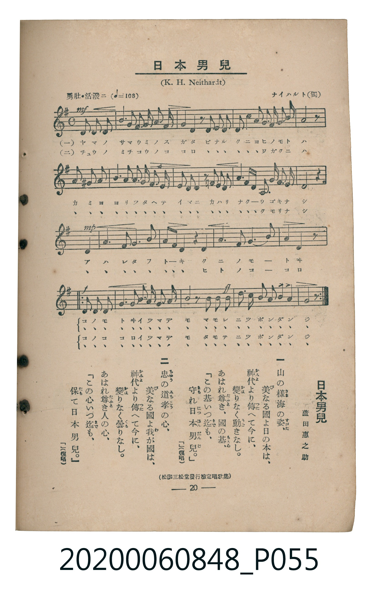

# 日本男兒

> Re:Shōka 使用 AI 協助辨識與重建樂譜，可能會有錯誤。歡迎回報。

<audio controls src="nihon_danji.mp3"></audio>

- 詞：蘆田惠之助（松邑三松堂發行檢定唱歌集）
- 曲：K. H. Neithardt（ナイハルト）
- 臺灣教育會公認《新定兒童唱歌》高等科男子用（2020.006.0848）

## 說明

原書資訊與歌詞全文（對應 P055.jpg，書頁 p. 20，高一第二學期第 8 首）：
調性與拍號：ト長調（1 升記號）、4/4 拍（勇壯・活潑ニ ♩=108）


## 歌詞

```text
一
山（やま）の樣（さま）海（うみ）の姿（すがた）、
美（び）なる國（くに）よ日（ひ）の本（もと）は、
神代（かみよ）より傳（つた）へて今（いま）に、
變（かは）りなく動（うご）きなし。
あはれ尊（たふと）き、國（くに）の基（もとゐ）、
「この基（もとゐ）いつ迄（まで）も、
守（まも）れ日本男兒（にっぽんだんじ）。」（復唱）

二
忠（ちゅう）の道（みち）孝（こう）の心（こころ）、
美（び）なる國（くに）よ我（わ）が國（くに）は、
神代（かみよ）より傳（つた）へて今（いま）に、
變（かは）りなく曇（くも）りなし。
あはれ尊（たふと）き人（ひと）の心（こころ）、
「この心（こころ）いつ迄（まで）も、
保（たも）て日本男兒（にっぽんだんじ）。」（復唱）
```

## ABC

```abc
X:1
T:日本男兒
C:曲：K. H. Neithardt（ナイハルト）
M:4/4
L:1/16
Q:1/4=108
K:G
V:V1 name="Piano" snm="Pia"
[V:V1]
!mf! D3 D E2 D2 G3 A B2 c2 | d4 B2 G2 z2 d2 c3 A | G4 F2 G2 A3 B c2 A2 | B8 B4 z4 |
E3 ^D E2 F2 G3 A B2 c2 | A4 F2 D2 z2 A2 ^G3 A | B4 A2 G2 F3 E F2 D2 | D8 D4 z4 |
!mp! A4 A4 c3 B A4 | B6 c2 d4 z2 G2 | F4 G4 A6 B2 | G8 D4 z4 |
!f! B3 A G2 F2 E3 F G2 A2 | B4 A4 z2 G2 A2 B2 | !ff! c3 B A2 G2 d4 D4 | G12 z4 |
```

## TMD 檔案連結

- [主旋律 TMD 檔案](nihon_danji.tmd) [[在 TMD Studio 編輯](https://tmdlang.github.io/Tmd-TS/#tmd=s7IKdvYPcrWy4qpTUCpJTLdSSM7PyUlNLsnMz7MqzsjMK0nNjM_KTMmPL87Iz05Ugisry88pzU21ys4vyY9Pyq8sjjcyMDKINzAwizewMLFAqCvOLy1KTrUqTs7Iz8-JL0mtKEnKz89GyBcU5Zel5iXmAdUUFIGsSwErQihILctMSQVJp6ZkluQXZSbmIDkitagY7FCwJfElRYl5xclFmQUg1yNUlWSkAl2am5mTWZJYVIkQBxqWnplnlZuamZWJxWVQ6fLU4pLUorz43NSc_BSgbi0thWfTlz6bs-b5lO1PWycpaGlxKdoqGBpYcNnbKrhz2Zjom9iBzHixct77PbNezGh7PmXDs-YFT3Z2P-1a-X5Px7O5-142TXyyoxPIeLqg6fnMPS8W9jxbtejpullPp2x8trbn5ey293s6we54NnsT0AxvPQUPPQW_1MySjMSilBKgGY-bux43LXnc3P-4efXj5g6Y8hftu543Ln42deaLpk3P5jQ_bV3zYlXv44auZ9M2gExvnfR89VKIHY8bul-unvF8befz5RNB_lg74fmUFUCDQZGoB4xEPVAkgo3l0tdSsKUW4FJQUHjaN__Z7B0vNre_WNH1oqMd6BhgSD1tXfFsWjvQAU839D5r71QIMDA11csqSH-_pweo-OWCRoUCPQUjAyAX6OwnOxqer1nzZFfP07U7ns2ZD2QrWCi8XDYN6F5gaIHseLFq_7OG5SDTu3tfzJwPFAWG0sup24HiQDsMFZ72Am2fAZbpfNzQCIwyBaBKkPXd7U8Xr3_cvPvZlt3P9k583Nyt8GjmSltg7AJVcoGMBloO9sXGjaB4aGp53LgPZEjjumcrFoNEGqdCRJ5t3Q7mtj1uBNoJUvB0Ocjyx40zHzf2PG6EWg0y6_m-PrDEZrC6VY-bup_O6QaL9D9uXA0SbOoAJjmwCDA9gC2bswZsfdPjRmC0AUXWw8xaOu_JbohDuoE2A3VC9D9u6nraBLQAKL4EannjjseNy57s7gILwv2xGmrQi3UQCaAp68FGdIGc1tj_tHsqzF9TwBp6weLTHzc0gbQ9bgQ6af3jpp6nGyD65z9u3ApzJDAtNqJ7DRgu83fB_fK4aQIiXB43AMNpMnYVIAcvebG_BWzWvseNy8FubILqfLoO6G2wRFMTWKIHOcuCpVY_blz8uHHv4yagBQvA5AywzUAjwAlh30pgToFH-q4esLH7F4D1Lnzc1AoMAYjzXzZOBgvuB4oDRZ6unQvmAg2EKni6vxkmMvlxE9BwkuK9YyLY6_1gNT0YoUe3eH82G5Q9QTZDgxQiTly8P9kFjsDGTTAR3IGCiHRMFfgj_cl-SMjPh7qwcRn5kQ40jvLSDgoUtPS5uMKANVWqVUBmYl6-Q41BjUI1yAoFG0MzLTswC1jKgsq0HQ3AykBBw0Th6Yb-5-sbdOAFoSbIFJBCoNbctFoF03gFXSAEUmYgFphrCBYyUjAGkiZAXKNgChbRBYuAZA1ASqGyIJU1UCMhOnUVzGHGGEG1gRSC2DVgI5AhjA8yEgRrwBkF5o9dPYT9AXY40D3qUD_ALUf1A8QpUGmwP0FWgkQN1dG8AXMTWBKmRRdkOkIzMFAgoggIF8Dulx2dxMRJQS3cpTAaEsrGcD5qIIJkYfEDshjkYJhHoA6HBQfCSFjII6IMjydqubiCUtOKEoGNGEIJ7-ns2Tg8qaMAyRXIngWmP4hPjBDBDI1NIBuWflDjA9mbID7YF3ADgSYihxZIESxs4B7D9DMMonhZ104BnNkUgAyo90FMZS4uAA)]
- [鋼琴伴奏 TMD 檔案](nihon_danji_piano.tmd) [[在 TMD Studio 編輯](https://tmdlang.github.io/Tmd-TS/#tmd=s7IKdvYPcrWy4tLSUng2femzOWueT9n-tHXS-z0dL7v3PJ-w5cmeLU-X9j_v7Hi_p1NBS4tL0VbB0MCCy95WwZ3LxkTfxI6rTkHpxcp57_fMejGj7fmUDc-aFzzZ2f20ayXQiGdz971smvhkRyeQ8XRB0_OZe14s7Hm2atHTdbOeTtn4bG3Py9ltQHOVQGY8m70JaIa3noKHnoJfamZJRmJRSgnQjMfNXY-bljxu7n_cvPpxM8gZYOUv2nc9b1z8bOrMF02bns1pftq65sWq3scNXc-mbQCZ3jrp-eqlEDseN3S_XD3j-drO58sngjy3dsLzKSuABhsZGBnoGRiY6RlYmFiAjeUKSy0qTrUKyEzMyw_ycKgxqFGo5lIAAhtDMy07MEtfS-H5mjVPdjQAPaKgpQ8WA6rKTatVMI1X0AVCIGUGYoG5hmAhIwVjIGkCxDUKpmARXbAISNYApBQqC1JZAzUSolNXwRxmjBFUG0ghiF0DNgIZwvggI0GwhgvZybt6UJwMdiPQanWoc-H2oDoXYitUGuwlkOkgUUN1NBfDrAdLwrTogkxHaAb6HyKKgHAB7M7e0YkW0gW1cEfBaEjYGcP5qEEDkoWFOsgOkNtgboa6EeZzhJGw8EREBB731qKkHB-UlGOCN-EYxitEG8bCKDjfNB5Im8YDRVDVIcSRdBoQimigSrP4XCRb4MaA5YyQ7IHLGMEkEEIgBrpdaLGDoharQ5HUYfUPzBJgkAalphUlZuYRkR2fzp4NcobG030rgVleEym1ALMlJCkYIZIkNOUD2bBshZp2kdMJiA9OBnADgSYiJzeQIljigqcMzEQDgyhpBsWD-FINTv9BA80ESJnAQxEUnrCohqqDKcAZLUDX6NopgBOxApABdRkak4C0MhcXAA)]

## 分析

```text
================================================================================
📊 TMD Song Profile: [ 日本男兒 ]
================================================================================
⏱  Duration:       0:35 (35.6s), 16 measures total
🎼 Key & Tempo:    首調基準 G, != 108.0 BPM, <4/4>
   - 分析範圍：      由實際發聲的音符與和弦推測調性；播放脈絡另行呈現
🎤 人聲音域:    D4 (MIDI 62) – D5 (MIDI 74) [跨度: 12 個半音 / 1.0 個八度, 難度: easy]
   - 最低音:  D4 in [Verse #1 @ m.1, 0:00]
   - 最高音: D5 in [Verse #1 @ m.2, 0:02]
   - 適合: soprano, mezzo-soprano, contralto, tenor, baritone, bass
🏛  結構:      Verse (26.7s) -> Refrain (8.9s)
⚡ 編曲密度:        Peak 1 軌道同時演奏
🗝  調性診斷：       G 大調（推測轉調經歷 1 次）
   - 風格氣質:    純淨自然大調（陽光明朗、易唱易記，無明顯調外色彩）
   - 轉調歷程:    G 大調起奏 ➔ [Refrain] 轉至 G 大調 (+5 半音 / 五度圈 -1 步)
   - 核心骨幹音:  G, A, D, B, F#
   - 調性數值:    G 大調 [相關度: 0.85, 穩定度: Moderate, 自然音純度: 98.3%]
   - 候選調性 (K-S): G 大調 (0.85), D 大調 (0.79), B 小調 (0.65)
   - 五度圈歷程:   +2 -> +1
   - 各段落調性細節:
     • [Verse #1]: D 大調 (r: 0.83, 自然音純度: 89.7%, 調外音: C, D#, G#)
     • [Refrain #1]: G 大調 (r: 0.89, 自然音純度: 100.0%)

  [ 五度圈游移軌跡 ]
               C  
         F           [G ]*
      Bb              [D ]*
      Eb               A  
         Ab           E  
            Db       B  
               F# 
     (* = active key center)

  [ 十二半音累積音高分佈 ]
     C  : ████████                   7.3%
     C# :                            0.0%
     D  : █████████████████████     19.0%
     D# :                            0.4%
     E  : █████                      4.7%
     F  :                            0.0%
     F# : █████████                  7.8%
     G  : ████████████████████████  21.6%
     G# : █                          1.3%
     A  : ██████████████████████    19.8%
     A# :                            0.0%
     B  : ████████████████████      18.1%
--------------------------------------------------------------------------------
Assignment 軌道音域：
  - Piano         : D4 – D5 (12 個半音 / 1.0 個八度, 81 個音符)
================================================================================
```


## 原書掃描頁




