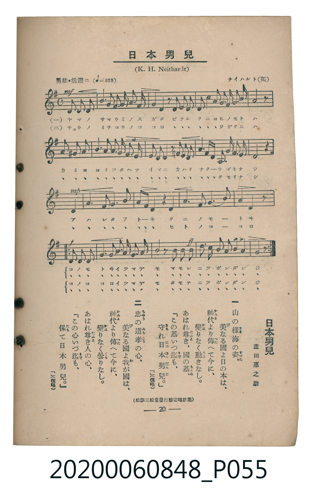

# 日本男兒

<audio controls src="nihon_danji.mp3"></audio>

- 詞：蘆田惠之助（松邑三松堂發行檢定唱歌集）
- 曲：K. H. Neithardt（ナイハルト）
- 臺灣教育會公認《新定兒童唱歌》高等科男子用（2020.006.0848）

## 說明

原書資訊與歌詞全文（對應 P055.jpg，書頁 p. 20，高一第二學期第 8 首）：
調性與拍號：ト長調（1 升記號）、4/4 拍（勇壯・活潑ニ ♩=108）

## 歌詞

```text
一
山（やま）の樣（さま）海（うみ）の姿（すがた）、
美（び）なる國（くに）よ日（ひ）の本（もと）は、
神代（かみよ）より傳（つた）へて今（いま）に、
變（かは）りなく動（うご）きなし。
あはれ尊（たふと）き、國（くに）の基（もとゐ）、
「この基（もとゐ）いつ迄（まで）も、
守（まも）れ日本男兒（にっぽんだんじ）。」（復唱）

二
忠（ちゅう）の道（みち）孝（こう）の心（こころ）、
美（び）なる國（くに）よ我（わ）が國（くに）は、
神代（かみよ）より傳（つた）へて今（いま）に、
變（かは）りなく曇（くも）りなし。
あはれ尊（たふと）き人（ひと）の心（こころ）、
「この心（こころ）いつ迄（まで）も、
保（たも）て日本男兒（にっぽんだんじ）。」（復唱）
```

## ABC

```abc
X:1
T:日本男兒
C:曲：K. H. Neithardt（ナイハルト）
M:4/4
L:1/16
Q:1/4=108
K:G
V:V1 name="Piano" snm="Pia"
[V:V1]
!mf! d3 d e2 d2 g3 a b2 c2 | d4 b2 g2 z2 d2 c3 a | g4 f2 g2 a3 b c2 a2 | b8 b4 z4 |
e3 ^d e2 f2 g3 a b2 c2 | a4 f2 d2 z2 a2 ^g3 a | b4 a2 g2 f3 e f2 d2 | d8 d4 z4 |
!mp! a4 a4 c3 b a4 | b6 c2 d4 z2 g2 | f4 g4 a6 b2 | g8 d4 z4 |
!f! b3 a g2 f2 e3 f g2 a2 | b4 a4 z2 g2 a2 b2 | !ff! c3 b a2 g2 d4 d4 | g12 z4 |
!f! b3 a g2 f2 e3 f g2 a2 | b4 a4 z2 g2 a2 b2 | !ff! c3 b a2 g2 d4 d4 | g12 z4 |
!mf! d3 d e2 d2 g3 a b2 c2 | d4 b2 g2 z2 d2 c3 a | g4 f2 g2 a3 b c2 a2 | b8 b4 z4 |
e3 ^d e2 f2 g3 a b2 c2 | a4 f2 d2 z2 a2 ^g3 a | b4 a2 g2 f3 e f2 d2 | d8 d4 z4 |
!mp! a4 a4 c3 b a4 | b6 c2 d4 z2 g2 | f4 g4 a6 b2 | g8 d4 z4 |
!f! b3 a g2 f2 e3 f g2 a2 | b4 a4 z2 g2 a2 b2 | !ff! c3 b a2 g2 d4 d4 | g12 z4 |
!f! b3 a g2 f2 e3 f g2 a2 | b4 a4 z2 g2 a2 b2 | !ff! c3 b a2 g2 d4 d4 | g12 z4 |
```

## TMD 檔案連結

- [主旋律 TMD 檔案](nihon_danji.tmd)
- [鋼琴伴奏 TMD 檔案](nihon_danji_piano.tmd)

## 分析

```text
================================================================================
📊 TMD Song Profile: [ 日本男兒 ]
================================================================================
⏱  Duration:       1:28 (88.9s), 40 measures total
🎼 Key & Tempo:    首調基準 G, != 108.0 BPM, <4/4>
   - 分析範圍：      由實際發聲的音符與和弦推測調性；播放脈絡另行呈現
🎤 人聲音域:    D4 (MIDI 62) – D5 (MIDI 74) [跨度: 12 個半音 / 1.0 個八度, 難度: easy]
   - 最低音:  D4 in [Verse #1 @ m.1, 0:00]
   - 最高音: D5 in [Verse #1 @ m.2, 0:02]
   - 適合: soprano, mezzo-soprano, contralto, tenor, baritone, bass
🏛  結構:      Verse (26.7s) -> Refrain (8.9s) -> Refrain (8.9s) -> Verse (26.7s) -> Refrain (8.9s) -> Refrain (8.9s)
⚡ 編曲密度:        Peak 1 軌道同時演奏
🗝  調性診斷：       G 大調（推測轉調經歷 3 次）
   - 風格氣質:    純淨自然大調（陽光明朗、易唱易記，無明顯調外色彩）
   - 轉調歷程:    G 大調起奏 ➔ [Refrain] 轉至 G 大調 (+5 半音 / 五度圈 -1 步) ➔ [Verse] 轉至 D 大調 (-5 半音 / 五度圈 +1 步) ➔ [Refrain] 轉至 G 大調 (+5 半音 / 五度圈 -1 步)
   - 核心骨幹音:  G, A, D, B, F#
   - 調性數值:    G 大調 [相關度: 0.87, 穩定度: Moderate, 自然音純度: 98.6%]
   - 候選調性 (K-S): G 大調 (0.87), D 大調 (0.76), B 小調 (0.62)
   - 五度圈歷程:   +2 -> +1 -> +1 -> +2 -> +1 -> +1
   - 各段落調性細節:
     • [Verse #1]: D 大調 (r: 0.83, 自然音純度: 89.7%, 調外音: C, D#, G#)
     • [Refrain #1]: G 大調 (r: 0.89, 自然音純度: 100.0%)
     • [Refrain #2]: G 大調 (r: 0.89, 自然音純度: 100.0%)
     • [Verse #2]: D 大調 (r: 0.83, 自然音純度: 89.7%, 調外音: C, D#, G#)
     • [Refrain #3]: G 大調 (r: 0.89, 自然音純度: 100.0%)
     • [Refrain #4]: G 大調 (r: 0.89, 自然音純度: 100.0%)

  [ 五度圈游移軌跡 ]
               C  
         F           [G ]*
      Bb              [D ]*
      Eb               A  
         Ab           E  
            Db       B  
               F# 
     (* = active key center)

  [ 十二半音累積音高分佈 ]
     C  : ███████                    6.9%
     C# :                            0.0%
     D  : ██████████████████        17.9%
     D# :                            0.3%
     E  : █████                      4.8%
     F  :                            0.0%
     F# : ███████                    7.2%
     G  : ████████████████████████  24.1%
     G# : █                          1.0%
     A  : ████████████████████      19.7%
     A# :                            0.0%
     B  : ██████████████████        17.9%
--------------------------------------------------------------------------------
Assignment 軌道音域：
  - Piano         : D4 – D5 (12 個半音 / 1.0 個八度, 202 個音符)
================================================================================
```


## 原書掃描頁




