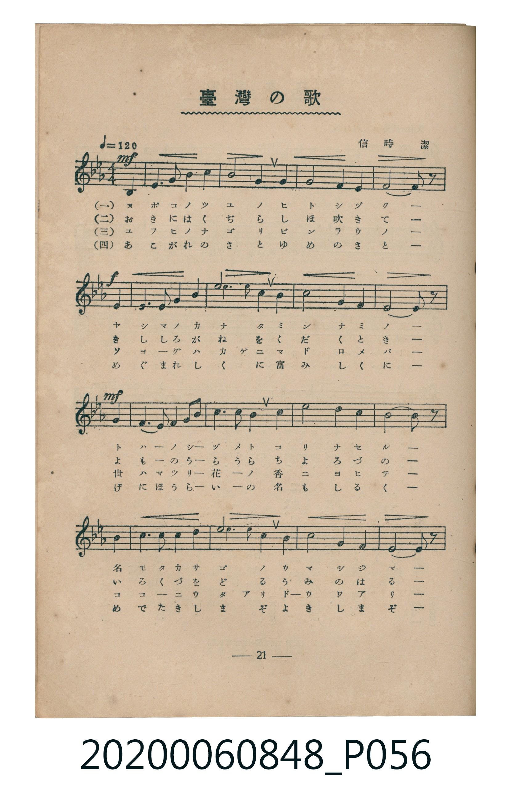
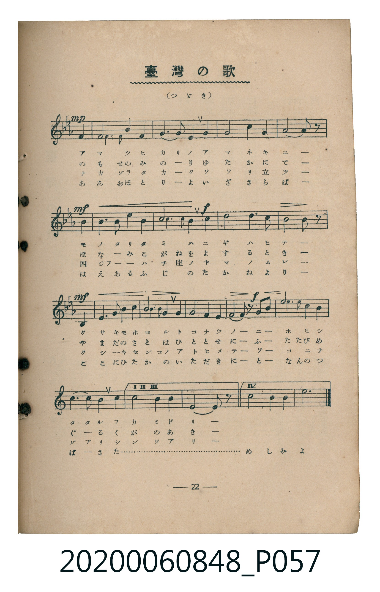
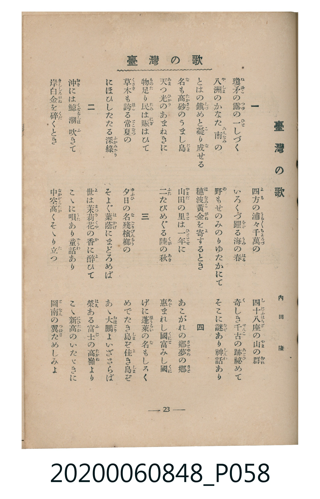

# 臺灣の歌

> Re:Shōka 使用 AI 協助辨識與重建樂譜，可能會有錯誤。歡迎回報。

- **鋼琴伴奏版**：<br><audio controls src="taiwan_no_uta.mp3"></audio>

- 詞：內田隆（昭和6年臺灣教育會選歌）
- 曲：信時潔
- 臺灣教育會公認《新定兒童唱歌》高等科第一學年用（2020.006.0848 / 2020.006.0849）

## 說明

原書資訊與歌詞全文（對應 P056.jpg – P058.jpg，書頁 pp. 21–23，高一第二學期第 9 首）：
調性與拍號：變ロ長調／ト律音階（2 降記號）、4/4 拍（♩=120，弱起第 4 拍進入）


## 歌詞

```text
一　瓊矛（ぬぼこ）の露（つゆ）の一（ひと）しづく
八洲（やしま）のかなた南（みんなみ）の
とはの鎭（しづ）めと凝（こ）り成（な）せる
名（な）も高砂（たかさご）のうまし島（じま）
天（あま）つ光（ひかり）のあまねきに
物足（ものた）り民（たみ）は賑（にぎ）はひて
草木（くさき）も誇（ほこ）る常夏（とこなつ）の
にほひしたたる深綠（ふかみどり）

二　沖（おき）には鯨（くぢら）潮（しほ）吹（ふ）きて
岸白金（きししろがね）を碎（くだ）くとき
四方（よも）の浦々（うらうら）千萬（ちよろづ）の
いろくづ躍（をど）る海（うみ）の春（はる）
野（の）もせのみのりゆたかにて
穗波黃金（ほなみこがね）を寄（よ）するとき
山田（やまだ）の里（さと）は一年（ひととせ）に
二（ふ）たびめぐる陸（くが）の秋（あき）

三　夕日（ゆふひ）の名殘（なごり）檳榔（びんらう）の
そよぐ葉蔭（はかげ）にまどろめば
世（よ）は茉莉花（まつりくゎ）の香（か）に醉（ゑ）ひて
こゝに唄（うた）あり童話（どうわ）あり
中空高（なかぞらたか）くそゝり立（た）つ
四十八座（しじふはちざ）の山（やま）の群（むれ）
奇（く）しき千古（せんこ）の跡（あと）祕（ひ）めて
そこに謎（なぞ）あり神話（しんわ）あり

四　あこがれの鄕（さと）夢（ゆめ）の鄕（さと）
惠（めぐ）まれし國（くに）富（と）みし國（くに）
げに蓬萊（ほうらい）の名（な）もしるく
めでたき島（しま）ぞ佳（よ）き島（しま）ぞ
あゝ大鵬（おほとり）よいざさらば
榮（はえ）ある富士（ふじ）の高嶺（たかね）より
こゝ新高（にひたか）のいたゞきに
圖南（となん）の翼（つばさ）ためしみよ

弱起拍（第 4 拍進入）與主體樂段（共 29 小節 + 結尾）
```

## ABC

<div class="abc-score" data-abc-src="taiwan_no_uta.abc" aria-label="五線譜載入中"></div>

[下載 ABC 原始檔](taiwan_no_uta.abc)

## TMD 檔案連結

- [主旋律 TMD 檔案](taiwan_no_uta.tmd) [[在 TMD Studio 編輯](https://tmdlang.github.io/Tmd-TS/#tmd=s7IKdvYPcrWy4qpTUCpJTLdSSM7PyUlNLsnMz7MqzsjMK0nNjM_KTMmPL87Iz05Ugisry88pzU21ys4vyY9Pyq8sjjcyMDKINzAwizewMLFAqCvOLy1KTrUqTs7Iz8-JL0mtKEnKz89GyBcU5Zel5iXmAdUUFIGsSwErQihILctMSQVJp6ZkluQXZSbmIDkitagY7FCwJfElRYl5xclFmQUg1yNUlWSkAl1akJOYnIoQBJqUnplnVZKYCfQYyHPlifG5iZl5OYl5KdhUlSfmxeenpWUmgx2gpaXwon3X88bFjxvXPVvbo6ClxaVoq2BoZMBlb6vgpMNlY6JvYgcy5cXKee_3zHrauvz5lA0vZ7W939PxbMbap5N6zJ7u3AIx4dnUmS-aNj2b0_yycQfQqPd7OsHWP5u9Cajxyf6Fz2Y2Pds7BSyGpuFp65oXq3ofN3Q9m7bh6TqgJZOer176dMpGoCmPG7pfrp7xfG3n8-UTn69Z82RHw9O1O4BWPp-yAugEUFTpAaNKDxRVCvoKyHxLsAO49LUUbKkFuBQUFJ72zX82e8eLze0vVnS96GgHOhEYMk9bVzyb1g500NMNvc_aOxUCDEzN9LIK0hUeNUwGcSxAnPd7eoA6Xy5oVCgo0FMwMgTKGRkDBYH-A3oL5LldPUDPPZszH8hWsFR4uWwa0AvAsANZ-2LV_mcNy0EWdve-mDkfKPpiXdfj5rUvp24HSr3f0_-4uePpvu6X8ze_nNUHChmFlzN7X6yYAVbb-bihERiPCkC9QKlHM1faAiMYaPPTPRtfbN0Osg0s97Jh09PWpUDlXCAbgW563NDwfHLX8_mzgboeN6553LjnceNkkHGN617OAcYqUHDJ4yZgWgCJANWDRTY9bgRGDVBk-uPGpY8b-8GB1rr62RawhqYWsMQ-iJ7Hjd2PG1c9bpz_tHc6WPP-x02TwSJAL4EUgDQDzXvcuB5kZ99asCKQwSDppkag1NP2uWBBsLuaup51TABzV4H1z37c1A22fwLI41DRpiZQilrQBBaZD3bC1MeNU2AuagO6DmjH083bwApmQBwLNmXJSrBQE8z9S562AuMH4uduoOUwI0AKHjeufdzY-7hxNUjn886VL7ZtBvsfKAdUAY4UoGs3TIS5AuLh9S82Q0RWP24ERiNIBGz6MnAa6O18NgeU7IGhCnYz0FMg77xYBUp6jxt3w0Kh--mOHU-X9IMFgWEHCdElyCEKNB6oGmgwMCyBls8H6nm2fePzbQvAeraCA2X_48aVEE9B0sMuYGZseLYJmCiBSrqgtoNMWv9yPdxVix43AYOk89nedbCo2g3kPp2wE2IwWAswVMD-ebppx_OZe1-2Q3wMFAWqnv64CcjoAYYe2CeTni8CpWaw0UC3ATUDGUAv9YL1z579bBrY4CZQwEL892zrsscNrWA9bUC3QEiQE3qbX0xYAxZfCFYPtAacimBB0gIWAhq_9MUucGppmgQMAEh4Ptu6HWoiLGE-mwHUDBRZD5SFJo-X7RCnAn0OihVQ6gNFNTAY1wGDEZhPYKkNGGRg_z9fOf3Z5kUvdzfDggAYJaCkD44xRBA8Xd8C8SPY5plAC5GCYONGYHkMy1jARAcJpHUv24HlL9BEYCKBZMb1oJJz5xZ4DgUjYL4GxSA0dpFiCOjOzeDsNQFo28uZO2BRACrUgaY_Xw70MyQjgBIBtLgAljINT5dMfTYdHDIg7wLTETDTg3QAM-CzdTMgeRCY1yDJ6tmqzc-WAfMdUBBo22RIbCFHyVxQRDVOeDGx88UUSNYH5gag7yfBUh7Qw8Ak2gt26gaIK8DJExpW61_0dL7o63zRtRGsGagaWFwBU27_4yZI5lr3ctlMsBQoDoEmvmwD5-cmYHQAubB8B4qPprlA6adTwDEBSgbgDAwMgKYuYFX1YiXEgpXg1AbMd1ApiIvWPl-5C1jiwDwPdP88sFdBiQGWpIE-BSKgWZCAhZi-BJrIn_Y2AgvQp7uWw7IUsEwCBi0wLBY-bgTVEaAA3gh2AjgVQCNpHzDHA0UaHjeBog1s1lJIQQFxIdCgXmCueNoPVgcqK4HJDlq8v9i-EBbDoPTzfOlUSMqBFbvQcAEGClDP6hdrICkf6DtgIwEWLkvnwcIFmKmBIYgULlCPARMM2Apwcm8Cpvh1L1sgFkHT7dMli6BpqakRGmGoCkAGPWsGl1rg5ApWtA9s1vSncyCBCQze1SCz1kNSOCQ_ADMZugKIl4CZfvWLyWteTACmUEiWhBQjwJiHJmTkmgTsN2CMgms5sBOWgyO2F1Z9wOu6eU_2QioASNLEogBiPzB85j5dsvzlVkhZBUytQCesgFYuoOwAjOFpIP-DHAVO88-WQcpaYHqAmA00ohvo26eLgb6ClObAxAcOvNUznm7bBatxgM6GlDBAR4GTKiSdA9tgsNQKzGHAPABPp8DCDGg5sK6Yh6jZns6ZBqu7gQXKKmBEQ1Pf_j1gwSVARwJdCy1VQAEE9DCwlu8Aaaa8RQYFClr64JYepEEDaeZgNmuAracnO3a_XD3l2YqmZ-uAJV3H09aNCkaWCk839D9f36CgrfB864SnG0DRATIwDNgmT3XKT6m0CshMzMt3qNE1rKkGOVvBxkLLDsyAWwk1QeNpZ6-CMcjSJ3smPlsLTLw9cGc8buh53AxMgsDU1vS4AeoqTZBFIJNqFAwUdOG4OjetVsE0HsiqAecVkEWYnoa0h18s7FHQMIH6QQfe9NTEogFqF9AwDaBGTSuFx81zQALAlLsZ6ILHzX0gdnML2D2Pm5eB5SBskEx0WCyQNQnM70DINW0H62qF8tYj6doD0vW4eUksstXAjA-yunEyxOrGHrC2HjB7HURj41SEIY0rYFY3tYFVNiLJgdRDVMNUolrd1Ai3ukbBGBSguqBwNQRSRqDQBUYWSAjCA4nWKJhBVIHV6UJ4NRA2BBooVBMbObt6KIoccMCCgnYeInKaVkP914UUAfvhkTMfLLcZKRxA6kDiiGhEi5wOrJEzARo5-5AiZzo0mPuRIgDkHJDVwPIGzAc5BSYHUg9RDVOJanXjJJyRA4oWYKhDgxzEg0QOKJpQReDRBY4ZUL4Bm0Qw33RSlm9AvgL5AxSkkDwA8RXEf6C8AJJfCM8rkAQMyWWr0KOnaTeUhxFGwOoGa_SAFAJrBiCG5IlOZOsbQRkY4jxYHgFH0YResNom9Chq6saMWGz5xwQeReBANwdFFTwCgBRyhjFBiiioECzuQBFFTPYB-pWyOFoECQZg9gB5GxxkTVsh3mvaguRVeNnWtAzMn4eQg5RtTTugKpFkYAG0CGv8LIdY3QjOj429YDYs--xDCn-QgRCrO-AqUeIGrBqmEtXqxiaysw84RsDRiV605RYQmYF2TcGMHHMSIgfZP6D0CqpYIEEOyQSgbIIaOYswogAcrk1roTxQKkYNoWbskQPKAJCWFazSADaAkDSC-JDoADkMbHnjNDAfqVoCZjmQKRtQ9KFEz3rM6IGGPCT1w3IOOB9h1jRYaiR4EQeJOgLZp3UtZTEEqSug2QdcaEFqGhAPVJ_AvAsqNSC1Tzc4YEDlDbIcPGab2zACqQkRSMgxBGldgGIKZCAoYoHNWIjGxhkIQ-BFGyyjISWBRlCyAMUjJLaQqktY_EzGLNqAFFJUILcNQHU-JFchl2youYrEGqiZougBl2SQ5A_yE6ise9wM7MNBqhhYHgIlY1jVA6psQHkNkqsgwQDJN8hV12ykgALFG6QIxNN8Ww0O7U1gNqirAI8Y8KAKzH5gBAEHJ8AlHEh-NcJ-YAZErrtAXQiU-AX2IRAOQC7oYFkJGGkYwtC6CZaHQLEHYuMoFwllpNXAmAK27J_2diloGJIbX5CWESw7wdpNj5unYgtcULGCqMFBxQ4sFOEBAUl1xohygqsW3AeC9Are750HbOMAezmQLo2ChmteSmZeuoKnjoInGHuC3ASKBmDENHdCszjQQnCPBKLY0MgY1vUxQO_5EGyKgboxSE4CjdWBHNMEnA5Ad1IYyCmN4BoP1IAEZdcO4Mj5FAVglwnSv4R0KNF6kMBO1LMZTc_6Zz3Z0QWMIJDZaxchOd-ECMdjdgQgroe6XddOAd4LVABy4OGC4ACLAzsFZS4A)]
- [鋼琴伴奏 TMD 檔案](taiwan_no_uta_piano.tmd) [[在 TMD Studio 編輯](https://tmdlang.github.io/Tmd-TS/#tmd=s7IKdvYPcrWy4tLSUnjRvut54-LHjeuere15v6fjZfee5xO2PNmz5enS_uedHe_3dCpoaXEp2ioYGhlw2dsqOOlw2Zjom9hx1SkovVg57_2eWU9blz-fsuHlrDag7mcz1j6d1GP2dOcWiLHPps580bTp2Zzml407wOZ3KoE0Ppu9Cajxyf6Fz2Y2Pds7BSyGpuFp65oXq3ofN3Q9m7bh6TqgJZOer176dMpGoCmPG7pfrp7xfG3n8-UTn69Z82RHw9O1O4BWPp-yAugEIwMjAz0DAzM9AwsTCwV9BWS-JdgBXGGpRcWpTvkplVYBmYl5-UEeDjW6hjXVXApAYGOhZQdm6GspPN2z8cXW7U839D9f36CgpQ8WrlEwUNCF4-rctFoF03ggq4YLpgvipBcLexBajEEqdEEKDYGUEUi5gjFYCMIDidYomEFUgdXpQng1EDYEGihUY7dtVw8e20D2AI2BmgHiQWwD2YsqArcfbBXIZ2CT0HzWiWKXCdwusG5zkJ1wk4AUsldMkGyECsEcAbIR02NPZ8-mwGNgK8DuQw_F3AKsXts1BZttUIMgroP5DOxPzDjCEpfwsIS4BMV7rWuxhSWQQjIbOZmAoh_ia-SgRPU13rhrxhGcMB8CrcYQhkYpzGsgN4DYOEIf1X-rgfY97ex92tuFsBXiUGNEWHHVYuRIH5QcaUI4R0JgDZ4saAjyS7RhLNjZEI5pPIRnFg_mmsXnQvimED5IGs1MtIyGYiY49mAcI5wWoLsSS3aKNsHhMIipRgTdiZ5vCLmTsInoeQPdZWR5Hmv6h3se1RQUC3A7Ey2FozsTnLTRwxNmBXIoEU7FyFpBKdg1LyUzL93QyBhRpxigVykEC11QlYLNNFB-gJsGyw6EAhpujAlRTsKsmSBuQnER1Cii3AMPT6hjdO0U4NlcAciB-xHEwSIDLOPsFJS5AA)]

## 分析

```text
================================================================================
📊 TMD Song Profile: [ 臺灣の歌 ]
================================================================================
⏱  Duration:       1:06 (66.0s), 33 measures total
🎼 Key & Tempo:    首調基準 B,, != 120.0 BPM, <4/4>
   - 分析範圍：      由實際發聲的音符與和弦推測調性；播放脈絡另行呈現
🎤 人聲音域:    D4 (MIDI 62) – F5 (MIDI 77) [跨度: 15 個半音 / 1.2 個八度, 難度: moderate]
   - 最低音:  D4 in [VerseBody #1 @ m.2, 0:02]
   - 最高音: F5 in [VerseBody #1 @ m.7, 0:12]
   - 適合: soprano, mezzo-soprano, contralto, tenor, baritone, bass
🏛  結構:      VerseBody (58.0s) -> Ending123 (4.0s) -> Ending4 (4.0s)
⚡ 編曲密度:        Peak 1 軌道同時演奏
🗝  調性診斷：       A# 調性不明確（推測轉調經歷 2 次）
   - 風格氣質:    純淨自然大調（陽光明朗、易唱易記，無明顯調外色彩）
   - 轉調歷程:    A# 調性不明確起奏 ➔ [Ending123] 轉至 C 小調 (-10 半音 / 五度圈 +2 步) ➔ [Ending4] 轉至 C 大調 (+0 半音 / 五度圈 +0 步)
   - 核心骨幹音:  D, G, C, F, A#
   - 調性數值:    A# 調性不明確 [相關度: 0.72, 穩定度: Ambiguous, 自然音純度: 100.0%]
   - 候選調性 (K-S): A# 大調 (0.72), G 小調 (0.71), D 小調 (0.65)
   - 五度圈歷程:   -2 -> +0 -> +0
   - 各段落調性細節:
     • [VerseBody #1]: A# 大調 (r: 0.75, 自然音純度: 100.0%)
     • [Ending123 #1]: C 小調 (r: 0.59, 自然音純度: 100.0%)
     • [Ending4 #1]: C 大調 (r: 0.75, 自然音純度: 84.6%, 調外音: A#)

  [ 五度圈游移軌跡 ]
              [C ]*
         F            G  
     [Bb]*              D  
      Eb               A  
         Ab           E  
            Db       B  
               F# 
     (* = active key center)

  [ 十二半音累積音高分佈 ]
     C  : █████████████████         17.6%
     C# :                            0.0%
     D  : ████████████████████████  24.3%
     D# : ████████                   7.8%
     E  :                            0.0%
     F  : █████████████████         17.6%
     F# :                            0.0%
     G  : ██████████████████        18.0%
     G# :                            0.0%
     A  : █                          1.2%
     A# : █████████████             13.3%
     B  :                            0.0%
--------------------------------------------------------------------------------
Assignment 軌道音域：
  - Piano         : D4 – F5 (15 個半音 / 1.2 個八度, 104 個音符)
================================================================================
```


## 原書掃描頁








