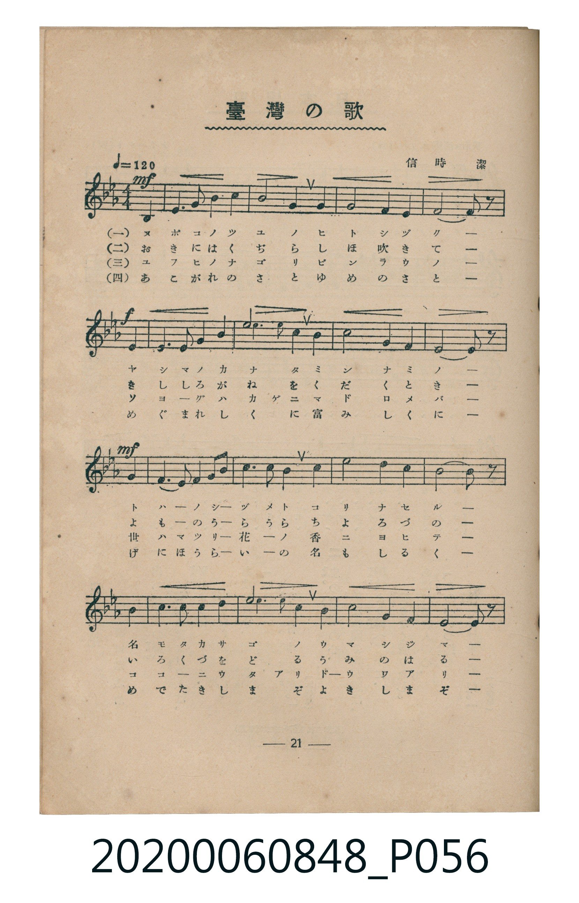
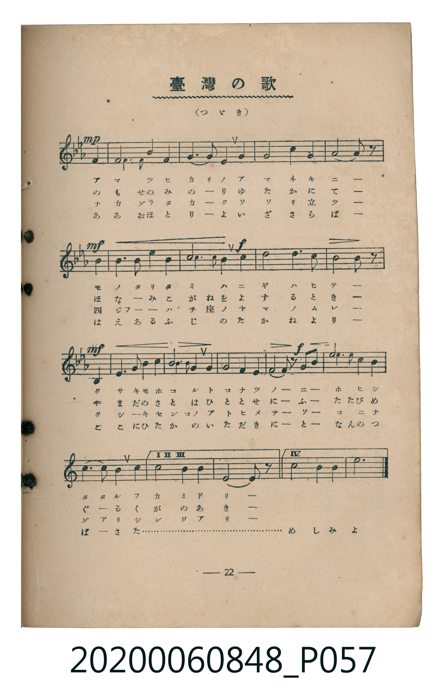
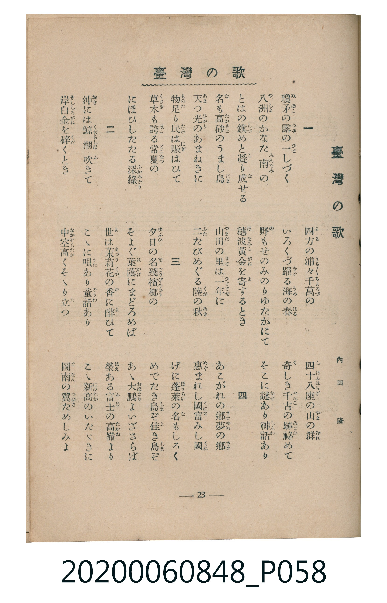

# 臺灣の歌

<audio controls src="taiwan_no_uta.mp3"></audio>

- 詞：內田隆（昭和6年臺灣教育會選歌）
- 曲：信時潔
- 臺灣教育會公認《新定兒童唱歌》高等科第一學年用（2020.006.0848 / 2020.006.0849）

## 說明

原書資訊與歌詞全文（對應 P056.jpg – P058.jpg，書頁 pp. 21–23，高一第二學期第 9 首）：
調性與拍號：變ロ長調／ト律音階（2 降記號）、4/4 拍（♩=120，弱起第 4 拍進入）

## 跨冊／重複收錄參照

> 同曲（《新定兒童唱歌》高等科男、女共用教材）

- **[同曲]** 《新定兒童唱歌》高等科女子用（2020.006.0849）：[**〈臺灣の歌〉**](../../koto_girls_2020.006.0849/1_2_09_taiwan_no_uta/index.md)（`B,` / `4/4` — [原始 TMD](../../koto_girls_2020.006.0849/1_2_09_taiwan_no_uta/taiwan_no_uta.tmd)）
- 總表：[跨冊重複與同名歌曲總索引](../../../duplicate_songs.md)

## 歌詞

```text
一　瓊矛（ぬぼこ）の露（つゆ）の一（ひと）しづく
八洲（やしま）のかなた南（みんなみ）の
とはの鎭（しづ）めと凝（こ）り成（な）せる
名（な）も高砂（たかさご）のうまし島（じま）
天（あま）つ光（ひかり）のあまねきに
物足（ものた）り民（たみ）は賑（にぎ）はひて
草木（くさき）も誇（ほこ）る常夏（とこなつ）の
にほひしたたる深綠（ふかみどり）

二　沖（おき）には鯨（くぢら）潮（しほ）吹（ふ）きて
岸白金（きししろがね）を碎（くだ）くとき
四方（よも）の浦々（うらうら）千萬（ちよろづ）の
いろくづ躍（をど）る海（うみ）の春（はる）
野（の）もせのみのりゆたかにて
穗波黃金（ほなみこがね）を寄（よ）するとき
山田（やまだ）の里（さと）は一年（ひととせ）に
二（ふ）たびめぐる陸（くが）の秋（あき）

三　夕日（ゆふひ）の名殘（なごり）檳榔（びんらう）の
そよぐ葉蔭（はかげ）にまどろめば
世（よ）は茉莉花（まつりくゎ）の香（か）に醉（ゑ）ひて
こゝに唄（うた）あり童話（どうわ）あり
中空高（なかぞらたか）くそゝり立（た）つ
四十八座（しじふはちざ）の山（やま）の群（むれ）
奇（く）しき千古（せんこ）の跡（あと）祕（ひ）めて
そこに謎（なぞ）あり神話（しんわ）あり

四　あこがれの鄕（さと）夢（ゆめ）の鄕（さと）
惠（めぐ）まれし國（くに）富（と）みし國（くに）
げに蓬萊（ほうらい）の名（な）もしるく
めでたき島（しま）ぞ佳（よ）き島（しま）ぞ
あゝ大鵬（おほとり）よいざさらば
榮（はえ）ある富士（ふじ）の高嶺（たかね）より
こゝ新高（にひたか）のいたゞきに
圖南（となん）の翼（つばさ）ためしみよ

弱起拍（第 4 拍進入）與主體樂段（共 29 小節 + 結尾）
```

## ABC

```abc
X:1
T:臺灣の歌
C:曲：信時潔
M:4/4
L:1/16
Q:1/4=120
K:Bb
V:V1 name="Piano" snm="Pia"
[V:V1]
!mf! z4 z4 z4 F4 | D6 F2 B4 c4 | d8 c4 B4 | G8 F4 G4 |
!f! F10 z2 F4 | D6 F2 B4 d4 | f8 d4 B4 | c8 d4 B4 |
!mf! G10 z2 D4 | E6 F2 G4 A2 B2 | G6 G2 F4 G4 | e8 d4 G4 |
c10 z2 F4 | D6 F2 B4 d4 | f8 d4 B4 | c8 G4 E4 |
!mp! F10 z2 D4 | D8 G4 F4 | G6 A2 B4 G4 | F8 c4 B4 |
!mf! G10 z2 E4 | E6 E2 B4 G4 | !f! d8 c4 d4 | e8 d4 B4 |
!mf! c10 z2 D4 | D6 F2 G4 F2 E2 | D6 F2 G4 A2 B2 | !f! c4 B4 c4 d4 |
f8 d4 B4 | c6 d2 c4 B4 | c8 d4 B4 | G10 z2 z4 |
!mf! z4 z4 z4 F4 | D6 F2 B4 c4 | d8 c4 B4 | G8 F4 G4 |
!f! F10 z2 F4 | D6 F2 B4 d4 | f8 d4 B4 | c8 d4 B4 |
!mf! G10 z2 D4 | E6 F2 G4 A2 B2 | G6 G2 F4 G4 | e8 d4 G4 |
c10 z2 F4 | D6 F2 B4 d4 | f8 d4 B4 | c8 G4 E4 |
!mp! F10 z2 D4 | D8 G4 F4 | G6 A2 B4 G4 | F8 c4 B4 |
!mf! G10 z2 E4 | E6 E2 B4 G4 | !f! d8 c4 d4 | e8 d4 B4 |
!mf! c10 z2 D4 | D6 F2 G4 F2 E2 | D6 F2 G4 A2 B2 | !f! c4 B4 c4 d4 |
f8 d4 B4 | c6 d2 c4 B4 | c8 B4 c4 | d12 z4 |
```

## TMD 檔案連結

- [主旋律 TMD 檔案](taiwan_no_uta.tmd) [[在 TMD Studio 編輯](https://tmdlang.github.io/Tmd-TS/#tmd=s7IKdvYPcrWy4tLSUnjRvut54-LHjeuere1R0NLiUrRVMDQy4LK3VXDS4bIx0Tex46pTUHqxct77PbOeti5_PmXDy1lt7_d0PJux9umkHrOnO7dATHg2deaLpk3P5jS_bNwBNOr9nk4lkMZnszcBNT7Zv_DZzKZne6eAxdA0PG1d82JV7-OGrmfTNjxdB7Rk0vPVS59O2Qg05XFD98vVM56v7Xy-fOLzNWue7Gh4unYH0MrnU1YAnWBkYGSgZ2BgpmdgYWKhoK-AzLcEO4BLX0vBllqAS0FB4Wnf_Gezd7zY3P5iRdeLjnagE4Eh87R1xbNp7UAHPd3Q-6y9UyHAwNRML6sgXeFRw2QQxwLEeb-nB6jz5YJGhYICPQUjQ6CckTFQEOg_oLdAntvVA_TcsznzgWwFS4WXy6YBvQAMO5C1L1btf9awHGRhd--LmfOBoi_WdT1uXvty6nag1Ps9_Y-bO57u6345f_PLWX2gkFF4ObP3xYoZYLWdjxsagfGoANQLlHo0c6UtMIKBNj_ds_HF1u0g28ByLxs2PW1dClTOBbIR6KbHDQ3PJ3c9nz8bqOtx45rHjXseN04GGde47uUcYKwCBZc8bgKmBZAIUD1YZNPjRmDUAEWmP25c-rixHxxoraufbQFraGoBS-yD6Hnc2P24cdXjxvlPe6eDNe9_3DQZLAL0EkgBSDPQvMeN60F29q0FKwIZDJJuagRKPW2fCxYEu6up61nHBDB3FVj_7MdN3WD7J4A8DhVtagKlqAVNYJH5YCdMfdw4BeaiNqDrgHY83bwNrGAGxLFgU5asBAs1wdy_5GkrMH4gfu4GWg4zAqTgcePax429jxtXg3Q-71z5YttmsP-BckAV4EgBunbDRJgrIB5e_2IzRGT140ZgNIJEwKYvA6eB3s5nc0DJHhiqYDcDPQXyzotVoKT3uHE3LBS6n-7Y8XRJP1gQGHaQEF2CHKJA44GqgQYDwxJo-XygnmfbNz7ftgCsZys4UPY_blwJ8RQkPewCZsaGZ5uAiRKopAtqO8ik9S_Xw1216HETMEg6n-1dB4uq3UDu0wk7IQaDtQBDBeyfp5t2PJ-592U7xMdAUaDq6Y-bgIweYOiBfTLp-SJQagYbDXQbUDOQAfRSL1j_7NnPpoENbgIFLMR_z7Yue9zQCtbTBnQLhAQ5obf5xYQ1YPGFYPVAa8CpCBYkLWAhoPFLX-wCp5amScAAgITns63boSbCEuazGUDNQJH1QFlo8njZDnEq0OegWAGlPlBUA4NxHTAYgfkEltqAQQb2__OV059tXvRydzMsCIBRAkr64BhDBMHT9S0QP4Jtngm0ECkINm4ElsewjAVMdJBAWveyHVj-Ak0EJhJIZlwPKjl3boHnUDAC5mtQDEJjFymGgO7cDM5eE4C2vZy5AxYFoEIdaPrz5UA_QzICKBFAiwtgKdPwdMnUZ9PBIQPyLjAdATM9SAcwAz5bNwOSB4F5DZKsnq3a_GwZMN8BBYG2TYbEFnKUzAVFVOOEFxM7X0yBZH1gbgD6fhIs5QE9DEyivWCnboC4Apw8oWG1_kVP54u-zhddG8GagaqBxRUw5fY_boJkrnUvl80ES4HiEGjiyzZwfm4CRgeQC8t3oPhomguUfjoFHBOgZADOwMAAaOoCVlUvVkIsWAlObcB8B5WCuGjt85W7gCUOzPNA988DexWUGGBJGuhTIAKaBQlYiOlLoIn8aW8jsAB9ums5LEsByyRg0ALDYuHjRlAdAQrgjWAngFMBNJL2AXM8UKThcRMo2sBmLYUUFBAXAg3qBeaKp_1gdaCyEpjsoMX7i-0LYTEMSj_Pl06FpBxYsQsNF2CgAPWsfrEGkvKBvgM2EmDhsnQeLFyAmRoYgkjhAvUYMMGArQAn9yZgil_3sgViETTdPl2yCJqWmhqhEYaqAGTQs2ZwqQVOrmBF-8BmTX86BxKYwOBdDTJrPSSFQ_IDMJOhK4B4CZjpV7-YvObFBGAKhWRJSDECjHloQkauScB-A8YouJYDO2E5OGJ7YdUHvK6b92QvpAKAJE0sCiD2A8Nn7tMly19uhZRVwNQKdMIKaOUCyg7AGJ4G8j_IUeA0_2wZpKwFpgeI2UAjuoG-fboY6CtIaQ5MfODAWz3j6bZdsBoH6GxICQN0FDipQtI5sA0GS63AHAbMA_B0CizMgJYD64p5iJrt6ZxpsLobWKCsAkY0NPXt3wMWXAJ0JNC10FIFFEBADwNr-Q6QZspbZFCgoKUPbulBGjSQZg5mswbYenqyY_fL1VOerWh6tg5Y0nU8bd2oYGSp8HRD__P1DQraCs-3Tni6ARQdIAPDUouKU53yUyqtAjIT8_IdagxqFKpBzlawsdCyAzPgVkJN0Hja2atgDLL0yZ6Jz9YCE28P3BmPG3oeNwOTIDC1NT1ugLpKE2QRyKQaBQMFXTiuzk2rVTCNB7JqwHkFZBGmpyHt4RcLexQ0TKB-0IE3PTWxaIDaBTRMA6hR00rhcfMckAAw5W4GuuBxcx-I3dwCds_j5mVgOQgbJBMdFgtkTQLzOxByTdvBulqhvPVIuvaAdD1uXhKLbDUw44OsbpwMsbqxB6ytB8xeB9HYOBVhSOMKmNVNbWCVjUhyIPUQ1TCVqFY3NcKtrlEwBgWoLihcDYGUESh0gZEFEoLwQKI1CmYQVWB1uhBeDYQNgQYK1cRGzq4eiiIHHLCgoJ2HiJym1VD_dSFFwH545MwHy21GCgeQOpA4IhrRIqcDa-RMgEbOPqTImQ4N5n6kCAA5B2Q1sLwB80FOgcmB1ENUw1SiWt04CWfkgKIFGOrQIAfxIJEDiiZUEXh0gWMGlG_AJhHMN52U5RuQr0D-AAUpJA9AfAXxHygvgOQXwvMKJAFDctkq9Ohp2g3lYYQRsLrBGj0ghcCaAYgheaIT2fpGUAaGOA-WR8BRNKEXrLYJPYqaujEjFlv-MYFHETjQzUFRBY8AIIWcYUyQIgoqBIs7UEQRk32AfqUsjhZBggGYPUDeBgdZ01aI95q2IHkVXrY1LQPz5yHkIGVb0w6oSiQZWAAtwho_yyFWN4LzY2MvmA3LPvuQwh9kIMTqDrhKlLgBq4apRLW6sYns7AOOEXB0ohdtuQVEZqBdUzAjx5yEyEH2Dyi9gioWSJBDMgEom6BGziKMKACHa9NaKA-UilFDqBl75IAyAKRlBas0gA0gJI0gPiQ6QA4DW944DcxHqpaAWQ5kygYUfSjRsx4zeqAhD0n9sJwDzkeYNQ2WGglexEGijkD2aV1LWQxB6gpo9gEXWpCaBsQD1Scw74JKDUjt0w0OGFB5gywHj9nmNoxAakIEEnIMQVoXoJgCGQiKWGAzFqKxcQbCEHjRBstoSEmgEZQsQPEIiS2k6hIWP5MxizYghRQVyG0DUJ0PyVXIJRtqriKxBmqmKHrAJRkk-YP8BCrrHjcD-3CQKgaWh0DJGFb1gCobUF6D5CpIMEDyDXLVNRspoEDxBikC8TTfVoNDexOYDeoqwCMGPKgCsx8YQcDBCXAJB5JfjbAfmAGR6y5QFwIlfoF9CIQDkAs6WFYCRhqGMLRuguUhUOyB2DjKRUIZaTUwpoAt-6e9XQoahuTGF6RlBMtOsHbT4-ap2AIXVKwganBQsQMLRXhAQFKdMaKc4KoF94EgvYL3e-cB2zjAXg6kS6Og4ZqXkpmXruCpo-AJxp4gN4GiARgxzZ3QLA60ENwjgSg2NDLG3fUh2BYD9WOQ3AQarAO5pgk4H4DupjCQWxrBVR6oBQnKrx3AofMpCsA-E6SDCelRonUhgb2oZzOanvXPerKjCxhDILPXLkJyvwkxrsfsCkCcD3W8rp0CvB-oAOTAQwbEwSIDLB3sFJS5uAA)]
- [鋼琴伴奏 TMD 檔案](taiwan_no_uta_piano.tmd) [[在 TMD Studio 編輯](https://tmdlang.github.io/Tmd-TS/#tmd=s7IKdvYPcrWy4tLSUnjRvut54-LHjeuere15v6fjZfee5xO2PNmz5enS_uedHe_3dCpoaXEp2ioYGhlw2dsqOOlw2Zjom9hx1SkovVg57_2eWU9blz-fsuHlrDag7mcz1j6d1GP2dOcWiLHPps580bTp2Zzml407wOZ3KoE0Ppu9Cajxyf6Fz2Y2Pds7BSyGpuFp65oXq3ofN3Q9m7bh6TqgJZOer176dMpGoCmPG7pfrp7xfG3n8-UTn69Z82RHw9O1O4BWPp-yAugEIwMjAz0DAzM9AwsTCwV9BWS-JdgBXGGpRcWpTvkplVYBmYl5-UEeDjUGNQrVXApAYGOhZQdm6GspPN2z8cXW7U839D9f36CgpQ8WrlEwUNCF4-rctFoF03ggq4YLpgvipBcLexBajEEqdEEKDYGUEUi5gjFYCMIDidYomEFUgdXpQng1EDYEGihUY7dtVw8e20D2AI2BmgHiQWwD2YsqArcfbBXIZ2CT0HzWiWKXCdwusG5zkJ1wk4AUsldMkGyECsEcAbIR02NPZ8-mwGNgK8DuQw_F3AKsXts1BZttUIMgroP5DOxPzDjCEpfwsIS4BMV7rWuxhSWQQjIbOZmAoh_ia-SgRPU13rhrxhGcMB8CrcYQhkYpzGsgN4DYOEIf1X-rgfY97ex92tuFsBXiUGNEWHHVYuRIH5QcaUI4R0JgDZ4saAjyS7RhLNjZEI5pPIRnFg_mmsXnQvimED5IGs1MtIyGYiY49mAcI5wWoLsSS3aKNsHhMIipRgTdiZ5vCLmTsInoeQPdZWR5Hmv6h3se1RQUC3A7Ey2FozsTnLTRwxNmBXIoEU7FyFpBKdg1LyUzL93QyBhfnUKw1AXVKdiMw54hCAU13BwT4hyFWTlBXIXiJqhZxLkIHqZQ5-jaKcCzugKQA_cmiINFBljO2Skoc3EBAA)]

## 分析

```text
================================================================================
📊 TMD Song Profile: [ 臺灣の歌 ]
================================================================================
⏱  Duration:       2:08 (128.0s), 64 measures total
🎼 Key & Tempo:    首調基準 B,, != 120.0 BPM, <4/4>
   - 分析範圍：      由實際發聲的音符與和弦推測調性；播放脈絡另行呈現
🎤 人聲音域:    D4 (MIDI 62) – F5 (MIDI 77) [跨度: 15 個半音 / 1.2 個八度, 難度: moderate]
   - 最低音:  D4 in [VerseBody #1 @ m.2, 0:02]
   - 最高音: F5 in [VerseBody #1 @ m.7, 0:12]
   - 適合: soprano, mezzo-soprano, contralto, tenor, baritone, bass
🏛  結構:      VerseBody (60.0s) -> Ending123 (4.0s) -> VerseBody (60.0s) -> Ending4 (4.0s)
⚡ 編曲密度:        Peak 1 軌道同時演奏
🗝  調性診斷：       A# 大調（推測轉調經歷 2 次）
   - 風格氣質:    純淨自然大調（陽光明朗、易唱易記，無明顯調外色彩）
   - 轉調歷程:    A# 大調起奏 ➔ [Ending123] 轉至 G 小調 (-3 半音 / 五度圈 +3 步) ➔ [VerseBody] 轉至 A# 大調 (+3 半音 / 五度圈 -3 步)
   - 核心骨幹音:  D, F, G, C, A#
   - 調性數值:    A# 大調 [相關度: 0.74, 穩定度: Moderate, 自然音純度: 100.0%]
   - 候選調性 (K-S): A# 大調 (0.74), G 小調 (0.71), D 小調 (0.66)
   - 五度圈歷程:   -2 -> +1 -> -2 -> +2
   - 各段落調性細節:
     • [VerseBody #1]: A# 大調 (r: 0.75, 自然音純度: 100.0%)
     • [Ending123 #1]: G 小調 (r: 0.75, 自然音純度: 100.0%)
     • [VerseBody #2]: A# 大調 (r: 0.75, 自然音純度: 100.0%)
     • [Ending4 #1]: D 調性不明確 (r: 0.45, 自然音純度: 100.0%)

  [ 五度圈游移軌跡 ]
               C  
         F           [G ]*
     [Bb]*             [D ]*
      Eb               A  
         Ab           E  
            Db       B  
               F# 
     (* = active key center)

  [ 十二半音累積音高分佈 ]
     C  : █████████████████         16.6%
     C# :                            0.0%
     D  : ████████████████████████  24.0%
     D# : ████████                   8.3%
     E  :                            0.0%
     F  : ███████████████████       18.6%
     F# :                            0.0%
     G  : ██████████████████        18.0%
     G# :                            0.0%
     A  : █                          1.2%
     A# : █████████████             13.3%
     B  :                            0.0%
--------------------------------------------------------------------------------
Assignment 軌道音域：
  - Piano         : D4 – F5 (15 個半音 / 1.2 個八度, 200 個音符)
================================================================================
```


## 原書掃描頁








