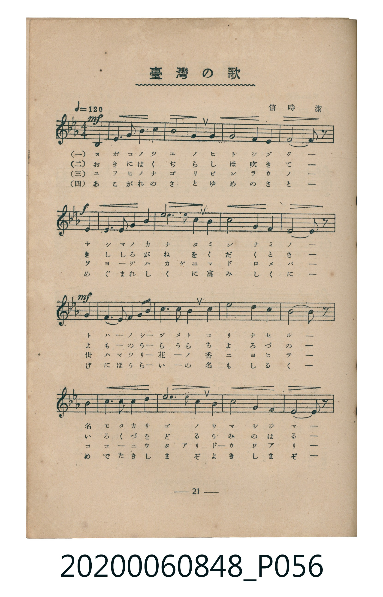
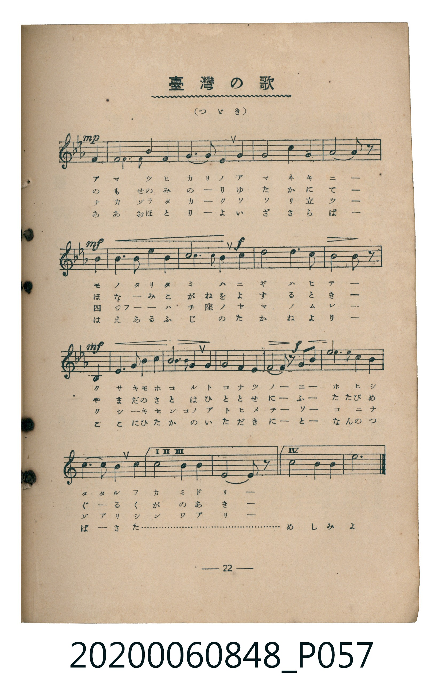
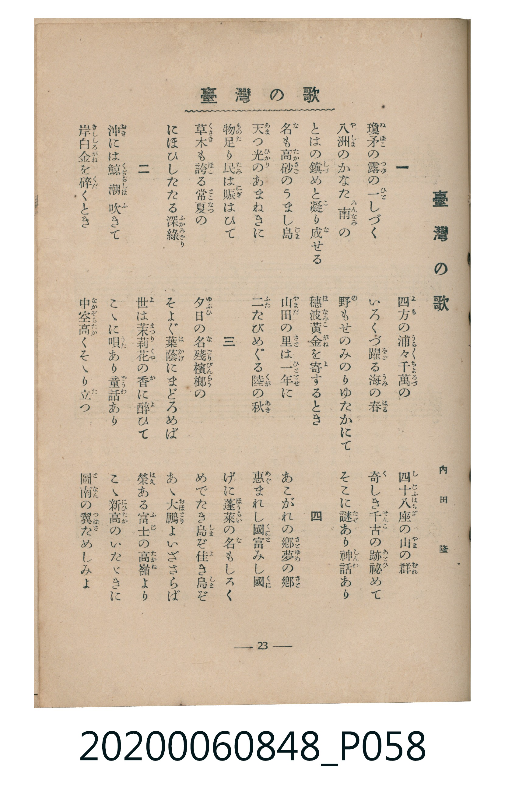

# 臺灣の歌

> Re:Shōka 使用 AI 協助辨識與重建樂譜，可能會有錯誤。歡迎[回報](https://github.com/TMDLang/reshoka/issues)。

- **鋼琴伴奏版**：<br><audio controls src="taiwan_no_uta.mp3"></audio>
- **NEUTRINO 歌聲合成版**：<br><audio controls src="taiwan_no_uta_neutrino.mp3"></audio>

- 詞：內田隆（昭和4年臺灣教育會選歌）
- 曲：信時潔
- 臺灣教育會公認《新定兒童唱歌》高等科男子用（2020.006.0848）

## 說明

原書資訊與歌詞全文（對應 P056.jpg – P058.jpg，書頁 pp. 21–23，高一第二學期第 9 首）：
調性與拍號：變ホ長調（降 E 大調，3 降記號）、4/4 拍（♩=120，弱起第 4 拍進入）


## 歌詞

```text
一　瓊矛（ぬぼこ）の露（つゆ）の一（ひと）しづく
八洲（やしま）のかなた南（みんなみ）の
とはの鎭（しづ）めと凝（こ）り成（な）せる
名（な）も高砂（たかさご）のうまし島（じま）
天（あま）つ光（ひかり）のあまねきに
物足（ものた）り民（たみ）は賑（にぎ）はひて
草木（くさき）も誇（ほこ）る常夏（とこなつ）の
にほひしたたる深綠（ふかみどり）

二　沖（おき）には鯨（くぢら）潮（しほ）吹（ふ）きて
岸白金（きししろがね）を碎（くだ）くとき
四方（よも）の浦々（うらうら）千萬（ちよろづ）の
いろくづ躍（をど）る海（うみ）の春（はる）
野（の）もせのみのりゆたかにて
穗波黃金（ほなみこがね）を寄（よ）するとき
山田（やまだ）の里（さと）は一年（ひととせ）に
二（ふ）たびめぐる陸（くが）の秋（あき）

三　夕日（ゆふひ）の名殘（なごり）檳榔（びんらう）の
そよぐ葉蔭（はかげ）にまどろめば
世（よ）は茉莉花（まつりくゎ）の香（か）に醉（ゑ）ひて
こゝに唄（うた）あり童話（どうわ）あり
中空高（なかぞらたか）くそゝり立（た）つ
四十八座（しじふはちざ）の山（やま）の群（むれ）
奇（く）しき千古（せんこ）の跡（あと）祕（ひ）めて
そこに謎（なぞ）あり神話（しんわ）あり

四　あこがれの鄕（さと）夢（ゆめ）の鄕（さと）
惠（めぐ）まれし國（くに）富（と）みし國（くに）
げに蓬萊（ほうらい）の名（な）もしるく
めでたき島（しま）ぞ佳（よ）き島（しま）ぞ
あゝ大鵬（おほとり）よいざさらば
榮（はえ）ある富士（ふじ）の高嶺（たかね）より
こゝ新高（にひたか）のいたゞきに
圖南（となん）の翼（つばさ）ためしみよ
```

## ABC

<div class="abc-score" data-abc-src="taiwan_no_uta.abc" aria-label="五線譜載入中"></div>

[下載 ABC 原始檔](taiwan_no_uta.abc)

## TMD 檔案連結

- [主旋律 TMD 檔案](taiwan_no_uta.tmd) [[在 TMD Studio 編輯](https://tmdlang.github.io/Tmd-TS/#tmd=s7IKdvYPcrWy4qpTUCpJTLdSSM7PyUlNLsnMz7MqzsjMK0nNjM_KTMmPL87Iz05Ugisry88pzU21ys4vyY9Pyq8sjjcyMDKINzAwizewMLFAqCvOLy1KTrUqTs7Iz8-JL0mtKEnKz89Gl48vSExPtQowMDXDKWOOUwbJtoKi_LLUvMQ8oI0FRSDHp4CtRChILctMSQVJFycn5sWXpRZlpmWmpiB5K7WoGOx1iBUlRYl5xclFmQWg8ECoyi8qychPL0osyKi0ysgsLskvykxOzInPTsxDCqGSjFRgABXkJCanIuvMTM_MsypJzASGJyhMyxPjcxMz83IS85BcgVBVDnRlflpaZnJmYo4Sl5aWwov2Xc8bFz9uXPdsbY-ClhaXoq2CoZEBl72tgqsOl42JvokdyJQXK-e93zPraevy51M2vJzV9n5Px7MZa59O6jF5unMLxIRnU2e-aNr0bE7zy8YdQKPe7-kEW_9s9iagxif7Fz6b2fRs7xSwGJqGp61rXqzqfdzQ9WzahqfrgJZMer566dMpG4GmPG7ofrl6xvO1nc-XT3w-ZfvTtROeT1kBtByUNvSAaUMPlDbAVnHpaynYUgtwKSgoPO2b_2z2jheb21-s6HrR0Q50DDAMnraueDatHeiApxt6n7V3KoASmF5WQbrCo4bJII4FiPN-Tw9Q58sFjQoFBXoKRoZAOSNjoCDQJ092NDxfs-bJrp6na3c8mzMfyFawVHi5bBrQC8BQAln7YtX-Zw3LQRZ2976YOR8o-mJd1-Pm2S-nbgdKAW1-ObNXwVXh6ZLlYG6PsQJQ4MWKGWC1nY8bGoExpgDUC1T5aOZKW2BUAhU93bPxxdbtINvAci8bNj1tXQpUzgWyEeimxw0Nzyd3PZ8_G6jrceOax417HjdOBhnXuO7lHGD8AQWXPG4CxjpIBKgeLLLpcSMwKoAi0x83Ln3c2A8OtNbVz7aANTS1gCX2QfQ8bux-3LjqceP8p73TwZr3P26aDBYB-gGkAKQZaN7jxvUgO_vWghWBDAZJNzUCpZ62zwULgt3V1PWsYwKYuwqsf_bjpm6w_RNAHoeKNjWB0s6CJrDIfLATpj5unAJzURvQdUA7nm7eBlYwA-JYsClLVoKFmmDuX_K0FRg_ED93Ay2HGQFS8Lhx7ePG3seNq0E6n3eufLFtM9j_QDmgCnCkAF27YSLMFRAPr3-xGSKy-nFjH0QEbPoycBro7Xw2B5TMgaEKdjPQUyDvvFgFSnqPG3fDQqH76Y4dT5f0gwWBYQcJ0SXIIQo0HqgaaDAwLIGWzwfqebZ94_NtC8B6toIDZf_jxpUQT0HSwy5gtmt4tgmYKIFKuqC2g0xa_3I93FWLHjcBg6Tz2d51sKjaDeQ-nbATYjBYCzBUwP55umnH85l7X7ZDfAwUBaqe_rgJyOgBhh7YJ5OeLwIGA8RooNuAmoEMoJd6wfpnz342DWxwEyhgIf57tnXZ44ZWsJ42oFsgJMgJvc0vJqwBiy8EqwdaA05FsCBpAQsBjV_6Yhc4tTRNAgYAJDyfbd0ONRGWMJ_NAGoGiqwHykKTx8t2iFOBPgfFCij1gaIaGIzrgMEIzCew1AYMMrD_n6-c_mzzope7m2FBAIwSUNIHxxgiCJ6ub4H4EWzzTKCFSEGwcSOw5IVlLGCigwTSupftwJIWaCIwkUAy43pg9gSWyfAcCkbAfA2KQWjsIsUQ0J2bwdlrAtC2lzN3wKIAVHwDTX--HOhnSEYAJQJocQEsZRqeLpn6bDo4ZEDeBaYjYKYH6QBmwGfrZkDyIDCvQZLVs1Wbny0D5jugINC2yZDYQo6SuaCIapzwYmLniymQrA_MDUDfT4KlPKCHgUm0F-zUDRBXgJMnNKzWv-jpfNHX-aJrI1gzUDWwuAKm3P7HTZDMte7lsplgKVAcAk182QbOz03A6AByYfkOFB9Nc4HST6eAYwKUDMAZGBgATV3ASunFSogFK8GpDZjvoFIQF619vnIXsMSBeR7o_nlgr4ISAyxJA30KRECzIAELMX0JNJE_7W0EFqBPdy2HZSlgmQQMWmBYLHzcCKojQAG8EewEcCqARtI-YI4HijQ8bgJFG9ispZCCAuJCoEG9wFzxtB-sDlRWApMdtHh_sX0hLIZB6ef50qmQlAMrdqHhAgwUoJ7VL9ZAUj7Qd8DmACxcls6DhQswUwNDEClcoB4DJhiwFeDk3gRM8etetkAsgqbbp0sWQdNSUyM0wlAVgAx61gwutcDJFaxoH9is6U_nQAITGLyrQWath6RwSH4AZjJ0BRAvATP96heT17yYAEyhkCwJKUaAMQ9NyMg1CdhvwBgF13JgJywHR2wvrPqA13XznuyFVACQpIlFAcR-YPjMBdbiL7dCyipgagU6YQW0cgFlB2AMTwP5H-QocJp_tgxS1gLTA8RsoBHdQN8-XQz0FaQ0ByY-cOCtnvF02y5YjQN0NqSEAToKnFQh6RzY2oKlVmAOA-YBeDoFFmZAy4F1xTxEzfZ0zjRY3Q0sUFYBIxqa-vbvAQsuAToS6FpoqQIKIKCHgbV8B0gz5S0yKFDQ0ufiCgM2qVMNjYxNrMLyM5NTHWp0DWuqQdYo2Fho2YEZNQoGCrpwWJ2bVqtgGg9k1SgYgkWMFUyBpBlYBMSCiEFwDZgEQSMgBqmvAbMg0EChGmgYWBRsk49hjQLIZBgENp_AOoBtKCh_MhCvA7OWQGSa2uBqIeKboDpWwMWng8mlUPF-uOnxQN0tCLuN0O3ugurohfJXA_F6MAtkBkhmEUxtUyfcJpD4brgZW8EkyASQ-DJkuyGiELuN0ewG-wqkA6Qf4iuY_1ZBZabA1YLcCawMoOExGc1NMJNAuhF2z0XYbYLu7yaoDohJwFIGaFYPmAUyAyQzFa4WFMpw1zY1wsUhbgWpQ44LSJiDVNWASzN4EjIEJxNQ4gGKxEHVglIURAjEgqUqUOqBaYOmIVCKBCc2eCKCRAXICfvgjumGOgYUgBC5-WByP3rAgVXAxdECDuQVRIJB2DMdaAIoQkHBBdG3FmZe0ySwOCzRLIDbAxKBmghPZrBA6kDYA0wcED5I9QR4IoT5B2Q6LIFCfAwRXwm3H-wuSLADxTfgsgeYEEDmw8MNGumwRA3LODB7YO4GhRMsDJD9CVKFCDeQK-GRDikBDME0qPSAxbAZUkkCTwbmcCFY4QKKdHDCQIpvRJaDxDbM1aBsD_E9NLGCkzUoREHZBjm-Z0PFQeGKcDc4uyHiuwmUOZDtgSV9UGaD8GEZbyFUBhJz8HiAF0So6QqpIALFNziOYekXVNRB3AuOB0iphewIWFKABTmwLQYWh5WFqOUOOACQohyiCxSEEO9APACSQbcHWvYgBQI4ysFBhlm2ouRzWASDaFCMkpXPC2ohwoh4hzoFlJchwYAodOAFJGpMgfMHcnqdgSYOCSRwIYgU76C4g6RuSAxCcjVqPoPYD7MHkS8g9oNiFDN9gYtUpHiHFbqgygYcGeBSCiQDD3RogQ-yFyQOrwCbIOUJtPiGp2-MdAyO9OVI4QZJl7AcgwifeWBTwSUEVBVyuMHKGZAqbOEGHEMyBTUxkLO8ETiiIVELaRgYg6MYtakASgYQERO42dBiHj3bIxwLziTwFA8JZFAgwIIfVqshdKwFkyBvYRRX4GSFme1BhQTMPPTqARot8JobFG0QPZBkATIfMy-Cii3k6Ie6GxiosGIEFv2wZAOrNsA1OJRGThYw9aDwQNgDjlyk6If5BxQ-IDfAi3NEsQiOeGjBBKSnwe0HZTBEGYFSnUASOSzPQ8prU0hOR87hkHIe1PaDFOygAgEEIbQZWlGP1OJEinlIuIMTMJrPERkPUlHCQr4PRRySWjBjBFx9IVXwiOYCyFx49QGu5iGpCFrBwzPKTHgIwmJzBZYKHr3ABxVDENWQNiO0uABXIyD-NFjKg-hEScnQsGhqAMcgxGVY_AOOeVhDogleYIHsQ3UBJIVjpry1UHs6sBQwkFoFpVVHaccA3DRAinJIsxMUkJAMCc0-UMsRQY5om6C36aCdBrS6F5xAkKIcErCglhquhiwsaWF2NiBtDGhbAq0NBA5opCiHtR2B_gHrgLRBUd2NWngh7AHZjGjToSZh1MY9ap0C1oclaiH2wJIWovACtVZxFJLQtjAsyiHVOZBCr8-RWnVYG2wQJ8GqH4jVkHyNlD6RogdJBbjXgwgGSOMVkQyQ0j5S5QorExB9KUgVBskTkLIEvbyElAKgCELrf0LLP1ASgXYooO2eWkTf2jUvBda7NsDsXMMaPaBAgvaA4KFsAO56IwcbIsYgxRG0FYCSGZGKSnCAwQoE9NQEilUsesD9DUSOwt2qgOiBedSEZG_CGoAQn6L4E6krCWltwHppsNY0xAVQ-3XtFODjGApIHKCL4FyQ84AcZS4A)]
- [鋼琴伴奏 TMD 檔案](taiwan_no_uta_piano.tmd) [[在 TMD Studio 編輯](https://tmdlang.github.io/Tmd-TS/#tmd=s7IKdvYPcrWy4qpTUCpJTLdSSM7PyUlNLsnMz7MqzsjMK0nNjM_KTMmPL87Iz05Ugisry88pzU21ys4vyY9Pyq8sjjcyMDKINzAwizewMLFAqCvOLy1KTrUqTs7Iz8-JL0mtKEnKz89Gl48vSExPtQowMDXDKWOOUwbJtoKi_LLUvMQ8oI0FRSDHp4CtRChILctMSQVJFycn5sWXpRZlpmWmpiB5K7WoGOx1iBUlRYl5xclFmQWg8ECoyi8qychPL0osyKi0ysgsLskvykxOzInPTsxDCqHEIqDm9NTc1LwSq4LMxLz8-MTk5PzcgsS8TJAYQmFJBlCRVUFOYnIqshWZ6Zl5ViWJmcCABwV-eWJ8bmJmXk5iHpJzEarKgd7JT0vLTM5MzFHi0tJSeNG-63nj4seN656t7Xm_p-Nl957nE7Y82bPl6dL-550d7_d0KmhpcSnaKhgaGXDZ2yq46nDZmOib2IGMfrFy3vs9s562Ln8-ZcPLWW1A3c9mrH06qcfk6c4tEGOfTZ35omnTsznNLxt3gM3vBLvp2exNQI1P9i98NrPp2d4pYDE0DU9b17xY1fu4oevZtA1P1wEtmfR89dKnUzYCTXnc0P1y9YznazufL5_4fMr2p2snPJ-yAmg5KGXpAVOWHihlga3iCgNGU6qhkbFVAChggzwcanQNa6q5FIDAxkLLDsyoUTBQ0IXD6ty0WgXTeCCrRsEQLGKsYAokzcAiIBZEDIJrwCQIGgExSH0NmAWBBgrVQMPAomCbfAxrFEAmw-DjxjVgHY8b90D5k4F4HZi1BCLT1AZXCxHfBNWxAi4-HUzOgor3w02PB-puQdhthG53F1RHL5S_GojXg1kgM0AyM2BqmzrhNoHEd8PN2AomQSaAxJch2w0RhdhtjGY32FcgHSD9EF_B_LcKKjMFrhbkzseNm6HhMRnNTTCTQLoRds8F2w2NXkg0GoKjChSBQJE4qFpQrEKEQCxYzIJiEKYNGo-gVAGOcHhEQoID5IR9cMd3Qx0D8gREbj6Y3I_ueLAKuDia40FRi4g0hD3TgSaAAvVxYw9U31p4YEwCi8MibgHcHpAI1ER4VMMSRwfCHmAEQfgg1RPgCQHmH5DpsEQC8TFEfCXcfrC7mhqh4huw2AONDEjuMATToJwFC3kzpFwGjx5zuBAs44EiAxxhSPGASI6QWIAlU1CWgLgKEgKg7AWJB1CSQo6H2VBxkH8R8QBOioh4aGpCswea9MAJEcKHJcqFUBlIiMLDB55JUeMbKZOC4gEc9rB0BSoGIO4FZ25IjkZ2BCyKQBEDEQdZiignUPMkOABgUQELeBANCmmy8kVBLUQYER_QcAKlfYjzHjdOhToGnqlRQxCcnmBpHESCCh5kcYjjQeYixwckNYPSOCRkIbkANV1C7IfZA8pvyPaDQhoz3kFyyPEBybWQAhJkEiRXg2TgKQJaSIHsBYnDC-0mSP4Duxwp3SGnL5R8YQQOdUg4Q2oWY3B4I9c1xuA4gYiYwA2EllHoeQMRsuCUBE8WEB-DXAQLC6gbkXSsBZOgUEZOYJA8jR4XsDifDTcPvWyDhhG86AeFIUQPJI5A5mMmWFDeRo4LqLsb58HzGiwuYHEIK_PAVQCURo4jmHpQeCDsAZcZsLiAFDamkOyAnA0ghRSoUoeUSqBcA4IQ2gytnEJqSiDFCCQ8wLkDzUWI1AkpfWEh0ociDolFzJACl_1ItQaiDgKZCy_7wHUHJHahtQakfAaKzISHFCyUV2CpNdBLK3gjAdoYgOYpcBkI4k-DpQiITpQUBg2LpgZw7oC4DNU_KFU4pS0xcH2DFBWgYgmSxCEJGJrcoIGFCApEBYpegUNbaWgFOjjikKIC4mFQtQzLHLACEdGKg0Q5ZusOUnFBKyjUTAgOcOSogDUUgP4B64A0OFDdjZrZEfaAbEZU4KhJC7U1BakjgBR6JYFUhWOtncFWwGtnSP6H5ANIICN5BxxsSCrAzT-E8ybAzITqREr7SCU2LA8hGpXzoKJN8LyHku9hdR3IG9CGIjwcDMC9BGSPIQocSAaDFv4ohTxS5gd7CZbE0eOhF7secLMMkRZxVyYQPbXoHR4jwv0dsK8UjOO1wQUV0N_x2oYKhtqgzGSoDapegIEA5sEl4RQieMxBeiEmgZmYQYZsBYQFNQRiOMgSWF0GYUEsMAMqgktAdZjEa4MtQTYSYh20wIU4DmotTDXMWhgf7k-Qk7WNoJZAmej-hxQ2INoIzAbKqEN9q41cyEC5MLthTgfREDbEHlQjKfEvsPUFkYPaCPUqkAKzoPpgHSCwZnjkmarDgwZIgW0G-RrEgLkFpQAFBS6KZbB0AaKhIQb1HLK3QeLgbjA0oiEhCILAwACFIjQ4MQITe-KhavqEdM_BqQDuJ0ghAKKhEYNIoEiuBboVJbAQsQZPTXAGZsRBvIaRXX2IGJ-A-MIwHmQi0HKIqUhcFBmTeFDExoNdALMfyAcxQcKQWEZyG4hjAuIYQyTBbFB4grIrPAxhQQW3G8I0R5gINQ5kPcgsmGEQcSO4aRASbhLELFRLgEoQKlE42OUgliD8CzIRZCHIWpgmqJ9g2QHJNqh_QYbAggGoDe5AkKHU8ZO2EVKoo_NBmhE8IBscG6C4gUYL0HYIE6hXHcKGyyIpAzoKaC7UGKTyESqKFo-g6INEHbrnQKJgReCGL1QSbjDe0EVNLwOTZqGujteGaofHNVgjPK0CAxLIB5IQzWAXoQejESi0gQQiBoAGQGxHUgeVhEqBPAZNaVAGJCiQggEaBGAR1KLBZLAOXMIaLrC-cQ-0_Q7tPcMb1_AmLKzfB27DQcSxN4UhvQxwS4_WA3iQZiR4oAXqeFjjFDaKCmtAwtr_--HikIEK2IAbarscPAxBwwEviG2gpjV0QALcFQbJoI8OQRu-SENXYHeDm83I_sQS6DQaHWpcDnUIqFXfC3cSar8Q1E5H9EtBqpADHTb6CGnNwwIdMiJB29EU2CgHaNQE1K-BJwzEiCLY1dAxPSA9De52UDpHRBTKCCmkz0yX0QfYGC-oB4TU6wLSiH48JOnMh4ojujlr4T5E736gDSzSpreOPAwH6UpiOhHidFjgg-Qh4qABcRxDWdDhdlJ6t9g6irC8AXE_aqBDhmJAPTm02R1oMgAlDoRrUQtJSJIHlTsgcdiAMsTtWGqK0R7faI8PHk2jPT6M9Em9Hh8osFA6fVAK4US4t-G5Dj23jnb4Rjt8UM2jHb4R0uFDKw507RRgg0DRPoaxCih8IzS-MYJvAlWtzAUA)]

## 分析

```text
================================================================================
📊 TMD Song Profile: [ 臺灣の歌 ]
================================================================================
⏱  Duration:       1:08 (68.0s), 34 measures total
🎼 Key & Tempo:    首調基準 E,, != 120.0 BPM, <4/4>
   - 分析範圍：      由實際發聲的音符與和弦推測調性；播放脈絡另行呈現
🎤 人聲音域:    A#3 (MIDI 58) – D#5 (MIDI 75) [跨度: 17 個半音 / 1.4 個八度, 難度: challenging]
   - 最低音:  A#3 in [Verse1234 #1 @ m.1, 0:01]
   - 最高音: D#5 in [Verse1234 #1 @ m.7, 0:12]
   - 適合: soprano, mezzo-soprano, contralto, tenor, baritone, bass
🏛  結構:      Verse1234 (60.0s) -> Verse123End (4.0s) -> Verse4End (4.0s)
⚡ 編曲密度:        Peak 1 軌道同時演奏
🗝  調性診斷：       D# 大調（推測轉調經歷 2 次）
   - 風格氣質:    純淨自然大調（陽光明朗、易唱易記，無明顯調外色彩）
   - 轉調歷程:    D# 大調起奏 ➔ [Verse123End] 轉至 C 小調 (-3 半音 / 五度圈 +3 步) ➔ [Verse4End] 轉至 D# 大調 (+3 半音 / 五度圈 -3 步)
   - 核心骨幹音:  A#, D#, C, G, F
   - 調性數值:    D# 大調 [相關度: 0.85, 穩定度: Moderate, 自然音純度: 100.0%]
   - 候選調性 (K-S): D# 大調 (0.85), C 小調 (0.75), A# 大調 (0.74)
   - 五度圈歷程:   -3 -> +0 -> -3
   - 各段落調性細節:
     • [Verse1234 #1]: D# 大調 (r: 0.85, 自然音純度: 100.0%)
     • [Verse123End #1]: C 小調 (r: 0.56, 自然音純度: 100.0%)
     • [Verse4End #1]: D# 大調 (r: 0.76, 自然音純度: 100.0%)

  [ 五度圈游移軌跡 ]
              [C ]*
         F            G  
      Bb               D  
     [Eb]*              A  
         Ab           E  
            Db       B  
               F# 
     (* = active key center)

  [ 十二半音累積音高分佈 ]
     C  : █████████████████████     21.0%
     C# :                            0.0%
     D  : ████                       4.2%
     D# : ██████████████████████    22.1%
     E  :                            0.0%
     F  : ████████████              11.8%
     F# :                            0.0%
     G  : ███████████████           15.3%
     G# : ██                         1.9%
     A  :                            0.0%
     A# : ████████████████████████  23.7%
     B  :                            0.0%
--------------------------------------------------------------------------------
Assignment 軌道音域：
  - Voice         : A#3 – D#5 (17 個半音 / 1.4 個八度, 106 個音符)
================================================================================
```


## 原書掃描頁








