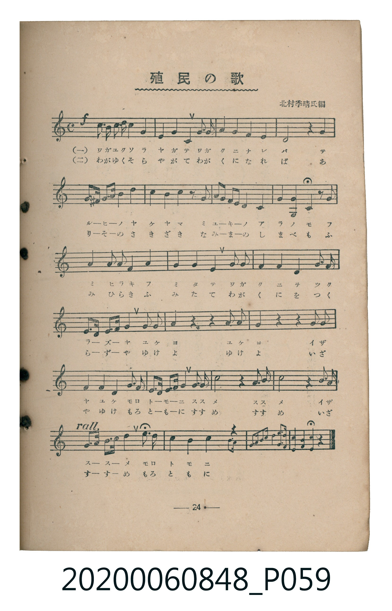
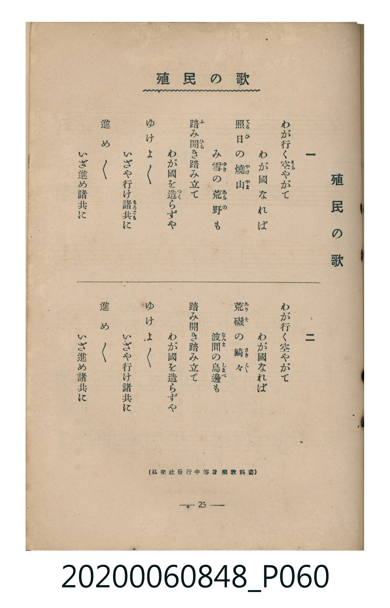

# 殖民の歌

<audio controls src="shokumin_no_uta.mp3"></audio>

- 編：北村季晴（弘樂社發行中等音樂教科書）
- 臺灣教育會公認《新定兒童唱歌》高等科男子用（2020.006.0848）

## 說明

原書資訊與歌詞全文（對應 P059.jpg – P060.jpg，書頁 pp. 24–25，高一第二學期第 10 首）：
調性與拍號：ヘ長調（1 降記號）、4/4 拍

## 歌詞

```text
一
わが行（ゆ）く空（そら）やがて　わが國（くに）なれば
照（て）る日（ひ）の燒山（やけやま）　み雪（ゆき）の荒野（あらの）も
踏（ふ）み開（ひら）き踏（ふ）み立（た）て　わが國（くに）を造（つく）らずや
ゆけよ　ゆけよ　いざや行（ゆ）け諸共（もろとも）に
進（すす）め　進（すす）め　いざ進（すす）め諸共（もろとも）に

二
わが行（ゆ）く空（そら）やがて　わが國（くに）なれば
荒磯（ありそ）の崎々（さきざき）　波間（なみま）の島邊（しまべ）も
踏（ふ）み開（ひら）き踏（ふ）み立（た）て　わが國（くに）を造（つく）らずや
ゆけよ　ゆけよ　いざや行（ゆ）け諸共（もろとも）に
進（すす）め　進（すす）め　いざ進（すす）め諸共（もろとも）に
```

## ABC

```abc
X:1
T:殖民の歌
M:4/4
L:1/16
Q:1/4=108
K:F
V:V1 name="Piano" snm="Pia"
[V:V1]
!f! c3 =B c2 d2 c4 A4 | G4 A4 F4 G3 A | G4 F4 E4 F4 | D8 z4 G4 |
G3 ^F G2 A2 c4 c4 | c4 z2 G2 G3 A G2 E2 | D4 G,4 C4 z2 C2 | F4 F3 D F4 G4 |
A4 A4 A4 A3 B | c4 A4 F4 A3 c | F3 D E3 ^F G4 G3 A | A4 z4 z4 A3 G |
F4 z4 z4 F3 G | A4 A4 A4 A3 G | F3 E D3 C D4 G3 G | c8 z4 =B3 c |
d8 z4 G3 A | [Q:1/4=96] c3 A F3 A G4 c3 d | c4 G4 F4 C3 C | F3 G A3 B c4 F4- |
F8 z4 z4 | !f! c3 =B c2 d2 c4 A4 | G4 A4 F4 G3 A | G4 F4 E4 F4 |
D8 z4 G4 | G3 ^F G2 A2 c4 c4 | c4 z2 G2 G3 A G2 E2 | D4 G,4 C4 z2 C2 |
F4 F3 D F4 G4 | A4 A4 A4 A3 B | c4 A4 F4 A3 c | F3 D E3 ^F G4 G3 A |
A4 z4 z4 A3 G | F4 z4 z4 F3 G | A4 A4 A4 A3 G | F3 E D3 C D4 G3 G |
c8 z4 =B3 c | d8 z4 G3 A | [Q:1/4=96] c3 A F3 A G4 c3 d | c4 G4 F4 C3 C |
F3 G A3 B c4 F4- | F8 z4 z4 |
```

## TMD 檔案連結

- [主旋律 TMD 檔案](shokumin_no_uta.tmd) [[在 TMD Studio 編輯](https://tmdlang.github.io/Tmd-TS/#tmd=s7IKdvYPcrWy4tLSUni2btqzDRMfN657trZHQUuLS9FWwdDAgsveVsGNy8ZE38SOq05B6fn2Fe_3zHraM_3Z3IlP1y5-NnPL-z0dT_fMeLai6fmSfc9n7nmxsOfJjrXP13a-nL8ZKPhs6sznyyc-m73j_Z5OJZABL9p3PW9cDBR-0bTp2Zzmp61rXqzqfdzQ9WzahqfrZj1tnfR89dKnUzYC3fC4ofvl6hlAk4AGPJ-y_enaCc-nAC3vMDIwMtAzMDDTM7AwsQAby6WvpWBLLcCloKDwtG8-0MkvNre_WNH1oqMd6JgXK-c9bV3xbFo7yLsbep-1dyoEGJha6mUVpCs8apgM5JgZgDjv9_QAdb5c0KhQUKCnYGQClDMyBQoCffJkR8PzNWue7Op5unbHsznzgWxg-Cq8XDYN6AdgmILsfbFq_7OG5SAbu3tfzJwPFH3cPOPl1O1AcaC9hgovZ_a-WDEDLNP5uKERGCkKQJVcIK1A00HU46b-x409wEgAqn_c1AZS19j_fOUuELdx7uMmoE2dj5tagGoeNy573NAAUf90TjdYAZC9Gqxl1eMmoIINIBOfty4Hyy0D6-x-Nn0pmLsJrG7d8_ZJTzduBFsGNHQimNwHdl3D48b9L2evgrjjcWMvRP2L3kkv2_vAJjQBXQMUARvbBPb9jn6wxFaw0v0vp0EctQnq6sZeNAXPV0MUgEMDj2-aJr1sWAAWWQIUBIsA1c8CuhUSYkDXAR3eAdaPxG4EemUaUBFqYE58sXrH01aIj4E-6H3cuALIAEutBhn3sgEYMkCrZgIR2KpGoFlYBSEWYErhswAc07t6aBPTwLh5vng9LG66gKZA4uzplr7HDa1g8anAWACFCiQ6GxqebV70ctpksNQqYIxA4x6oZfO2l01dYPHpQMHHjTtHo5mEaAZaQHlBBgUKWvpcXL6JmXlWAZmJefkONQY1CtUgGxRsDM207MAsYPkJKpp2NAADQUHDROHphv7n6xt04EWcJsgQkEKg1rRaBVMFXSA0UQczzIAYIqCrYAylaxSM0EQMoTRE3FihBmocTB1M3jweTaBGwQwmBIMGKGYBlYCzBcwTu0B5QkHDGJ8nIDoN1cEMkBNhHoDRNXAWyDKQKpjDQTTYkTAfwJ1nBGOYwhggvWAOqgt3dBJ2Icz7EBpoB2oAglwIC1rstAncgeiRAzMJwjdFddzT2bOJdRzQUdDYggYkSvzCrYPFFoyGiBvBnQdzDro6iDhIHUrsTiGcRPEHDNBEqNlA10MjDxhJiGhEcx8s-GAQ5j5g8oeGHzgLYFOCSOzIIdy6FocXdBSKEnNy9BSeb53wdMM-YCsASD5d2o-c-YBtMkszWAY0hvoDkighjgFHDJKr0fMXNG0CKdTwN4InG5hORAZE9RxmTNVw1XJx6dopgAoZBSRamYsLAA)]
- [鋼琴伴奏 TMD 檔案](shokumin_no_uta_piano.tmd) [[在 TMD Studio 編輯](https://tmdlang.github.io/Tmd-TS/#tmd=s7IKdvYPcrWy4tLSUni2btqzDRMfN657trbn_Z6Ol917nk_Y8mTPlqdL-593drzf06mgpcWlaKtgaGDBZW-r4MZlY6JvYsdVp6D0fPuK93tmPe2Z_mzuxKdrFz-buQWo_-meGc9WND1fsu_5zD0vFvY82bH2-drOl_M3AwWfTZ35fPnEZ7N3AA1VAhnwon3X88bFQOEXTZuezWl-2rrmxarexw1dz6ZteLpu1tPWSc9XL306ZSPQYY8bul-ungE0CWjA8ynbn66d8HwK0PIOIwMjAz0DAzM9AwsTC7CxXL6JmXlWAZmJeflBHg41BjUK1VwKQGBjaKZlB2bpayk8X7PmyY4GoPMUtPTBYkBVabUKpgq6QGiiDmaYATFEQFfBGErXKBihiRhCaYi4sUIN1DiYOpi8eTyaQI2CGUwIBg1QzAIq4UJ2764eFPdCFBmqgxkg18DcCqNr4CyQuSBVMDeCaLB7YI6Fu8QIxjCFMUB6wRxUx-zoRHEMzFMQGmgcarCAHAMLMOy0Cdwt6EEOMwnCN0V1x9PZs7G4A2g_NLihwYMSQXCTYcENoyHiRnCXwGxGVwcRB6lDiZ4pKC7B712gZqgxQIdCQx8Yyoh4QHMKLFBgEOYUYFKFhgo4uWJTgkiYyOHWuhY18QPzt6UZLAMYQ90GSSkQC8DhiuQS9PQNTTBACjX4jOARDNOJyACoDsYM6BquWuTs7IOSnU3w5mbDeIVow1gYVaNgAmSYxCMEYOEaD-SbAsXBDLBKYBaINorPjQUxDPBnQbhuuDVQBlwCkcFgpiJJ4ctPCOeD1UIMMAMZYAxjwMMZ1av4sgfcbwhXoJmM7GiEwRjhgJrWsTkOHuIgO7GbCnUAFkfhS6oYQQw3CupQTGWwqAGlLJAKYKrStVMAJSwFJFqZiwsA)]

## 分析

```text
================================================================================
📊 TMD Song Profile: [ 殖民の歌 ]
================================================================================
⏱  Duration:       1:40 (100.3s), 42 measures total
🎼 Key & Tempo:    首調基準 F, != 108.0 BPM, <4/4>
   - 分析範圍：      由實際發聲的音符與和弦推測調性；播放脈絡另行呈現
🎤 人聲音域:    G3 (MIDI 55) – D5 (MIDI 74) [跨度: 19 個半音 / 1.6 個八度, 難度: challenging]
   - 最低音:  G3 in [Main #1 @ m.7, 0:13]
   - 最高音: D5 in [Main #1 @ m.1, 0:00]
   - 適合: mezzo-soprano, contralto, tenor, baritone, bass
🏛  結構:      Main (47.8s) -> Main (52.5s)
⚡ 編曲密度:        Peak 1 軌道同時演奏
🗝  調性診斷：       F 調性不明確（純淨自然大調，未偵測到可信轉調）
   - 風格氣質:    純淨自然大調（陽光明朗、易唱易記，無明顯調外色彩）
   - 轉調歷程:    全曲維持單一推測調性（未偵測到可信轉調）
   - 核心骨幹音:  A, F, G, C, D
   - 調性數值:    F 調性不明確 [相關度: 0.80, 穩定度: Ambiguous, 自然音純度: 98.0%]
   - 候選調性 (K-S): F 大調 (0.80), C 大調 (0.79), A 小調 (0.68)
   - 五度圈歷程:   -1 -> -1
   - 各段落調性細節:
     • [Main #1]: F 調性不明確 (r: 0.80, 自然音純度: 98.0%, 調外音: F#, B)
     • [Main #2]: F 調性不明確 (r: 0.80, 自然音純度: 98.0%, 調外音: F#, B)

  [ 五度圈游移軌跡 ]
               C  
        [F ]*          G  
      Bb               D  
      Eb               A  
         Ab           E  
            Db       B  
               F# 
     (* = active key center)

  [ 十二半音累積音高分佈 ]
     C  : ███████████████████████   20.3%
     C# :                            0.0%
     D  : ████████████              10.8%
     D# :                            0.0%
     E  : ████                       3.4%
     F  : ████████████████████████  20.9%
     F# : █                          0.7%
     G  : ███████████████████████   20.6%
     G# :                            0.0%
     A  : ████████████████████████  21.3%
     A# : █                          0.7%
     B  : ██                         1.4%
--------------------------------------------------------------------------------
Assignment 軌道音域：
  - Piano         : G3 – D5 (19 個半音 / 1.6 個八度, 194 個音符)
================================================================================
```


## 原書掃描頁






