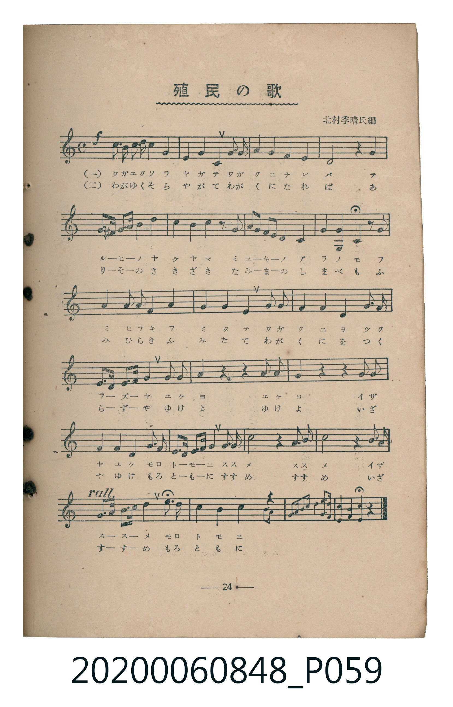
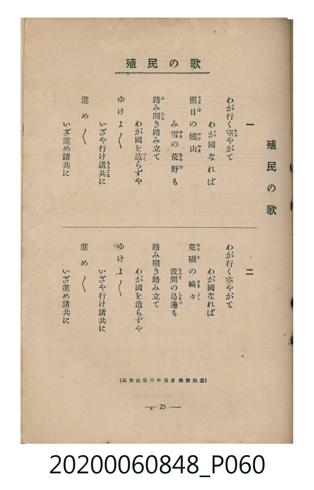

# 殖民の歌

> Re:Shōka 使用 AI 協助辨識與重建樂譜，可能會有錯誤。歡迎回報。

- **鋼琴伴奏版**：<br><audio controls src="shokumin_no_uta.mp3"></audio>

- 編：北村季晴（弘樂社發行中等音樂教科書）
- 臺灣教育會公認《新定兒童唱歌》高等科男子用（2020.006.0848）

## 說明

原書資訊與歌詞全文（對應 P059.jpg – P060.jpg，書頁 pp. 24–25，高一第二學期第 10 首）：
調性與拍號：ヘ長調（1 降記號）、4/4 拍


## 歌詞

```text
一
わが行（ゆ）く空（そら）やがて　わが國（くに）なれば
照（て）る日（ひ）の燒山（やけやま）　み雪（ゆき）の荒野（あらの）も
踏（ふ）み開（ひら）き踏（ふ）み立（た）て　わが國（くに）を造（つく）らずや
ゆけよ　ゆけよ　いざや行（ゆ）け諸共（もろとも）に
進（すす）め　進（すす）め　いざ進（すす）め諸共（もろとも）に

二
わが行（ゆ）く空（そら）やがて　わが國（くに）なれば
荒磯（ありそ）の崎々（さきざき）　波間（なみま）の島邊（しまべ）も
踏（ふ）み開（ひら）き踏（ふ）み立（た）て　わが國（くに）を造（つく）らずや
ゆけよ　ゆけよ　いざや行（ゆ）け諸共（もろとも）に
進（すす）め　進（すす）め　いざ進（すす）め諸共（もろとも）に
```

## ABC

<div class="abc-score" data-abc-src="shokumin_no_uta.abc" aria-label="五線譜載入中"></div>

[下載 ABC 原始檔](shokumin_no_uta.abc)

## TMD 檔案連結

- [主旋律 TMD 檔案](shokumin_no_uta.tmd) [[在 TMD Studio 編輯](https://tmdlang.github.io/Tmd-TS/#tmd=s7IKdvYPcrWy4qpTUCpJTLdSSM7PyUlNLsnMz7MqzsjMK0nNjM_KTMmPL87Iz05Ugisry88pzU21ys4vyY9Pyq8sjjcyMDKINzAwizewMLFAqCvOLy1KTrUqTs7Iz8-JL0mtKEnKz89GyBcU5Zel5iXmAdUUFIGsSwErQihILctMSQVJp6ZkluQXZSbmIDkitagY7FCwJfElRYl5xclFmQUg1yNUlWSkAl2amVuQiqobaFh6Zp5VSWIm0G8g_5UnxucmZublJOalKHFpaSk8Wzft2YaJjxvXPVvbo6ClxaVoq2BoYMFlb6vgxmVjom9iBzLq-fYV7_fMetoz_dnciU_XLn42c8v7PR1P98x4tqLp-ZJ9z2fuebGw58mOtc_Xdr6cvxko-GzqzOfLJz6bveP9nk6wW16073reuBgo_KJp07M5zU9b17xY1fu4oevZtA1P18162jrp-eqlT6dsBLrhcUP3y9UzgCYBDXg-ZfvTtROeTwFa3gEKej1g0OuBgh5sLJe-loIttQCXgoLC0775QCe_2Nz-YkXXi452oGNerJz3tHXFs2ntIO9u6H3W3qkQYGBqqZdVkK7wqGEykGNmAOK839MD1PlyQaNCQYGegpEJUM7IFCgI9MmTHQ3P16x5sqvn6dodz-bMB7KB4avwctk0oB-AYQqy98Wq_c8aloNs7O59MXM-UPRx84yXU7cDxYH2Giq8nNn7YsUMsEzn44ZGYKQoAFVygbQCTQdRj5v6Hzf2ACMBqP5xUxtIXWP_85W7QNzGuY-bgDZ1Pm5qAap53LjscUMDRP3TOd1gBUD2arCWVY-bgAo2gEx83rocLLcMrLP72fSlYO4msLp1z9snPd24EWwZ0NCJYHIf2HUNjxv3v5y9CuKOx429EPUveie9bO8Dm9AEdA1QBGxsE9j3O_rBElvBSve_nAZx1Caoqxt70RQ8Xw1RAA4NPL5pmvSyYQFYZAlQECwCVD8L6FZIiAFdB3R4B1g_ErsR6JVpQEWogTnxxeodT1shPgb6oPdx4wogAyy1GmTcywZgyACtmglEYKsagWZhFYRYgCmFzwJwTO_qoU1MA-Pm-eL1sLjpApoCibOnW_oeN7SCxacCYwEUKpDobGh4tnnRy2mTwVKrgDECjXugls3bXjZ1gcWnAwUfN-4cjWYSohloAeUFGRQoaOlzcfkCC3qrgMzEvHyHGoMahWqQDQo2hmZadmAWsPwEFU07GoCBoKBhovB0Q__z9Q068CJOE2QISCFQa1qtgqmCLhCaqIMZZkAMEdBVMIbSNQpGaCKGUBoibqxQAzUOpg4mbx6PJlCjYAYTgkEDFLOASsDZAuaJXaA8oaBhjM8TEJ2G6mAGyIkwD8DoGjgLZBlIFczhIBrsSJgP4M4zgjFMYQyQXjAH1YU7Ogm7EOZ9CA20AzUAQS6EBS122gTuQPTIgZkE4ZuiOu7p7NnEOg7oKGhsQQMSJX7h1sFiC0ZDxI3gzoM5B10dRBykDiV2pxBOovgDBmgi1Gyg66GRB4wkRDSiuQ8WfDAIcx8w-UPDD5wFsClBJHbkEG5di8MLOgpFiTk5egrPt054umEfsBUAJJ8u7UfOfMA2maUZLAMaQ_0BSZQQx4AjBsnV6PkLmjaBFGr4G8GTDUwnIgOieg4zpmq4arm4dO0UQIWMApBW5uICAA)]
- [鋼琴伴奏 TMD 檔案](shokumin_no_uta_piano.tmd) [[在 TMD Studio 編輯](https://tmdlang.github.io/Tmd-TS/#tmd=s7IKdvYPcrWy4tLSUni2btqzDRMfN657trbn_Z6Ol917nk_Y8mTPlqdL-593drzf06mgpcWlaKtgaGDBZW-r4MZlY6JvYsdVp6D0fPuK93tmPe2Z_mzuxKdrFz-buQWo_-meGc9WND1fsu_5zD0vFvY82bH2-drOl_M3AwWfTZ35fPnEZ7N3AA1VAhnwon3X88bFQOEXTZuezWl-2rrmxarexw1dz6ZteLpu1tPWSc9XL306ZSPQYY8bul-ungE0CWjA8ynbn66d8HwK0PIOIwMjAz0DAzM9AwsTC7CxXL6JmXlWAZmJeflBHg41BjUK1VwKQGBjaKZlB2bpayk8X7PmyY4GoPMUtPTBYkBVabUKpgq6QGiiDmaYATFEQFfBGErXKBihiRhCaYi4sUIN1DiYOpi8eTyaQI2CGUwIBg1QzAIq4UJ2764eFPdCFBmqgxkg18DcCqNr4CyQuSBVMDeCaLB7YI6Fu8QIxjCFMUB6wRxUx-zoRHEMzFMQGmgcarCAHAMLMOy0Cdwt6EEOMwnCN0V1x9PZs7G4A2g_NLihwYMSQXCTYcENoyHiRnCXwGxGVwcRB6lDiZ4pKC7B712gZqgxQIdCQx8Yyoh4QHMKLFBgEOYUYFKFhgo4uWJTgkiYyOHWuhY18QPzt6UZLAMYQ90GSSkQC8DhiuQS9PQNTTBACjX4jOARDNOJyACoDsYM6BquWuTs7IOSnU3w5mbDeIVow1gYVaNgAmSYxCMEYOEaD-SbAsXBDLBKYBaINorPjQUxDPBnQbhuuDVQBlwCkcFgpiJJ4ctPCOeD1UIMMAMZYAxjwMMZ1av4sgfcbwhXoJmM7GiEwRjhgJrWsTkOHuIgO7GbCnUAFkfhS6oYQQw3CupQTGWwqAGlLJAKYKrStVMAJSwFJFqZiwsA)]

## 分析

```text
================================================================================
📊 TMD Song Profile: [ 殖民の歌 ]
================================================================================
⏱  Duration:       0:47 (47.8s), 21 measures total
🎼 Key & Tempo:    首調基準 F, != 108.0 BPM, <4/4>
   - 分析範圍：      由實際發聲的音符與和弦推測調性；播放脈絡另行呈現
🎤 人聲音域:    G3 (MIDI 55) – D5 (MIDI 74) [跨度: 19 個半音 / 1.6 個八度, 難度: challenging]
   - 最低音:  G3 in [Main #1 @ m.7, 0:13]
   - 最高音: D5 in [Main #1 @ m.1, 0:00]
   - 適合: mezzo-soprano, contralto, tenor, baritone, bass
🏛  結構:      Main (47.8s)
⚡ 編曲密度:        Peak 1 軌道同時演奏
🗝  調性診斷：       F 調性不明確（純淨自然大調，未偵測到可信轉調）
   - 風格氣質:    純淨自然大調（陽光明朗、易唱易記，無明顯調外色彩）
   - 轉調歷程:    全曲維持單一推測調性（未偵測到可信轉調）
   - 核心骨幹音:  A, F, G, C, D
   - 調性數值:    F 調性不明確 [相關度: 0.80, 穩定度: Ambiguous, 自然音純度: 98.0%]
   - 候選調性 (K-S): F 大調 (0.80), C 大調 (0.79), A 小調 (0.68)
   - 五度圈歷程:   -1
   - 各段落調性細節:
     • [Main #1]: F 調性不明確 (r: 0.80, 自然音純度: 98.0%, 調外音: F#, B)

  [ 五度圈游移軌跡 ]
               C  
        [F ]*          G  
      Bb               D  
      Eb               A  
         Ab           E  
            Db       B  
               F# 
     (* = active key center)

  [ 十二半音累積音高分佈 ]
     C  : ███████████████████████   20.3%
     C# :                            0.0%
     D  : ████████████              10.8%
     D# :                            0.0%
     E  : ████                       3.4%
     F  : ████████████████████████  20.9%
     F# : █                          0.7%
     G  : ███████████████████████   20.6%
     G# :                            0.0%
     A  : ████████████████████████  21.3%
     A# : █                          0.7%
     B  : ██                         1.4%
--------------------------------------------------------------------------------
Assignment 軌道音域：
  - Piano         : G3 – D5 (19 個半音 / 1.6 個八度, 97 個音符)
================================================================================
```


## 原書掃描頁






