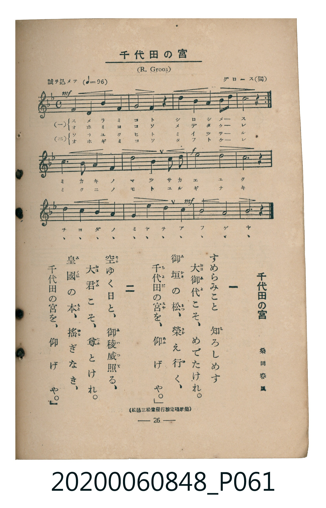

# 千代田の宮

<audio controls src="chiyoda_no_miya.mp3"></audio>

- 詞：桑田春風
- 曲：R. Groos（グロース）
- 臺灣教育會公認《新定兒童唱歌》高等科男子用（2020.006.0848）

## 說明

原書資訊與歌詞全文（對應 P061.jpg，書頁 p. 26，高一第三學期第 1 首）：
調性與拍號：ヘ長調（1 降記號）、4/4 拍（誠ヲ込メテ ♩=96）
出處註記：（松邑三松堂發行檢定唱歌集）

## 跨冊／重複收錄參照

> 同曲（《新定兒童唱歌》高等科男、女共用教材）

- **[同曲]** 《新定兒童唱歌》高等科女子用（2020.006.0849）：[**〈千代田の宮〉**](../../koto_girls_2020.006.0849/1_3_01_chiyoda_no_miya/index.md)（`F` / `4/4` — [原始 TMD](../../koto_girls_2020.006.0849/1_3_01_chiyoda_no_miya/chiyoda_no_miya.tmd)）
- 總表：[跨冊重複與同名歌曲總索引](../../../duplicate_songs.md)

## 歌詞

```text
一
すめらみこと　知ろしめす
大御代こそ、めでたけれ。
御垣の松、榮え行く、
千代田の宮を、仰げや。

二
空ゆく日と、御稜威照る、
大君こそ、尊とけれ。
皇國の本、搖ぎなき、
千代田の宮を、仰げや。
```

## ABC

```abc
X:1
T:千代田の宮
C:曲：R. Groos（グロース）
M:4/4
L:1/16
Q:1/4=96
K:F
V:V1 name="Piano" snm="Pia"
[V:V1]
!mf! F4 F4 G4 A4 | G8 F4 z4 | A4 B4 c4 d2 c2 | c12 z4 |
!mf! F4 F4 G4 A4 | G8 F4 z4 | A4 B4 c4 d2 c2 | c12 z4 |
B4 A4 G4 F4 | c8 c4 A2 c2 | !f! f8 d8 | c12 z4 |
d4 c4 B4 A4 | G6 F2 c4 A4 | !mf! G8 G8 | F12 z4 |
```

## TMD 檔案連結

- [主旋律 TMD 檔案](chiyoda_no_miya.tmd) [[在 TMD Studio 編輯](https://tmdlang.github.io/Tmd-TS/#tmd=s7IKdvYPcrWy4qpTUCpJTLdSSM7PyUlNLsnMz7MqzsjMK0nNjM_KTMmPL87Iz05Ugisry88pzU21ys4vyY9Pyq8sjjcyMDKINzAwizewMLFAqCvOLy1KTrUqTs7Iz8-JL0mtKEnKz89GyBcU5Zel5iXmAdUUFIGsSwErQihILctMSQVJp6ZkluQXZSbmIDkitagY7FCwJfElRYl5xclFmQUg1yNUlWSkAl2amVuQCtGtpaXwtLf5ye7Fz6dseNy47um6dQpaWlyKtgqWZlz2tgpuXDYm-iZ2IO0vVs57v2fWs4UTgSqfzVj6ctEKsKnPZm8CCgfpKbgX5ecXv9_T8bhpw-PmtY-b9zxu2vl-TydY0Yv2Xc8bFz-bOvNF06Znc5qftq55sar3cUPXs2kbnq6b9bR10vPVS59O2fhsbc_jhu6Xq2c8X9v5fDnQou1P1054PmUF0FRQiOoBQ1QPFKJgY7n0tRRsqQW4FBQUnvbNfzZ7x4vN7S9WdL3oaAc6Bujlp60rnk1rBzrg6YbeZ-2dCgEGZoZ6WQXp7_f0ABW_XNCoUKCnYGQG5AKd_WRHw_M1a57s6Hy6dsezOfOBbAVDhZfLpgHdCwwjkB0vVu1_1rAcZHp374uZ84Gij5tnvJy6HSgOtAOoeGbvixUzwDKdjxsagWGvAFQJlHqxasHj5k0v9u153LzwcXObwqOZK20tgdZ2gl3evuvFzKkvVuwG6gUaCVT-bO6-l00TgS4BMp4uaHo-c8-LhT3PVi0ChTY4nF_ObgNpBukGuhpEPW6c-bip8XFT5-PG_Y8bJz9uXPG4oeH5_KWPm3ofN04HSTXOBFu2ZPnTfQuBKQasaC7QlWC55Y8b5z9unPi4CRiFTWB1-xY-nQdUtA7oBKCiZ8vWPW7sALricWM_kAtWgZrwHjdNAko82Q3kTnrc1AIyBuy8XT0g6vnKXY-b2oCan01fCnZbI9CC5yvmPF3R-Lx1-eOmbpihQOdNmA1329MNXSDVyA57Pqv96ZxukMPmrAE5bMK0x419jxtXPW4EJkkiHQZURHmigwIFLX0uLkergMzEvHyHGoMahWqQ8Qo2Flp2YAYwnYNTVQMw8EAJsb_3xbI2WCqZBZF62r8UmKhA7F09QPbTCT3Ppnc_3dcNjGOQ8SBjgObmptUCE6QuGBsBsTEQ14BZIAgSNQCLgMRNgNgUiM2AZA2YBYNgNVy1XFxOBN28qwfoZoQDQGaCzAbZCLINYS6INgbbVA1yYxxU2AxKY3MASth0otgD0gbSALMP5kdDqD0gEXBgwLwOo2vAzsLwqK6dgqMCjHACEcpcXAA)]
- [鋼琴伴奏 TMD 檔案](chiyoda_no_miya_piano.tmd) [[在 TMD Studio 編輯](https://tmdlang.github.io/Tmd-TS/#tmd=s7IKdvYPcrWy4tLSUnja2_xk9-LnUzY8blz3dN2693s6XnbveT5hy5M9W54u7X_e2fF-T6eClhaXoq2CpRmXva2CG5eNib6JHVedgtKLlfPe75n1bOFEoPZnM5a-XLRCCST8bPYmoHCQnoJ7UX5-MdDEx00bHjevfdy853HTTqBxYEUv2nc9b1z8bOrMF02bns1pftq65sWq3scNXc-mbXi6btbT1knPVy99OmXjs7U9jxu6X66e8Xxt5_PlQIu2P1074fmUFUBTjQyMDPQMDMz0DCxMLMDGcjlaBWQm5uUHeTjUGNQoVHMpAIGNhZYdmAEUyE2rVTBU0AVjIyA2BuIaMAsEQaIGYBGQuAkQmwKxGZCsAbNgEKyGqxZunQ-KdSZw6wzjgQqjDWPBRprGw3gGOKRM48FyIIOd8PsD5DSQE0EOBzka4TwQbQx2cDXIq3FQYTMojc0fECNBKkByMKNhoWIINRIkAg4-WGDBaKBfsAUN1Ae4gsYEh_9BXIicCdawwaLbCI9R8GCGhquunYKjAoxwAhHKXFwA)]

## 分析

```text
================================================================================
📊 TMD Song Profile: [ 千代田の宮 ]
================================================================================
⏱  Duration:       0:40 (40.0s), 16 measures total
🎼 Key & Tempo:    首調基準 F, != 96.0 BPM, <4/4>
   - 分析範圍：      由實際發聲的音符與和弦推測調性；播放脈絡另行呈現
🎤 人聲音域:    F4 (MIDI 65) – F5 (MIDI 77) [跨度: 12 個半音 / 1.0 個八度, 難度: easy]
   - 最低音:  F4 in [A #1 @ m.1, 0:00]
   - 最高音: F5 in [B #1 @ m.11, 0:25]
   - 適合: soprano, mezzo-soprano, contralto, tenor, baritone, bass
🏛  結構:      A (10.0s) -> A (10.0s) -> B (20.0s)
⚡ 編曲密度:        Peak 1 軌道同時演奏
🗝  調性診斷：       C 調性不明確（流行色彩大調，未偵測到可信轉調）
   - 風格氣質:    流行大調（略帶和弦色彩音與裝飾副屬和弦）
   - 轉調歷程:    全曲維持單一推測調性（未偵測到可信轉調）
   - 核心骨幹音:  C, F, G, A, D
   - 調性數值:    C 調性不明確 [相關度: 0.84, 穩定度: Ambiguous, 自然音純度: 93.1%]
   - 候選調性 (K-S): C 大調 (0.84), F 大調 (0.84), C 小調 (0.57)
   - 五度圈歷程:   +0 -> +0 -> -1
   - 各段落調性細節:
     • [A #1]: C 調性不明確 (r: 0.83, 自然音純度: 92.9%, 調外音: A#)
     • [A #2]: C 調性不明確 (r: 0.83, 自然音純度: 92.9%, 調外音: A#)
     • [B #1]: F 調性不明確 (r: 0.84, 自然音純度: 100.0%)

  [ 五度圈游移軌跡 ]
              [C ]*
        [F ]*          G  
      Bb               D  
      Eb               A  
         Ab           E  
            Db       B  
               F# 
     (* = active key center)

  [ 十二半音累積音高分佈 ]
     C  : ████████████████████████  30.2%
     C# :                            0.0%
     D  : █████                      6.9%
     D# :                            0.0%
     E  :                            0.0%
     F  : █████████████████         21.6%
     F# :                            0.0%
     G  : █████████████████         21.6%
     G# :                            0.0%
     A  : ██████████                12.9%
     A# : █████                      6.9%
     B  :                            0.0%
--------------------------------------------------------------------------------
Assignment 軌道音域：
  - Piano         : F4 – F5 (12 個半音 / 1.0 個八度, 46 個音符)
================================================================================
```


## 原書掃描頁




