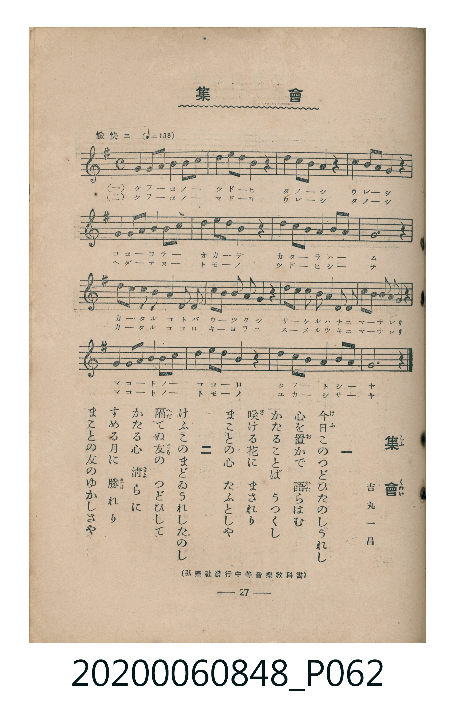

# 集會

<audio controls src="shukai.mp3"></audio>

- 詞：吉丸一昌
- 臺灣教育會公認《新定兒童唱歌》高等科男子用（2020.006.0848）

## 說明

原書資訊與歌詞全文（對應 P062.jpg，書頁 p. 27，高一第三學期第 2 首）：
調性與拍號：ト長調（1 升記號）、4/4 拍（愉快ニ ♩=138）
出處註記：（弘樂社發行中等音樂教科書）

## 歌詞

```text
一
今日このつどひたのしうれし
心を置かで　語らはむ
かたることは　うつくし
咲ける花に　まされり
まことの心　たふとしや

二
けふこのまどゐうれしたのし
隔てぬ友の　つどひして
かたる心　清らに
すめる月に　勝れり
まことの友のゆかしさや
```

## ABC

```abc
X:1
T:集會
M:4/4
L:1/16
Q:1/4=138
K:G
V:V1 name="Piano" snm="Pia"
[V:V1]
!mf! G4 A2 B2 G4 A2 B2 | c4 B2 A2 G4 z4 | B4 c2 d2 e4 z4 | A4 B2 A2 G4 z4 |
D4 E2 F2 G4 A2 B2 | c4 B2 A2 B4 z4 | c4 B2 A2 G4 F2 E2 | D12 z4 |
!f! d2 B2 G2 B2 d4 B2 G2 | E2 G2 A4 B2 A2 z4 | D2 E2 F2 G2 A4 B2 c2 | B2 A2 G4 A2 F2 z4 |
!mf! G4 A2 B2 G4 A2 B2 | c4 d2 c2 B4 z4 | c4 B2 A2 G4 F2 A2 | G12 z4 |
```

## TMD 檔案連結

- [主旋律 TMD 檔案](shukai.tmd) [[在 TMD Studio 編輯](https://tmdlang.github.io/Tmd-TS/#tmd=s7IKdvYPcrWy4qpTUCpJTLdSSM7PyUlNLsnMz7MqzsjMK0nNjM_KTMmPL87Iz05Ugisry88pzU21ys4vyY9Pyq8sjjcyMDKINzAwizewMLFAqCvOLy1KTrUqTs7Iz8-JL0mtKEnKz89GyBcU5Zel5iXmAdUUFIGsSwErQihILctMSQVJp6ZkluQXZSbmIDkitagY7FCwJfElRYl5xclFmQUg1yNUlWSkAl2anJ-bW5qXWVKpxKWlpfBydtuzOc0KWlpcirYKhsYWXPa2Cu5cNib6JnYgfS9Wznu_Z9bTCZ1Pdux4sqPh2YwesHEv2nc9b1z8bOrMF02bgNqftq55sar3cUPXs2kbnq6b9bR10vPVS59O2fhsbc_jhu6Xq2c8X9v5fPnE51O2P1074fmUFe_3dIBCSQ8YSnqgUHq_p1OJi0tfS8GWWoBLQUHhad_8Z7N3vNjc_mJF14uOdqBjgL552rri2bR2oAOebuh91t6pEGBgZqSXVZD-fk8PUPHLBY0KBXoKRuZALtDZQB8_X7PmyY7Op2t3PJszH8hWMFJ4uWwa0L3AUAHZ8WLV_mcNy0Gmd_e-mDkfKPq4uePl1O1AcaAdhgpPe4G2zwDLdD5uaAQGqwJQJVDqWUvn0_2rHzd3KzyaudIWGPBABWBHt-96MXPqixW7gdqApoEcumfGsxVNz5fsez5zz4uFPU92rAWG5sv5m4GCwAgABivQ3SDNIN1AB4Op3V3Ppi993Dj5ceO6x41LHjeufNy46XHjfDB3-uPGtsdNPUAG2L79zY-bJj3fC5Tofty4_HFDw4tV8x43dT5uXP-4CWwYWGL-4yYgCTRvBUiioQFkBsjgfpgxk4DmTwQqetG18XHjarCKfY8bp4IsauqCGAPkQwxYB7IUpALooK1gkemPm1ogHtjVA1E8ESwF8QBQ48rHTRPg7ob7BKT05awpjxuXPW5c87Qf6MJ1YHPhPgYqXYbiB4jNz3a0gr24GiI383FTI1Du2ZwOiNOfds_F4W6IFU1AvwMZQMOB_msBKaI8wUKBgpY-F5dvYmaeVUBmYl6-Q41BjUI1yAYFGwstOzADmE3AibIBmBhAykFiQEW5abUKhgq6wARqDKdrFEyALGMgGyRiAMQ1QJ4uUNRUwQwuYoSuBhwTMHt29aDYYxoPVGEWr2Aej8UWkNkQM5HtBSoFaoBqhUFMi3Z0onoI6B9TsF-MgTTINEOgKNAgQ7iDIVYBjYW5ByJhAvYlxG4jkASGXU9nzyY28EyBJE5vGQGFQExUT9VycenaKYAiUQFIK3NxAQA)]
- [鋼琴伴奏 TMD 檔案](shukai_piano.tmd) [[在 TMD Studio 編輯](https://tmdlang.github.io/Tmd-TS/#tmd=s7IKdvYPcrWy4tLSUng5u-3ZnOb3ezpedu95PmHLkz1bni7tf97Z8X5Pp4KWFpeirYKhsQWXva2CO5eNib6JHVedgtKLlfPe75n1dELnkx07nuxoeDajRwks3L7reePiZ1NnvmjaBDTzaeuaF6t6Hzd0PZu24em6WU9bJz1fvfTplI3P1vY8buh-uXrG87Wdz5dPfD5l-9O1E55PWQF0g5GBkYGegYGZnoGFiQXQBUpcXL6JmXlWAZmJeflBHg41BjUK1VwKQGBjoWUHZuhrKTxfswboihcLexS09MFiQEW5abUKhgq6CkYKxnC6RsEEyDIGskEiBkBcA-TpAkVNFczgIkboariQ7dnVg2KPaTxQhVm8gnk8FltAZkPMRLYXqBSoAaoVBjEt2tGJ6iGgf0zBfjEG0iDTDIGiQIMM4Q6GWAU0FuYeiIQJ2JcQu41AEhh2PZ09m9jAMwWSOL1lBBQCMVE9VYschz4ocWgCjUOgNlBgRBvGQoyFcQzgMiYQjmk8khQ8CnDqNQJzjOJzIXJQlabxyNpRbIZogCpAVg-ShKjEoxvFbggHVS_U3cAQ0bVTAAWKApBW5uICAA)]

## 分析

```text
================================================================================
📊 TMD Song Profile: [ 集會 ]
================================================================================
⏱  Duration:       0:27 (27.8s), 16 measures total
🎼 Key & Tempo:    首調基準 G, != 138.0 BPM, <4/4>
   - 分析範圍：      由實際發聲的音符與和弦推測調性；播放脈絡另行呈現
🎤 人聲音域:    D4 (MIDI 62) – E5 (MIDI 76) [跨度: 14 個半音 / 1.2 個八度, 難度: moderate]
   - 最低音:  D4 in [Main #1 @ m.5, 0:06]
   - 最高音: E5 in [Main #1 @ m.3, 0:04]
   - 適合: soprano, mezzo-soprano, contralto, tenor, baritone, bass
🏛  結構:      Main (27.8s)
⚡ 編曲密度:        Peak 1 軌道同時演奏
🗝  調性診斷：       G 大調（純淨自然大調，未偵測到可信轉調）
   - 風格氣質:    純淨自然大調（陽光明朗、易唱易記，無明顯調外色彩）
   - 轉調歷程:    全曲維持單一推測調性（未偵測到可信轉調）
   - 核心骨幹音:  G, B, A, D, C
   - 調性數值:    G 大調 [相關度: 0.89, 穩定度: High, 自然音純度: 100.0%]
   - 候選調性 (K-S): G 大調 (0.89), E 小調 (0.60), D 大調 (0.56)
   - 五度圈歷程:   +1
   - 各段落調性細節:
     • [Main #1]: G 大調 (r: 0.89, 自然音純度: 100.0%)

  [ 五度圈游移軌跡 ]
               C  
         F           [G ]*
      Bb               D  
      Eb               A  
         Ab           E  
            Db       B  
               F# 
     (* = active key center)

  [ 十二半音累積音高分佈 ]
     C  : ██████████                11.8%
     C# :                            0.0%
     D  : ███████████               12.7%
     D# :                            0.0%
     E  : █████                      5.5%
     F  :                            0.0%
     F# : ████                       4.5%
     G  : ████████████████████████  27.3%
     G# :                            0.0%
     A  : ████████████████          18.2%
     A# :                            0.0%
     B  : ██████████████████        20.0%
--------------------------------------------------------------------------------
Assignment 軌道音域：
  - Piano         : D4 – E5 (14 個半音 / 1.2 個八度, 76 個音符)
================================================================================
```


## 原書掃描頁




