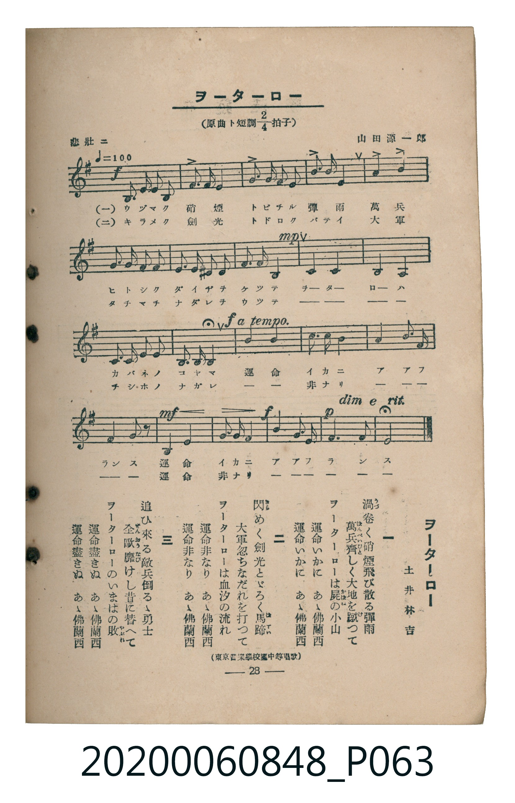

# ヲーターロー

> Re:Shōka 使用 AI 協助辨識與重建樂譜，可能會有錯誤。歡迎回報。

- **鋼琴伴奏版**：<br><audio controls src="waterloo.mp3"></audio>
- **NEUTRINO 歌聲合成版**：<br><audio controls src="waterloo_neutrino.mp3"></audio>

- 詞：土井林吉
- 曲：山田源一郎
- 臺灣教育會公認《新定兒童唱歌》高等科男子用（2020.006.0848）

## 說明

原書資訊與歌詞全文（對應 P063.jpg，書頁 p. 28，高一第三學期第 3 首）：
調性與拍號：ホ短調（原曲ト短調 2/4 拍子，1 升記號）、2/4 拍（悲壯ニ ♩=100）
出處註記：（東京音樂學校編中等唱歌）


## 歌詞

```text
一
渦（うづ）卷く硝煙飛び散る彈雨
萬兵（ばんぺい）齊（ひと）しく大地を蹴（け）つて
ヲーターローは屍（かばね）の小山
運命いかに　あゝ佛蘭西
運命いかに　あゝ佛蘭西

二
閃（きら）めく劍光とゞろく馬蹄（ばてい）
大軍忽ちなだれを打つて
ヲーターローは血汐の流れ
運命非なり　あゝ佛蘭西
運命非なり　あゝ佛蘭西

三
追ひ來る敵兵倒るゝ勇士
全歐靡（ぜんおうなび）けし昔に替へて
ヲーターローのいまはの敗（やぶれ）
運命盡きぬ　あゝ佛蘭西
運命盡きぬ　あゝ佛蘭西
```

## ABC

<div class="abc-score" data-abc-src="waterloo.abc" aria-label="五線譜載入中"></div>

[下載 ABC 原始檔](waterloo.abc)

## TMD 檔案連結

- [主旋律 TMD 檔案](waterloo.tmd) [[在 TMD Studio 編輯](https://tmdlang.github.io/Tmd-TS/#tmd=s7IKdvYPcrWy4qpTUCpJTLdSSM7PyUlNLsnMz7MqzsjMK0nNjM_KTMmPL87Iz05Ugisry88pzU21ys4vyY9Pyq8sjjcyMDKINzAwizewMLFAqCvOLy1KTrUqTs7Iz8-JL0mtKEnKz89Gl48vSExPtQowMDNGyBQU5Zel5iXmAXUXFIEckgLWjlCQWpaZkgqSLk5OzIsvSy3KTMtMTUFyYmpRMdgbECtKihLzipOLMgtAfkOoyi8qychPL0osyKi0ysgsLskvykxOzInPTsxD8m1JRirQs7mZOZkliUWVyJoz0zPzrHJTM7MykTynpaXwuHnT4-Y9j5v2g8jmtUBSQUuLS9FWwdDAgMveVsGdKzu10lbBNZfLxkjfxA5k4ouV897vmfV0zvwnu6Y-mzf96YROsEXPZm8CCW_c-HzKhme7JjzZ0fCyuQ8s86J91_PGxc-mznzRtOnZnOanrWterOp93ND1bNqGp-tmPW2d9Hz10qdTNj5b2_O4ofvl6hnP13Y-Xz7x-ZTtT9dOeD5lxfs9HaBI0wNGmh4o0t7vAVrIpa-lYEstwKWgoPC0b_6z2TtebG5_saLrRUc70DFAfz5tXfFsWjvQAU839D5r71QAxbxeVkH6-z09QMUvFzQqFOgpGAFd1AN0NtDHz9esebKj8-naHc_mzAeyFYwVXi6bBnQvMGBAdrxYtf9Zw3KQ6d29L2bOB4o-bp79fP5aoDjIDpALgLHRARFRAIa3AlAhMBCA5hsqPO0FOm0GWFvn44ZGqCxQ37OmTU8Xr3_c3K3waOZKW2C8ARWAfdS-68XMqS9W7AZqA1oFUjl345Nda17O3_xsRRPIkQsWPt--4smOtcAAh4Q_SCdIK9ArIOrZjmVAXY8b2x43LgVKPe3d_rix__nCuc9bZ75cPPtx4-ZnUxc_bup-urfj5ewVYA9OWPO0dStYz4bHTZMfN-563NgC1PlybxdYcNPjRmB0dj5unA406OmS5U_nAJVNerFzC1h2IlhqyePGZSCzMFPm48b1TzeCfPy4sRtkQeNasIZ1Tzf0A5MdSM_Lxu6nE_cC7QSrWP24oeFxY9PjprlP9s5-MWPti6X7iVMEDoJdPWDF05rBFvY-bgLGYufjpkaQy7t6n7YCbV7xuGne46ZeoMjLZWte7AT6FOzxxmUQX4MjYcnyF7t7n-4H2rfwceOqx40LHjf1AP38rBMYOni9-mJhw7ONE4Dee7a1EagH4fKXc-eBTGrqwuc9fIogMQx23guQwzY92dcGjMZnU7cCI-9pwyQgG6j-aXf708WrwX4A5oK1E17OXQj23xxwxHaBUwXQP5vBcTARGKXPZkwBBuez2fsfN-7A47F14JDfB_QhyG9Tp4MMbQKKbAN6EhpoEC88nw0MMWDgrsHnTwKKKC8boEBBS5-LyzcRWIgGZCbm5TvUGNRUgyxQsDE007IDs4AlEjj_N7xY2KOgYaoATJbP1zfowAsNTZAZIIU1CtVptQrG8Qq6QGgWD0K6EG6NgjlEFEiBRUGwRsEQTBtCJMHiNcCiBSRmjKzMCMqCSAFFwLb5GNYoPG5aBhZ53NwKxPNArKb1YD3A3AyV2aMAzNZws4DFEFR8MhA3glmrwTLA3A7XAcz2cB3AvA9lA1MRqguMQC5YC9W1EogXIrkAmJng5gFzFRYXdAIxSDdMx-PmCVCZNqDYErgOYF6DsoFZDtUFxiAXrILqmgQ1CeYjYMJHcgHc7UBV-6HiU6Fq4WHQ3Y7QsRgkBnVBKyw8gBkG7gLk1LGrh3DqQIluMFEDi2YgZaqOlAoQyQWanECC1bkFtQomMD6cAUwzMKYRXAyRRIDBAvFSB9Dj21GCuwEiAwzqx81NYDWboAG0EaqnBRwZiKgDyUP0QIIQIgpJAiD1_aj2gxMILLAbYUkUnOxA-rqgMg1ADEpkCPthyZpC-0HJA24LMMGD_QUJBZDMAqhZq2EhA6xrIfZDov5x8wwS7e-D249SdHQSThzQ6ARS4CQAKw0gokAKOR2AShkoD14mKJhA9COJoJYbwLSEXHDAfDgBiHvhbgfJbIbKgFIFKL4ghgGLZSgbWDoj_A7NpuAwBIceTHwRPKQgLFBmQ0oV4DQAiQtgWwnZflh8Na2Bpgp89gOrQ6jpXUAMKQgI2g8uNKDuBvoQkmoQ9sNkphFhPyiFQmxZC2T3ELQfKVU8nT0bnCrM8KUKaDkAKjV0FQzARlfnIioZaDqB2IlSvGCmFIg0UD1QGFiOwFVB0wZSYYSAyMXIysfNkJQB8tNOIAnRQ5V0ATIeyVqITSDVIHuwOAicgkhyEIkJhVQHgQsa0kKItJRDgoNqubh07RRAbRoFIK3MBQA)]
- [鋼琴伴奏 TMD 檔案](waterloo_piano.tmd) [[在 TMD Studio 編輯](https://tmdlang.github.io/Tmd-TS/#tmd=s7IKdvYPcrWy4qpTUCpJTLdSSM7PyUlNLsnMz7MqzsjMK0nNjM_KTMmPL87Iz05Ugisry88pzU21ys4vyY9Pyq8sjjcyMDKINzAwizewMLFAqCvOLy1KTrUqTs7Iz8-JL0mtKEnKz89Gl48vSExPtQowMDNGyBQU5Zel5iXmAXUXFIEckgLWjlCQWpaZkgqSLk5OzIsvSy3KTMtMTUFyYmpRMdgbECtKihLzipOLMgtAfkOoyi8qychPL0osyKi0ysgsLskvykxOzInPTsxD8m1iEVBzempual6JVUFmYl5-fGJycn5uQWJeJkgMobAkA6jIKjczJ7MksagS2ZbM9Mw8q9zUzKxMpFDQ0lJ43LzpcfOex037QWTzWiD5fk_Hy-49zydsebJny9Ol_c87O97v6VTQ0uJStFUwNDDgsrdVcOfKTq20VXDN5bIx0jexA1nzYuW893tmPZ0z_8muqc_mTX86oRNs-7PZm0DCGzc-n7Lh2a4JT3Y0vGzuA8u8aN_1vHHxs6kzXzRtejan-Wnrmhereh83dD2btuHpullPWyc9X7306ZSNz9b2PG7ofrl6xvO1nc-XT3w-ZfvTtROeT1kBdCUoyvWAUa4HinKgG5W4uHwTgb4MAIVQkIdDjUFNNZcCENgYmmnZgVn6WgrP16wBuuLFwh4FDVOFpxv6n69v0FTQ0gdL1yhUp9UqGMcr6AKhWTwI6UK4NQrmEFEgBRYFwRoFQzBtCJEEi9coGIPFjJGVGUFZECmgCNg2H8MahcdNy8Aij5tbgXgeiNW0HqzncdP2x83LEfJ7gCIrHjdvhhv6uLkDKjUZiBvBrNVQmQaYQog-iBkQqQkIMx43z3rctATVTUYgm9dCpVcC8UIUN21ENXgzqtkwB3UCMcgMuL7mCVCZNqAY3EYgez-C-7hpA5L3IK4xBqlZBdU7CWoewpttCKcCXdM8A81sqNRUqA6EvmWowbodSRMwE8CDp2kVkve4kBPQrh5cCQglRYCJGlhKAFKm6kgJBZGioCkOJFidW1CrYALjwxnAZAVjGsHFEKkIGDYQ73RAvYMI-QaoX5YA2U1gNZugXt0I1dMCjhdELILkIXogIQgRhQQ0SH0_qv3gFAML60ZYKgYnSJC-LqhMAxCvQbEfFgUU2g9KI3BbgFkB7C9IKIBkFkDNWg0LmeZuqP2g1ADizyDR_j64_ShlSieuJAGNRCAFjnhYMQERBVLIsQ8qfqA8eGGhYALRjySCWqAAUxByiQLz1wQg7oW7GCQDy7qgtACKJajfmpYhlwkLUXMRhA0OP3DIwcQXwUMJwgLlM6QUAY5_SDw8bp6N7ApYXDWtgaYIIlwBT99dQAwpDwi6Alx2QF0P9C0k3SBcAZOZRoIrWqB2rQWyewi6Ail1PJ09G5w6zDBTB7QUAJUZugoGYAOrcxG1EDS9QGxCKVwwUwxEGqgeKAwsReCqoGkEqShCQORCZCVy2bcTSEL0UDF9gCxBshxiLEg1yDYszgKnJHKcRVqCIdVZ4CKHLGeRlIJIcFYtctvHB7ntYwJt-oDiPl4h2iw-NxZc-iDYhsjCcCawmok2jgeyYBUbjI9pDkTYBMQ0ATORTIeXgVj1gOyD6Yax0C0GKQdajmovwjVITkYyGKQWGi66dgqgoFEA0spcAA)]

## 分析

```text
================================================================================
📊 TMD Song Profile: [ ヲーターロー ]
================================================================================
⏱  Duration:       0:25 (25.2s), 21 measures total
🎼 Key & Tempo:    首調基準 G, != 100.0 BPM, <2/4>
   - 分析範圍：      由實際發聲的音符與和弦推測調性；播放脈絡另行呈現
🎤 人聲音域:    A3 (MIDI 57) – C5 (MIDI 72) [跨度: 15 個半音 / 1.2 個八度, 難度: moderate]
   - 最低音:  A3 in [Main #1 @ m.10, 0:11]
   - 最高音: C5 in [Main #1 @ m.14, 0:15]
   - 適合: soprano, mezzo-soprano, contralto, tenor, baritone, bass
🏛  結構:      Main (25.2s)
⚡ 編曲密度:        Peak 1 軌道同時演奏
🗝  調性診斷：       E 小調（純淨自然小調，未偵測到可信轉調）
   - 風格氣質:    純淨自然小調（陰鬱抒情、旋律集中，無明顯調外色彩）
   - 轉調歷程:    全曲維持單一推測調性（未偵測到可信轉調）
   - 核心骨幹音:  B, E, F#, G, C
   - 調性數值:    E 小調 [相關度: 0.74, 穩定度: Moderate, 自然音純度: 98.8%]
   - 候選調性 (K-S): E 小調 (0.74), B 大調 (0.68), E 大調 (0.63)
   - 五度圈歷程:   +4
   - 各段落調性細節:
     • [Main #1]: E 小調 (r: 0.74, 自然音純度: 98.8%, 調外音: D#)

  [ 五度圈游移軌跡 ]
               C  
         F            G  
      Bb               D  
      Eb               A  
         Ab          [E ]*
            Db       B  
               F# 
     (* = active key center)

  [ 十二半音累積音高分佈 ]
     C  : ███████                    9.6%
     C# :                            0.0%
     D  :                            0.0%
     D# : █                          1.2%
     E  : █████████████████         21.7%
     F  :                            0.0%
     F# : ██████████████            18.7%
     G  : ████████                  10.2%
     G# :                            0.0%
     A  : ██████                     7.2%
     A# :                            0.0%
     B  : ████████████████████████  31.3%
--------------------------------------------------------------------------------
Assignment 軌道音域：
  - Piano         : A3 – C5 (15 個半音 / 1.2 個八度, 59 個音符)
================================================================================
```


## 原書掃描頁




