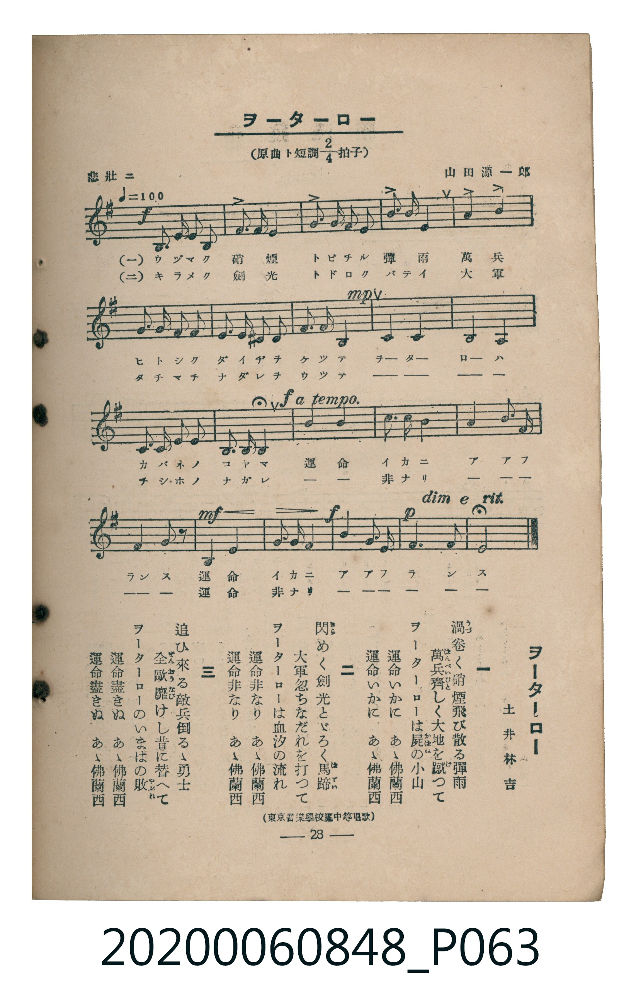

# ヲーターロー

> Re:Shoka 使用 AI 協助辨識與重建樂譜，可能會有錯誤。歡迎回報。

<audio controls src="waterloo.mp3"></audio>

- 詞：土井林吉
- 曲：山田源一郎
- 臺灣教育會公認《新定兒童唱歌》高等科男子用（2020.006.0848）

## 說明

原書資訊與歌詞全文（對應 P063.jpg，書頁 p. 28，高一第三學期第 3 首）：
調性與拍號：ホ短調（原曲ト短調 2/4 拍子，1 升記號）、2/4 拍（悲壯ニ ♩=100）
出處註記：（東京音樂學校編中等唱歌）

## 跨冊／重複收錄參照

> 同曲（《新定兒童唱歌》高等科男、女共用教材，男子用為ト調、女子用移為變ロ調）

- **[同曲]** 《新定兒童唱歌》高等科女子用（2020.006.0849）：[**〈ヲーターロー〉**](../../koto_girls_2020.006.0849/1_3_03_waterloo/index.md)（`Bb` / `2/4` — [原始 TMD](../../koto_girls_2020.006.0849/1_3_03_waterloo/waterloo.tmd)）
- 總表：[跨冊重複與同名歌曲總索引](../../../duplicate_songs.md)

## 歌詞

```text
一
渦卷く硝煙飛び散る彈雨
萬兵齊しく大地を蹴つて
ヲーターローは屍の小山
運命いかに　あゝ佛蘭西
運命いかに　あゝ佛蘭西

二
閃めく劍光とゞろく馬蹄
大軍忽ちなだれを打つて
ヲーターローは血汐の流れ
運命非なり　あゝ佛蘭西
運命非なり　あゝ佛蘭西

三
追ひ來る敵兵倒るゝ勇士
全歐靡けし昔に替へて
ヲーターローのいまはの敗
運命盡きぬ　あゝ佛蘭西
運命盡きぬ　あゝ佛蘭西
```

## ABC

```abc
X:1
T:ヲーターロー
C:曲：山田源一郎
M:2/4
L:1/16
Q:1/4=100
K:Em
V:V1 name="Piano" snm="Pia"
[V:V1]
!f! E2 E2 E2 E2 | G6 F2 | G2 F2 G2 A2 | B6 B2 |
B4 B4 | e2 d2 c2 B2 | F2 E2 ^A,2 E2 | F2 F2 B,4 |
!mp! E4 D4 | C4 B,4 | A,2 A,2 B,2 C2 | B,3 A, B,4 |
!f! E4 A4 | c3 B A4 | G4 A3 G | F2 E2 B,2 z2 |
!mf! B,4 E4 | G3 F E4 | !f! B4 F3 G | !p! A3 F E4 |
```

## TMD 檔案連結

- [主旋律 TMD 檔案](waterloo.tmd) [[在 TMD Studio 編輯](https://tmdlang.github.io/Tmd-TS/#tmd=s7IKdvYPcrWy4qpTUCpJTLdSSM7PyUlNLsnMz7MqzsjMK0nNjM_KTMmPL87Iz05Ugisry88pzU21ys4vyY9Pyq8sjjcyMDKINzAwizewMLFAqCvOLy1KTrUqTs7Iz8-JL0mtKEnKz89GyBcU5Zel5iXmAdUUFIGsSwErQihILctMSQVJp6ZkluQXZSbmIDkitagY7FCwJfElRYl5xclFmQUg1yNUlWSkAl2am5mTWZJYVKnEpaWl8Lh50-PmPY-b9oPI5rVAUkFLi0vRVsHQwIDL3lbBnSs7tdJWwTWXy8ZI38QOZNSLlfPe75n1dM78J7umPps3_emETrANz2ZvAglv3Ph8yoZnuyY82dHwsrkPLPOifdfzxsXPps580bTp2Zzmp61rXqzqfdzQ9WzahqfrZj1tnfR89dKnUzY-W9vzuKH75eoZz9d2Pl8-8fmU7U_XTng-ZcX7PR2gINUDBqkeKEjf7wFayKWvpWBLLcCloKDwtG_-s9k7Xmxuf7Gi60VHO9AxQH8-bV3xbFo70AFPN_Q-a-9UCDAwM9bLKkh_v6cHqPjlgkaFAj0FI6CLeoDOBvr4-Zo1T3Z0Pl2749mc-UC2grHCy2XTgO4FBgzIjher9j9rWA4yvbv3xcz5QNHHzbOfz18LFAfZAXIBMDY6ICIKwPBWACoEBgLQfEOFp71Ap80Aa-t83NAIlQXqe9a06eni9Y-buxUezVxpC4w3oAKwj9p3vZg59cWK3UBtQKtAKudufLJrzcv5m5-taAI5csHC59tXPNmxFhjgkPAH6QRpBXoFRD3bsexp7_bHjf3PF8593jrz5eLZjxs3P5u6-HFT99O9HS9nrwB7asKap61bX-7tetw4Haj06ZLlT-dseNw06cXOLY8blzxuXAZShJnMHjeuf7qx93Hjuqcb-oGJBqToZWP304l7Hze2PG7sfty4-nFDw-PGpsdNc5_snf1ixtoXS_cTpwjsgV09YMXTmh83NYJc1dX7tLXzceOKx03zHjcBre1_uWzNi50t4HBasvzF7t6n-4GGLnzcuOpx44LHTT1ADzzrnEzAAy8WNjzbOAHoh2dbG4F6EM57OXceyKSmLnx-wKcIEgngaHwBctimJ_vagKH-bOpWYFg_bZgEZAPVP-1uf7p4NdgPwIS6dsLLuUAPTATGw7MZU4Bh82z2_seNO_B4YB04GPcBfQLyw9TpCLc9nw00CRhMa_B5gIAiyvMlFCho6XNx-SZm5lkFZCbm5TvUGNQoVINsULAxNNOyA7OAxQE48zW8WNijoGGqAExVz9c3aIK0gqSBGtJqFcziFXTRiRoFQyAJg-YIITATxDACCxkjqQKxESIwugYcazCX7OrB5RIzoFpTIDaBmwS2CuwaI3Ukh4GFwYQxiADboVCdWwD1CAiaIiRMYEyEYhQH7ejE5SAjsM1we8AGAb0HMQYojmw7LBTBUgi7oQGBEIEFKkTEENUtT2fPxuUWRFCAbTWA-hloLdwVcPthtgD1IImBnAiLErBpYOsVqoHBBnEMinKuWi4uXTsFUOpSANLKXFwA)]
- [鋼琴伴奏 TMD 檔案](waterloo_piano.tmd) [[在 TMD Studio 編輯](https://tmdlang.github.io/Tmd-TS/#tmd=s7IKdvYPcrWy4tLSUnjcvOlx857HTftBZPNaIPl-T8fL7j3PJ2x5smfL06X9zzs73u_pVNDS4lK0VTA0MOCyt1Vw58pOrbRVcM3lsjHSN7HjqlNQerFy3vs9s57Omf9k19Rn86Y_ndCpBBJ-NnsTSHjjxudTNjzbNeHJjoaXzX1gmRftu543Ln42deaLpk3P5jQ_bV3zYlXv44auZ9M2PF0362nrpOerlz6dsvHZ2p7HDd0vV894vrbz-fKJz6dsf7p2wvMpK4CuNDIwMtAzMDDTM7AwsQC6UYmLyzcxM88qIDMxLz_Iw6HGoEahmksBCGwMzbTswCx9LYXna9YAnfFiYY-ChqnC0w39z9c3aCpo6YOlgRrSahXM4hV00YkaBUMgCYPmCCEwE8QwAgsZI6kCsREiMLqGC9klu3pwucQMqNYUiE3gJoGtArvGSB3JYWBhMGEMIsB2KFTnFkA9AoKmCAkTGBOhGMVBOzpxOcgIbDPcHrBBQO9BjAGKI9sOC0WwFMJuaEAgRGCBChExRHXL09mzcbkFERRgWw2gfgZaC3cF3H6YLUA9SGIgJ8KiBGwa2HqFamCwQRyDopyrFjlx-aAkLhNo2gJGWXy8QrRZfG4sHjbQfchM43ggCxHA0UbYdYCVoYiagNiouhHajeGSED1QYSQLDIFMQ4Rm7HZgdwXCB6BQ0bVTAAWMApBW5uICAA)]

## 分析

```text
================================================================================
📊 TMD Song Profile: [ ヲーターロー ]
================================================================================
⏱  Duration:       0:23 (24.0s), 20 measures total
🎼 Key & Tempo:    首調基準 G, != 100.0 BPM, <2/4>
   - 分析範圍：      由實際發聲的音符與和弦推測調性；播放脈絡另行呈現
🎤 人聲音域:    A3 (MIDI 57) – E5 (MIDI 76) [跨度: 19 個半音 / 1.6 個八度, 難度: challenging]
   - 最低音:  A3 in [Main #1 @ m.11, 0:12]
   - 最高音: E5 in [Main #1 @ m.6, 0:06]
   - 適合: soprano, mezzo-soprano, contralto, tenor, baritone, bass
🏛  結構:      Main (24.0s)
⚡ 編曲密度:        Peak 1 軌道同時演奏
🗝  調性診斷：       E 小調（純淨自然小調，未偵測到可信轉調）
   - 風格氣質:    純淨自然小調（陰鬱抒情、旋律集中，無明顯調外色彩）
   - 轉調歷程:    全曲維持單一推測調性（未偵測到可信轉調）
   - 核心骨幹音:  B, E, A, G, F#
   - 調性數值:    E 小調 [相關度: 0.81, 穩定度: High, 自然音純度: 98.7%]
   - 候選調性 (K-S): E 小調 (0.81), E 大調 (0.68), B 小調 (0.62)
   - 五度圈歷程:   +4
   - 各段落調性細節:
     • [Main #1]: E 小調 (r: 0.81, 自然音純度: 98.7%, 調外音: A#)

  [ 五度圈游移軌跡 ]
               C  
         F            G  
      Bb               D  
      Eb               A  
         Ab          [E ]*
            Db       B  
               F# 
     (* = active key center)

  [ 十二半音累積音高分佈 ]
     C  : ██████                     7.0%
     C# :                            0.0%
     D  : ███                        3.8%
     D# :                            0.0%
     E  : ███████████████████       22.8%
     F  :                            0.0%
     F# : █████████                 10.8%
     G  : ██████████                12.0%
     G# :                            0.0%
     A  : ███████████               13.3%
     A# : █                          1.3%
     B  : ████████████████████████  29.1%
--------------------------------------------------------------------------------
Assignment 軌道音域：
  - Piano         : A3 – E5 (19 個半音 / 1.6 個八度, 58 個音符)
================================================================================
```


## 原書掃描頁




