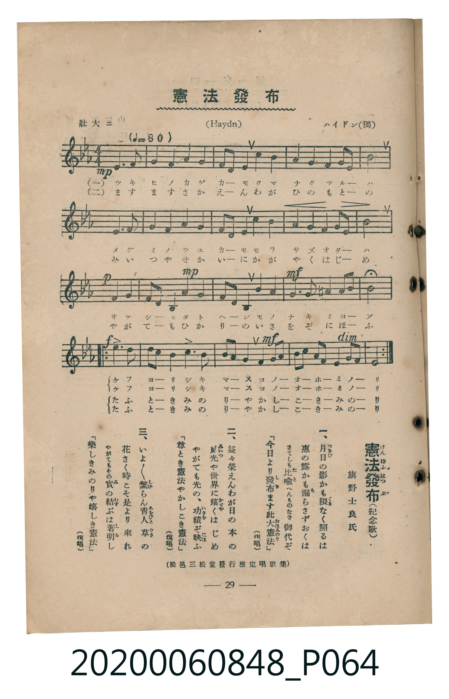

# 憲法發布

> Re:Shōka 使用 AI 協助辨識與重建樂譜，可能會有錯誤。歡迎回報。

- **鋼琴伴奏版**：<br><audio controls src="kenpo_happu.mp3"></audio>

- 詞：旗野士良
- 曲：F. J. Haydn（ハイドン）
- 臺灣教育會公認《新定兒童唱歌》高等科男子用（2020.006.0848）

## 說明

原書資訊與歌詞全文（對應 P064.jpg，書頁 p. 29，高一第三學期第 4 首）：
調性與拍號：變ホ長調（3 降記號）、4/4 拍（壯大ニ ♩=80）
出處註記：（松邑三松堂發行檢定唱歌集）


## 歌詞

```text
一、
月日の影かも隈なく照るは
惠の露かも漏らさずおくは
さてしも比喩へんものなき御代ぞ
「今日より發布ます此大憲法」（復唱）

二、
益々榮えんわが日の本の
威光や世界に耀くはじめ
やがても光の、功績ぞ映ふ
「尊とき憲法やかしこき憲法」（復唱）

三、
いよ／＼繁らん青人草の
花さく時こそ是より來れ
やがてもその實の、結ぶは著明し
「樂しきみのりや嬉しき憲法」（復唱）
```

## ABC

<div class="abc-score" data-abc-src="kenpo_happu.abc" aria-label="五線譜載入中"></div>

[下載 ABC 原始檔](kenpo_happu.abc)

## TMD 檔案連結

- [主旋律 TMD 檔案](kenpo_happu.tmd) [[在 TMD Studio 編輯](https://tmdlang.github.io/Tmd-TS/#tmd=s7IKdvYPcrWy4qpTUCpJTLdSSM7PyUlNLsnMz7MqzsjMK0nNjM_KTMmPL87Iz05Ugisry88pzU21ys4vyY9Pyq8sjjcyMDKINzAwizewMLFAqCvOLy1KTrUqTs7Iz8-JL0mtKEnKz89GyBcU5Zel5iXmAdUUFIGsSwErQihILctMSQVJp6ZkluQXZSbmIDkitagY7FCwJfElRYl5xclFmQUg1yNUlWSkAl2amVuQiqobaFh6Zp5VbmpmViYWl0Gly1OLS1KL8uJzU3PyUyqVuLS0FJ61bXq2eerzmXue7mhW0NLiUrRVsDDgsrdVcNXhsjHRN7EDmfFi5bz3e2Y9mz79ZXvf08WrX3SuBxv9bPYmoLCbnoKXnoJHYmVK3vs9HY-b-x83LXnc3Pm4efP7PZ1gdS_adz1vXPxs6swXTZuezWl-2rrmxarexw1dz6ZteLpu1tPWSc9XL306ZeOztT2PG7pfrp7xfG3n8-UTn0_Z_nTthOdTVgBNBUWIHjBC9EARAjaWS19LwZZagEtBQeFp3_xns3e82Nz-YkXXi452oGOAvn7auuLZtHagA55u6H3W3qkQYGBmopdVkP5-Tw9Q8csFjQoFegpGlkAu0NlPdjQ8X7PmyY7Op2t3PJszH8hWMFF4uWwa0L3AYALZ8WLV_mcNy0Gmd_e-mDkfKPpiXdfj5tkvp24HSgGtMVZ4ObP3xYoZYMnOxw2NwBhQACoGuWDx-qdLlj9u7lZ4NHOlrYUBUB7s7PZdL2ZOfbFiN1AX0Dygwmdz971smgh0BpDxdEETMGpfLOx5tmoRKKjBgfxydhtIM0g30MlAS0CsZ3M6nk1f-rhx3dO9Gx83dj9uano5q-Nx46rHjf3PW5c_bup-3LgerK55AVDRyzmbIIqe7QFGd-fjxqmPG2c9buwCqoaqAwste9w4HaRo_ZSn01Y-btzxuGkykAvUDza49-m-hU92L37cOA-soaHnye4ukBuaOh43dUFS5OPGfY8bZz5buwTodUhKfdwADox9K4F-gftiFzDhgH3xfHbX44bWZ8uAFgANAVoGdE4PxF_P5qwBkuAgW9H4tLXzcVPLkx3Tnk_tedy4-kVDA8TljxtnPG4CmwSUBmoFeaGpCaQa6OaGxqdd85_vALpo3rMZwFDYCnX20w1Af68A-gfqQpBOYHBNf9w4GSGIzdk7QDEMCawWoK_f7-l_v2fP852NoBBtmvxy7qQnu3a96AXZDU48XcCIAQZq_7OZwCAEGj332Yz1kMB6sq_tcVMPurOBKkDxuR4YCyDHP9864XHjNqAnX0yc_mxGH9CBUPc_WwFUCnRt7-PG_SClTV1AU56uAdoLEsTufqBOyrMdFCho6XNxOVoFZCbm5TvUGNRUg0xXsLHQsgMzgBkdnK0agMkYpBQkVqNQnVtQq2CooAuERgrGYFIXKGwCJCE883iwdI2CGZA0BWKYVA1YqTFQFiQKgjXg6IBZtKsHxSKa2LGjE9UzQL9ANEBNNY0HGwL2JIp1UAmYXdW5abVgSZASoMvUQeLqQGmEtbVcXEGpaUWJwOIfPYQNzVCC-Ons2UBXwaP5aX_vi2WgkgLJnUDbDOOgRoOgORAj-x1sJdxyEES4XhcalCBHweIQaB7QUxBRkCwsEEC6QKaAzEYEDwwaA3kws2AQ7FFdOwVHBSAB9TCIqcwFAA)]
- [鋼琴伴奏 TMD 檔案](kenpo_happu_piano.tmd) [[在 TMD Studio 編輯](https://tmdlang.github.io/Tmd-TS/#tmd=s7IKdvYPcrWy4tLSUnjWtunZ5qnPZ-55uqP5_Z6Ol917nk_Y8mTPlqdL-593drzf06mgpcWlaKtgYcBlb6vgqsNlY6JvYsdVp6D0YuW893tmPZs-_WV739PFq190rlcCCT-bvQko7Kan4KWn4JFYmZIHNPVxc__jpiWPmzsfN28GGglW96J91_PGxc-mznzRtOnZnOanrWterOp93ND1bNqGp-tmPW2d9Hz10qdTNj5b2_O4ofvl6hnP13Y-Xz7x-ZTtT9dOeD5lBdBUIwMjAz0DAzM9AwsTC7CxXI5WAZmJeflBHg41BjXVXApAYGOhZQdm6GspPF-z5smOhhcLexS09MFiNQrVuQW1CoYKukBopGAMJnWBwiZAEsIzjwdL1yiYAUlTIIZJ1YCVGgNlQaIgWMOFbNGuHhSLaGLHjk5UzwD9AtEANdU0HmwI2JMo1kElYHZV56bVgiVBSoAuUweJqwOlEdbWwkPXBzl0TaChC_QgyMhow1iFaNP4WJAh8QgeiIFNxAhJBGQJtU0yjQcbBRXExgVzgBYiTDECmQkzBujroNS0osTMPCwpy9AM7vlqYPgZxkEDCwTNgRg5NsGBCA9OEETEhy40cSDcDY4PYDRBREGysGgF6QKZAjIbEeEwaAzkwcyCQUxP4I1AE5SgAoYKPKRAwQuUBWGksIMqAVmia6fgqAAkoJahMZW5AA)]

## 分析

```text
================================================================================
📊 TMD Song Profile: [ 憲法發布 ]
================================================================================
⏱  Duration:       0:48 (48.0s), 16 measures total
🎼 Key & Tempo:    首調基準 E,, != 80.0 BPM, <4/4>
   - 分析範圍：      由實際發聲的音符與和弦推測調性；播放脈絡另行呈現
🎤 人聲音域:    A#3 (MIDI 58) – D#5 (MIDI 75) [跨度: 17 個半音 / 1.4 個八度, 難度: challenging]
   - 最低音:  A#3 in [A #1 @ m.9, 0:26]
   - 最高音: D#5 in [A #1 @ m.13, 0:36]
   - 適合: soprano, mezzo-soprano, contralto, tenor, baritone, bass
🏛  結構:      A (36.0s) -> Refrain (12.0s)
⚡ 編曲密度:        Peak 1 軌道同時演奏
🗝  調性診斷：       D# 大調（純淨自然大調，未偵測到可信轉調）
   - 風格氣質:    純淨自然大調（陽光明朗、易唱易記，無明顯調外色彩）
   - 轉調歷程:    全曲維持單一推測調性（未偵測到可信轉調）
   - 核心骨幹音:  A#, G, D#, F, G#
   - 調性數值:    D# 大調 [相關度: 0.86, 穩定度: Moderate, 自然音純度: 97.7%]
   - 候選調性 (K-S): D# 大調 (0.86), A# 大調 (0.76), G 小調 (0.68)
   - 五度圈歷程:   -3 -> -3
   - 各段落調性細節:
     • [A #1]: D# 大調 (r: 0.76, 自然音純度: 96.9%, 調外音: A)
     • [Refrain #1]: D# 大調 (r: 0.90, 自然音純度: 100.0%)

  [ 五度圈游移軌跡 ]
               C  
         F            G  
      Bb               D  
     [Eb]*              A  
         Ab           E  
            Db       B  
               F# 
     (* = active key center)

  [ 十二半音累積音高分佈 ]
     C  : █████                      4.7%
     C# :                            0.0%
     D  : ██████                     5.5%
     D# : ███████████████████       17.2%
     E  :                            0.0%
     F  : ██████████████████        16.8%
     F# :                            0.0%
     G  : █████████████████████     19.1%
     G# : ██████████████            12.5%
     A  : ███                        2.3%
     A# : ████████████████████████  21.9%
     B  :                            0.0%
--------------------------------------------------------------------------------
Assignment 軌道音域：
  - Piano         : A#3 – D#5 (17 個半音 / 1.4 個八度, 73 個音符)
================================================================================
```


## 原書掃描頁




