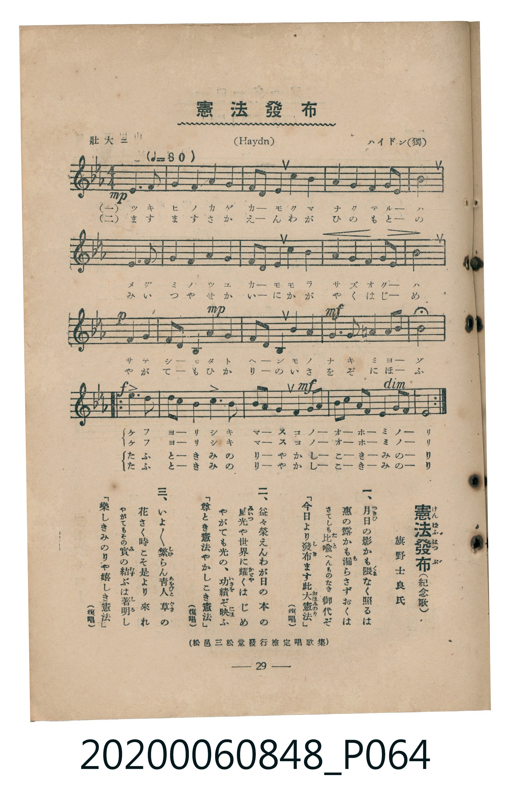

# 憲法發布

<audio controls src="kenpo_happu.mp3"></audio>

- 詞：旗野士良
- 曲：F. J. Haydn（ハイドン）
- 臺灣教育會公認《新定兒童唱歌》高等科男子用（2020.006.0848）

- note

原書資訊與歌詞全文（對應 P064.jpg，書頁 p. 29，高一第三學期第 4 首）：
調性與拍號：變ホ長調（3 降記號）、4/4 拍（壯大ニ ♩=80）
出處註記：（松邑三松堂發行檢定唱歌集）

## 歌詞

```text
一、
月日の影かも隈なく照るは
惠の露かも漏らさずおくは
さてしも比喩へんものなき御代ぞ
「今日より發布ます此大憲法」（復唱）

二、
益々榮えんわが日の本の
威光や世界に耀くはじめ
やがても光の、功績ぞ映ふ
「尊とき憲法やかしこき憲法」（復唱）

三、
いよ／＼繁らん青人草の
花さく時こそ是より來れ
やがてもその實の、結ぶは著明し
「樂しきみのりや嬉しき憲法」（復唱）
```

## 原書掃描頁



## 調性分析

```text
================================================================================
📊 TMD Song Profile: [ 憲法發布 ]
================================================================================
⏱  Duration:       1:00 (60.0s), 20 measures total
🎼 Key & Tempo:    首調基準 E,, != 80.0 BPM, <4/4>
   - 分析範圍：      由實際發聲的音符與和弦推測調性；播放脈絡另行呈現
🎤 人聲音域:    A#3 (MIDI 58) – D#5 (MIDI 75) [跨度: 17 個半音 / 1.4 個八度, 難度: challenging]
   - 最低音:  A#3 in [A #1 @ m.9, 0:26]
   - 最高音: D#5 in [A #1 @ m.13, 0:36]
   - 適合: soprano, mezzo-soprano, contralto, tenor, baritone, bass
🏛  結構:      A (36.0s) -> Refrain (12.0s) -> Refrain (12.0s)
⚡ 編曲密度:        Peak 1 軌道同時演奏
🗝  調性診斷：       D# 大調（純淨自然大調，未偵測到可信轉調）
   - 風格氣質:    純淨自然大調（陽光明朗、易唱易記，無明顯調外色彩）
   - 轉調歷程:    全曲維持單一推測調性（未偵測到可信轉調）
   - 核心骨幹音:  A#, D#, F, G, G#
   - 調性數值:    D# 大調 [相關度: 0.90, 穩定度: High, 自然音純度: 98.1%]
   - 候選調性 (K-S): D# 大調 (0.90), A# 大調 (0.76), G 小調 (0.63)
   - 五度圈歷程:   -3 -> -3 -> -3
   - 各段落調性細節:
     • [A #1]: D# 大調 (r: 0.76, 自然音純度: 96.9%, 調外音: A)
     • [Refrain #1]: D# 大調 (r: 0.90, 自然音純度: 100.0%)
     • [Refrain #2]: D# 大調 (r: 0.90, 自然音純度: 100.0%)

  [ 五度圈游移軌跡 ]
               C  
         F            G  
      Bb               D  
     [Eb]*              A  
         Ab           E  
            Db       B  
               F# 
     (* = active key center)

  [ 十二半音累積音高分佈 ]
     C  : ██████                     5.0%
     C# :                            0.0%
     D  : ███████                    6.2%
     D# : ███████████████████████   20.0%
     E  :                            0.0%
     F  : ████████████████████      16.9%
     F# :                            0.0%
     G  : ████████████████████      16.9%
     G# : ███████████████           12.5%
     A  : ██                         1.9%
     A# : ████████████████████████  20.6%
     B  :                            0.0%
--------------------------------------------------------------------------------
Assignment 軌道音域：
  - Piano         : A#3 – D#5 (17 個半音 / 1.4 個八度, 94 個音符)
================================================================================
```

## ABC

```abc
X:1
T:憲法發布
C:曲：F. J. Haydn（ハイドン）
M:4/4
L:1/16
Q:1/4=80
K:Eb

V:V1 name="Piano" snm="Pia"

[V:V1]
!mp! e6 f2 g4 f4 | a4 g4 f2 d2 e4 | c4 b4 a4 g4 | f4 g2 e2 b8 |
e6 f2 g4 f4 | a4 g4 f2 d2 e4 | c4 b4 a4 g4 | f4 g2 e2 b8 |
!p! f4 g4 f2 d2 B4 | !mp! a4 g4 f2 d2 B4 | !mf! b4 a4 g6 g2 | =a4 a2 b2 b8 |
!f! e6 d2 c2 b2 a4 | b6 a2 g2 f2 e4 | !mf! d4 e2 f2 g2 a2 b2 c2 | !p! f6 g f e8 |
!f! e6 d2 c2 b2 a4 | b6 a2 g2 f2 e4 | !mf! d4 e2 f2 g2 a2 b2 c2 | !p! f6 g f e8 |
```

- [主旋律 TMD 檔案](kenpo_happu.tmd)
- [鋼琴伴奏 TMD 檔案](kenpo_happu_piano.tmd)
