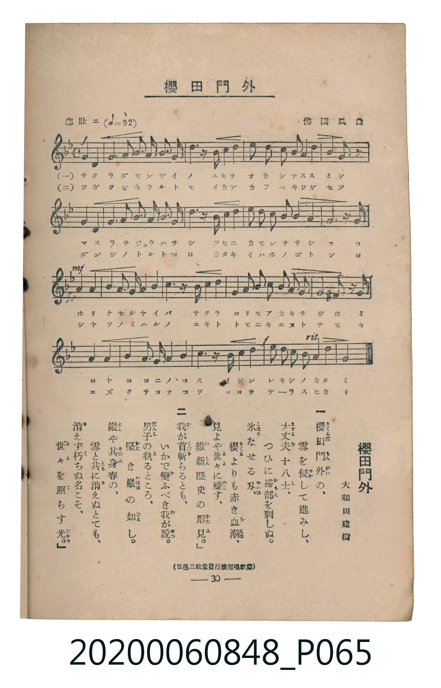

# 櫻田門外

<audio controls src="sakuradamon_gai.mp3"></audio>

- 詞：大和田建樹
- 曲：佛國風曲
- 臺灣教育會公認《新定兒童唱歌》高等科男子用（2020.006.0848）

## 說明

原書資訊與歌詞全文（對應 P065.jpg，書頁 p. 30，高一第三學期第 5 首）：
調性與拍號：ニ短調（1 降記號）、4/4 拍（悲壯ニ ♩=92，弱起第 4 拍進入）
出處註記：（松邑三松堂發行檢定唱歌集）

## 歌詞

```text
一
櫻田門外の、
雪を侵して進みし、
大丈夫十八士、
つひに掃部を刺しぬ。
氷なせる刃、
櫻よりも赤き血潮、
見よや世々に殘す、
維新歷史の形見。

二
我が首斬らるとも、
いかで變ふべき我が説。
男子の執るところ、
堅き巖の如し。
縱や其身春の、
雪と共に消えぬとても、
消えず朽ちぬ名こそ、
世々を照らす光。
```

## ABC

```abc
X:1
T:櫻田門外
C:曲：佛國風曲
M:4/4
L:1/16
Q:1/4=92
K:Dm
V:V1 name="Piano" snm="Pia"
[V:V1]
!f! z2 z2 z2 z2 z2 z2 D2 D2 | A4 A2 B2 A4 G2 F2 | E4 z2 E2 F2 G2 A3 G | F4 E2 D2 A6 A2 |
D8 z4 D2 D2 | G4 G2 A2 G4 F2 E2 | F4 z2 F2 G2 A2 B3 A | G4 F2 E2 c6 c2 |
!mf! A8 z4 A3 A | d4 c2 B2 A4 G2 F2 | G4 z2 G2 A2 B2 c3 B | A4 G2 F2 E2 D2 ^C3 D |
E8 z4 A3 A | F4 G2 A2 B4 G2 E2 | A4 z2 A2 d6 c2 | !f! B4 A2 G2 A6 A2 |
D8 z4 z4 |
```

## TMD 檔案連結

- [主旋律 TMD 檔案](sakuradamon_gai.tmd) [[在 TMD Studio 編輯](https://tmdlang.github.io/Tmd-TS/#tmd=s7IKdvYPcrWy4tLSUni2evfzKRteTmt4umSagpYWl6KtgqURl72tghtXdmqlrYJLLpeNib6JHVedgtKLlfPe75n1dMnyp5N6gJqe7t71bMVOJZDMs9mbgDJP9s5-Oqf75aIVQC5Y-EX7rueNi59NnfmiadOzOc1PW9e8WNX7uKHr2bQNT9fNeto66fnqpU-nbHy2tudxQ_fL1TOer-18vnzi8ynbn66d8HzKivd7OowMjAz0DAzM9AwsTCze7-lU4uLS11KwpRbgUlBQeNo3_9nsHS82t79Y0fWiox3oGKA_n7aueDatHeiApxt6n7V3KgQYmJnqZRWkv9_TA1T8ckGjQoGegrEBkAt09pMdDc_XrHmyo_Pp2h3P5swHshVMFV4umwZ0LzBUQHa8WLX_WcNykOndvS9mzgeKPm7ufj5_LVAcaIehwsuZvS9WzADLdD5uaAQGuAJQJVDqWdOmp4vXAxUrPJq50tbSCGjh0z0bX2zdDrIErOhlw6anrUuB-sB-ad_1YubUFyt2A00DWgIyYO6-l00TgW4DMp4uaHo-c8-LhT3PVi0ChT845F_ObgNpBukG-gNEISeJx43rgO4Bib6cvepx06Qn-7Y-bpz-uHEZ0NrHjftBbIg0MFU82dHxdMnqp72NT1tXP128GirxuHHJ40ag2tXP-ppfNq8AmvG0YxfYjDWPG5rA9m3Y_rhx1ePG2Y-bup92NEP1AV3xuKnjcVPX46amF1uBZvS-WNjwbC_MOS-WdYOlW57smPa4oRVk_roZjxtnQqWfb1sLTGTP1m5_2g-0e93TvYtAGoD2gf25qwdsQ8fEx409wHh6Nm3N46ZOoO2PG4Hua4I7vOVxI1Bo-Yt1XY8bgd7eCXQDRM-LVTC3Q9IqyIb526EGNE5-3ARM5JBQWQB0We_T7aBwfLqsCRxcEH07NgLd_rR124tdq5_NWIoazI0rnrZuBPloW8fjRiBaAzZ2GcJpMIlZz-bsfdy4EKji6YRekMWNc6EqoKHSNOl563KQ3xpnPm0Fpiyw3ZRnGyhQ0NLn4vJNzMyzCshMzMt3qDGoUagG2aBgY2imZQdmAXMrJME-3dD_fH0DMEViplyQOSC1NQoGCrpYcXVarYJZPJABJmrAsQgyGpztGoApGmGEMVABCIJoEygNgkZAbAjSrGAOMgMEQSaDOSBxkDxErRHQAohZIHEQBCsCWw0zDWZDDUQYGYJMBUFc7t3Vg-JekL0w94FMhPFBdoPtRTgDZDKyU0HeA7FgzsXQaorkLBAbETrojq3OBYYwRBJkHkr4dqK41wzJPOzhC3MGyGxkp0JcYwJ3LrpORCibqkMCFchBii50N2N17tPZs1GcCws71DCD8KHBC3MHyFwQG-ZDeKhBjQIlQph2WEyRkB5gdA1XLReXrp0CKOMoAGllLi4A)]
- [鋼琴伴奏 TMD 檔案](sakuradamon_gai_piano.tmd) [[在 TMD Studio 編輯](https://tmdlang.github.io/Tmd-TS/#tmd=s7IKdvYPcrWy4tLSUni2evfzKRteTmt4umTa-z0dL7v3PJ-w5cmeLU-X9j_v7Hi_p1NBS4tL0VbB0ojL3lbBjSs7tdJWwSWXy8ZE38SOq05B6cXKee_3zHq6ZPnTST1Ak57u3vVsxU4lkMyz2ZuAMk_2zn46p_vlohVALlj4Rfuu542Ln02d-aJp07M5zU9b17xY1fu4oevZtA1P18162jrp-eqlT6dsfLa253FD98vVM56v7Xy-fOLzKdufrp3wfMoKoCONDIwM9AwMzPQMLEwsgE5U4uLyTczMswrITMzLD_JwqDGoUajmUgACG0MzLTswS19L4emejS-2bn-6of_5-gYFLX2wcI2CgYIuVlydVqtgFg9kgIkaLpgpz9esebKj4cXCHoQRxkAFIAiiTaA0CBoBsSFIs4I5yAwQBJkM5oDEQfIQtUZACyBmgcRBEKwIbDXMNJgNNRBhZAgyFQRxuXdXD4p7QfbC3AcyEcYH2Q22F-EMkMnITgV5D8SCORdDqymSs0BsROigO7Y6FxjCEEmQeSjh24niXjMk87CHL8wZILORnQpxjQncueg6EaFsqg4JVCAHKbrQ3YzVuU9nz0ZxLizsUMMMwocGL8wdIHNBbJgP4aEGNQqUCGHaYTFFQnqA0TVctchZxAcli5hAcwgoK0AgzHazeJDB0WbxubEQV0P4xvEQLlQamQtRi2yGEViNEcwIdCMh0viNQNdjCuEbYnUFyI1gDhYT4K6AeoRIVwDDTtdOARR8CkBamYsLAA)]

## 分析

```text
================================================================================
📊 TMD Song Profile: [ 櫻田門外 ]
================================================================================
⏱  Duration:       0:44 (44.3s), 17 measures total
🎼 Key & Tempo:    首調基準 F, != 92.0 BPM, <4/4>
   - 分析範圍：      由實際發聲的音符與和弦推測調性；播放脈絡另行呈現
🎤 人聲音域:    C#4 (MIDI 61) – D5 (MIDI 74) [跨度: 13 個半音 / 1.1 個八度, 難度: moderate]
   - 最低音:  C#4 in [Main #1 @ m.12, 0:30]
   - 最高音: D5 in [Main #1 @ m.10, 0:23]
   - 適合: soprano, mezzo-soprano, contralto, tenor, baritone, bass
🏛  結構:      Main (44.3s)
⚡ 編曲密度:        Peak 1 軌道同時演奏
🗝  調性診斷：       D 調性不明確（純淨自然大調，未偵測到可信轉調）
   - 風格氣質:    純淨自然大調（陽光明朗、易唱易記，無明顯調外色彩）
   - 轉調歷程:    全曲維持單一推測調性（未偵測到可信轉調）
   - 核心骨幹音:  A, D, G, F, E
   - 調性數值:    D 調性不明確 [相關度: 0.72, 穩定度: Ambiguous, 自然音純度: 98.7%]
   - 候選調性 (K-S): D 小調 (0.72), A 小調 (0.69), D 大調 (0.59)
   - 五度圈歷程:   +2
   - 各段落調性細節:
     • [Main #1]: D 調性不明確 (r: 0.72, 自然音純度: 98.7%, 調外音: C#)

  [ 五度圈游移軌跡 ]
               C  
         F            G  
      Bb              [D ]*
      Eb               A  
         Ab           E  
            Db       B  
               F# 
     (* = active key center)

  [ 十二半音累積音高分佈 ]
     C  : █████                      6.5%
     C# : █                          1.3%
     D  : █████████████             16.8%
     D# :                            0.0%
     E  : ████████                  10.3%
     F  : █████████                 11.2%
     F# :                            0.0%
     G  : █████████████             15.9%
     G# :                            0.0%
     A  : ████████████████████████  30.2%
     A# : ██████                     7.8%
     B  :                            0.0%
--------------------------------------------------------------------------------
Assignment 軌道音域：
  - Piano         : C#4 – D5 (13 個半音 / 1.1 個八度, 80 個音符)
================================================================================
```


## 原書掃描頁




