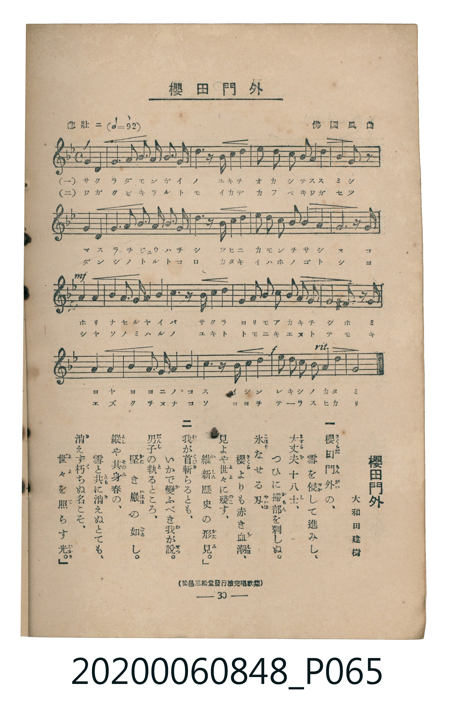

# 櫻田門外

> Re:Shōka 使用 AI 協助辨識與重建樂譜，可能會有錯誤。歡迎回報。

- **鋼琴伴奏版**：<br><audio controls src="sakuradamon_gai.mp3"></audio>

- 詞：大和田建樹
- 曲：佛國風曲
- 臺灣教育會公認《新定兒童唱歌》高等科男子用（2020.006.0848）

## 說明

原書資訊與歌詞全文（對應 P065.jpg，書頁 p. 30，高一第三學期第 5 首）：
調性與拍號：ト短調（2 降記號）、4/4 拍（悲壯ニ ♩=92，弱起第 3 拍進入）
出處註記：（松邑三松堂發行檢定唱歌集）


## 歌詞

```text
一
櫻田門外の、
雪を侵して進みし、
大丈夫十八士、
つひに掃部を刺しぬ。
氷なせる刃、
櫻よりも赤き血潮、
見よや世々に殘す、
維新歷史の形見。

二
我が首斬らるとも、
いかで變ふべき我が説。
男子の執るところ、
堅き巖の如し。
縱や其身春の、
雪と共に消えぬとても、
消えず朽ちぬ名こそ、
世々を照らす光。
```

## ABC

<div class="abc-score" data-abc-src="sakuradamon_gai.abc" aria-label="五線譜載入中"></div>

[下載 ABC 原始檔](sakuradamon_gai.abc)

## TMD 檔案連結

- [主旋律 TMD 檔案](sakuradamon_gai.tmd) [[在 TMD Studio 編輯](https://tmdlang.github.io/Tmd-TS/#tmd=s7IKdvYPcrWy4qpTUCpJTLdSSM7PyUlNLsnMz7MqzsjMK0nNjM_KTMmPL87Iz05Ugisry88pzU21ys4vyY9Pyq8sjjcyMDKINzAwizewMLFAqCvOLy1KTrUqTs7Iz8-JL0mtKEnKz89Gl48vSExPtQowMDNFyBQU5Zel5iXmAXUXFIEckgLWjlCQWpaZkgqSLk5OzIsvSy3KTMtMTUFyYmpRMdgbECtKihLzipOLMgtAfkOoyi8qychPL0osyKi0ysgsLskvykxOzInPTsxD8m1JRirQsxDpSmS9memZeVa5qZlZmVj8BpUuTy0uSS3Ki89NzclPAerW0lJ4tnr38ykbXk5reLpkmoKWFpeirYKlEZe9rYJTEld2aqWtgnsul42JvokdyKwXK-e93zPr6ZLlTyf1AHU93b3r2YqdYFuezd4ElHmyd_bTOd0vF60AcsHCL9p3PW9c_GzqzBdNm57NaX7auubFqt7HDV3Ppm14um7W09ZJz1cvfTpl47O1PY8bul-unvF8befz5ROfT9n-dO2E51NWvN_TAYpMPWBk6oEi8_2eTiUuLn0tBVtqAS4FBYWnffOfzd7xYnP7ixVdLzragY4B-vNp64pn09qBDni6ofdZe6cCKEXoZRWkv9_TA1T8ckGjQoGegrEBkAt09pMdDc_XrHmyo_Pp2h3P5swHshVMFV4umwZ0LzBUQHa8WLX_WcNykOndvS9mzgeKPm7ueD5_LVAc5EmFlzN7X6yYAZbpfNzQCAxwBaBKoNSzpk1PF69_3Nyt8GjmSltLI6CFT_dsfLF1O8gSY5Cilw2bnrYuBeoD-6V914uZU1-s2A00DWgJyIC5-142TQS6Dch4uqDp-cw9Lxb2PFu1CBT-4JB_ObsNpBmkG-gPEIWcJh43rgO6ByT6cvaqx02Tnuzb-rhx-uPGZUBrHzfuB7Eh0sBU8WRHx9Mlq5_2Nj5tXf108WqoxOPGJY8bgWpXP-trftm8AmjG045dYDPWPG5oAtu3YfvjxlWPG2c_bup-2tEM1Qd0xeOmjsdNXY-bml5sBZrR-2Jhw7O9MOe8WNYNlm55smPa44ZWkPnrZjxunAmVfr5tLTCRPVu7_Wk_0O51T_cuAmkA2gf2564esA0dEx839gDj6dm0NY-bOoG2P24Euq8J7vCWx41AoeUv1nU9bgR6eyfQDRA9L1bB3A5JqyAb5m-HGtA4-XETMJFDQmUB0GW9T7eDwvHpsiZwcEH07dgIdPvT1m0vdq1-NmMpajA3rnjauhHko20djxuBaA3Y2GUIp8EkZj2bs_dx40KgiqcTekEWN86FqoCGStOk563LQX5rnPm0FZiywHZTnm2gQEFLn4vLNxFYsgRkJublO9ToGtZUg2xQsDE007IDs4C5FZJgn27of76-AZgiMVMuyByQ2hoFAwVdMITR1Wm1CmbxUI4xjFEDVu1jWKMAE4HRj5u2wlnrUVUbYVHdDFPzuGkNXDXM2eAs3QDMLQjnwZ0CguYgjiGMCWEAFdQAPYdQZACUMIK5H8P5j5tXIql93NwAJhdBeZvhznrctARo7uPmPiTV8UD-MqDMWrjuTRgeRgQCRMVksFkQHSC7HzevhrI7wOZDbIabD7T1cRNEBUhNO2oQ1SiYQD0F8iDI_-AQQfEpNFjAAQOJVXyx-bhpFdiBICsfN20HW9oGZu-EOQLOAjl3PlwUpBZk3uPmeZgqkYIDbHLzVDA5Ex4YWNMBkL0b7vUWuPmgKIJFD0pwQFPMrh66phhQnD9u2vG4eSnU_cAk0dwPlWwE-wIUNkiRCvTL4-ZJcAO6sYQSsg5IogMlEAhvNYLdtBkcC6AQRDIfGMaPm_bDdMOTJ85EA0sh8MSDFmgGIG51LrAggKtAKEVKOpCoBaVgSNTAwgZRIMC8BXJ0D5qjgXmteTbcy6BkiB4oS8AyoKCFqIQGTNMWuC5IsECSDnqgr0ASe9wMMgspUGCFTSdK0kELGGAowP0Nk6qBpxRISOFPOV3wkIAkbEhkwtwC8SEsfCaguh8YioiyBJEGkcNnL1wWUkqBsicsKULsQpiOvxyDhyMsycDTAzwDoZQ4YGkkVabx6uDQQA4xbEkGGCkwK8HlDiTxNEFISBkEchQoH0EidQdcPSgBgBwO8iLCFES0woMF7hlY0gTlN6i5TSCdkKQIUQdSDyrvEOpBQb8WqhISSbtQAweSdJ7Onk3bpIPwI4QF8gciGkHZBx658HIXGrngSgSR9BGlJmYlBQlpSJggJ1dk02HJDGo6KGMhuQ5RBUJDAtSAIKKaQilxIAGCSiMHBqiKgEUhpJKClATwmhJe_CFXUghHo9LIiQVc2TXvAZOgPAYJTKTiGm4HSDWslMJtci0Xl66dAqiFpgCklbkA)]
- [鋼琴伴奏 TMD 檔案](sakuradamon_gai_piano.tmd) [[在 TMD Studio 編輯](https://tmdlang.github.io/Tmd-TS/#tmd=s7IKdvYPcrWy4qpTUCpJTLdSSM7PyUlNLsnMz7MqzsjMK0nNjM_KTMmPL87Iz05Ugisry88pzU21ys4vyY9Pyq8sjjcyMDKINzAwizewMLFAqCvOLy1KTrUqTs7Iz8-JL0mtKEnKz89Gl48vSExPtQowMDNFyBQU5Zel5iXmAXUXFIEckgLWjlCQWpaZkgqSLk5OzIsvSy3KTMtMTUFyYmpRMdgbECtKihLzipOLMgtAfkOoyi8qychPL0osyKi0ysgsLskvykxOzInPTsxD8m1iEVBzempual6JVUFmYl5-fGJycn5uQWJeJkgMobAkA6gIak4lsiWZ6Zl5VrmpmVmZWAIBKl2eWlySWpQXn5uak58C1K2lpfBs9e7nUza8nNbwdMm093s6XnbveT5hy5M9W54u7X_e2fF-T6eClhaXoq2CpRGXva2CUxJXdmqlrYJ7LpeNib6JHciCFyvnvd8z6-mS5U8n9QCNerp717MVO8FWP5u9CSjzZO_sp3O6Xy5aAeSChV-073reuPjZ1JkvmjY9m9P8tHXNi1W9jxu6nk3b8HTdrKetk56vXvp0ysZna3seN3S_XD3j-drO58snPp-y_enaCc-nrAC6EpQU9IBJQQ-UFIBuVOLi8k0E-i8AFHJBHg41uoY11VwKQGBjaKZlB2bpayk83bPxxdbtTzf0P1_fADTl-Zo1CsYKz7p7XzZsetq6FOxXfbDaGgUDBV0whNHVabUKZvFQjjGMUQNW7WNYowATgdGPm7bCWetRVRthUd0MU_O4aQ1cNczZQHc-2dHwYmEPwnlwp4CgOYhjCGNCGEAFNUDPIRQZACWMYO7HcP7j5pVIah83N4DJRVDeZrizHjctAZr7uLkPSXU8kL8MKLMWrnsThocRgQBRMRlsFkQHyO7Hzauh7A6w-RCb4eYDbX3cBFEBUtOOGkQ1CiZQT4E8CPI_OERQfAoNFnDAQGIVX2w-bloFdiDIysdN28GWtoHZO2GOgLNAzp0PFwWpBZn3uHkepkqk4ACb3DwVTM6EBwbWdABk74Z7vQVuPiiKYNGDEhzQFLOrh64pBhTnj5t2PG5eCnU_MEk090MlG8G-AIUNUqQC_fK4eRLcgG4soYSsA5LoQAkEwluNYDdtBscCKASRzAeG8eOm_TDd8OSJM9HAUgg88aAFmgGIW50LLAjgKhBKkZIOJGpBKRgSNbCwQRQIMG-BHN2D5mhgXmueDfcyKBmiB8oSsAwoaCEqoQHTtAWuCxIskKSDHugrkMQeN4PMQgoUWGHTiZJ00AIGGApwf8OkauApBRJS-FNOFzwkIAkbEpkwt0B8CAufCajuB4YioixBpEHk8NkLl4WUUqDsCUuKELsQpuMvx-DhCEsy8PQAz0AoJQ5YGkmVabw6ODSQQwxbkgFGCsxKcLkDSTxNEBJSBoEcBcpHkEjdAVcPSgAgh4O8iDAFEa3wYIF7BpY0QfkNam4TSCckKULUgdSDyjuEelDQr4WqhETSLtTAgSSdp7Nn0zbpIPwIYYH8gYhGUPaBRy683IVGLrgSQSR9RKmJWUlBQhoSJsjJFdl0WDKDmg7KWEiuQ1SB0JAANSCIqKZQShxIgKDSyIEBqiJgUQippCAlAbymhBd_yJUUwtGoNHJiAVd2zXvAJCiPQQITqbiG2wFSDSulcJtci9xA80FpoJlA22egNhcEQhwCCguQAdFm8bmxYIuMIXzjeAjXCIUHUgxRShsjkBUhm4jNBrBiEszA7wxg2OnaKYCCTwFIK3MBAA)]

## 分析

```text
================================================================================
📊 TMD Song Profile: [ 櫻田門外 ]
================================================================================
⏱  Duration:       0:41 (41.7s), 16 measures total
🎼 Key & Tempo:    首調基準 B,, != 92.0 BPM, <4/4>
   - 分析範圍：      由實際發聲的音符與和弦推測調性；播放脈絡另行呈現
🎤 人聲音域:    D4 (MIDI 62) – D#5 (MIDI 75) [跨度: 13 個半音 / 1.1 個八度, 難度: moderate]
   - 最低音:  D4 in [Main #1 @ m.1, 0:01]
   - 最高音: D#5 in [Main #1 @ m.4, 0:07]
   - 適合: soprano, mezzo-soprano, contralto, tenor, baritone, bass
🏛  結構:      Main (41.7s)
⚡ 編曲密度:        Peak 1 軌道同時演奏
🗝  調性診斷：       G 小調（純淨自然小調，未偵測到可信轉調）
   - 風格氣質:    純淨自然小調（陰鬱抒情、旋律集中，無明顯調外色彩）
   - 轉調歷程:    全曲維持單一推測調性（未偵測到可信轉調）
   - 核心骨幹音:  G, A, D, A#, C
   - 調性數值:    G 小調 [相關度: 0.79, 穩定度: High, 自然音純度: 99.2%]
   - 候選調性 (K-S): G 小調 (0.79), G 大調 (0.54), D 小調 (0.52)
   - 五度圈歷程:   +1
   - 各段落調性細節:
     • [Main #1]: G 小調 (r: 0.75, 自然音純度: 99.2%, 調外音: F#)

  [ 五度圈游移軌跡 ]
               C  
         F           [G ]*
      Bb               D  
      Eb               A  
         Ab           E  
            Db       B  
               F# 
     (* = active key center)

  [ 十二半音累積音高分佈 ]
     C  : █████████████████         14.5%
     C# :                            0.0%
     D  : ███████████████████████   20.2%
     D# : ███                        2.4%
     E  :                            0.0%
     F  :                            0.0%
     F# : █                          0.8%
     G  : ████████████████████████  21.0%
     G# :                            0.0%
     A  : ████████████████████████  21.0%
     A# : ███████████████████████   20.2%
     B  :                            0.0%
--------------------------------------------------------------------------------
Assignment 軌道音域：
  - Piano         : D4 – D#5 (13 個半音 / 1.1 個八度, 79 個音符)
================================================================================
```


## 原書掃描頁




