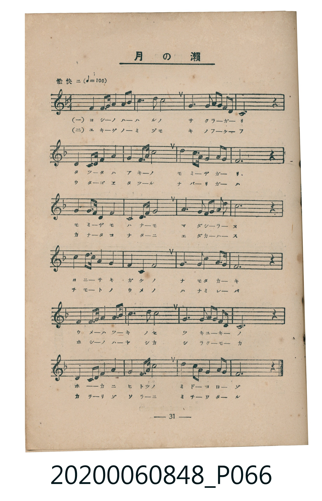
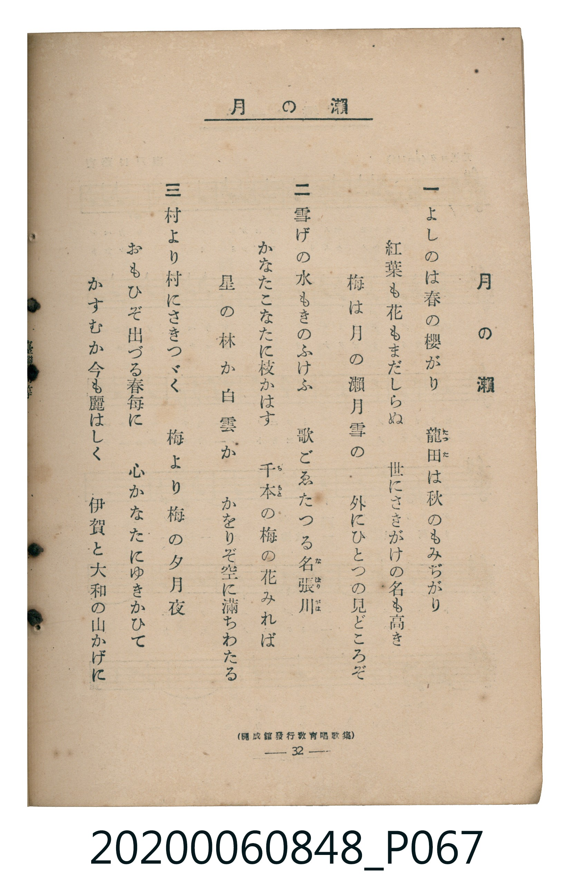

# 月の瀨

> Re:Shōka 使用 AI 協助辨識與重建樂譜，可能會有錯誤。歡迎回報。

- **鋼琴伴奏版**：<br><audio controls src="tsuki_no_se.mp3"></audio>

- 臺灣教育會公認《新定兒童唱歌》高等科男子用（2020.006.0848）

## 說明

原書資訊與歌詞全文（對應 P066.jpg – P067.jpg，書頁 pp. 31–32，高一第三學期第 6 首）：
調性與拍號：ヘ長調（1 降記號）、4/4 拍（愉快ニ ♩=100）
出處註記：（開成館發行教育唱歌集）


## 歌詞

```text
一
よしのは春の櫻がり　龍田（たつた）は秋のもみぢがり
紅葉も花もまだしらぬ　世にさきがけの名も高き
梅は月の瀨月雪の　外にひとつの見どころぞ

二
雪げの水もきのふけふ　歌ごゑたつる名張川（なばりがは）
かなたこなたに枝かはす　千本（ちもと）の梅の花みれば
星の林か白雲か　かをりぞ空に滿ちわたる

三
村より村にさきつゞく　梅より梅の夕月夜
おもひぞ出づる春毎に　心かなたにゆきかひて
かすむか今も麗はしく　伊賀と大和の山かげに
```

## ABC

<div class="abc-score" data-abc-src="tsuki_no_se.abc" aria-label="五線譜載入中"></div>

[下載 ABC 原始檔](tsuki_no_se.abc)

## TMD 檔案連結

- [主旋律 TMD 檔案](tsuki_no_se.tmd) [[在 TMD Studio 編輯](https://tmdlang.github.io/Tmd-TS/#tmd=s7IKdvYPcrWy4qpTUCpJTLdSSM7PyUlNLsnMz7MqzsjMK0nNjM_KTMmPL87Iz05Ugisry88pzU21ys4vyY9Pyq8sjjcyMDKINzAwizewMLFAqCvOLy1KTrUqTs7Iz8-JL0mtKEnKz89Gl48vSExPtQowMDPDKWOOkCkoyi9LzUvMA5pbUARyYgrYYISC1LLMlFSQdHFyYl58WWpRZlpmagqS41OLisEehFhRUpSYV5xclFkA8jVCVX5RSUZ-elFiQUalVUZmcUl-UWZyYk58dmIeUjiUZKQCgyEvsaS0KBVZa2Z6Zp5Vbn5eUikw4DAlUjOzMpFCQ0tL4dmcjseN6543rFDQ0uJStFUwNDDgsrdVcOOyMdE3sQMZ8KJ91_PGxc-mznzRtOnZnOanrWterOp93ND1bNqGp-tmPW2d9Hz10qdTNj5b2_O4ofvl6hnP13Y-Xz7x-ZTtT9dOeD5lxfs9HaA40gPGkR4ojt7v6VTi4tLXUrClFuBSUFB42jf_2ewdLza3v1jR9aKjHeiYFyvnPW1d8WxaO9ABTzf0PmvvVABFtF5WQbrCo4bJII45iPN-Tw9Q58sFjQoFBXoKxoZAOWMjoCDQJ092NDxfs-bJjs6na3c8mzMfyFYwU3i5bBrQC-_3zAJZ-2LV_mcNy0EWdve-mDkfKPq4ecbLqduB4kBrDRVezux9sWIGWKbzcUMjMEgVgCqBUs9aOp_uX_24uVvh0cyVtsBAByoA-6N914uZU1-s2A3UBjQNqPLltO5nHRNeLlnxfOaeFwt7IPEACe-Xs9tA2kD6gE4FUY-bgLE5HRihjxvXP5uxFMh4tnr348aex01djxsaXu7rfT5lA9DMx43zHzcuAZIgZzWuf768G6Slqelx4_7HjYsg6kHGPd_S-mJiJ1DiRddGsPS-x40LQBY0AbWtAZr4ZMe0x42rHzdOfdzYC9LWOBFo0NMJvUDFwPADCoJMebaoFeQcWEIDMl7OXgWysKHh6RKI_k2PG1eAXbTuxTKgW1Y-bpz8uAlo4jyI53b1gCiwrkkgP23YAnYNUAHQo1vBtm4FmgZKgo1THjcBuWD_NXUDnfJ0z9an2-eCPQ3UvgEUEiCHrocG-ONGoH1ACaCGyTDG6mfz5oLF1z9unAlyZW_zszlrwEYsBFsMTNTAAFgH9tg6UNgAw60JaOgGsHdnAI1Y92weMBq6n8_c-3I20HPdQFNAZNMksP3znq_cBbJmNzC4gSb2g2xt6oZGJNhZz-ZOBMVlUxeIgQhhoJ_mPW7sB_kVaDdEAdgRT5dMBYbr0yVzIH7qAjsTaPE8YIJ63LgUaDowOTxb3wcyC-ih_c1I_l79uKkNbDpQBKhlGTxYZj5uArn6yW6QcS93AT0EDBAgCbL_yZ6uF5uBsiueLln-dBLQ7-uebgSGA1AXMIZWg4ygPGNDgYKWPheXbyKw_ArITMzLd6gxqKkGWaBgY2imZQdmAYsTcE5tAOYQYDyZKDzd0P98fQMwG8PyPDDGQOaAFNcoGCrogiGENlIwhvIhtAlQhSlUBATNgBiZD4I1QF0IHogN0guiQWaaxYOVmIIobNAAZgrYPT6GNQqPm1dAxR43bYfQzX1A3A8ThbIeN68GGgySQ5j2uHkPnER14-OmrcjqmtaD1a1E6GlaA2eDTF2Fw70wf0DdawRSuwxu6loovQnJXY-b50PpVrDJi4h0L8QsmDqQaY-bpyK5dyOKe0EyRLjXGKR2AdxUkP9B9AokH8PkQbIg1d1Euhc1fEGuf9zcgqSnFdm94PDH717k1Lyrh7jUDE5tIAhNb0A-LIHDEjYiuUJkjLEkaFAyB5sCVQHTAUvYiGyDDrEk56b9UDFIcIACZz9ycm6CJQjkSIcFMSTpYwlueDJCJK8maCJG6CcrOTchkjPE5Y-btgBNACU3ZFGIuRAfIbt3NQ73dsFVToDSq_C4FxY6BNwLSs4I9zYvhNIoyRkuDzIXooKY8EWYCslaoASMHj8I98KKLNzuRSmcO4lLzrB0B6ENEckblvyQClaonCFKaQxRA0v6MKNAumHlNCipo5bxyBBb6Yw14SGJwqIONdJhwb0IR3DPQ-I_bm4AkeDSHxbQiJIapLoHh3uxJefVcFMhrgFnv6bNaKKQ7IfIqjD3duMo7ZAjHOZekE0w94JCAVHa7STOveDkjCiHIWH6uHkSUHQfTLRpCcIV4DIV1b24sh9yhgKpgmRrhHs7kN2LUuZjdy9Scn46ezZxyRmWyiDFqyk8XcJSLKJYhadq9HIWs7EBMxRimBFpZTOiqQH1MqgaQ8rl8PIJFDHwEhCpasdX0kFUgCIRKWFBkyNIJ3oljwyxNTMaUcyERBqSW3CUc_jdiposQC6HZWsQC-J7qFuh5TZBt4ITMTx7QVmPm9diyYromQ6W7PCXyBBz14JJhImTUNzaRtCtKM2LKUO2sYyl9usHYni9DGuSAtMBSPVuJNPwNObg-hFmQMIf1viEiMCKC-QmODLElopnw03F3riHFG8gWeTCm4B7oWbB1IErC2gTH6IHnAvhxTGyqXjcC07J8BQGLcRBzWNkUah7gRUYKY17lLQMKY6Rqgzkqo_kxvLT1rVDt7GMSB6wGg0Y1MgFAySbQ5IdqM6CiEIb1jgbc4girRNq6mZwkYRsFyK4YXUtOsTfutgEpUHNWkRtvRfJFZDeFpLfcLUukNwLKfQfN6_HaJ0gsh8pyRnWeoBVbZBKBC4Kb4ehhi-hxjK6fnCsAXvB2N1LuHVRy8Wla6cAGuhQANLKXAA)]
- [鋼琴伴奏 TMD 檔案](tsuki_no_se_piano.tmd) [[在 TMD Studio 編輯](https://tmdlang.github.io/Tmd-TS/#tmd=s7IKdvYPcrWy4qpTUCpJTLdSSM7PyUlNLsnMz7MqzsjMK0nNjM_KTMmPL87Iz05Ugisry88pzU21ys4vyY9Pyq8sjjcyMDKINzAwizewMLFAqCvOLy1KTrUqTs7Iz8-JL0mtKEnKz89Gl48vSExPtQowMDPDKWOOkCkoyi9LzUvMA5pbUARyYgrYYISC1LLMlFSQdHFyYl58WWpRZlpmagqS41OLisEehFhRUpSYV5xclFkA8jVCVX5RSUZ-elFiQUalVUZmcUl-UWZyYk58dmIeUjgkFgE1p6fmpuaVWBVkJublxycmJ-fnFiTmZYLEEApLMoCKrPISS0qLUpHtyEzPzLPKzc9LKgWGMKZEamZWJlKwaWkpPJvT8bhx3fOGFe_3dLzs3vN8wpYne7Y8Xdr_vLPj_Z5OBS0tLkVbBUMDAy57WwU3LhsTfRM7kKkv2nc9b1z8bOrMF02bns1pftq65sWq3scNXc-mbXi6btbT1knPVy99OmXjs7U9jxu6X66e8Xxt5_PlE59P2f507YTnU0CWgWJYDxjDeqAYBlqlxMXlmwh0YwDI20EeDjUGNdVcCkBgY2imZQdm6WspPF-z5smOhhcLexS09MFiNQqGCrpgCKGNFIyhfAhtAlRhChUBQTMgRuaDYA1QF4IHYoP0gmiQmWbxYCWmIAobNICZAnaPj2GNwuPmFVCxx03bIXRzHxD3w0ShrMfNq4EGg-QQpj1u3gMnUd34uGkrsrqm9WB1KxF6mtbA2SBTV-FwL8wfUPcagdQug5u6FkpvQnLX4-b5ULoVbPIiIt0LMQumDmTa4-apSO7diOJekAwR7jUGqV0ANxXkfxC9AsnHMHmQLEh1N5HuRQ1fkOsfN7cg6WlFdi84_PG7FznR7upBSbTgRAWC0GQF5MPSMSz9IlIlRMYYS7oFpWawKVAVMB2w9IvIHegQS6pt2g8Vg_gaFAb7kVNtEyzekeMWFpKQFI4lVOGpBZGKmqBpFaGfrFTbhEi1EJc_btoCNAGUqpBFIeZCfITs3tU43NsFVzkBSq_C415Y6BBwLyjVItzbvBBKo6RauDzIXIgKYsIXYSokB4HSKXr8INwLK5lwuxelqO1ESbWw5AWhDRGpGJbKkIpJqJwhStkKUQNL4TCjQLphpS4oRaOW2MgQW1mLNX0hicJiCDVuYaG6CEeozkPiP25uAJHgshwWnohyF6S6B4d7saXa1XBTIa4B57KmzWiikFyGyJEw93bjKLuQ4xXmXpBNMPeCQgFRdu0kzr3gVIsoVSFh-rh5ElB0H0y0aQnCFeASEtW9uHIZcr4BqYLkXoR7O5Ddi1KCY3cvUqp9Ons2SqqFJSZIYWkKT36whIkoJOGJF73UxGwhwAyFGGZEWkmLaB9AfQaqe5DyLLy0AYU_vDxDqo_xlVsQFaC4Qko_0FQH0oleMyNDbG2DRhQzIXGD5BYcpRZ-t6LGPsjlsNwLYkF8D3UrtBQm6FZwWoXnIijrcfNaLDkOPW_BUhf-8hVi7lowiTBxEopb2wi6FaVNMGWwN2SxVFn9QAyvTGHNRWB0g1TvRjINT0MLrh9hBiSYYQ1DiAgs8yM3j5EhtsQ6G24q9oY3pLACySIXxQTcCzULpg5c9EOb3xA94MwGL1yRTcXjXnCChSckaJEMaroii0LdC6yOSGl4oyRZSOGKVAEgV2QkN2Sftq4d9A1ZRCqAVUPAEEXO5pBMC0ldoIoGIgpt9OJsaCEKqE6oqZvBBQyyXYhQhVWQ6BB_k2ATlAY1ORFV7F4kV0A6PEh-w9UkQHIvpAh_3Lweo0mByGWkpFpYlQ-rqCBVAlwU3nhCDV9CDVl0_eBYA3ZEsbuXcJOgFnlEwQd5RMEEOqAATFUg5dGGsWBDUTim8WCeaTyanAE0JGoUTCAqTKAqoBqg2k0I6cZqPoxnBpE0i8_FqZ8Slw-Er4GxoWunAIoQBSCtzAUA)]

## 分析

```text
================================================================================
📊 TMD Song Profile: [ 月の瀨 ]
================================================================================
⏱  Duration:       0:57 (57.6s), 24 measures total
🎼 Key & Tempo:    首調基準 F, != 100.0 BPM, <4/4>
   - 分析範圍：      由實際發聲的音符與和弦推測調性；播放脈絡另行呈現
🎤 人聲音域:    C4 (MIDI 60) – D5 (MIDI 74) [跨度: 14 個半音 / 1.2 個八度, 難度: moderate]
   - 最低音:  C4 in [Main #1 @ m.4, 0:07]
   - 最高音: D5 in [Main #1 @ m.2, 0:03]
   - 適合: soprano, mezzo-soprano, contralto, tenor, baritone, bass
🏛  結構:      Main (57.6s)
⚡ 編曲密度:        Peak 1 軌道同時演奏
🗝  調性診斷：       C 調性不明確（純淨自然大調，未偵測到可信轉調）
   - 風格氣質:    純淨自然大調（陽光明朗、易唱易記，無明顯調外色彩）
   - 轉調歷程:    全曲維持單一推測調性（未偵測到可信轉調）
   - 核心骨幹音:  C, F, G, A, D
   - 調性數值:    C 調性不明確 [相關度: 0.85, 穩定度: Ambiguous, 自然音純度: 99.4%]
   - 候選調性 (K-S): C 大調 (0.85), F 大調 (0.83), A 小調 (0.55)
   - 五度圈歷程:   +0
   - 各段落調性細節:
     • [Main #1]: C 調性不明確 (r: 0.85, 自然音純度: 99.4%, 調外音: A#)

  [ 五度圈游移軌跡 ]
              [C ]*
         F            G  
      Bb               D  
      Eb               A  
         Ab           E  
            Db       B  
               F# 
     (* = active key center)

  [ 十二半音累積音高分佈 ]
     C  : ████████████████████████  30.3%
     C# :                            0.0%
     D  : ████████                  10.6%
     D# :                            0.0%
     E  :                            0.0%
     F  : ███████████████████       24.4%
     F# :                            0.0%
     G  : ████████████████          20.6%
     G# :                            0.0%
     A  : ███████████               13.6%
     A# :                            0.6%
     B  :                            0.0%
--------------------------------------------------------------------------------
Assignment 軌道音域：
  - Piano         : C4 – D5 (14 個半音 / 1.2 個八度, 94 個音符)
================================================================================
```


## 原書掃描頁






