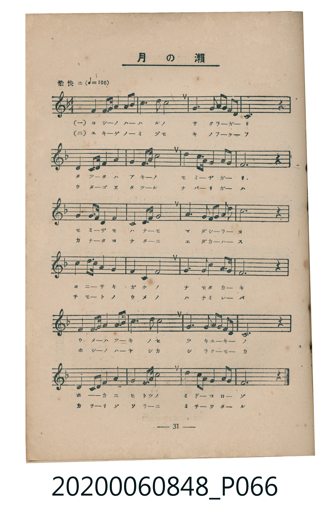
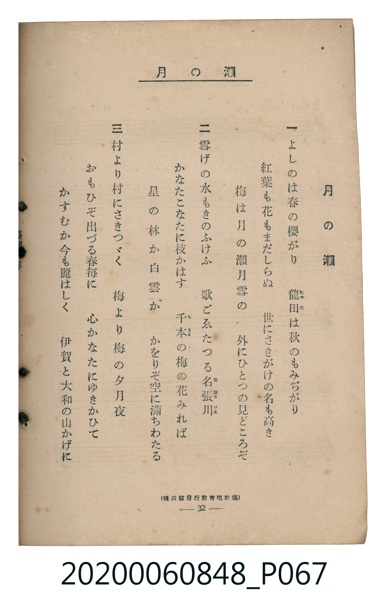

# 月の瀨

<audio controls src="tsuki_no_se.mp3"></audio>

- 臺灣教育會公認《新定兒童唱歌》高等科男子用（2020.006.0848）

## 說明

原書資訊與歌詞全文（對應 P066.jpg – P067.jpg，書頁 pp. 31–32，高一第三學期第 6 首）：
調性與拍號：ヘ長調（1 降記號）、4/4 拍（愉快ニ ♩=100）
出處註記：（開成館發行教育唱歌集）

## 跨冊／重複收錄參照

> 同曲（《新定兒童唱歌》高等科男、女共用教材）

- **[同曲]** 《新定兒童唱歌》高等科女子用（2020.006.0849）：[**〈月の瀨〉**](../../koto_girls_2020.006.0849/1_3_06_tsuki_no_se/index.md)（`F` / `4/4` — [原始 TMD](../../koto_girls_2020.006.0849/1_3_06_tsuki_no_se/tsuki_no_se.tmd)）
- 總表：[跨冊重複與同名歌曲總索引](../../../duplicate_songs.md)

## 歌詞

```text
一
よしのは春の櫻がり　龍田は秋のもみぢがり
紅葉も花もまだしらぬ　世にさきがけの名も高き
梅は月の瀨月雪の　外にひとつの見どころぞ

二
雪げの水もきのふけふ　歌ごゑたつる名張川
かなたこなたに枝かはす　千本の梅の花みれば
星の林か白雲か　かをりぞ空に滿ちわたる

三
村より村にさきつゞく　梅より梅の夕月夜
おもひぞ出づる春毎に　心かなたにゆきかひて
かすむか今も麗はしく　伊賀と大和の山かげに
```

## ABC

```abc
X:1
T:月の瀨
M:4/4
L:1/16
Q:1/4=100
K:F
V:V1 name="Piano" snm="Pia"
[V:V1]
!mf! F4 F3 G A4 c4 | A6 c2 d8 | G6 A2 G3 F F2 D2 | C12 z4 |
F4 F3 G A4 A4 | c6 d2 c8 | d6 c2 A3 G F2 G2 | A12 z4 |
G4 G3 A c4 G4 | F4 A3 c d8 | A6 G2 F3 D F2 G2 | c12 z4 |
d4 d3 c A4 c4 | A4 F4 G8 | G6 c2 A3 G F2 G2 | F12 z4 |
F4 F3 G A4 c4 | d6 d2 c8 | G6 A2 G3 F F2 D2 | C12 z4 |
F4 D3 F G4 A4 | c6 d2 c8 | D6 F2 G3 c A2 G2 | F12 z4 |
```

## TMD 檔案連結

- [主旋律 TMD 檔案](tsuki_no_se.tmd) [[在 TMD Studio 編輯](https://tmdlang.github.io/Tmd-TS/#tmd=s7IKdvYPcrWy4tLSUng2p-Nx47rnDSsUtLS4FG0VDA0MuOxtFdy4bEz0Tey46hSUXrTvet64-NnUmS-aNj2b0_y0dc2LVb2PG7qeTdvwdN2sp62Tnq9e-nTKxmdrex43dL9cPeP52s7nyyc-n7L96doJz6eseL-nw8jAyEDPwMBMz8DCxOL9nk4lLi59LQVbagEuBQWFp33zn83e8WJz-4sVXS862oGOebFy3tPWFc-mtQMd8HRD77P2ToUAAzMzvayCdIVHDZNBHHMQ5_2eHqDOlwsaFQoK9BSMDYFyxkZAQaBPnuxoeL5mzZMdnU_X7ng2Zz6QrWCm8HLZNKAX3u-ZBbL2xar9zxqWgyzs7n0xcz5Q9HHzjJdTtwPFgdYaKryc2ftixQywTOfjhkZgkCoAVQKlnrV0Pt2_-nFzt8KjmSttgYEOVAD2R_uuFzOnvlixG6gNaBpQ5ctp3c86JrxcsuL5zD0vFvZA4gES3i9nt4G0gfQBnQqiHjcBY3M6MEIfN65_NmMpkPFs9e7HjT2Pm7oeNzS83Nf7fMoGoNTz5d0gNU1Njxv3P25cBFEA0v98S-uLiZ1AiRddG8HS-x43LgCZ2NT5uHEN0IgnO6Y9blz9uHHq48ZekLbGiUCDnk7oBSoGBhhQEGTKs0WtIPthKQvIeDl7FcjChoanSyD6Nz1uXPG4cQlQ8MUyoFtWPm6c_LgJaOI8iG929YAosK5JIE9s2AJ2DVAB0GdbwbZuBZoGSnONUx43AbnzQaY1dQOd8nTP1qfb54JDoxFoNNAIoNxkGGP1s3lzweLrHzfOBDmot_nZnDUgO0COXgfyNzBMmoDmbgB7ZQZQz7pn84Bh2v185t6Xs4EO7wZqA5FNk0DB2jjv-cpdIHN3A4Ny4eOmfpA1Td3QWAFH6rO5E0ER09QFYiBCD-jeeY8b-0H-ANoNUQB2xNMlU4Fh9nTJHIgnusB-B1o8D5g6HjcuBZoOjNtn6_tAZgF9sL8ZyaOrHze1gU0HigC1LIOHw8zHTSBXP9kNMu7lLqCHgCEAJEH2P9nT9WIzUHbF0yXLn04C-n3d043AcADqAob-apARlOdSKFDQ0ufi8k3MzLMKyEzMy3eoMahRqAbZoGBjaKZlB2YBCwdwvmsApneQepAYUFVuWq2CoYIuGEJoIwVjKN8UStfARWCiZkh8sAqocUZIYiA9EL4h2GSzeLBRpiAKGzSAm4Xs3l09KO7F5VQYDTQfyUiQM5H5yE5F9gJIDcQEI7DJIGejepqwQ3d0ojgUFhIQ2hjuDJg4wisQa0xxhimyM0C6IfqAoYlwKbof8br06ezZKC6F2QuhTfHEPszFyLGM7FJkcexBCjOBKIc-2TWFqLhHOBQ5CPHFPdWT6dPWtVidCjYMZDLMRjLSKbJDYCEJiydiQ7WWi0vXTgFUQigAaWUuLgA)]
- [鋼琴伴奏 TMD 檔案](tsuki_no_se_piano.tmd) [[在 TMD Studio 編輯](https://tmdlang.github.io/Tmd-TS/#tmd=s7IKdvYPcrWy4tLSUng2p-Nx47rnDSve7-l42b3n-YQtT_Zsebq0_3lnx_s9nQpaWlyKtgqGBgZc9rYKblw2Jvomdlx1Ckov2nc9b1z8bOrMF02bns1pftq65sWq3scNXc-mbXi6btbT1knPVy99OmXjs7U9jxu6X66e8Xxt5_PlE59P2f507YTnU0CWGRkYGegZGJjpGViYWACtUuLi8k3MzLMKyEzMyw_ycKgxqFGo5lIAAhtDMy07MEtfS-H5mjVPdjS8WNijoKUPFgOqyk2rVTBU0AVDCG2kYAzlm0LpGrgITNQMiQ9WATXOCEkMpAfCNwSbbBYPNsoURGGDBnCzkN27qwfFvbicCqOB5iMZCXImMh_ZqcheAKmBmGAENhnkbFRPE3bojk4Uh8JCAkIbw50BE0d4BWKNKc4wRXYGSDdEHzA0ES5F9yNelz6dPRvFpTB7IbQpntiHuRg5lpFdiiyOPUhhJhDl0Ce7phAV9wiHIgchvrinejJ92roWq1PBhoFMhtlIRjpFdggsJGHxRGyo1iIXED4oBYQJtHwAGgOyKdowFmImmGMC4RiBOUbxuRCuaTyYbxofC7QC5k4suqEcE2SOGUSvGcgshGYkEzEsR9aB03YUOyDaYYZhNRuoEofTUUwi3uNwNVgMw2o1MEp07RRAsaIApJW5uAA)]

## 分析

```text
================================================================================
📊 TMD Song Profile: [ 月の瀨 ]
================================================================================
⏱  Duration:       0:57 (57.6s), 24 measures total
🎼 Key & Tempo:    首調基準 F, != 100.0 BPM, <4/4>
   - 分析範圍：      由實際發聲的音符與和弦推測調性；播放脈絡另行呈現
🎤 人聲音域:    C4 (MIDI 60) – D5 (MIDI 74) [跨度: 14 個半音 / 1.2 個八度, 難度: moderate]
   - 最低音:  C4 in [Main #1 @ m.4, 0:07]
   - 最高音: D5 in [Main #1 @ m.2, 0:03]
   - 適合: soprano, mezzo-soprano, contralto, tenor, baritone, bass
🏛  結構:      Main (57.6s)
⚡ 編曲密度:        Peak 1 軌道同時演奏
🗝  調性診斷：       F 調性不明確（純淨自然大調，未偵測到可信轉調）
   - 風格氣質:    純淨自然大調（陽光明朗、易唱易記，無明顯調外色彩）
   - 轉調歷程:    全曲維持單一推測調性（未偵測到可信轉調）
   - 核心骨幹音:  C, F, A, G, D
   - 調性數值:    F 調性不明確 [相關度: 0.81, 穩定度: Ambiguous, 自然音純度: 100.0%]
   - 候選調性 (K-S): F 大調 (0.81), C 大調 (0.80), A 小調 (0.64)
   - 五度圈歷程:   -1
   - 各段落調性細節:
     • [Main #1]: F 調性不明確 (r: 0.81, 自然音純度: 100.0%)

  [ 五度圈游移軌跡 ]
               C  
        [F ]*          G  
      Bb               D  
      Eb               A  
         Ab           E  
            Db       B  
               F# 
     (* = active key center)

  [ 十二半音累積音高分佈 ]
     C  : ████████████████████████  26.9%
     C# :                            0.0%
     D  : ██████████████            15.3%
     D# :                            0.0%
     E  :                            0.0%
     F  : ███████████████████       20.8%
     F# :                            0.0%
     G  : ████████████████          18.1%
     G# :                            0.0%
     A  : █████████████████         18.9%
     A# :                            0.0%
     B  :                            0.0%
--------------------------------------------------------------------------------
Assignment 軌道音域：
  - Piano         : C4 – D5 (14 個半音 / 1.2 個八度, 91 個音符)
================================================================================
```


## 原書掃描頁






