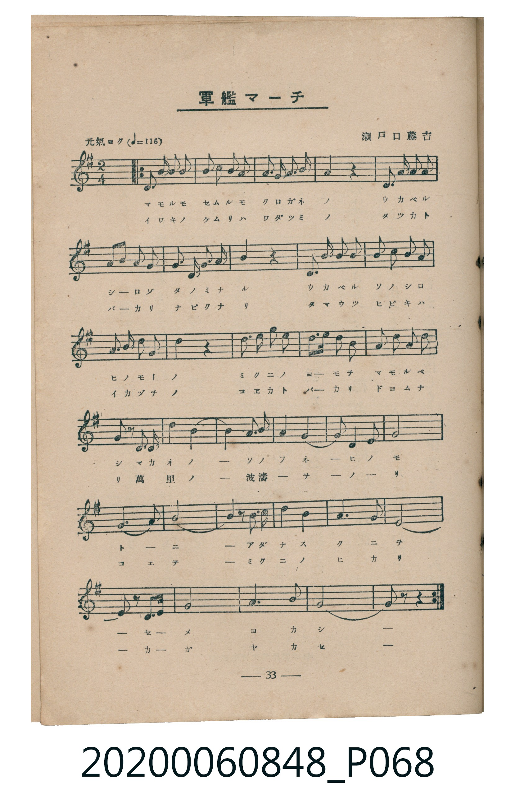
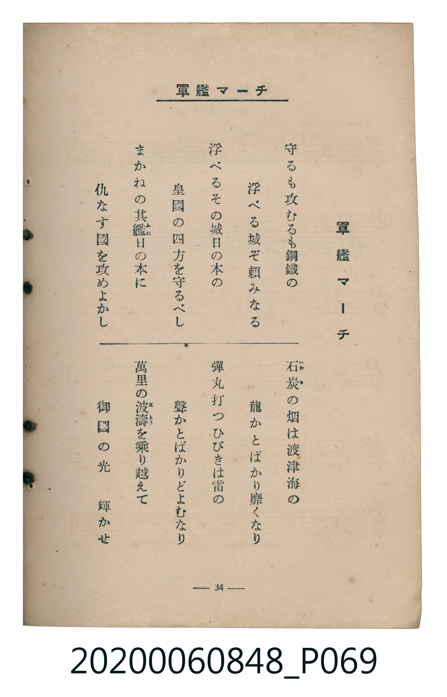

# 軍艦マーチ

> Re:Shōka 使用 AI 協助辨識與重建樂譜，可能會有錯誤。歡迎回報。

- **鋼琴伴奏版**：<br><audio controls src="gunkan_machi.mp3"></audio>

- 詞：鳥山啓
- 曲：瀨戶口藤吉
- 臺灣教育會公認《新定兒童唱歌》高等科男子用（2020.006.0848）

## 說明

原書資訊與歌詞全文（對應 P068.jpg – P069.jpg，書頁 pp. 33–34，高一第三學期第 7 首）：
調性與拍號：ト長調（1 升記號）、2/4 拍（元氣ヨク ♩=116）


## 歌詞

```text
一
守るも攻むるも鋼鐵の
浮べる城ぞ頼みなる
浮べるその城日の本の
皇國の四方を守るべし
まかねの其艦日の本に
仇なす國を攻めよかし

二
石炭の烟は渡津海の
龍かとばかり靡くなり
彈丸打つひびきは雷の
聲かとばかりどよむなり
萬里の波濤を乗り越えて
御國の光　輝かせ
```

## ABC

<div class="abc-score" data-abc-src="gunkan_machi.abc" aria-label="五線譜載入中"></div>

[下載 ABC 原始檔](gunkan_machi.abc)

## TMD 檔案連結

- [主旋律 TMD 檔案](gunkan_machi.tmd) [[在 TMD Studio 編輯](https://tmdlang.github.io/Tmd-TS/#tmd=s7IKdvYPcrWy4qpTUCpJTLdSSM7PyUlNLsnMz7MqzsjMK0nNjM_KTMmPL87Iz05Ugisry88pzU21ys4vyY9Pyq8sjjcyMDKINzAwizewMLFAqCvOLy1KTrUqTs7Iz8-JL0mtKEnKz89Gl48vSExPtQowMMPQCZexRMgUFOWXpeYl5gHNLSgCOTEFbDBCQWpZZkoqSLo4OTEvviy1KDMtMzUFyfGpRcVgD0KsKClKzCtOLsosAPkaoSq_qCQjP70osSCj0iojs7gkvygzOTEnPjsxDykcSjJSgcGQm5mTWZJYVImsOTM9M88qNzUzKxPJ21paCi92977oXPa4ed7j5j2PmxsVtLS4FG0VDA3NuOxtFdy5bIz0TexAxrxYOe_9nlkvNy99unHj06mTwUY_m70JKPa8YcWzjm1P-xe_mL7k6YROsMyL9l3PGxc_mzrzRdOmZ3Oan7auebGq93FD17NpG56um_W0ddLz1UufTtn4bG3P44bul6tnPF_b-Xz5xOdTtj9dO-H5lBXv93SAIlAPGIF6oAh8vwdoLJe-loIttQCXgoLC0775z2bveLG5_cWKrhcd7UDHAD35tHXFs2ntQAc83dD7rL1TAZQK9LIK0hUeNUwGcSxBnPd7eoA6Xy5oVCgo0FMwNgbKGZsABYE-ebKj4fmaNU92dD5du-PZnPlAtoK5wstl04BeAIYVyNoXq_Y_a1gOsrC798XM-UDRx80dL6duB4oDrTVUeNoLdNAMsEzn44ZGYAQoAFWCXNTa_GzD4sfNKx43rVd4NHOlLTCWgGq4QIYCrQV7aV3H46bux01Nz6bsftzUAGG_7N7zcsLWx43rQCqebV33uHEnUOLp_L7HjfNeLtjzuHH_48ZVQBEU6ceNc4E6gIqeTV8KZDybswZqwPNZ7U_nAKXXPZ09-9k0oNJJUEuB2hqng1Q8btz3uBHIXwtS1LoNmLyQzFgNdu3udpCVjTNBJjVNAju28XFTB1jbdIiHdvWAbZu_-XkTyKDnzfMfN65_tmPhsy1Ln23dDnXMy329YD0rHjduADGaul7OXfi4sR_soS5wiOzteLJjx7POyY8blzxu3PS4cfPjRqCe9S9nw8x4ARJFMeNx40qQY4DhBzfmxYQ1L9t7QJ7YvOjZ_iVARz_ZOR0o92IbUDXQ3cvAdu1bCA2aVmDMNbzYAwxCIHc2SI7yJAsFClr6XFy-icDcHJCZmJfvUGNQUw2yQMHG0EzLDswCZhRwGmx4sbBHQcNU4emG_ufrGzRBOkHSNQqm8Qq6IAKIDIEsIyCuUTAGkoZAaAqkQewasLgxkASpMQNpgeoEQQMoDRUyBCoDaQJprgHb4mNYowAsVoD8x82LgHg1mAbx9oC1PW7aDeYtwCq3HsxbC2StAdK9yHLNfVCrYU4BqV8GUtEEMmcm2Dy4eohbjEBqloBF1wNZQHPBpiDs2wh3yyog7kexD-KWBiBuAeL5BN2yH6wCqBbsng4ktyDHzq4eXLFjBg1HSITAIgIczJAYAQmBJAjFA6ZJiJhp2g53FyicQaG3D8X9kPCB-LYL6ltQuBId8kDRvQiToPaBbEKKk-YJCFcAzQCxV0HtAtn5uHkyWAYSAzBXgFRgD_N5YPeAwh45jiYhmQT2KTh-UWNjRyeu2AAFOSQbwDMBRAg57M3BtBmYRgQ9iI0aiSCDTIAkOMchZROQEyFBBcsIoGSDI4GBIwUSLI-bu-FBDJJZATVnD9ycTVAZUEZEZEUQaybCDfDsAYvKVrCKRtxuaNoMVb0CHnEwF4OiFOoGtCjthMoA9QCzGjxKkSMCWKngighQSBpASy1odoAIIsMaMAmOJ3NIfkCOMFRVYCMQStEzRzw0QUH8ACqCkMMC1SiUpN48FaoWpAeLWmiChKgFxRJyhgCFVTyoulEA1jdwdSAZUHLGNA1YH4HI_ZDCDZbkQbGOzWZEoQeNFdQiaQqusIeVNiCIqC0wbTAAioNkTNTBQqCsAI4PMGkKFAElfhCEaUfOBKAEBIMIr4ASOKZFwMhpAiXlBrBaaMnQtBOmG1xigGS6UYIDUucg2QtO-JCkDFMBykIgPW247AVmP1iJBHIbcqKAZ2RgokEuqSCJCGIvcmJvXYsrwCGBCUyhkKRrCCpRYNkP4SJ4bQyCkESMElXIEYNUXMHDHOYjUHGxEOqDPUgFCbIpCD_A1EFEQVkFWzghFRfwsEayD1ivI9sHKXyIsQ8Wg_jsq-Xi0rVTADWSFIC0MhcA)]
- [鋼琴伴奏 TMD 檔案](gunkan_machi_piano.tmd) [[在 TMD Studio 編輯](https://tmdlang.github.io/Tmd-TS/#tmd=s7IKdvYPcrWy4qpTUCpJTLdSSM7PyUlNLsnMz7MqzsjMK0nNjM_KTMmPL87Iz05Ugisry88pzU21ys4vyY9Pyq8sjjcyMDKINzAwizewMLFAqCvOLy1KTrUqTs7Iz8-JL0mtKEnKz89Gl48vSExPtQowMMPQCZexRMgUFOWXpeYl5gHNLSgCOTEFbDBCQWpZZkoqSLo4OTEvviy1KDMtMzUFyfGpRcVgD0KsKClKzCtOLsosAPkaoSq_qCQjP70osSCj0iojs7gkvygzOTEnPjsxDykcEouAmtNTc1PzSqwKMhPz8uMTk5PzcwsS8zJBYgiFJRlARVa5mTmZJYlFlci2ZKZn5lnlpmZmZSKFj5aWwovdvS86lz1unve4ec_j5sb3ezpedu95PmHLkz1bni7tf97Z8X5Pp4KWFpeirYKhoRmXva2CO5eNkb6JHcjsFyvnvd8z6-XmpU83bnw6dTLYvmezNwHFnjeseNax7Wn_4hfTlzyd0AmWedG-63nj4mdTZ75o2vRsTvPT1jUvVvU-buh6Nm3D03WznrZOer566dMpG5-t7Xnc0P1y9YznazufL5_4fMr2p2snPJ-yAug0UPTrAaNfDxT9QIcpcXH5JgL9FQAKkyAPhxqDmmouBSCwMTTTsgOz9LUUnq9Z82RHw4uFPQoapgpPN_Q_X9-gqaClD5auUTCNV9AFEUBkCGQZAXGNgjGQNARCUyANYteAxY2BJEiNGUgLVCcIGkBpqJAhUBlIE0hzDdgWH8MaBWAQA_mPmxcB8WowDeLtAWt73LQbzFuAVW49mLcWyFoDpHuR5Zr7oFbDnAJSvwykoglkzkyweXD1ELcYgdQsAYuuB7KA5oJNQdi3Ee6WVUDcj2IfxC0NQNwCxPMJumU_WAVQLdg9HUhuQY6dXT24YscMGo6QCIFFBDiYITECEgJJEIoHTJMQMdO0He4uUDiDQm8fivsh4QPxbRfUt6BwJTrkgaJ7ESZB7QPZhBQnzRMQrgCaAWKvgtoFsvNx82SwDCQGYK4AqcAe5vPA7gGFPXIcTUIyCexTcPyixsaOTlyxAQpySDaAZwKIEHLYm4NpMzCNCHoQGzUSQQaZAElwjkPKJiAnQoIKlhFAyQZHAgNHCiRYHjd3w4MYJLMCas4euDmboDKgjIjIiiDWTIQb4NkDFpWtYBWNuN3QtBmqegU84mAuBkUp1A1oUdoJlQHqAWY1eJQiR8TT2bNxRQQoJA2gpRY0O0AEkWENmATHkzkkPyBHGKoqsBEIpeiZIx6aoCB-ABVByGGBahRKUm-eClUL0oNFLTRBQtSCYgk5Q4DCKl7hxYQ1Ci_be-DqQDKg5Ixp2rPNIBOe7YcUbrAkD4p1bDYjCj1orKAWSVNwhT2stAFBRG2BaYMBUBwkY6IOFgJlBXB8gElToAgo8YMgTDtyJgAlIBhEeAWUwDEtAkZOEygpN4DVQkuGpp0w3eASAyTTjRIckDoHyV5wwockZZgKUBYC6WnDZS8w-8FKJJDbkBMFPCMDEw1ySQVJRBB7kRN761pcAQ4JTGAKhSRdQ1CJAst-CBfBa2MQhCRilKhCjhik4goe5jAfgYqLhVAf7EEqSJBNQfgBpg4iCsoq2MIJqbiAhzWSfcB6Hdk-SOFDjH2wGMRnXy1yG8kHuY1kAm0iAcMpXiHaMBaZYQRkGMWDWKbxQKYpmAmTheoygSnGogTBgKmCVSHYDMZmAEIM4UgDZAXGQIZZfC7MtegmoXsNpNwYrMYMqAZkEsQpqAYg6YIYCFIMswaHP4FmgUJZ104BFNAKQFqZCwA)]

## 分析

```text
================================================================================
📊 TMD Song Profile: [ 軍艦マーチ ]
================================================================================
⏱  Duration:       0:31 (31.0s), 30 measures total
🎼 Key & Tempo:    首調基準 G, != 116.0 BPM, <2/4>
   - 分析範圍：      由實際發聲的音符與和弦推測調性；播放脈絡另行呈現
🎤 人聲音域:    D4 (MIDI 62) – F#5 (MIDI 78) [跨度: 16 個半音 / 1.3 個八度, 難度: moderate]
   - 最低音:  D4 in [Main #1 @ m.1, 0:00]
   - 最高音: F#5 in [Main #1 @ m.13, 0:12]
   - 適合: soprano, mezzo-soprano, tenor, baritone
🏛  結構:      Main (31.0s)
⚡ 編曲密度:        Peak 1 軌道同時演奏
🗝  調性診斷：       D 調性不明確（純淨自然大調，未偵測到可信轉調）
   - 風格氣質:    純淨自然大調（陽光明朗、易唱易記，無明顯調外色彩）
   - 轉調歷程:    全曲維持單一推測調性（未偵測到可信轉調）
   - 核心骨幹音:  B, D, A, G, E
   - 調性數值:    D 調性不明確 [相關度: 0.80, 穩定度: Ambiguous, 自然音純度: 97.3%]
   - 候選調性 (K-S): D 大調 (0.80), G 大調 (0.78), B 小調 (0.76)
   - 五度圈歷程:   +2
   - 各段落調性細節:
     • [Main #1]: D 調性不明確 (r: 0.80, 自然音純度: 97.3%, 調外音: C)

  [ 五度圈游移軌跡 ]
               C  
         F            G  
      Bb              [D ]*
      Eb               A  
         Ab           E  
            Db       B  
               F# 
     (* = active key center)

  [ 十二半音累積音高分佈 ]
     C  : ███                        2.7%
     C# : █                          0.9%
     D  : ██████████████████████    21.0%
     D# :                            0.0%
     E  : █████████████             12.3%
     F  :                            0.0%
     F# : █████                      5.0%
     G  : ██████████████████        16.9%
     G# :                            0.0%
     A  : ███████████████████       18.3%
     A# :                            0.0%
     B  : ████████████████████████  22.8%
--------------------------------------------------------------------------------
Assignment 軌道音域：
  - Piano         : D4 – F#5 (16 個半音 / 1.3 個八度, 86 個音符)
================================================================================
```


## 原書掃描頁






