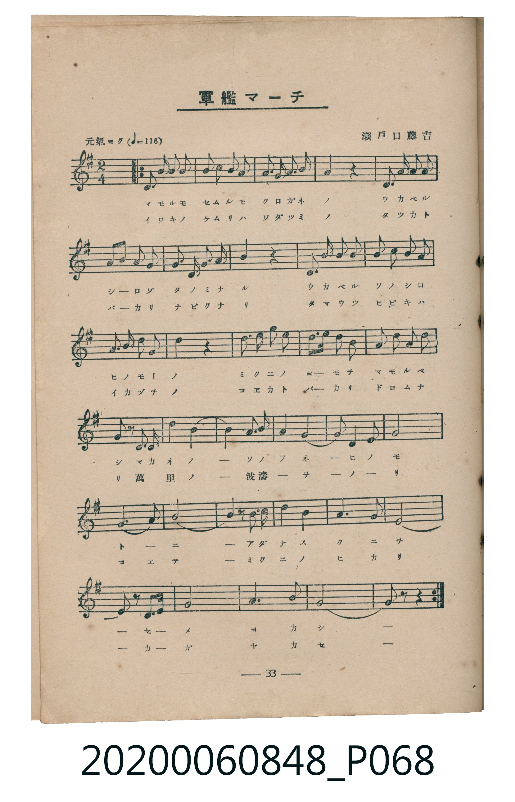
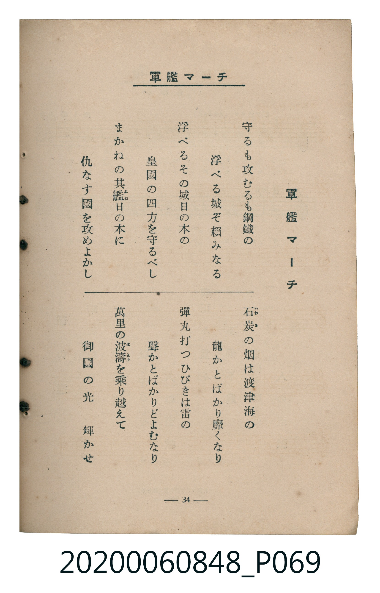

# 軍艦マーチ

<audio controls src="gunkan_machi.mp3"></audio>

- 詞：鳥山啓
- 曲：瀨戶口藤吉
- 臺灣教育會公認《新定兒童唱歌》高等科男子用（2020.006.0848）

## 說明

原書資訊與歌詞全文（對應 P068.jpg – P069.jpg，書頁 pp. 33–34，高一第三學期第 7 首）：
調性與拍號：ト長調（1 升記號）、2/4 拍（元氣ヨク ♩=116）

## 歌詞

```text
一
守るも攻むるも鋼鐵の
浮べる城ぞ頼みなる
浮べるその城日の本の
皇國の四方を守るべし
まかねの其艦日の本に
仇なす國を攻めよかし

二
石炭の烟は渡津海の
龍かとばかり靡くなり
彈丸打つひびきは雷の
聲かとばかりどよむなり
萬里の波濤を乗り越えて
御國の光　輝かせ
```

## ABC

```abc
X:1
T:軍艦マーチ
C:曲：瀨戶口藤吉
M:2/4
L:1/16
Q:1/4=116
K:G
V:V1 name="Piano" snm="Pia"
[V:V1]
!f! D2 D D G2 A2 | B2 G G d2 B2 | A2 B A G2 E2 | D4 z4 |
D2 G A B2 d2 | e2 d2 B2 G2 | A2 D2 A2 B2 | G4 z4 |
D2 G A B2 d2 | e2 d2 B2 G2 | A3 B A2 E2 | A4 z4 |
f3 e f2 d2 | e3 d B2 G2 | A3 B c2 A2 | B2 z D D2 D2 |
B8 | B2 E2 F2 G2 | A8 | A2 D2 E2 F2 |
G6 A2 | B8 | B2 z B B2 ^c2 | d4 e3 d |
c4 B4 | B2 z D A3 G | E8 | d6 F2 |
G8 | G2 z2 z4 | !f! D2 D D G2 A2 | B2 G G d2 B2 |
A2 B A G2 E2 | D4 z4 | D2 G A B2 d2 | e2 d2 B2 G2 |
A2 D2 A2 B2 | G4 z4 | D2 G A B2 d2 | e2 d2 B2 G2 |
A3 B A2 E2 | A4 z4 | f3 e f2 d2 | e3 d B2 G2 |
A3 B c2 A2 | B2 z D D2 D2 | B8 | B2 E2 F2 G2 |
A8 | A2 D2 E2 F2 | G6 A2 | B8 |
B2 z B B2 ^c2 | d4 e3 d | c4 B4 | B2 z D A3 G |
E8 | d6 F2 | G8 | G2 z2 z4 |
```

## TMD 檔案連結

- [主旋律 TMD 檔案](gunkan_machi.tmd) [[在 TMD Studio 編輯](https://tmdlang.github.io/Tmd-TS/#tmd=s7IKdvYPcrWy4tLSUnixu_dF57LHzfMeN-953NyooKXFpWirYGhoxmVvq-DOZWOkb2LHVaeg9GLlvPd7Zr3cvPTpxo1Pp05WAok9m70JKPa8YcWzjm1P-xe_mL7k6YROsMyL9l3PGxc_mzrzRdOmZ3Oan7auebGq93FD17NpG56um_W0ddLz1UufTtn4bG3P44bul6tnPF_b-Xz5xOdTtj9dO-H5lBXv93QYGRgZ6BkYmOkZWJhYvN8DNJZLX0vBllqAS0FB4Wnf_Gezd7zY3P5iRdeLjnagY4CefNq64tm0dqADnm7ofdbeqRBgYGahl1WQrvCoYTKIYwnivN_TA9T5ckGjQkGBnoKxMVDO2AQoCPTJkx0Nz9esebKj8-naHc_mzAeyFcwVXi6bBvQCMKxA1r5Ytf9Zw3KQhd29L2bOB4o-bu54OXU7UBxoraHC016gg2aAZTofNzQCI0ABqBLkotbmZxsWP25e8bhpvcKjmSttgbEEVMMFMhRoLdhL6zoeN3U_bmp6NmX346YGCPtl956XE7Y-blwHUvFs67rHjTuBEk_n9z1unPdywZ7HjfsfN64CiqBIP26cC9QBVPRs-lIg49mcNVADns9qfzoHKL3u6ezZz6YBlU6CWgrU1jgdpOJx477HjUD-WpCi1m3A5IVkxmqwa3e3g6xsnAkyqWkS2LGNj5s6wNqmQzy0qwds2_zNz5tABj1vnv-4cf2zHQufbVn6bOt2qGNe7usF61nxuHEDiNHU9XLuwseN_WAPdYFDZG_Hkx07nnVOfty45HHjpseNmx83AvWsfzkbZsYLkCiKGY8bV4IcAww_uDEvJqx52d4D8sTmRc_2LwE6-snO6UC5F9uAqoHuXga2a99CaNC0AmOu4cUeYBACubNBcpQnWShQ0NLn4gpLLSpOtQrITMzLd6gxqFGoBlmhYGNopmUHZgGzCjgVNrxY2KOgYarwdEP_8_UNmiC9IGmghrRaBdN4BV0QAUSGQJYRENcoGANJQyA0BdIgdg1Y3BhIgtSYgbTUQHSCoAGUhgoZApWBNIE014CjEeaSXT24XGIGVQ-xGGYh2DiIzSAhkAQh-zBNQnHBjk5cLgBZA_Ei3IMQIWT7zMG0GZhGWAdiozocZJAJLDSRHQDMLrgcADLBABoTUK9DBJEhRATsPnOI35EdilAFDz2EUrSomILLHbBQBkFEasB0hAGQBNEm6mAhUHBAAgcSIDXgAIAEBVQbSkC0riUYEBBvGYJCGZbUEE6A2QeCEP-huByiCCQCij14DHLVcnHp2imAc44CMkOZiwsA)]
- [鋼琴伴奏 TMD 檔案](gunkan_machi_piano.tmd) [[在 TMD Studio 編輯](https://tmdlang.github.io/Tmd-TS/#tmd=s7IKdvYPcrWy4tLSUnixu_dF57LHzfMeN-953Nz4fk_Hy-49zydsebJny9Ol_c87O97v6VTQ0uJStFUwNDTjsrdVcOeyMdI3seOqU1B6sXLe-z2zXm5e-nTjxqdTJyuBxJ7N3gQUe96w4lnHtqf9i19MX_J0QidY5kX7rueNi59NnfmiadOzOc1PW9e8WNX7uKHr2bQNT9fNeto66fnqpU-nbHy2tudxQ_fL1TOer-18vnzi8ynbn66d8HzKCqDTjAyMDPQMDMz0DCxMLIAOU-LiCkstKk61CshMzMsP8nCoMahRqOZSAAIbQzMtOzBLX0vh-Zo1T3Y0vFjYo6BhqvB0Q__z9Q2aClr6YGmghrRaBdN4BV0QAUSGQJYRENcoGANJQyA0BdIgdg1Y3BhIgtSYgbTUQHSCoAGUhgoZApWBNIE013Ahu2RXDy6XmEHVQyyGWQg2DmIzSAgkQcg-TJNQXLCjE5cLQNZAvAj3IEQI2T5zMG0GphHWgdioDgcZZAILTWQHPJ09G5cDQCYYQGMC6nWIIDKEiIDdZw7xO7JDEargoYdQihYVU3C5AxbKIIhIDZiOMACSINpEHSwECg5I4EACpAYcAJCggGpDCYjWtQQDAuItQ1Aow5Iawgkw-0AQ4j8Ul0MUgURAsQePQa5alIzjg5JxTKD5BqgvXiHaMBaZYQRkGMWDWKbxQKYpmAmTheoygSnGogTBgKmCpTtsBmMzACGGcKQBsgJjIMMsPhfmWnST0L0GUm4MVmMGVAMyCeIUVAOQdEEMBCmGWYPDn0CzQOGsa6cADmoFZIYyFxcA)]

## 分析

```text
================================================================================
📊 TMD Song Profile: [ 軍艦マーチ ]
================================================================================
⏱  Duration:       1:02 (62.1s), 60 measures total
🎼 Key & Tempo:    首調基準 G, != 116.0 BPM, <2/4>
   - 分析範圍：      由實際發聲的音符與和弦推測調性；播放脈絡另行呈現
🎤 人聲音域:    D4 (MIDI 62) – F#5 (MIDI 78) [跨度: 16 個半音 / 1.3 個八度, 難度: moderate]
   - 最低音:  D4 in [Verse #1 @ m.1, 0:00]
   - 最高音: F#5 in [Verse #1 @ m.13, 0:12]
   - 適合: soprano, mezzo-soprano, tenor, baritone
🏛  結構:      Verse (31.0s) -> Verse (31.0s)
⚡ 編曲密度:        Peak 1 軌道同時演奏
🗝  調性診斷：       D 調性不明確（純淨自然大調，未偵測到可信轉調）
   - 風格氣質:    純淨自然大調（陽光明朗、易唱易記，無明顯調外色彩）
   - 轉調歷程:    全曲維持單一推測調性（未偵測到可信轉調）
   - 核心骨幹音:  B, D, A, G, E
   - 調性數值:    D 調性不明確 [相關度: 0.80, 穩定度: Ambiguous, 自然音純度: 97.3%]
   - 候選調性 (K-S): D 大調 (0.80), G 大調 (0.78), B 小調 (0.76)
   - 五度圈歷程:   +2 -> +2
   - 各段落調性細節:
     • [Verse #1]: D 調性不明確 (r: 0.80, 自然音純度: 97.3%, 調外音: C)
     • [Verse #2]: D 調性不明確 (r: 0.80, 自然音純度: 97.3%, 調外音: C)

  [ 五度圈游移軌跡 ]
               C  
         F            G  
      Bb              [D ]*
      Eb               A  
         Ab           E  
            Db       B  
               F# 
     (* = active key center)

  [ 十二半音累積音高分佈 ]
     C  : ███                        2.7%
     C# : █                          0.9%
     D  : ██████████████████████    21.0%
     D# :                            0.0%
     E  : █████████████             12.3%
     F  :                            0.0%
     F# : █████                      5.0%
     G  : ██████████████████        16.9%
     G# :                            0.0%
     A  : ███████████████████       18.3%
     A# :                            0.0%
     B  : ████████████████████████  22.8%
--------------------------------------------------------------------------------
Assignment 軌道音域：
  - Piano         : D4 – F#5 (16 個半音 / 1.3 個八度, 182 個音符)
================================================================================
```


## 原書掃描頁






