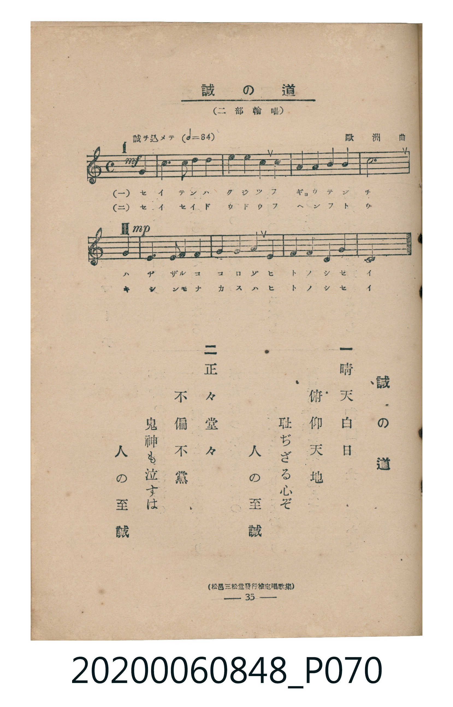

# 誠の道

<audio controls src="makoto_no_michi.mp3"></audio>

- 曲：歐洲曲
- 臺灣教育會公認《新定兒童唱歌》高等科男子用（2020.006.0848）

## 說明

原書資訊與歌詞全文（對應 P070.jpg，書頁 p. 35，高一輪唱第 1 首）：
調性與拍號：ハ長調（無升降記號）、4/4 拍（二部輪唱，誠ヲ込メテ ♩=84，弱起第 4 拍進入）
出處註記：（松邑三松堂發行檢定唱歌集）

## 歌詞

```text
一
晴天白日
俯仰天地
耻ぢざる心ぞ
人の至誠

二
正々堂々
不偏不黨
鬼神も泣すは
人の至誠
```

## 原書掃描頁



## 分析

```text
================================================================================
📊 TMD Song Profile: [ 誠の道 ]
================================================================================
⏱  Duration:       0:37 (37.1s), 13 measures total
🎼 Key & Tempo:    首調基準 C, != 84.0 BPM, <4/4>
   - 分析範圍：      由實際發聲的音符與和弦推測調性；播放脈絡另行呈現
🎤 人聲音域:    B3 (MIDI 59) – A4 (MIDI 69) [跨度: 10 個半音 / 0.8 個八度, 難度: easy]
   - 最低音:  B3 in [Main #1 @ m.6, 0:15]
   - 最高音: A4 in [Main #1 @ m.3, 0:06]
   - 適合: soprano, mezzo-soprano, contralto, tenor, baritone, bass
🏛  結構:      Main (37.1s)
⚡ 編曲密度:        Peak 2 軌道同時演奏
🗝  調性診斷：       C 大調（純淨自然大調，未偵測到可信轉調）
   - 風格氣質:    純淨自然大調（陽光明朗、易唱易記，無明顯調外色彩）
   - 轉調歷程:    全曲維持單一推測調性（未偵測到可信轉調）
   - 核心骨幹音:  C, E, G, D, F
   - 調性數值:    C 大調 [相關度: 0.93, 穩定度: High, 自然音純度: 100.0%]
   - 候選調性 (K-S): C 大調 (0.93), E 小調 (0.61), A 小調 (0.57)
   - 五度圈歷程:   +0
   - 各段落調性細節:
     • [Main #1]: C 大調 (r: 0.93, 自然音純度: 100.0%)

  [ 五度圈游移軌跡 ]
              [C ]*
         F            G  
      Bb               D  
      Eb               A  
         Ab           E  
            Db       B  
               F# 
     (* = active key center)

  [ 十二半音累積音高分佈 ]
     C  : ████████████████████████  32.8%
     C# :                            0.0%
     D  : ████████                  10.9%
     D# :                            0.0%
     E  : █████████████████         23.4%
     F  : ███████                    9.4%
     F# :                            0.0%
     G  : ███████████               15.6%
     G# :                            0.0%
     A  : ██                         3.1%
     A# :                            0.0%
     B  : ███                        4.7%
--------------------------------------------------------------------------------
Assignment 軌道音域：
  - Part1         : B3 – A4 (10 個半音 / 0.8 個八度, 28 個音符)
  - Part2         : B3 – A4 (10 個半音 / 0.8 個八度, 28 個音符)
================================================================================
```

## ABC

```abc
X:1
T:誠の道
C:曲：歐洲曲
M:4/4
L:1/16
Q:1/4=84
K:C

V:V1 name="Part1" snm="Par"
V:V2 name="Part2" snm="Par"

[V:V1]
!mf! z4 z4 z4 c4 | e6 d2 e4 f4 | g4 a4 g4 e4 | c4 d4 e4 f4 |
!mp! g12 c4 | c6 B2 c4 d4 | e4 f4 e4 c4 | e4 d4 c4 B4 |
c12 z4 | z16 | z16 | z16 |
z16 |


[V:V2]
z16 | z16 | z16 | z16 |
!mf! z4 z4 z4 c4 | e6 d2 e4 f4 | g4 a4 g4 e4 | c4 d4 e4 f4 |
!mp! g12 c4 | c6 B2 c4 d4 | e4 f4 e4 c4 | e4 d4 c4 B4 |
c12 z4 |
```

- [主旋律 TMD 檔案](makoto_no_michi.tmd)
- [鋼琴伴奏 TMD 檔案](makoto_no_michi_piano.tmd)
