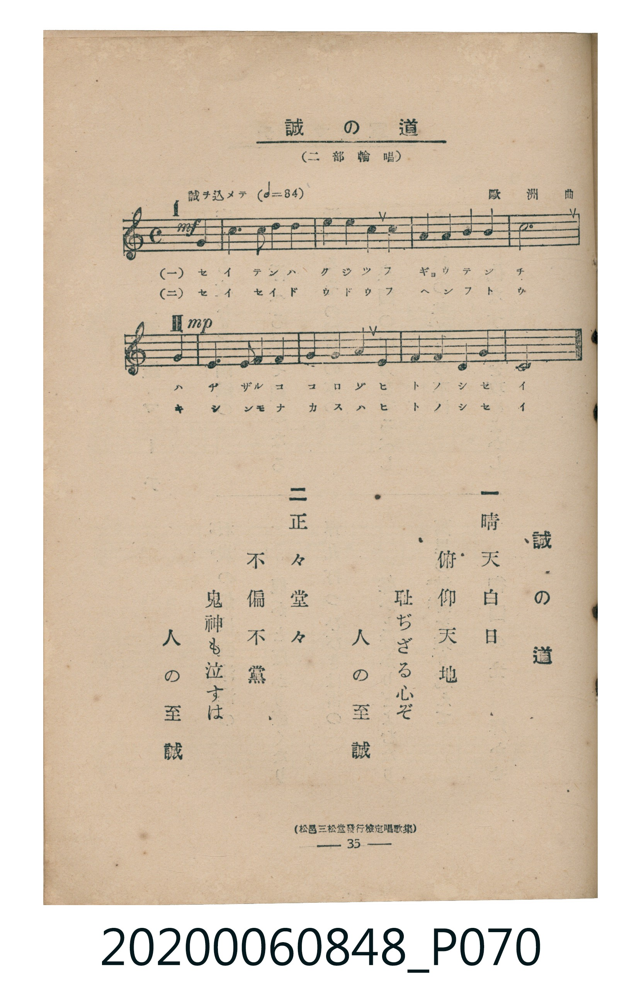

# 誠の道

> Re:Shōka 使用 AI 協助辨識與重建樂譜，可能會有錯誤。歡迎回報。

- **鋼琴伴奏版**：<br><audio controls src="makoto_no_michi.mp3"></audio>
- **NEUTRINO 歌聲合成版**：<br><audio controls src="makoto_no_michi_neutrino.mp3"></audio>

- 曲：歐洲曲
- 臺灣教育會公認《新定兒童唱歌》高等科男子用（2020.006.0848）

## 說明

原書資訊與歌詞全文（對應 P070.jpg，書頁 p. 35，高一輪唱第 1 首）：
調性與拍號：ハ長調（無升降記號）、4/4 拍（二部輪唱，誠ヲ込メテ ♩=84，弱起第 4 拍進入）
出處註記：（松邑三松堂發行檢定唱歌集）


## 歌詞

```text
一
晴天白日
俯仰天地
耻ぢざる心ぞ
人の至誠

二
正々堂々
不偏不黨
鬼神も泣すは
人の至誠
```

## ABC

<div class="abc-score" data-abc-src="makoto_no_michi.abc" aria-label="五線譜載入中"></div>

[下載 ABC 原始檔](makoto_no_michi.abc)

## TMD 檔案連結

- [主旋律 TMD 檔案](makoto_no_michi.tmd) [[在 TMD Studio 編輯](https://tmdlang.github.io/Tmd-TS/#tmd=s7IKdvYPcrWy4qpTUCpJTLdSSM7PyUlNLsnMz7MqzsjMK0nNjM_KTMmPL87Iz05Ugisry88pzU21ys4vyY9Pyq8sjjcyMDKINzAwizewMLFAqCvOLy1KTrUqTs7Iz8-JL0mtKEnKz89Gl48vSExPtQowMDdAyBQU5Zel5iXmAXUXFIEckgLWjlCQWpaZkgqSLk5OzIsvSy3KTMtMTUFyYmpRMdgbECtKihLzipOLMgtAfkOoyi8qychPL0osyKi0ysgsLskvykxOzInPTsxD8m1JRirQs6m5-eh6M9Mz86xyUzOzMrH4DSpdnlpcklqUF5-bmpOfUqnEpaWl8GLVgseN6142TlbQ0uJStFWwMOGyt1Vw5rIx0TexA-l_NnvT-z2znq2d8GzLJiAbbOaL9l3PGxc_mzrzRdOmZ3Oan7auebGq93FD17NpG56um_W0ddLz1UufTtn4bG3P44bul6tnPF_b-Xz5xOdTtj9dO-H5lBXv93SA4kgPGEd6oDh6v6dTiYtLX0vBllqAS0FB4Wnf_Gezd7zY3P5iRdeLjnagY16snPe0dcWzae1ABzzd0PusvVMBFNF6WQXp7_f0ABW_XNCoUKCnYGwK5AKd_WRHw4s9q4Aeeb5mjYKhwstl04AuBQYGyPQXq_Y_a1gOMre798XM-UDRx839L6duB4oDTX_esvBpb_vLmb0vVswAy3Y-bmgEhqgCUDVQ-smunpfNKyBmA60CxUHzphf79jxuXvi4uU3h0cyVthYmQImneza-2LodZDtY58uGTU9blwINA3uvfdeLmVNfrNgNtAJoO9DUZ3P3vWya-GRHJ5DxdEHT85l7XizsebZqEShKwJHxcnYbSDNIN9BrIOrZzC1Pl6x8PnPvs-lLwcL71z_ZvQEo9HTOBrAvG3Y_blz0uHHa46bup_ubHzfOA6vatQuYZl60bwY6HGLarh6waWsXP25oBVoNJCGW9D5t7AeSL3evAPFfrtnzfOm8x01NzzYvftw483HjegzTgHzKYx8KFLT0ubh8E4HpPiAzMS_f0KFG17CmGmSFgo2Flh2YAUx0kEB-uqH_-foGkBaQcI2CgYIuHFfnptUqmAIZNWBJH8MahXggD4YfN-1GyBlhl4NZBoxLUKpa2KOg4amJsM0wDqhKF0QZgVhgokbBGESBCbA8mKhRMAOSIGwOxXDdEFidW4Du2MdNS8BSoLT1uHkzmNUP1vm4aT3YkTvAYi1gcipUZt3j5uVgyWVQrSASpBko2dyIZCPUMLj_4dYB_Q5hP27uhBoKMQvEg7Gh1jXPgJsPEXvc3IGkB25X01qM8NzVAwlP5AA1Bqs2BuYbXTCuAQcJCIOCDiRbA5czgsoAAxLJJlDEIwVhcxPU_m1A9mowCxoWYPpxM8hdj5v2gdmToH4C-eBxcx9YZjs0RCB6ICEEgaB0ghx6IJWQsHjcvAjM6oLqgti7Ex7m5NkED7u1nU_3tUJCEFgcPd864dnc-QoaJgqQvIAUmqCwQIZkiqDkHlS1ZImg5DhqmFeLXF4Y4SgvEMG2owEYbMCi9em6HqR8DSlPFLSBaQtrQCJjagQtgdIJHOdUCCF8pRy17RgtLUdLy8FSWgLLBF07BVCxoACklbkA)]
- [鋼琴伴奏 TMD 檔案](makoto_no_michi_piano.tmd) [[在 TMD Studio 編輯](https://tmdlang.github.io/Tmd-TS/#tmd=s7IKdvYPcrWy4qpTUCpJTLdSSM7PyUlNLsnMz7MqzsjMK0nNjM_KTMmPL87Iz05Ugisry88pzU21ys4vyY9Pyq8sjjcyMDKINzAwizewMLFAqCvOLy1KTrUqTs7Iz8-JL0mtKEnKz89Gl48vSExPtQowMDdAyBQU5Zel5iXmAXUXFIEckgLWjlCQWpaZkgqSLk5OzIsvSy3KTMtMTUFyYmpRMdgbECtKihLzipOLMgtAfkOoyi8qychPL0osyKi0ysgsLskvykxOzInPTsxD8m1iEVBzempual6JVUFmYl5-fGJycn5uQWJeJkgMobAkA6jIKjU3H92SzPTMPKvc1MysTCyBAJUuTy0uSS3Ki89NzclPqVTi0tJSeLFqwePGdS8bJ7_f0_Gye8_zCVue7NnydGn_886O93s6FbS0uBRtFSxMuOxtFZy5bEz0TexAhj6bven9nlnP1k54tmUTkA226EX7rueNi59NnfmiadOzOc1PW9e8WNX7uKHr2bQNT9fNeto66fnqpU-nbHy2tudxQ_fL1TOer-18vnzi8ynbn66d8HzKCqD9oBjWA8awHiiGgbYrcXH5JgKdHQAKEEOHGl3DmmouBSCwsdCyAzP0tRSe7tn4Yuv2pxv6n69vUNDSBwvXKBgo6MJxdW5arYIpkFEDlvQxrFGIB_Jg-HHTboScEXY5mGXP16x5sqPhxcIeBQ1PTYRthnFAVbogygjEAhM1CsYgCkyA5cFEjYIZkARhcyiG64bA6twCdMc-bloClnrc3AbEm8GsfrDOx03rwY7cARZrAZNToTLrHjcvB0sug2oFkSDNQMnmRiQboYbB_Q-3Duh3CPtxcyfUUIhZIB6MDbWueQbcfIjY4-YOJD1wu5rWYoTnrh5IeCIHqDFYtbGCCZAE4RpwkIAwKOhAsjVwOSOoDDAgkWwCRTxSEDY3Qe3fBmSvBrOgYQGmHzeD3PW4aR-YPQnqJ5APHjf3gWW2Q0MEogcSQhAISifIoQdSCQmLx82LwKwuqC6IvTvhYU6eTfCwW9v5dF8rJARfNq94vnXCs7nzFTRMFCB5ASk0QWGBDMkUQck9qGrJEkHJcdQwrxa5vDDCUV4ggm1HAzDYgCXS03U9SPkaUp4oaAPTFtaARMbUCFoCpRM4zqkQQvhKOWrbMVpajpaWg6W0RCkTfDyQCwUTaKEAyo8QCHEYMGhAeqNN42MhAQXmmcXnxipEG8aCwhIkYBoPyTYQWaA4zF8Dox3keKBfde0UQN5VANLKXAA)]

## 分析

```text
================================================================================
📊 TMD Song Profile: [ 誠の道 ]
================================================================================
⏱  Duration:       0:34 (34.3s), 12 measures total
🎼 Key & Tempo:    首調基準 C, != 84.0 BPM, <4/4>
   - 分析範圍：      由實際發聲的音符與和弦推測調性；播放脈絡另行呈現
🎤 人聲音域:    C4 (MIDI 60) – E5 (MIDI 76) [跨度: 16 個半音 / 1.3 個八度, 難度: moderate]
   - 最低音:  C4 in [Main #1 @ m.9, 0:22]
   - 最高音: E5 in [Main #1 @ m.3, 0:05]
   - 適合: soprano, mezzo-soprano, contralto, tenor, baritone, bass
🏛  結構:      Main (34.3s)
⚡ 編曲密度:        Peak 2 軌道同時演奏
🗝  調性診斷：       C 大調（純淨自然大調，未偵測到可信轉調）
   - 風格氣質:    純淨自然大調（陽光明朗、易唱易記，無明顯調外色彩）
   - 轉調歷程:    全曲維持單一推測調性（未偵測到可信轉調）
   - 核心骨幹音:  C, E, G, F, D
   - 調性數值:    C 大調 [相關度: 0.98, 穩定度: High, 自然音純度: 100.0%]
   - 候選調性 (K-S): C 大調 (0.98), A 小調 (0.69), F 大調 (0.60)
   - 五度圈歷程:   +0
   - 各段落調性細節:
     • [Main #1]: C 大調 (r: 0.98, 自然音純度: 100.0%)

  [ 五度圈游移軌跡 ]
              [C ]*
         F            G  
      Bb               D  
      Eb               A  
         Ab           E  
            Db       B  
               F# 
     (* = active key center)

  [ 十二半音累積音高分佈 ]
     C  : ████████████████████████  31.2%
     C# :                            0.0%
     D  : ███████                    9.4%
     D# :                            0.0%
     E  : ████████████              15.6%
     F  : ██████████                12.5%
     F# :                            0.0%
     G  : ████████████              15.6%
     G# :                            0.0%
     A  : ███████                    9.4%
     A# :                            0.0%
     B  : █████                      6.2%
--------------------------------------------------------------------------------
Assignment 軌道音域：
  - Piano1        : C4 – E5 (16 個半音 / 1.3 個八度, 28 個音符)
  - Piano2        : C4 – E5 (16 個半音 / 1.3 個八度, 28 個音符)
================================================================================
```


## 原書掃描頁




