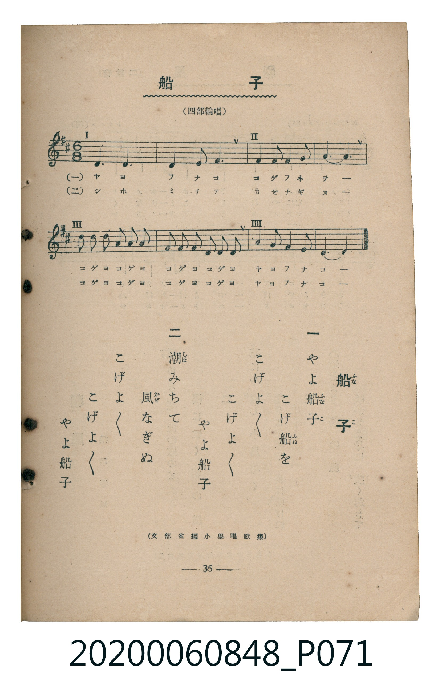

# 船子

> Re:Shōka 使用 AI 協助辨識與重建樂譜，可能會有錯誤。歡迎回報。

<audio controls src="funako.mp3"></audio>

- 臺灣教育會公認《新定兒童唱歌》高等科男子用（2020.006.0848）

## 說明

原書資訊與歌詞全文（對應 P071.jpg，書頁 p. 36，高一輪唱第 2 首）：
調性與拍號：ニ長調（2 升記號）、6/8 拍（四部輪唱）
出處註記：（文部省編小學唱歌集）


## 歌詞

```text
一
やよ船子
こげ船を
こげよ／＼
こげよ／＼
やよ船子

二
潮みちて
風なぎぬ
こげよ／＼
こげよ／＼
やよ船子
```

## ABC

```abc
X:1
T:船子
M:6/8
L:1/16
Q:3/8=45
K:D
V:V1 name="Piano" snm="Pia"
[V:V1]
!mp! D6 D6 | D4 E2 F6 | !mf! F4 F2 F4 G2 | A6 A6 |
w: 1.~ヤ ヨ | フ ナ コ | コ ゲ フ ネ | ヲ ー
w: 2.~シ ホ | ミ チ テ | カ ゼ ナ ギ | ヌ ー
!f! d2 d2 d2 A2 A2 A2 | F2 F2 F2 D2 D2 D2 | !mf! A4 G2 F4 E2 | D6 D6 |
w: 1.~コ ゲ ヨ コ ゲ ヨ | コ ゲ ヨ コ ゲ ヨ | ヤ ヨ フ ナ | コ ー
w: 2.~コ ゲ ヨ コ ゲ ヨ | コ ゲ ヨ コ ゲ ヨ | ヤ ヨ フ ナ | コ ー
```

## TMD 檔案連結

- [主旋律 TMD 檔案](funako.tmd) [[在 TMD Studio 編輯](https://tmdlang.github.io/Tmd-TS/#tmd=s7IKdvYPcrWy4qpTUCpJTLdSSM7PyUlNLsnMz7MqzsjMK0nNjM_KTMmPL87Iz05Ugisry88pzU21ys4vyY9Pyq8sjjcyMDKINzAwizewMLFAqCvOLy1KTrUqTs7Iz8-JL0mtKEnKz89Gl48vSExPtQowMDdEyBQU5Zel5iXmAXUXFIEckgLWjlCQWpaZkgqSLk5OzIsvSy3KTMtMTUFyYmpRMdgbECtKihLzipOLMgtAfkOoyi8qychPL0osyKi0ysgsLskvykxOzInPTsxD8m1JRirQs2ATCoAa0CXKE0tSi7CoLkvNQbYoMz0zzyo3Py-pFBiYGBIliZnlQH_kp6VlJmcmAjVqaSm86Nj5dO0EBS0tLkVbBTMLLntbBRcuGzN9CzuQ7hftu543Ln42deaLpk3P5jQ_bV3zYlXv44auZ9M2PF0362nrpOerlz6dsvHZ2p7HDd0vV894vrbz-fKJz6dsB5r5fMqK93s6QJGmB4w0PVCkvd_TqcTFpa-lYEstwKWgoPC0b_6z2TtebG5_saLrRUc70DEvVs572rri2bR2oAOebuh91t6pAIp5vayC9Pd7eoCKXy5oVCjQUzA2A3KBzn6yo-HFnlVAjzxfs0bBSOHlsmlAl77fMwtk-otV-581LAeZ2937YuZ8oOjj5u6XU7cDxUHeU3jaC7R3Blim83FDIzDkFIAqQRbPnv2yeQXEXKAc2KXtu17MnPpixW6gDqBBQEVANwIVPZ_T-Hz7iqcb-p-u3QEJzpez20B6QJqAjgNRj5taHjd1QKILzG-c_LhxEpD_uGkSgg9U8n5P__s9e3AJIZsCNn1XD4h6tnfd48b9jxsXPm5cBuK_XLTiceOqx419jxvXkGk6kE95_EKBgpY-F5dbaV5idr5VQGZiXr5DjUFNNcgKBRsLLTswA1uyUgBGKChyF_YoaJgoAAP4-foGHXha0MSiAWgRyLAahercgloFQwVdIISQNWDaSMEYyqvOTasFc4zBpAlQyBQsBSFrwOb4GNYoPG5eAhZ53LwCqvVx81QwvwsYYpthYmDW46ZNcNlesMpNUL17kE01AqnfDpWZDTd1PpjfCMRtcFNXg03dA7YNxFoHVtmDZir-ENzVQ1YIAsPHMA6KTMGwBhxYxsCQBEFoGILCywQchkbQQIYHOSIMgaEDCZsVKGy8MuBwB4vDwxsWzthDlHZ21HJx6dopQFKwApClzAUA)]
- [鋼琴伴奏 TMD 檔案](funako_piano.tmd) [[在 TMD Studio 編輯](https://tmdlang.github.io/Tmd-TS/#tmd=s7IKdvYPcrWy4qpTUCpJTLdSSM7PyUlNLsnMz7MqzsjMK0nNjM_KTMmPL87Iz05Ugisry88pzU21ys4vyY9Pyq8sjjcyMDKINzAwizewMLFAqCvOLy1KTrUqTs7Iz8-JL0mtKEnKz89Gl48vSExPtQowMDdEyBQU5Zel5iXmAXUXFIEckgLWjlCQWpaZkgqSLk5OzIsvSy3KTMtMTUFyYmpRMcgbBZmJefnxicnJ-bkFiXmZual5SIbkF5Vk5KcXJRZkVFplZBaX5BdlJifmxGcn5iF5tiQjFejXkqLEvOICoAZ0ifLEktQiLKrLUnOUuLS0FF507Hy6dsL7PR0vu_c8n7DlyZ4tT5f2P-_seL-nU0FLi0vRVsHMgsveVsGFy8ZM38IOZNCL9l3PGxc_mzrzRdOmZ3Oan7auebGq93FD17NpG56um_W0ddLz1UufTtn4bG3P44bul6tnPF_b-Xz5xOdTtgMtej5lBdAuUHzoAeNDDxQfQJuUuLg880qK8q0CQMER5OFQY1BTzaUABDYWWnZgRo1CdW5arYJhHBSZgmGNgjEYGoJhDVBEV8EEyNdVMALyDIG0Lpg0UKjhqkWxxAefJfFgjabxEBpoEIQBpYDWQGWwq4Ba5laal5hNyEsFQNvgrgQbBHY7yAcgHtg5IA7IkyCvQbwItBmiAGyOj2GNwuPmJWCRx80roFofN08F87sUHjdthomBWY-bNsFle8EqN0H17kE21QikfjtUZjbc1PlgfiMQt8FNXQ02dQ_YNhBrHVhlD5qpME8Tjkawt3HFJYq3gR6CeGcFChuvDDiowOLwIIIFDfZAoJ0daMkER6IkmB5x8OEaiDUHf7qGOljXTgGcjxSADIjjo30MY5F5RmCeMhcA)]

## 分析

```text
================================================================================
📊 TMD Song Profile: [ 船子 ]
================================================================================
⏱  Duration:       0:21 (21.2s), 8 measures total
🎼 Key & Tempo:    首調基準 D, != 68.0 BPM, <6/8>
   - 分析範圍：      由實際發聲的音符與和弦推測調性；播放脈絡另行呈現
🎤 人聲音域:    D4 (MIDI 62) – D5 (MIDI 74) [跨度: 12 個半音 / 1.0 個八度, 難度: easy]
   - 最低音:  D4 in [Funako #1 @ m.1, 0:00]
   - 最高音: D5 in [Funako #1 @ m.5, 0:10]
   - 適合: soprano, mezzo-soprano, contralto, tenor, baritone, bass
🏛  結構:      Funako (21.2s)
⚡ 編曲密度:        Peak 1 軌道同時演奏
🗝  調性診斷：       D 大調（純淨自然大調，未偵測到可信轉調）
   - 風格氣質:    純淨自然大調（陽光明朗、易唱易記，無明顯調外色彩）
   - 轉調歷程:    全曲維持單一推測調性（未偵測到可信轉調）
   - 核心骨幹音:  D, F#, A, E, G
   - 調性數值:    D 大調 [相關度: 0.90, 穩定度: High, 自然音純度: 100.0%]
   - 候選調性 (K-S): D 大調 (0.90), F# 小調 (0.61), D 小調 (0.54)
   - 五度圈歷程:   +2
   - 各段落調性細節:
     • [Funako #1]: D 大調 (r: 0.90, 自然音純度: 100.0%)

  [ 五度圈游移軌跡 ]
               C  
         F            G  
      Bb              [D ]*
      Eb               A  
         Ab           E  
            Db       B  
               F# 
     (* = active key center)

  [ 十二半音累積音高分佈 ]
     C  :                            0.0%
     C# :                            0.0%
     D  : ████████████████████████  41.7%
     D# :                            0.0%
     E  : ██                         4.2%
     F  :                            0.0%
     F# : ████████████████          27.1%
     G  : ██                         4.2%
     G# :                            0.0%
     A  : █████████████             22.9%
     A# :                            0.0%
     B  :                            0.0%
--------------------------------------------------------------------------------
Assignment 軌道音域：
  - Piano         : D4 – D5 (12 個半音 / 1.0 個八度, 29 個音符)
================================================================================
```


## 原書掃描頁




