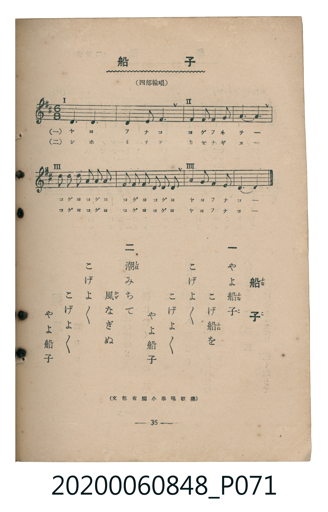

# 船子

<audio controls src="funako.mp3"></audio>

- 臺灣教育會公認《新定兒童唱歌》高等科男子用（2020.006.0848）

## 說明

原書資訊與歌詞全文（對應 P071.jpg，書頁 p. 36，高一輪唱第 2 首）：
調性與拍號：ニ長調（2 升記號）、6/8 拍（四部輪唱）
出處註記：（文部省編小學唱歌集）

## 歌詞

```text
一
やよ船子
こげ船を
こげよ／＼
こげよ／＼
やよ船子

二
潮みちて
風なぎぬ
こげよ／＼
こげよ／＼
やよ船子
```

## ABC

```abc
X:1
T:船子
M:6/8
L:1/16
Q:3/8=67
K:D
V:V1 name="Part1" snm="Par"
V:V2 name="Part2" snm="Par"
[V:V1]
!mf! D6 D6 | D4 E2 F6 | F4 G2 A4 B2 | A6 F6 |
A2 A2 A2 B2 A2 G2 | F2 F2 F2 G2 F2 E2 | F4 G2 E4 E2 | D12 |
z6 z6 | z6 z6 |
[V:V2]
z12 | z12 | !mf! D6 D6 | D4 E2 F6 |
F4 G2 A4 B2 | A6 F6 | A2 A2 A2 B2 A2 G2 | F2 F2 F2 G2 F2 E2 |
F4 G2 E4 E2 | D12 |
```

## TMD 檔案連結

- [主旋律 TMD 檔案](funako.tmd) [[在 TMD Studio 編輯](https://tmdlang.github.io/Tmd-TS/#tmd=s7IKdvYPcrWy4tLSUnjRsfPp2gkKWlpcirYKhgYGXPa2Ci5cNmb6FnZcdQpKL9p3PW9c_GzqzBdNm57NaX7auubFqt7HDV3Ppm14um7W09ZJz1cvfTpl47O1PY8bul-unvF8befz5ROfT9kONPT5lBXv93QYGRgZ6BkYmOkZWJhYvN_TqcTFpa-lYEstwKWgoPC0b_6z2TtebG5_saLrRUc70DEvVs572rri2bR2oAOebuh91t6pEGBgbqiXVZD-fk8PUPHLBY0KBXoKxmZALtDZT3Y0vNizCuiR52vWKBgpvFw2DejS93tmgUx_sWr_s4blIHO7e1_MnA8Ufdzc_XLqdqA4yHsKT3uB9s4Ay3Q-bmgEhpwCUCXI4tmzXzavgJgLlAO7tH3Xi5lTX6zYDdQBNAioCOhGoKLncxqfb1_xdEP_07U7IMH5cnYbSA9IE9BxIOpxU8vjpg5IfIH5jZMfN04C8h83TULwgUre7-l_v2cPLiFkU8Cm7-oBUc_2rnvcuP9x48LHjctA_JeLVjxuXPW4se9x4xoyTQfyKY9fKFDQ0ufi8k3MzLMKSCwqMXSoMahRqAbZoGBjoWUHZgBTlSdIGYgNlMxNq1UwVNAFQghZA6aNFIwhPLgWJD0gKRMFUyBpBuSBaF1M5UjqTcHQDIhNwLpB0ASIjVDUY1hgBHYHxD0wCNcAzEBP97UCkyEwXkAJY-uEZ3PnK2gAk9mG_ufrGzQRhhmANUJINB5XLVJgGTnUaBsNt9ACelDXTgHkRwUgrczFBQA)]
- [鋼琴伴奏 TMD 檔案](funako_piano.tmd) [[在 TMD Studio 編輯](https://tmdlang.github.io/Tmd-TS/#tmd=s7IKdvYPcrWy4tLSUnjRsfPp2gnv93S87N7zfMKWJ3u2PF3a_7yz4_2eTgUtLS5FWwVDAwMue1sFFy4bM30LO646BaUX7bueNy5-NnXmi6ZNz-Y0P21d82JV7-OGrmfTNjxdN-tp66Tnq5c-nbLx2dqexw3dL1fPeL628_nyic-nbAfa9HzKCqBlRgZGBnoGBmZ6BhYmFkCrlLi4fBMz86wCEotKDB1qDGoUqrkUgMDGQssOzAAK5KbVKhgq6AIhhKwB00YKxhAeVBmIZ6JgCiTNgDwQrYumwhQMzYDYBKweBE2A2AjNDCOw6RBbYBCmwgDMg5BoPK5aJL8YOdRoGw1ez8CdmpmYl-_jgT3gDePBqqMNY2EuRRNAU2caT7ZCuAj1jIQrBPpV104B5F0FIK3MxQUA)]

## 分析

```text
================================================================================
📊 TMD Song Profile: [ 船子 ]
================================================================================
⏱  Duration:       0:18 (18.0s), 10 measures total
🎼 Key & Tempo:    首調基準 D, != 100.0 BPM, <6/8>
   - 分析範圍：      由實際發聲的音符與和弦推測調性；播放脈絡另行呈現
🎤 人聲音域:    D4 (MIDI 62) – B4 (MIDI 71) [跨度: 9 個半音 / 0.8 個八度, 難度: easy]
   - 最低音:  D4 in [Main #1 @ m.1, 0:00]
   - 最高音: B4 in [Main #1 @ m.3, 0:05]
   - 適合: soprano, mezzo-soprano, contralto, tenor, baritone, bass
🏛  結構:      Main (18.0s)
⚡ 編曲密度:        Peak 2 軌道同時演奏
🗝  調性診斷：       D 大調（純淨自然大調，未偵測到可信轉調）
   - 風格氣質:    純淨自然大調（陽光明朗、易唱易記，無明顯調外色彩）
   - 轉調歷程:    全曲維持單一推測調性（未偵測到可信轉調）
   - 核心骨幹音:  D, F#, A, E, G
   - 調性數值:    D 大調 [相關度: 0.90, 穩定度: High, 自然音純度: 100.0%]
   - 候選調性 (K-S): D 大調 (0.90), F# 小調 (0.68), B 小調 (0.55)
   - 五度圈歷程:   +2
   - 各段落調性細節:
     • [Main #1]: D 大調 (r: 0.90, 自然音純度: 100.0%)

  [ 五度圈游移軌跡 ]
               C  
         F            G  
      Bb              [D ]*
      Eb               A  
         Ab           E  
            Db       B  
               F# 
     (* = active key center)

  [ 十二半音累積音高分佈 ]
     C  :                            0.0%
     C# :                            0.0%
     D  : ████████████████████████  29.2%
     D# :                            0.0%
     E  : █████████                 10.4%
     F  :                            0.0%
     F# : ████████████████████████  29.2%
     G  : ███████                    8.3%
     G# :                            0.0%
     A  : ███████████████           18.7%
     A# :                            0.0%
     B  : ███                        4.2%
--------------------------------------------------------------------------------
Assignment 軌道音域：
  - Part1         : D4 – B4 (9 個半音 / 0.8 個八度, 28 個音符)
  - Part2         : D4 – B4 (9 個半音 / 0.8 個八度, 28 個音符)
================================================================================
```


## 原書掃描頁




