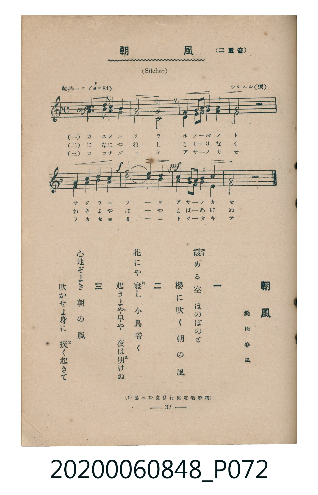

# 朝風

> Re:Shōka 使用 AI 協助辨識與重建樂譜，可能會有錯誤。歡迎回報。

- **鋼琴伴奏版**：<br><audio controls src="asakaze.mp3"></audio>
- **NEUTRINO 歌聲合成版**：<br><audio controls src="asakaze_neutrino.mp3"></audio>

- 詞：桑田春風
- 曲：F. Silcher（シルヘル）
- 臺灣教育會公認《新定兒童唱歌》高等科男子用（2020.006.0848）

## 說明

原書資訊與歌詞全文（對應 P072.jpg，書頁 p. 37，高一重音第 1 首）：
調性與拍號：ヘ長調（1 降記號）、4/4 拍（二重音，氣持ヨク ♩=84）
出處註記：（松邑三松堂發行檢定唱歌集）


## 歌詞

```text
一
霞（かす）める空　ほのぼのと
櫻に吹く　朝の風

二
花にや寢（ね）し　小鳥啼く
起きよや早や　夜は明（あ）けぬ

三
心地ぞよき　朝の風
吹かせよ身に　疾（と）く起きて
```

## ABC

<div class="abc-score" data-abc-src="asakaze.abc" aria-label="五線譜載入中"></div>

[下載 ABC 原始檔](asakaze.abc)

## TMD 檔案連結

- [主旋律 TMD 檔案](asakaze.tmd) [[在 TMD Studio 編輯](https://tmdlang.github.io/Tmd-TS/#tmd=s7IKdvYPcrWy4qpTUCpJTLdSSM7PyUlNLsnMz7MqzsjMK0nNjM_KTMmPL87Iz05Ugisry88pzU21ys4vyY9Pyq8sjjcyMDKINzAwizewMLFAqCvOLy1KTrUqTs7Iz8-JL0mtKEnKz89Gl48vSExPtQowMDdCyBQU5Zel5iXmAXUXFIEckgLWjlCQWpaZkgqSLk5OzIsvSy3KTMtMTUFyYmpRMdgbECtKihLzipOLMgtAfkOoyi8qychPL0osyKi0ysgsLskvykxOzInPTsxD8m1JRirQs-WpiUBGEbLezPTMPKvc1MysTCx-g0qXpxaXpBblxeem5uSnVGJIlyRmAsMWFL7lifG5iZl5OYl5QF9oaSk8mzP35aIVClpaXIq2ChYmXPa2Cm5cNib6JnYgM16snPd-z6xnCyc-n7Lh2YylQJVgo5_N3gQUdtNTCM7MSQa69v2ejsdN2x83r37cPANIvt_TCVb2on3X88bFz6bOfNG06dmc5qeta16s6n3c0PVs2oan62Y9bZ30fPXSp1M2Plvb87ih--XqGc_Xdj5fDrRq-9O1E55PWQE0FRThesAI1wNFONhYLn0tBVtqAS4FBYWnffOfzd7xYnP7ixVdLzragY4Bevpp64pn09qBDni6ofdZe6cCKNXoZRWkv9_TA1T8ckGjQoGegrE5kAt09pMdDS_be1_O3_x8zRoFQ4WXy6YBXQoMH5DpL1btf9awHGRud--LmfOBosAgejl1O1AcaDpQ8czeFytmgGU6Hzc0AsNdAagSKPVkVw_EUJCVGxY_62l83LzicdN6hUczV9pamACVgx3fvuvFzKkvVuwGGgI0G6jv2dx9L5smPtnRCWQ8XdD0fOaeFwt7nq1aBApwcFC_nN0G0gzSDXQ4iHo5BxjJHY8bux83zgQ5o6nxcVP385W7Hjc0PG7c_bhx3ePGPWByBUj1s9VAodVPJ-x83NgPVAFMP0A5YMKAmLirB-zrro1ANY-bWp6uXwQ2ei3I3MbpQPVPN_S_3Lz06VSgif1gpVu3P27sfdwETEAtz6avBJIgRUvmPG5c_2xGH1hzE1jzxMeNa6Cuhnh9f_PTORseN84D6QWagOwUkDTIgUAfzQZKv9i1GuSchobn0_aBTQQmLaCJ_VC7G5eBNFCemqBAQUufi8uxODE7sQpY3GQm5uUbOtQY1FSDLFGwsdCyAzOwJWMFYAICxgkwwp7s6HrRuOll8woFDRMFYJA9X9-gA0-Emlh0Au0EmVqjUJ2bVqtgqqALhGZg2gSIaxSMwSK6CkZQugaYUEE8Y7A8SLYGLmcAxTVgI30MaxQeN60Gyzxu2qnwuHkhiNUMEgHJ7IXqety8Em724-bZYJE-MDkHzgbJdEBVxUMx1BYjoFzjeohJjauAGGQ-MDVAdDWuhdnSOB1hS-NksMgKsMouqE6ITD92W4xBLt4M9ctmoGsawax9ULeBTILIwewDqV8EFtmK8BE4NEAyezBswR-3u3ooiltQlIGiChFl1cDINoM6AhHZ4DQAUmAE1AKKVYhikHZc8Qv2HbB0gcXj4-ZuaJhMheqChAtIBalhgohfSBz1gtWD0gEifiExD7MFKgpRA5YDlgJgciJU_RrstoDiF-xiiHseN-0GuxAUryCZ-ci2wH0IcQnYliZQ-oHEPkimDcOWWrSsbURG1u6mJGtDMrIJNHqRo9UU5EJImjUDMc3jobEPUlAD4o5mb7pkb3LjFxxrkGIZFmmg_A3K0yCIiHFwQgApAMYpUBM4ZsGxP5rHqZTHde0UoNlcAchU5gIA)]
- [鋼琴伴奏 TMD 檔案](asakaze_piano.tmd) [[在 TMD Studio 編輯](https://tmdlang.github.io/Tmd-TS/#tmd=s7IKdvYPcrWy4qpTUCpJTLdSSM7PyUlNLsnMz7MqzsjMK0nNjM_KTMmPL87Iz05Ugisry88pzU21ys4vyY9Pyq8sjjcyMDKINzAwizewMLFAqCvOLy1KTrUqTs7Iz8-JL0mtKEnKz89Gl48vSExPtQowMDdCyBQU5Zel5iXmAXUXFIEckgLWjlCQWpaZkgqSLk5OzIsvSy3KTMtMTUFyYmpRMdgbECtKihLzipOLMgtAfkOoyi8qychPL0osyKi0ysgsLskvykxOzInPTsxD8m1iEVBzempual6JVUFmYl5-fGJycn5uQWJeJkgMobAkA6jIqjw1EcgoQrYkMz0zzyo3NTMrE0sgQKXLU4tLUovy4nNTc_JTKjGkSxIzgZEAiojyxPjcxMy8nMQ8oHe1tBSezZn7ctGK93s6XnbveT5hy5M9W54u7X_e2fF-T6eClhaXoq2ChQmXva2CG5eNib6JHcjgFyvnvd8z69nCic-nbHg2YylQO9i-Z7M3AYXd9BSCM3OSgV4Amvm4afvj5tWPm2cASaCBYGUv2nc9b1z8bOrMF02bns1pftq65sWq3scNXc-mbXi6btbT1knPVy99OmXjs7U9jxu6X66e8Xxt5_PlQKu2P1074fkUkEtByUUPmFz0QMkFbCyXY3FidmIVMBmAAtjQocagpppLAQhsLLTswAx9LQVbdKDwfM2aJzsaXizsebKj60XjppfNKxQ0TBSebuh_vr5BRwGUpPSyCtI1sejU0gebWqNQnZtWq2CqoAuEZmDaBIhrFIzBIroKRlC6RsEQzDMGy4Nka-ByBlBcAzbSx7BG4XHTarDM46adCo-bF4JYzSARkMxeqK7HzSvhZj9ung0W6QOTc-BskEwHVFU8FENtMQLKNa6HmNS4CohB5j9uaoHoalwLs6VxOsKWxslgkRVglV1QnRCZfuy2GINcvBnql81A1zSCWfugbgOZBJGD2QdSvwgsshXhI3BogGT2YNiCP2539VAUt6AoA0UVIsqqgZFtBnUEIrLBaQCkwAioBRSrEMUg7bjiF-y7JlD4Q-LxcXM3NEymQnVBwgWkgtQwQcQvJI56wepB6QARv5CYh9kCFYWoAcs9bmwCkxOh6tdgtwUUv2AXQ9zzuGk32IWgeAXJzEe2Be5DiEvAtjSB0g8k9kEybRi21KJlbSMysnY3JVkbkpFNoNGLHK2mIBdC0qwZiGkeD419kIIaEHc0e9Mle5Mbv-BYgxTLsEgD5W9QngZBRIyDEwJIATBOgZrAMQuO_dE8Tos87uOBlMlNoJkcGNTxCtGGsWDKND4WIWAaDxcxAzHN4nNjFYwgcjUIWRDDAOonqEqYZrBCEyDDBN14sFlIFiDcADIK6HBdOwWo26N9gBLIXCNUrjGYq8wFAA)]

## 分析

```text
================================================================================
📊 TMD Song Profile: [ 朝風 ]
================================================================================
⏱  Duration:       0:22 (22.9s), 8 measures total
🎼 Key & Tempo:    首調基準 F, != 84.0 BPM, <4/4>
   - 分析範圍：      由實際發聲的音符與和弦推測調性；播放脈絡另行呈現
🎤 人聲音域:    F4 (MIDI 65) – D5 (MIDI 74) [跨度: 9 個半音 / 0.8 個八度, 難度: easy]
   - 最低音:  F4 in [Asakaze #1 @ m.3, 0:05]
   - 最高音: D5 in [Asakaze #1 @ m.1, 0:01]
   - 適合: soprano, mezzo-soprano, contralto, tenor, baritone, bass
🏛  結構:      Asakaze (22.9s)
⚡ 編曲密度:        Peak 2 軌道同時演奏
🗝  調性診斷：       F 大調（純淨自然大調，未偵測到可信轉調）
   - 風格氣質:    純淨自然大調（陽光明朗、易唱易記，無明顯調外色彩）
   - 轉調歷程:    全曲維持單一推測調性（未偵測到可信轉調）
   - 核心骨幹音:  F, A, G, C, A#
   - 調性數值:    F 大調 [相關度: 0.87, 穩定度: High, 自然音純度: 100.0%]
   - 候選調性 (K-S): F 大調 (0.87), D 小調 (0.68), C 大調 (0.59)
   - 五度圈歷程:   -1
   - 各段落調性細節:
     • [Asakaze #1]: F 大調 (r: 0.87, 自然音純度: 100.0%)

  [ 五度圈游移軌跡 ]
               C  
        [F ]*          G  
      Bb               D  
      Eb               A  
         Ab           E  
            Db       B  
               F# 
     (* = active key center)

  [ 十二半音累積音高分佈 ]
     C  : ████████████              11.6%
     C# :                            0.0%
     D  : █████████                  8.9%
     D# :                            0.0%
     E  : ███████                    7.1%
     F  : ████████████████████████  23.2%
     F# :                            0.0%
     G  : ██████████████████        17.9%
     G# :                            0.0%
     A  : ████████████████████      19.6%
     A# : ████████████              11.6%
     B  :                            0.0%
--------------------------------------------------------------------------------
Assignment 軌道音域：
  - Piano1        : F4 – D5 (9 個半音 / 0.8 個八度, 25 個音符)
  - Piano2        : C4 – A#4 (10 個半音 / 0.8 個八度, 25 個音符)
================================================================================
```


## 原書掃描頁




