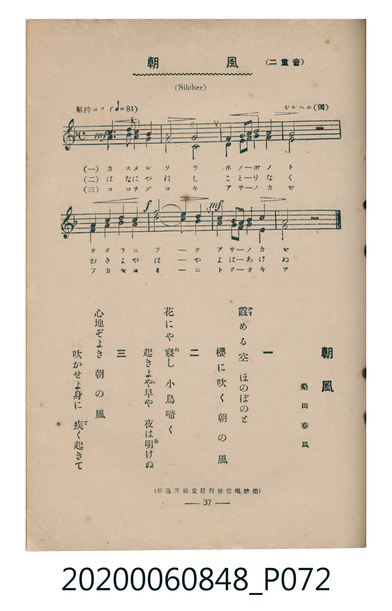

# 朝風

> Re:Shoka 使用 AI 協助辨識與重建樂譜，可能會有錯誤。歡迎回報。

<audio controls src="asakaze.mp3"></audio>

- 詞：桑田春風
- 曲：F. Silcher（シルヘル）
- 臺灣教育會公認《新定兒童唱歌》高等科男子用（2020.006.0848）

## 說明

原書資訊與歌詞全文（對應 P072.jpg，書頁 p. 37，高一重音第 1 首）：
調性與拍號：ヘ長調（1 降記號）、4/4 拍（二重音，氣持ヨク ♩=84）
出處註記：（松邑三松堂發行檢定唱歌集）

## 跨冊／重複收錄參照

> 同曲（《新定兒童唱歌》高等科男、女共用教材）

- **[同曲]** 《新定兒童唱歌》高等科女子用（2020.006.0849）：[**〈朝風〉**](../../koto_girls_2020.006.0849/1_5_01_asakaze/index.md)（`F` / `4/4` — [原始 TMD](../../koto_girls_2020.006.0849/1_5_01_asakaze/asakaze.tmd)）
- 總表：[跨冊重複與同名歌曲總索引](../../../duplicate_songs.md)

## 歌詞

```text
一
霞める空　ほのぼのと
櫻に吹く　朝の風

二
花にや寢し　小鳥啼く
起きよや早や　夜は明けぬ

三
心地ぞよき　朝の風
吹かせよ身に　疾く起きて
```

## ABC

```abc
X:1
T:朝風
C:曲：F. Silcher（シルヘル）
M:4/4
L:1/16
Q:1/4=84
K:F
V:V1 name="Part1" snm="Par"
V:V2 name="Part2" snm="Par"
[V:V1]
!mf! F4 A6 B2 A4 | G8 F4 G4 | A4 B4 c4 A4 | G8 z8 |
F4 G4 A4 B4 | !f! !mf! c8 B4 G4 | F4 A4 G4 B4 | F8 z8 |
[V:V2]
!mf! F4 F6 G2 F4 | E8 C4 E4 | F4 G4 A4 F4 | E8 z8 |
D4 E4 F4 G4 | !f! !mf! A8 G4 E4 | D4 F4 E4 C4 | F8 z8 |
```

## TMD 檔案連結

- [主旋律 TMD 檔案](asakaze.tmd) [[在 TMD Studio 編輯](https://tmdlang.github.io/Tmd-TS/#tmd=s7IKdvYPcrWy4qpTUCpJTLdSSM7PyUlNLsnMz7MqzsjMK0nNjM_KTMmPL87Iz05Ugisry88pzU21ys4vyY9Pyq8sjjcyMDKINzAwizewMLFAqCvOLy1KTrUqTs7Iz8-JL0mtKEnKz89GyBcU5Zel5iXmAdUUFIGsSwErQihILctMSQVJp6ZkluQXZSbmIDkitagY7FCwJfElRYl5xclFmQUg1yNUlWSkAl1anpoIZBQpcWlpKTybM_flohUKWlpcirYKFiZc9rYKblw2JvomdiBNL1bOe79n1rOFE59P2fBsxlKgSrBZz2ZvAgq76SkEZ-YkA016v6fjcdP2x82rHzfPAJLv93SClb1o3_W8cfGzqTNfNG16Nqf5aeuaF6t6Hzd0PZu24em6WU9bJz1fvfTplI3P1vY8buh-uXrG87Wdz5cDrdr-dO2E51NWAE0FhaQeMCT1QCEJNpZLX0vBllqAS0FB4Wnf_Gezd7zY3P5iRdeLjnagY4Ceftq64tm0dqADnm7ofdbeqRBgYG6kl1WQ_n5PD1DxywWNCgV6CsbmQC7Q2U92NLxs7305f_PzNWsUDBVeLpsGdCkwfECmv1i1_1nDcpC53b0vZs4HigKD6OXU7UBxoOlAxTN7X6yYAZbpfNzQCAx3BaBKoNSTXT0QQ0FWblj8rKfxcfOKx03rFR7NXGlrYQJUDnZ8-64XM6e-WLEbaAjQbKC-Z3P3vWya-GRHJ5DxdEHT85l7XizsebZqESjAwUH9cnYbSDNIN9DhIOrlnHmPmxofN3U_X7nrcUPD48bdjxvXPW7cAyZXgFQ8Ww0UWv10ws7Hjf1AFcA0A5QDJgaIKbt6wD7t2ghU87ip5en6RY8bpwOVPd3Q_3Lz0qdTgQb1g1Vs3f64sfdxEzCttDybvhJIghQtmfO4cf2zGX2PGyc-blwDdRfEc_ubn87Z8LgR6LoOkEZki0HSIOd0P26cDZR-sWs1yPKGhufT9gFtg9rUuAykjvJkAgUKWvpcXL6JmXlWAYlFJYYONQY1CtUgGxRsLLTswAxg4gQmAmC4AgMdpBwkBlSUm1YLTBi6CsZArKtgAqZrFIzAPF2wDIhdAxY3AWJTqFqEGgMoXQMOIJg9u3pQ7IEZBDMGaDPQYpBhEGt1IS6B2AVzD4gHUQwSQbWrFsm_RmT4F2KiEZiuUTCPhxpsCmKAeahuRlNGlJ_N4GYhghHka0hQQ0TA7oHaB1YPUgrmg12Cw-e6dgogzysAaWUuLgA)]
- [鋼琴伴奏 TMD 檔案](asakaze_piano.tmd) [[在 TMD Studio 編輯](https://tmdlang.github.io/Tmd-TS/#tmd=s7IKdvYPcrWy4tLSUng2Z-7LRSve7-l42b3n-YQtT_Zsebq0_3lnx_s9nQpaWlyKtgoWJlz2tgpuXDYm-iZ2XHUKSi9Wznu_Z9azhROfT9nwbMZSoHYlkPCz2ZuAwm56CsGZOckZqUVAMx83bX_cvPpx8wwgCTQQrOxF-67njYufTZ35omnTsznNT1vXvFjV-7ih69m0DU_XzXraOun56qVPp2x8trbncUP3y9Uznq_tfL4caNX2p2snPJ8CcqmRgZGBnoGBmZ6BhYkF2Fgu38TMPKuAzMS8_CAPhxqDGoVqLgUgsLHQsgMz9LUUnq9Z82RHw4uFPQpa-mAxoKLctFoFQwVdBWMg1lUwAdM1CkZgni5YBsSuAYubALEpVC1CjQGUruFCtmdXD4o9MINgxgBtBloMMgxirS7EJRC7YO4B8SCKQSKodtUi-9gHxccmUB8DtcUD1UYbxoLNMI2H8aJN42MhsmAWmgKQkAHQBogRJkiKok2g2qCqQJpA8jAjwS6FWQIyAuhIXTsFkDsVgLQyFxcA)]

## 分析

```text
================================================================================
📊 TMD Song Profile: [ 朝風 ]
================================================================================
⏱  Duration:       0:22 (22.9s), 8 measures total
🎼 Key & Tempo:    首調基準 F, != 84.0 BPM, <4/4>
   - 分析範圍：      由實際發聲的音符與和弦推測調性；播放脈絡另行呈現
🎤 人聲音域:    F4 (MIDI 65) – C5 (MIDI 72) [跨度: 7 個半音 / 0.6 個八度, 難度: easy]
   - 最低音:  F4 in [Main #1 @ m.1, 0:00]
   - 最高音: C5 in [Main #1 @ m.3, 0:07]
   - 適合: soprano, mezzo-soprano, contralto, tenor, baritone, bass
🏛  結構:      Main (22.9s)
⚡ 編曲密度:        Peak 2 軌道同時演奏
🗝  調性診斷：       F 大調（純淨自然大調，未偵測到可信轉調）
   - 風格氣質:    純淨自然大調（陽光明朗、易唱易記，無明顯調外色彩）
   - 轉調歷程:    全曲維持單一推測調性（未偵測到可信轉調）
   - 核心骨幹音:  F, G, A, E, C
   - 調性數值:    F 大調 [相關度: 0.77, 穩定度: High, 自然音純度: 100.0%]
   - 候選調性 (K-S): F 大調 (0.77), C 大調 (0.60), D 小調 (0.52)
   - 五度圈歷程:   -1
   - 各段落調性細節:
     • [Main #1]: F 大調 (r: 0.77, 自然音純度: 100.0%)

  [ 五度圈游移軌跡 ]
               C  
        [F ]*          G  
      Bb               D  
      Eb               A  
         Ab           E  
            Db       B  
               F# 
     (* = active key center)

  [ 十二半音累積音高分佈 ]
     C  : ████████                   8.9%
     C# :                            0.0%
     D  : ███                        3.6%
     D# :                            0.0%
     E  : ████████████              14.3%
     F  : ████████████████████████  27.7%
     F# :                            0.0%
     G  : ██████████████████        20.5%
     G# :                            0.0%
     A  : ███████████████           17.0%
     A# : ███████                    8.0%
     B  :                            0.0%
--------------------------------------------------------------------------------
Assignment 軌道音域：
  - Part1         : F4 – C5 (7 個半音 / 0.6 個八度, 24 個音符)
  - Part2         : C4 – A4 (9 個半音 / 0.8 個八度, 24 個音符)
================================================================================
```


## 原書掃描頁




