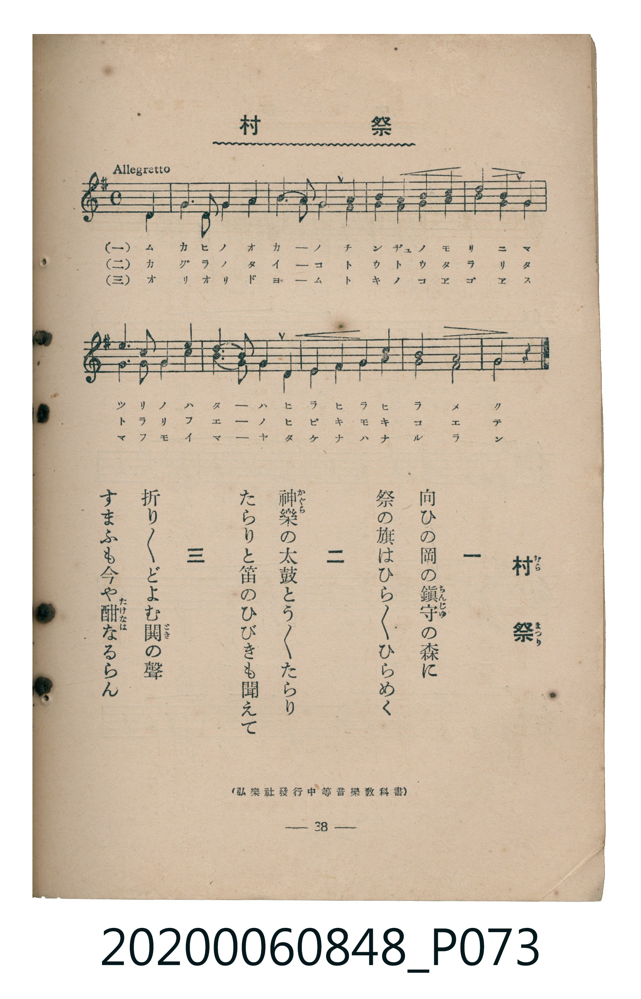

# 村祭

> Re:Shōka 使用 AI 協助辨識與重建樂譜，可能會有錯誤。歡迎回報。

- **鋼琴伴奏版**：<br><audio controls src="muramatsuri.mp3"></audio>

- 臺灣教育會公認《新定兒童唱歌》高等科男子用（2020.006.0848）

## 說明

原書資訊與歌詞全文（對應 P073.jpg，書頁 p. 38，高一重音第 2 首）：
調性與拍號：ト長調（1 升記號）、4/4 拍（Allegretto ♩=112，弱起第 4 拍進入）
出處註記：（弘樂社發行中等音樂教科書）


## 歌詞

```text
一
向ひの岡の鎮守の森に
祭の旗はひらく／＼ひらめく

二
神樂の太鼓とう／＼たらり
たらりと笛のひびきも聞えて

三
折り／＼どよむ鬨の聲
すまふも今や酣なるらん
```

## ABC

<div class="abc-score" data-abc-src="muramatsuri.abc" aria-label="五線譜載入中"></div>

[下載 ABC 原始檔](muramatsuri.abc)

## TMD 檔案連結

- [主旋律 TMD 檔案](muramatsuri.tmd) [[在 TMD Studio 編輯](https://tmdlang.github.io/Tmd-TS/#tmd=s7IKdvYPcrWy4qpTUCpJTLdSSM7PyUlNLsnMz7MqzsjMK0nNjM_KTMmPL87Iz05Ugisry88pzU21ys4vyY9Pyq8sjjcyMDKINzAwizewMLFAqCvOLy1KTrUqTs7Iz8-JL0mtKEnKz89GyBcU5Zel5iXmAdUUFIGsSwErQihILctMSQVJp6ZkluQXZSbmIDkitagY7FCwJfElRYl5xclFmQUg1yNUlWSkAl2allpcklmGrBsinpyfm1ual1lSiZAA2pKemWeVm5-XVAr0NoZESWImUBgUIuWJ8bmJmXk5iXkpSlxaWgrP5k58vnStgpYWl6KtgqGhEZe9rYI7l42JvokdyJAX7bueNy5-NnXmi6ZNz-Y0P21d82JV7-OGrmfTNjxdN-tp66Tnq5c-nbLx2dqexw3dL1fPeL628_nyic-nbH-6dsLzKSve7-kAhbIeMJT1QKH8fk-nEheXvpaCLbUAl4KCwtO--c9m73ixuf3Fiq4XHe1Ax7xYOe9p64pn09qBDni6ofdZe6dCgIG5sV5WQfr7PT1AxS8XNCoU6CkYA13UA3T2kx0NL9t7X87f_HzNGgUjhZfLpgFd-n7PLJDpL1btf9awHGRud--LmfOBoo-bO15O3Q4UB5puqPC0F2jvDLBM5-OGRmDIKQBVAqUcgckyvSi1pCRf4dHMlbbAwAVa9nTPxhdbt4OsASt72bDpaetSoE6wP9p3vZg59cWK3UDzgNaA3L5nxrMVTc-X7Hs-c8-LhT1PdqwFBjDQmUBBYJwAQxroFZBmkG6gH8CGTJj4uHHT48Z1TzctBJIv-9Y9XdcBZDxbvO5x42qQCmB8g_jTpz9uXA9S2tT5uLH__R4g2gPlNjUCRSCG7uqBaJkHtBJk6JJVL_dMfty44nFjG0zLfLCWLpA6OAeo4vma2UANYLdsftzY-7ip6UXjvMeNQLcsg7oX7OlnXTOA6mFmrXzc1PG4qeHlGqAF6140boIYOvNx477HjVuBRjzZ3fW4qeVl6-LHjaseN3WDLZsMUkR5SoICBS19Li5fYBaxCkgsKjF0qNE1rKkG2aBgY6FlB2YA0y8kGp9u6H--vgGkAyRco2CgoAvH1blptQqm8UBWDdi7IF3AaAfGEjAiEVoMgQp0gUkORBuBFCsYA0kTIAniQfSDhSDCQCGwiBlYG4QHFkGxY1cPih0QxeYKhnFw_SCTQFagWgtigWiEGpAISA3IRzVctUghY0SfkAGqAzGgAQFxrqGCOYiLJAbzBsjxEIeDIIgHVok3dGAxAFINYgPDC2q6SbyCMYgJ5kMUgo2DM6BK4YLwUNK1UwAFlAKQVuYCAA)]
- [鋼琴伴奏 TMD 檔案](muramatsuri_piano.tmd) [[在 TMD Studio 編輯](https://tmdlang.github.io/Tmd-TS/#tmd=s7IKdvYPcrWy4tLSUng2d-LzpWvf7-l42b3n-YQtT_Zsebq0_3lnx_s9nQpaWlyKtgqGhkZc9rYK7lw2Jvomdlx1Ckov2nc9b1z8bOrMF02bns1pftq65sWq3scNXc-mbXi6btbT1knPVy99OmXjs7U9jxu6X66e8Xxt5_PlE59P2f507YTnU1YALTMyMDLQMzAw0zOwMLEAWqXExeWbmJlnFZCZmJcf5OFQo2tYU82lAAQ2Flp2YIa-lsLTPRtfbN3-dEP_8_UNClr6YOEaBQMFXTiuzk2rVTCNB7JquGC6nq9Z82RHw4uFPQgthkAFugpGYNoIpFjBGEiaAEkQD6IfLAQRBgqBRczA2iA8sAiKHbt6UOyAKDZXMIyD6weZBLIC1VoQC0Qj1IBEQGpAPqrhqkUOGx-UsDGBhg0oECCwBuZDkB-iDWPBZkI4pvHIPJNYiAjQRphSCB9qAFwU7Ci4EqP4XJAeoBlg1QhtIDVwIZA7gM7WtVMAuVwBSCtzAQA)]

## 分析

```text
================================================================================
📊 TMD Song Profile: [ 村祭 ]
================================================================================
⏱  Duration:       0:17 (17.1s), 8 measures total
🎼 Key & Tempo:    首調基準 G, != 112.0 BPM, <4/4>
   - 分析範圍：      由實際發聲的音符與和弦推測調性；播放脈絡另行呈現
🎤 人聲音域:    D4 (MIDI 62) – G5 (MIDI 79) [跨度: 17 個半音 / 1.4 個八度, 難度: challenging]
   - 最低音:  D4 in [Main #1 @ m.1, 0:01]
   - 最高音: G5 in [Main #1 @ m.6, 0:11]
   - 適合: soprano, mezzo-soprano, tenor, baritone
🏛  結構:      Main (17.1s)
⚡ 編曲密度:        Peak 2 軌道同時演奏
🗝  調性診斷：       G 大調（純淨自然大調，未偵測到可信轉調）
   - 風格氣質:    純淨自然大調（陽光明朗、易唱易記，無明顯調外色彩）
   - 轉調歷程:    全曲維持單一推測調性（未偵測到可信轉調）
   - 核心骨幹音:  G, D, B, A, E
   - 調性數值:    G 大調 [相關度: 0.96, 穩定度: High, 自然音純度: 100.0%]
   - 候選調性 (K-S): G 大調 (0.96), E 小調 (0.69), D 大調 (0.68)
   - 五度圈歷程:   +1
   - 各段落調性細節:
     • [Main #1]: G 大調 (r: 0.97, 自然音純度: 100.0%)

  [ 五度圈游移軌跡 ]
               C  
         F           [G ]*
      Bb               D  
      Eb               A  
         Ab           E  
            Db       B  
               F# 
     (* = active key center)

  [ 十二半音累積音高分佈 ]
     C  : ████████                   9.4%
     C# :                            0.0%
     D  : ████████████████          17.2%
     D# :                            0.0%
     E  : █████████                 10.2%
     F  :                            0.0%
     F# : ████████                   8.6%
     G  : ████████████████████████  26.6%
     G# :                            0.0%
     A  : ███████████               12.5%
     A# :                            0.0%
     B  : ██████████████            15.6%
--------------------------------------------------------------------------------
Assignment 軌道音域：
  - Part1         : D4 – G5 (17 個半音 / 1.4 個八度, 33 個音符)
  - Part2         : B3 – C5 (13 個半音 / 1.1 個八度, 33 個音符)
================================================================================
```


## 原書掃描頁




