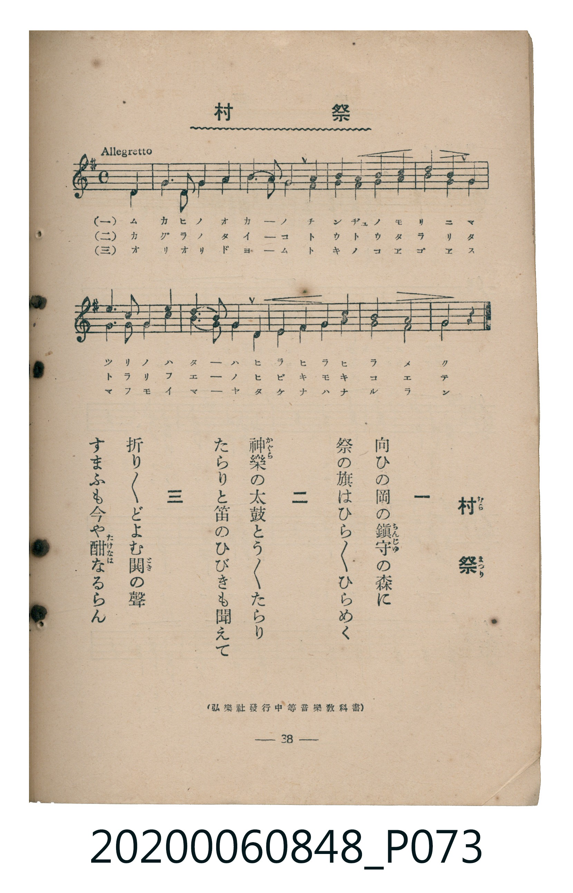

# 村祭

<audio controls src="muramatsuri.mp3"></audio>

- 臺灣教育會公認《新定兒童唱歌》高等科男子用（2020.006.0848）

## 說明

原書資訊與歌詞全文（對應 P073.jpg，書頁 p. 38，高一重音第 2 首）：
調性與拍號：ト長調（1 升記號）、4/4 拍（Allegretto ♩=112，弱起第 4 拍進入）
出處註記：（弘樂社發行中等音樂教科書）

## 歌詞

```text
一
向ひの岡の鎮守の森に
祭の旗はひらく／＼ひらめく

二
神樂の太鼓とう／＼たらり
たらりと笛のひびきも聞えて

三
折り／＼どよむ鬨の聲
すまふも今や酣なるらん
```

## 原書掃描頁



## 分析

```text
================================================================================
📊 TMD Song Profile: [ 村祭 ]
================================================================================
⏱  Duration:       0:19 (19.3s), 9 measures total
🎼 Key & Tempo:    首調基準 G, != 112.0 BPM, <4/4>
   - 分析範圍：      由實際發聲的音符與和弦推測調性；播放脈絡另行呈現
🎤 人聲音域:    D4 (MIDI 62) – G5 (MIDI 79) [跨度: 17 個半音 / 1.4 個八度, 難度: challenging]
   - 最低音:  D4 in [Main #1 @ m.1, 0:01]
   - 最高音: G5 in [Main #1 @ m.6, 0:11]
   - 適合: soprano, mezzo-soprano, tenor, baritone
🏛  結構:      Main (19.3s)
⚡ 編曲密度:        Peak 2 軌道同時演奏
🗝  調性診斷：       G 大調（純淨自然大調，未偵測到可信轉調）
   - 風格氣質:    純淨自然大調（陽光明朗、易唱易記，無明顯調外色彩）
   - 轉調歷程:    全曲維持單一推測調性（未偵測到可信轉調）
   - 核心骨幹音:  G, D, B, A, E
   - 調性數值:    G 大調 [相關度: 0.96, 穩定度: High, 自然音純度: 100.0%]
   - 候選調性 (K-S): G 大調 (0.96), E 小調 (0.69), D 大調 (0.68)
   - 五度圈歷程:   +1
   - 各段落調性細節:
     • [Main #1]: G 大調 (r: 0.96, 自然音純度: 100.0%)

  [ 五度圈游移軌跡 ]
               C  
         F           [G ]*
      Bb               D  
      Eb               A  
         Ab           E  
            Db       B  
               F# 
     (* = active key center)

  [ 十二半音累積音高分佈 ]
     C  : ████████                   9.4%
     C# :                            0.0%
     D  : ████████████████          17.2%
     D# :                            0.0%
     E  : █████████                 10.2%
     F  :                            0.0%
     F# : ████████                   8.6%
     G  : ████████████████████████  26.6%
     G# :                            0.0%
     A  : ███████████               12.5%
     A# :                            0.0%
     B  : ██████████████            15.6%
--------------------------------------------------------------------------------
Assignment 軌道音域：
  - Part1         : D4 – G5 (17 個半音 / 1.4 個八度, 33 個音符)
  - Part2         : B3 – C5 (13 個半音 / 1.1 個八度, 33 個音符)
================================================================================
```

## ABC

```abc
X:1
T:村祭
C:TMD (Chen, Chih-Han / aguai)
M:4/4
L:1/16
Q:1/4=112
K:G

V:V1 name="Part1" snm="Par"
V:V2 name="Part2" snm="Par"

[V:V1]
!mf! z4 z4 z4 d4 | g6 a2 g4 a4 | b4 c2 b2 a4 d4 | b4 b4 c4 d4 |
e8 d4 d4 | e6 f2 g4 d4 | c4 b2 a2 g4 a4 | b4 a4 b4 d4 |
c4 a4 g4 z4 |


[V:V2]
!mf! z4 z4 z4 d4 | g6 d2 g4 d4 | g4 a2 g2 f4 d4 | g4 g4 a4 b4 |
c8 b4 f4 | g6 a2 b4 g4 | e4 d2 c2 B4 e4 | g4 f4 g4 f4 |
e4 f4 g4 z4 |
```

- [主旋律 TMD 檔案](muramatsuri.tmd)
- [鋼琴伴奏 TMD 檔案](muramatsuri_piano.tmd)
