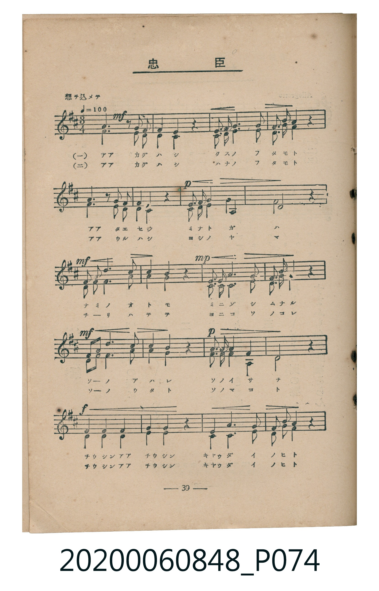
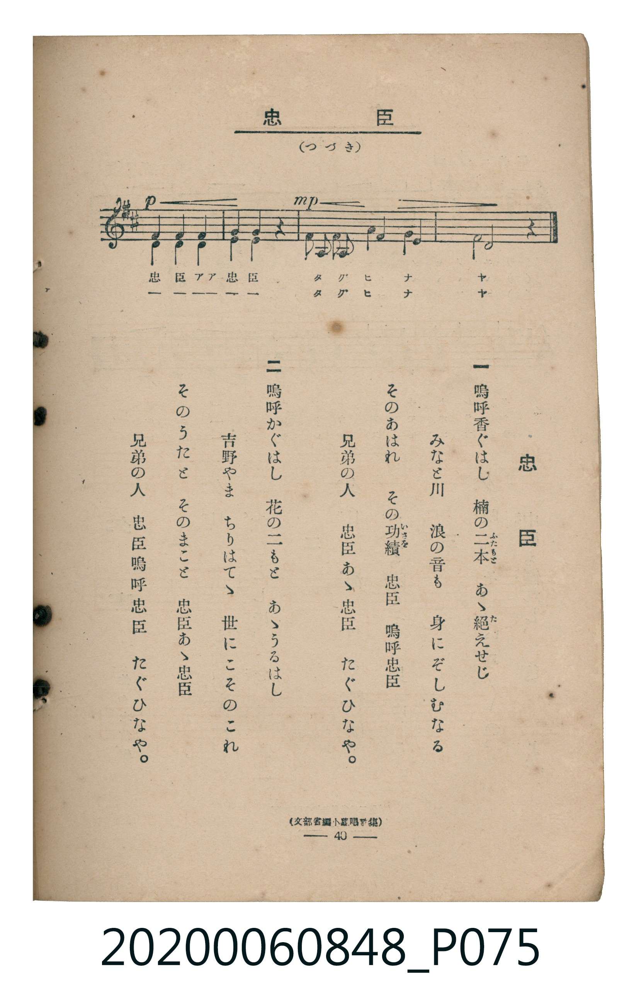

# 忠臣

<audio controls src="chushin.mp3"></audio>

- 臺灣教育會公認《新定兒童唱歌》高等科男子用（2020.006.0848）

## 說明

原書資訊與歌詞全文（對應 P074.jpg – P075.jpg，書頁 pp. 39–40，高一重音第 3 首）：
調性與拍號：ロ短調（2 升記號）、3/4 拍（想ヲ込メテ ♩=100）
出處註記：（文部省編小學唱歌集）

## 歌詞

```text
一
嗚呼香ぐはし　楠の二本　あゝ絶えせじ
みなと川　浪の音も　身にぞしむなる
そのあはれ　その功績　忠臣　嗚呼忠臣
兄弟の人　忠臣あゝ忠臣　たぐひなや。

二
嗚呼かぐはし　花の二もと　あゝうるはし
吉野やま　ちりはてゝ　世にこそのこれ
そのうたと　そのまこと　忠臣あゝ忠臣
兄弟の人　忠臣嗚呼忠臣　たぐひなや。
```

## ABC

```abc
X:1
T:忠臣
C:TMD (Chen, Chih-Han / aguai)
M:3/4
L:1/16
Q:1/4=100
K:Bm
V:V1 name="Part1" snm="Par"
V:V2 name="Part2" snm="Par"
[V:V1]
!mf! d6 z2 B2 c2 | f4 f4 z4 | e2 e2 f6 e2 | d2 e2 f4 z4 |
b6 z2 g2 e2 | d4 c4 z4 | !p! e2 e2 B4 c4 | B8 z4 |
!mf! d2 d2 f6 g2 | f4 e4 z4 | !mp! d2 d2 e6 f2 | e2 d2 c4 z4 |
!mf! f2 g2 a6 f2 | g4 f4 z4 | !p! e2 e2 B4 c4 | B8 z4 |
!f! d4 d4 d4 | e4 e4 z4 | d4 f6 g2 | f2 e2 f4 z4 |
!p! e4 e4 e4 | f4 f4 z4 | !mp! e2 e2 b4 f4 | B8 z4 |
[V:V2]
!mf! B6 z2 G2 ^A2 | d4 B4 z4 | c2 c2 d6 c2 | B2 c2 d4 z4 |
d6 z2 e2 c2 | B4 F4 z4 | !p! A2 A2 G4 F4 | B8 z4 |
!mf! B2 B2 d6 e2 | d4 c4 z4 | !mp! B2 B2 A6 A2 | G2 G2 F4 z4 |
!mf! d2 e2 f6 d2 | e4 d4 z4 | !p! A2 A2 G4 F4 | B8 z4 |
!f! G4 G4 G4 | A4 A4 z4 | B4 d6 e2 | d2 c2 d4 z4 |
!p! c4 c4 c4 | d4 d4 z4 | !mp! A2 A2 d4 c4 | B8 z4 |
```

## TMD 檔案連結

- [主旋律 TMD 檔案](chushin.tmd)
- [鋼琴伴奏 TMD 檔案](chushin_piano.tmd)

## 分析

```text
================================================================================
📊 TMD Song Profile: [ 忠臣 ]
================================================================================
⏱  Duration:       0:43 (43.2s), 24 measures total
🎼 Key & Tempo:    首調基準 D, != 100.0 BPM, <3/4>
   - 分析範圍：      由實際發聲的音符與和弦推測調性；播放脈絡另行呈現
🎤 人聲音域:    B3 (MIDI 59) – B4 (MIDI 71) [跨度: 12 個半音 / 1.0 個八度, 難度: easy]
   - 最低音:  B3 in [Main #1 @ m.1, 0:01]
   - 最高音: B4 in [Main #1 @ m.5, 0:07]
   - 適合: soprano, mezzo-soprano, contralto, tenor, baritone, bass
🏛  結構:      Main (43.2s)
⚡ 編曲密度:        Peak 2 軌道同時演奏
🗝  調性診斷：       B 小調（純淨自然小調，未偵測到可信轉調）
   - 風格氣質:    純淨自然小調（陰鬱抒情、旋律集中，無明顯調外色彩）
   - 轉調歷程:    全曲維持單一推測調性（未偵測到可信轉調）
   - 核心骨幹音:  D, B, F#, E, C#
   - 調性數值:    B 小調 [相關度: 0.91, 穩定度: High, 自然音純度: 99.6%]
   - 候選調性 (K-S): B 小調 (0.91), D 大調 (0.74), F# 小調 (0.52)
   - 五度圈歷程:   +5
   - 各段落調性細節:
     • [Main #1]: B 小調 (r: 0.91, 自然音純度: 99.6%, 調外音: A#)

  [ 五度圈游移軌跡 ]
               C  
         F            G  
      Bb               D  
      Eb               A  
         Ab           E  
            Db      [B ]*
               F# 
     (* = active key center)

  [ 十二半音累積音高分佈 ]
     C  :                            0.0%
     C# : ████████████              10.6%
     D  : ████████████████████████  21.2%
     D# :                            0.0%
     E  : ████████████████          14.4%
     F  :                            0.0%
     F# : ████████████████████      17.8%
     G  : █████████                  8.1%
     G# :                            0.0%
     A  : ████████                   7.2%
     A# :                            0.4%
     B  : ███████████████████████   20.3%
--------------------------------------------------------------------------------
Assignment 軌道音域：
  - Part1         : B3 – B4 (12 個半音 / 1.0 個八度, 67 個音符)
  - Part2         : F#3 – F#4 (12 個半音 / 1.0 個八度, 67 個音符)
================================================================================
```


## 原書掃描頁






