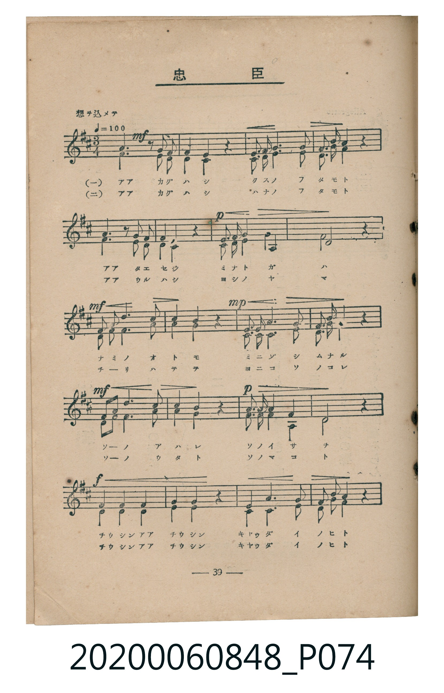
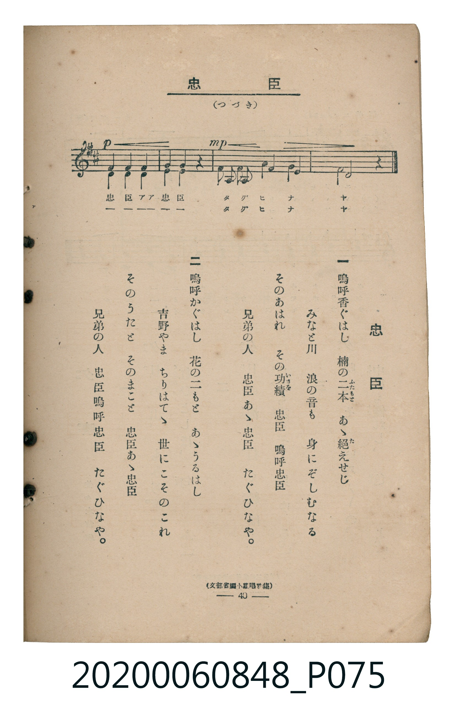

# 忠臣

> Re:Shōka 使用 AI 協助辨識與重建樂譜，可能會有錯誤。歡迎回報。

- **鋼琴伴奏版**：<br><audio controls src="chushin.mp3"></audio>
- **NEUTRINO 歌聲合成版**：<br><audio controls src="chushin_neutrino.mp3"></audio>

- 出處：（文部省編小學唱歌集）
- 臺灣教育會公認《新定兒童唱歌》高等科男子用（2020.006.0848）

## 說明

原書資訊與歌詞全文（對應 P074.jpg – P075.jpg，書頁 pp. 39–40，高一重音第 3 首）：
調性與拍號：ニ長調（2 升記號）、3/4 拍（想ヲ込メテ ♩=100）
出處註記：（文部省編小學唱歌集）


## 歌詞

```text
一
嗚呼香ぐはし　楠の二本（ふたもと）　あゝ絶（た）えせじ
みなと川　浪の音も　身にぞしむなる
そのあはれ　その功績（いさを）　忠臣　嗚呼忠臣
兄弟の人　忠臣あゝ忠臣　たぐひなや。

二
嗚呼かぐはし　花の二もと　あゝうるはし
吉野やま　ちりはてゝ　世にこそのこれ
そのうたと　そのまこと　忠臣あゝ忠臣
兄弟の人　忠臣嗚呼忠臣　たぐひなや。
```

## ABC

<div class="abc-score" data-abc-src="chushin.abc" aria-label="五線譜載入中"></div>

[下載 ABC 原始檔](chushin.abc)

## TMD 檔案連結

- [主旋律 TMD 檔案](chushin.tmd) [[在 TMD Studio 編輯](https://tmdlang.github.io/Tmd-TS/#tmd=s7IKdvYPcrWy4qpTUCpJTLdSSM7PyUlNLsnMz7MqzsjMK0nNjM_KTMmPL87Iz05Ugisry88pzU21ys4vyY9Pyq8sjjcyMDKINzAwizewMLFAqCvOLy1KTrUqTs7Iz8-JL0mtKEnKz89Gl48vSExPtQowMDfBKWOKkCkoyi9LzUvMA5pbUARyYgrYYISC1LLMlFSQdHFyYl58WWpRZlpmagqS41OLisEehFhRUpSYV5xclFkA8jVCVX5RSUZ-elFiQUalVUZmcUl-UWZyYk58dmIeUjiUZKQCgyE3MyezJLGoEl0cog1JGGhGemaeVW5-XlIpMESVuLS0FJ7uX_CifbGClhaXoq2CoYEBl72tgguXjbG-iR1I39P2XS9mTn2_Z9b7PR3PprW_bF7xfE7j8-0rnm7of7p2x9MpG5-t7Xk5u-39nk6wNS_adz1vXPxs6swXTZuezWl-2rrmxarexw1dz6ZteLpu1tPWSc9XL4VoetzQ_XL1jOdrO58vn_h8yvanayc8n7ICaAkoJvWAMakHikmwsVz6Wgq21AJcCgoKT_vmP5u948Xm9hcrul50tAMd82LlvKetK4D-Azrg6YbeZ-2dCqDkoJdVkK7wqGEyiGMK4rzf0wPU-XJBo0JBgZ6CsSVQzsQAKAj0yZMdDS_be1_O3_x8zRoFY4WXy6YBHQ8MN5CFL1btf9awHGRVd--LmfOBoo-bu19O3Q4UB_lY4Wkv0CkzwDKdjxsagWGvAFQJCvHmzY-bN73Yt-dx88LHzW0Kj2autAXGEVAZ2B_guHmxYjdQMzExxAXSBHQnWO_0WU8n7nm5bObjxgmPG9c_bpz-uKHh2dIFjxvXPdnV82zOGqBpjxu3Pm6c_7ip6XEjMGaALmt43Nj0uGnu863bwLJg5zYCGbMfN84AGfq4cf_jxlVA1U-3zwUZtxXIXgcMEpARDQ0vdq1-3AhE80CWNQHNWvW4qRuibS5QHchsoEOagCkDKAcSedo1__mOfWCrWh43Tn3cNAniCkiSBTHAnoBwwZ5qbXm6Zz7YC7sQ6sBuhusB-Qjk5U1g-1seNzRBgmVXDyJYHjd2IwfLi66NkGCBBAU8HB43tgF9AFEG1jyh82V7H8jQxn1gRQsfN3WBpZeBVDc0PNkxDRwCk2E-ngz0LnIItIFdB7EBIrIPrBokgukbnF5GDhfsXgbqpDwvQYGClj4Xl3MGsEQBli0BmYl5-YYONQY11SBLFGwstOzADGyZWAGYV4Dp8cXCnic7ul40bgKmXQUNEwVgyn2-vkEHngU1segE2gkytUahOjetVsFUQRcIDYD5zggoZARkG4L5umCesYIJWN4EyDNWMAOrBsuBjfAxrFF43LQIiMCK4oGc1UC8Aaj4cXM_UORx03awOMiwx03rgXgnUKYPrPpx81Sw6H4gaxEQd8BUQow2IsVooMjj5i4ijMYfnrt6KApPfEFZXVALD04QhshD1OMJTqAPmlaA_bIb7OcdSH6eD_UzyHePm9bAQwJiLN6gXAZUuBpHUK4A8yFB-bh5CVR0HoqxBJJlJ-XJ0hgYmoZxYCvNgGJmQBqe9oAqwKFpBA1xPIkTHECggIImjKZVYN-AgwyYNFADsxsovw-qbjtYdAHUhNWYAdrcCMR7gHgVNMn1g3W0gdkgEik8wSZvhpq8FyzaBxZ53AyKNiLC9Ons2bQOU2CQmoKhLlAhSASUeLEl0L1Qj8OCdBEiISG8A1UH8iYoCT1u2goNjk040ie6qcugORhkKjz_IkwFJ0hIoMIilNjkuWsKZUEJDklIIEECCpanYYUmJFjxp8tGkA_BCe1xM8gT8AyKTRLm97WPmxdDpZoboOG0BJacmidhL0TJtmoJsVbhT7mta_EEN7hpiD-4gekSX3CDywJjcNrGX7IC63QgH9RgRwkCZGGY50Gl7gawN0He74IGFSgdY6ZcKhtbi9YeMCKjPdBNWSEBCTpDBfN4oBiQAJYWIAIS3EC-ITSAQZWcITDIQTqGfZuA3DAlEJyg1A0PUrA47nJ32DQMKEqfhkAICVRQ8QrK8PD0BykLgMEJQQTS6HBrGlAYqqAiFEeoQgtYkIgp_iQ6TJoGZAclOCQhzX4QhlRFIAwvPHWJSZkjrnGAPcCJaxzgC3BwgQBMs0AECmeQBK7EO2SaB7p2CtAWggKQqcwFAA)]
- [鋼琴伴奏 TMD 檔案](chushin_piano.tmd) [[在 TMD Studio 編輯](https://tmdlang.github.io/Tmd-TS/#tmd=s7IKdvYPcrWy4qpTUCpJTLdSSM7PyUlNLsnMz7MqzsjMK0nNjM_KTMmPL87Iz05Ugisry88pzU21ys4vyY9Pyq8sjjcyMDKINzAwizewMLFAqCvOLy1KTrUqTs7Iz8-JL0mtKEnKz89Gl48vSExPtQowMDfBKWOKkCkoyi9LzUvMA5pbUARyYgrYYISC1LLMlFSQdHFyYl58WWpRZlpmagqS41OLisEehFhRUpSYV5xclFkA8jVCVX5RSUZ-elFiQUalVUZmcUl-UWZyYk58dmIeUjgkFgE1p6fmpuaVWBVkJublxycmJ-fnFiTmZYLEEApLMoCKrHIzczJLEosq0cUh5iMJAy1Lz8yzys3PSyoFBr0Sl5aWwtP9C160L36_p-Nl957nE7Y82bPl6dL-550d7_d0KmhpcSnaKhgaGHDZ2yq4cNkY65vYgQx72r7rxcyp7_fMAmp7Nq39ZfOK53Man29f8XRD_9O1O55O2fhsbc_L2W1AI8B2v2jf9bxx8bOpM180bXo2p_lp65oXq3ofN3Q9m7bh6bpZT1snPV-9FKLpcUP3y9Uznq_tfL584vMp25-unfB8ygqgJaB0oAdMB3qgdAA2lss5A-gFoGcCQOFj6FBjUFPNpQAENhZadmCGvpaCLTpQeL5mzZMdDS8W9jzZ0fWicRPQ5QoaJgpAdz9f36CjAEorelkF6ZpYdGrpg02tUajOTatVMFXQBUIDBWMFI6CQEZBtCObrgnnGCiZgeRMgz1jBDKwaLAc2wsewRuFx0yIgAiuKB3JWA_EGoOLHzf1AkcdN28HiIMMeN60H4p1AmT6w6sfNU8Gi-4GsRUDcAVMJMdqIFKOBIo-bu4gwGn947uqhKDzxBWV1QS08OEEYIg9Rjyc4gT5oWgH2y26wn3cg-Xk-1M8g3z1uWgMPCYixeINyGVDhahxBuQLMhwTl4-YlUNF5KMYSSJadlCdLY2BoGsaBrTQDipkBaXjaA6oAh6YRNMTxJE5wAIECCpowmlaBfQMOMmDSQA3MbqD8Pqi67WDRBVATVmMGaHMjEO8B4lXQJNcP1tEGZoNIpPAEm7wZavJesGgfWORxMyjaiAjTp7Nn0zpMgUFqCoa6QIUgEVDixZZA90I9DgvSRYiEhPAOVB3Im6Ak9LhpKzQ4NuFIn-imLoPmYJCp8PyLMBWcICGBCotQYpPnrimUBSU4JCGBBAkoWJ6GFZqQYMWfLhtBPgQntMfNIE_AMyg2SZjf1z5uXgyVam6AhtMSWHJqnoS9ECXbqiXEWoU_5bauxRPcpoSDG5gu8QU3uCwwBqdtAiUr0K_NS_GHBYY8LDhA5fAGsMdBAdIF1QBK2VjSMq0tqkVrMxiR0WbopqwggQSvoYJ5PFAMSABLFBABiRIg3xAaCaCK0BAYLSAdw77dQG6YEghOUA6ABylYHHfZPGwaDxSlT0MghAQqqAgGFQrw9AcpL4DBCUEE0uhwaz5QGKqgYhZHqEILYZCIKf4kOkyaD2QHJTgkIV0DEIZUVyAMLzx1iUmZI64BgT3AiWtA4AtwcIEATLNABApnkATOxDtsmxA-HkhtCBNoGwIYDPEK0YaxCtGm8bFQnll8biwwVICd3XggDySOJAlUCpQiRa8RSAiPZhNUWeJtRdeI6Rqs2oAYWLSBLDEBKiTJRhxasVoKDH5dOwVoDET7AEWRuUZgrjIXAA)]

## 分析

```text
================================================================================
📊 TMD Song Profile: [ 忠臣 ]
================================================================================
⏱  Duration:       0:43 (43.2s), 24 measures total
🎼 Key & Tempo:    首調基準 D, != 100.0 BPM, <3/4>
   - 分析範圍：      由實際發聲的音符與和弦推測調性；播放脈絡另行呈現
🎤 人聲音域:    D4 (MIDI 62) – D5 (MIDI 74) [跨度: 12 個半音 / 1.0 個八度, 難度: easy]
   - 最低音:  D4 in [Chushin #1 @ m.2, 0:02]
   - 最高音: D5 in [Chushin #1 @ m.9, 0:15]
   - 適合: soprano, mezzo-soprano, contralto, tenor, baritone, bass
🏛  結構:      Chushin (43.2s)
⚡ 編曲密度:        Peak 2 軌道同時演奏
🗝  調性診斷：       D 大調（純淨自然大調，未偵測到可信轉調）
   - 風格氣質:    純淨自然大調（陽光明朗、易唱易記，無明顯調外色彩）
   - 轉調歷程:    全曲維持單一推測調性（未偵測到可信轉調）
   - 核心骨幹音:  F#, D, E, A, G
   - 調性數值:    D 大調 [相關度: 0.86, 穩定度: High, 自然音純度: 100.0%]
   - 候選調性 (K-S): D 大調 (0.86), F# 小調 (0.68), A 大調 (0.62)
   - 五度圈歷程:   +2
   - 各段落調性細節:
     • [Chushin #1]: D 大調 (r: 0.86, 自然音純度: 100.0%)

  [ 五度圈游移軌跡 ]
               C  
         F            G  
      Bb              [D ]*
      Eb               A  
         Ab           E  
            Db       B  
               F# 
     (* = active key center)

  [ 十二半音累積音高分佈 ]
     C  :                            0.0%
     C# : ████████                   7.6%
     D  : █████████████████████     20.3%
     D# :                            0.0%
     E  : █████████████████         16.1%
     F  :                            0.0%
     F# : ████████████████████████  22.9%
     G  : █████████████             12.3%
     G# :                            0.0%
     A  : ███████████████           14.4%
     A# :                            0.0%
     B  : ███████                    6.4%
--------------------------------------------------------------------------------
Assignment 軌道音域：
  - Piano1        : D4 – D5 (12 個半音 / 1.0 個八度, 67 個音符)
  - Piano2        : A3 – G4 (10 個半音 / 0.8 個八度, 67 個音符)
================================================================================
```


## 原書掃描頁






