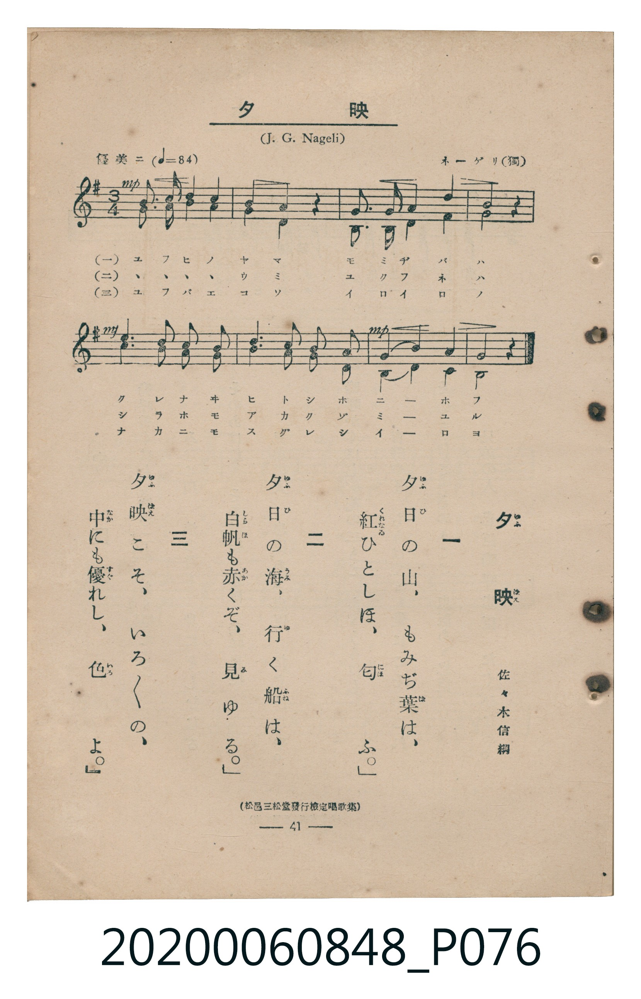

# 夕映

> Re:Shōka 使用 AI 協助辨識與重建樂譜，可能會有錯誤。歡迎回報。

- **鋼琴伴奏版**：<br><audio controls src="yubae.mp3"></audio>

- 詞：佐々木信綱
- 曲：J. G. Nägeli（ネーゲリ）
- 臺灣教育會公認《新定兒童唱歌》高等科男子用（2020.006.0848）

## 說明

原書資訊與歌詞全文（對應 P076.jpg，書頁 p. 41，高一重音第 4 首）：
調性與拍號：ト長調（1 升記號）、3/4 拍（優美ニ ♩=84，二部合唱）
出處註記：（松邑三松堂發行檢定唱歌集）


## 歌詞

```text
一
夕日の山、もみぢ葉は、
紅ひとしほ、匂ふ。

二
夕日の海、行く船は、
白帆も赤くぞ、見ゆる。

三
夕映こそ、いろ／＼の、
中にも優れし、色よ。
```

## ABC

<div class="abc-score" data-abc-src="yubae.abc" aria-label="五線譜載入中"></div>

[下載 ABC 原始檔](yubae.abc)

## TMD 檔案連結

- [主旋律 TMD 檔案](yubae.tmd) [[在 TMD Studio 編輯](https://tmdlang.github.io/Tmd-TS/#tmd=s7IKdvYPcrWy4qpTUCpJTLdSSM7PyUlNLsnMz7MqzsjMK0nNjM_KTMmPL87Iz05Ugisry88pzU21ys4vyY9Pyq8sjjcyMDKINzAwizewMLFAqCvOLy1KTrUqTs7Iz8-JL0mtKEnKz89Gl48vSExPtQowMDdDyBQU5Zel5iXmAXUXFIEckgLWjlCQWpaZkgqSLk5OzIsvSy3KTMtMTUFyYmpRMdgbECtKihLzipOLMgtAfkOoyi8qychPL0osyKi0ysgsLskvykxOzInPTsxD8m1JRirQs3mJJaVFqchaM9Mz86xyUzOzMrF4DSpdnlpcklqUF5-bmpOfUqnEpaWl8HTJ1GczFihoaXEp2ipYmHDZ2yq4c9kY65vYgTS_WDnv_Z5ZT_ZOeNzQ-mzOiif7Fz7fthFs7LPZm4AyXnoK7noKfoeXpKfmZL7f0_G4ufdx857HTZseN696v6cTrPJF-67njYufTZ35omnTsznNT1vXvFjV-7ih69m0DU_XzXraOun56qVPp2x8trbncUP3y9Uznq_tfL584vMp25-unfB8ygqgqaD41APGpx4oPsHGculrKdhSC3ApKCg87Zv_bPaOF5vbX6zoetHRDnQM0OtPW1c8m9YOdMDTDb3P2jsVQIlCL6sg_f2eHqDilwsaFQr0FEwMgVygs5_saHjZ3vty_ubna9YomCi8XDYN6FJgEIFMf7Fq_7OG5SBzu3tfzJwPFH3c3PFy6nagONB0Q4WnvUB7Z4BlOh83NAJDXwGoEmRxy6rn-_oeN3crPJq50tbCBGjVk109L5tXPJ3QAQwzoHKw49t3vZg59cWK3UBDgGYD9T2bu-9l08QnOzqBjKcLmp7P3PNiYc-zVYtAAQ4O6pez20CaQbqBDgcbAkwI05c-blz3dONGoBseNzU9btz_uHHRi4mdjxvXA0VAip5vaX3cuOlx44rHjdMfN-4Gij7tAarb-rihCWLWrh4Us55t3Q5UA7T7cWP_i46dSAbN3Pt0RxvQkhdblwDlHjfOA6lb1v24CSjYDTduB8R_4DT6uHHy48a5IKc1tjxuAoZO__s9e4B2QE18smPt48bVQBOBYfa4CWjhdJCJnZseN3WAjAOqoDylQIGClj4Xl28iMEMFZCbm5Rs61BjUVINsULAxNNOyA7OACRSYEIBhC_Q8SD1IrEahOregVsFYQRcITRRMwTSIBaFroDK6CkZQ2gAmA9buY1ij8Lh5GVjkcfNUIJ4ElX_c3Ac343HzErjoPCgrHtUcI6LMaYKoAInOx26OMbo5E2A6mlYgmbMZLroXwxxouJhDRICUIVQKFjiIQIFBbIGyCO7Qx81NcGfDnANS0Y9mCp4gaVoP9g7MlF7iTQEFSBMk-B83r4WzITyEKbBAxjQFOens6kFLOmm1CmZIukAhBEo6oPCpgYcXCMJEQckIKZSA_kKoedy8Bkx2gckNUJfBEgJERQc4NLaD2bMRZoHCCiyKULkSrgYSFyAVkDiBqmhaDSZBLnjctA9hFjgJgdyAphJY4iGbtRNFBci1UPeD3QFPRuDsBUtB6JmpBi4Dg9hSEsheiJ_2wFkgf8HiDpYuMOMOkY5g2QXZDFhmAsmDfIjHDKRUhGrGWiQzYBkM04xa5LLJiMSyCRJERngCzxRm04gpnIwgIkAK7ndoeUVsohopxROsJgNBWAEECh_UQhwmCg7NkVc-GcPCE56aTBCpCS4Jg8O2jNK1UwAVUwpAWpkLAA)]
- [鋼琴伴奏 TMD 檔案](yubae_piano.tmd) [[在 TMD Studio 編輯](https://tmdlang.github.io/Tmd-TS/#tmd=s7IKdvYPcrWy4qpTUCpJTLdSSM7PyUlNLsnMz7MqzsjMK0nNjM_KTMmPL87Iz05Ugisry88pzU21ys4vyY9Pyq8sjjcyMDKINzAwizewMLFAqCvOLy1KTrUqTs7Iz8-JL0mtKEnKz89Gl48vSExPtQowMDdDyBQU5Zel5iXmAXUXFIEckgLWjlCQWpaZkgqSLk5OzIsvSy3KTMtMTUFyYmpRMdgbECtKihLzipOLMgtAfkOoyi8qychPL0osyKi0ysgsLskvykxOzInPTsxD8m1iEVBzempual6JVUFmYl5-fGJycn5uQWJeJkgMobAkA6jIKi-xpLQoFdmOzPTMPKvc1MysTCxhAJUuTy0uSS3Ki89NzclPqVTi0tJSeLpk6rMZC97v6XjZvef5hC1P9mx5urT_eWfH-z2dClpaXIq2ChYmXPa2Cu5cNsb6JnYgE1-snPd-z6wneyc8bmh9NmfFk_0Ln2_bCLbr2exNQBkvPQV3PQW_w0vSU3MygSY_bu593LzncdOmx82rgMaCVb5o3_W8cfGzqTNfNG16Nqf5aeuaF6t6Hzd0PZu24em6WU9bJz1fvfTplI3P1vY8buh-uXrG87Wdz5dPfD5l-9O1E55PWQE0FZQa9ICpQQ-UGsDGcvkmAv0YAAo8Q4cag5pqLgUgsDE007IDs_S1FJ6vWfNkR8OLhT0KWvpgsRqF6tyCWgVjBV0gNFEwBdMgFoSugcroKhhBaQOYDFi7j2GNwuPmZWCRx81TgXgSVP5xcx_cjMfNS-Ci86CseFRzjIgypwmiAiQ6H7s5xujmTIDpaFqBZM5muOheDHOg4WIOEQFShlApWOAgAgUGsQXKIrhDHzc3wZ0Ncw5IRT-aKXiCpGk92DswU3qJNwUUIE2Q4H_cvBbOhvAQpsACGdMU5KSzqwct6aTVKpgh6QKFECjpgMKnBh5eIAgTBSUjpFAC-guh5nHzGjDZBSY3QF0GSwgQFR3g0NgOZs9GmAUKK7AoQuVKuBpIXIBUQOIEqqJpNZgEueBx0z6EWeAkBHIDmsrmbhSzdqKoALkW6n6wO-DJCJy9YCkIPTPVwGVgEFtKAtkL8dMeOAvkL1jcwdIFZtwh0hEsuyCbActMIHmQD_GYgZSKUM1Yi2QGLINhmlGLXDYZkVg2QYLICE_gmcJsGjGFkxFEBEjB_Q4tr4hNVCOleILVZCAIK4BA4YNaiMNEwaE58sonY1h4wlOTCSI1wSVhcASUUT4eSIWUCbSMAmaseIVow1iFaNP4WCgPxDIA1XXxUA6SHFAlUAqqFRig0SYgeaAoTuWYmoGu0rVTADlMAUgrcwEA)]

## 分析

```text
================================================================================
📊 TMD Song Profile: [ 夕映 ]
================================================================================
⏱  Duration:       0:17 (17.1s), 8 measures total
🎼 Key & Tempo:    首調基準 G, != 84.0 BPM, <3/4>
   - 分析範圍：      由實際發聲的音符與和弦推測調性；播放脈絡另行呈現
🎤 人聲音域:    F#4 (MIDI 66) – E5 (MIDI 76) [跨度: 10 個半音 / 0.8 個八度, 難度: easy]
   - 最低音:  F#4 in [Main #1 @ m.3, 0:04]
   - 最高音: E5 in [Main #1 @ m.5, 0:08]
   - 適合: soprano, mezzo-soprano, contralto, tenor, baritone, bass
🏛  結構:      Main (17.1s)
⚡ 編曲密度:        Peak 2 軌道同時演奏
🗝  調性診斷：       G 大調（純淨自然大調，未偵測到可信轉調）
   - 風格氣質:    純淨自然大調（陽光明朗、易唱易記，無明顯調外色彩）
   - 轉調歷程:    全曲維持單一推測調性（未偵測到可信轉調）
   - 核心骨幹音:  B, G, D, A, C
   - 調性數值:    G 大調 [相關度: 0.84, 穩定度: Moderate, 自然音純度: 100.0%]
   - 候選調性 (K-S): G 大調 (0.84), B 小調 (0.74), D 大調 (0.58)
   - 五度圈歷程:   +1
   - 各段落調性細節:
     • [Main #1]: G 大調 (r: 0.84, 自然音純度: 100.0%)

  [ 五度圈游移軌跡 ]
               C  
         F           [G ]*
      Bb               D  
      Eb               A  
         Ab           E  
            Db       B  
               F# 
     (* = active key center)

  [ 十二半音累積音高分佈 ]
     C  : ██████████                11.3%
     C# :                            0.0%
     D  : ███████████████           17.9%
     D# :                            0.0%
     E  : ███                        3.6%
     F  :                            0.0%
     F# : ████                       4.8%
     G  : ██████████████████        20.8%
     G# :                            0.0%
     A  : ████████████              13.7%
     A# :                            0.0%
     B  : ████████████████████████  28.0%
--------------------------------------------------------------------------------
Assignment 軌道音域：
  - Piano1        : F#4 – E5 (10 個半音 / 0.8 個八度, 23 個音符)
  - Piano2        : A3 – C5 (15 個半音 / 1.2 個八度, 23 個音符)
================================================================================
```


## 原書掃描頁




