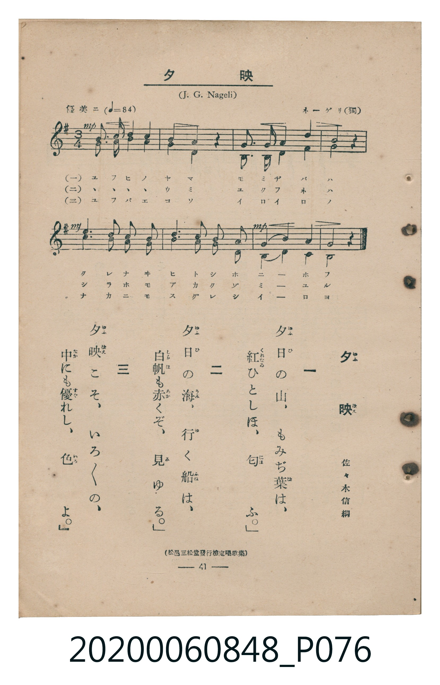

# 夕映

<audio controls src="yubae.mp3"></audio>

- 詞：佐々木信綱
- 曲：J. G. Nägeli（ネーゲリ）
- 臺灣教育會公認《新定兒童唱歌》高等科男子用（2020.006.0848）

## 說明

原書資訊與歌詞全文（對應 P076.jpg，書頁 p. 41，高一重音第 4 首）：
調性與拍號：ト長調（1 升記號）、3/4 拍（優美ニ ♩=84）
出處註記：（松邑三松堂發行檢定唱歌集）

## 歌詞

```text
一
夕日の山、もみぢ葉は、
紅ひとしほ、匂ふ。

二
夕日の海、行く船は、
白帆も赤くぞ、見ゆる。

三
夕映こそ、いろ／＼の、
中にも優れし、色よ。
```

## 原書掃描頁



## 分析

```text
================================================================================
📊 TMD Song Profile: [ 夕映 ]
================================================================================
⏱  Duration:       0:17 (17.1s), 8 measures total
🎼 Key & Tempo:    首調基準 G, != 84.0 BPM, <3/4>
   - 分析範圍：      由實際發聲的音符與和弦推測調性；播放脈絡另行呈現
🎤 人聲音域:    D4 (MIDI 62) – D5 (MIDI 74) [跨度: 12 個半音 / 1.0 個八度, 難度: easy]
   - 最低音:  D4 in [Main #1 @ m.2, 0:02]
   - 最高音: D5 in [Main #1 @ m.6, 0:10]
   - 適合: soprano, mezzo-soprano, contralto, tenor, baritone, bass
🏛  結構:      Main (17.1s)
⚡ 編曲密度:        Peak 2 軌道同時演奏
🗝  調性診斷：       G 大調（純淨自然大調，未偵測到可信轉調）
   - 風格氣質:    純淨自然大調（陽光明朗、易唱易記，無明顯調外色彩）
   - 轉調歷程:    全曲維持單一推測調性（未偵測到可信轉調）
   - 核心骨幹音:  G, D, B, A, F#
   - 調性數值:    G 大調 [相關度: 0.94, 穩定度: High, 自然音純度: 100.0%]
   - 候選調性 (K-S): G 大調 (0.94), D 大調 (0.67), G 小調 (0.56)
   - 五度圈歷程:   +1
   - 各段落調性細節:
     • [Main #1]: G 大調 (r: 0.94, 自然音純度: 100.0%)

  [ 五度圈游移軌跡 ]
               C  
         F           [G ]*
      Bb               D  
      Eb               A  
         Ab           E  
            Db       B  
               F# 
     (* = active key center)

  [ 十二半音累積音高分佈 ]
     C  : ████                       6.0%
     C# :                            0.0%
     D  : ██████████████            19.0%
     D# :                            0.0%
     E  : ███                        4.8%
     F  :                            0.0%
     F# : █████                      7.1%
     G  : ████████████████████████  33.3%
     G# :                            0.0%
     A  : ██████████                14.3%
     A# :                            0.0%
     B  : ███████████               15.5%
--------------------------------------------------------------------------------
Assignment 軌道音域：
  - Part1         : D4 – D5 (12 個半音 / 1.0 個八度, 23 個音符)
  - Part2         : G3 – A4 (14 個半音 / 1.2 個八度, 23 個音符)
================================================================================
```

## ABC

```abc
X:1
T:夕映
C:曲：J. G. Nägeli（ネーゲリ）
M:3/4
L:1/16
Q:1/4=84
K:G
V:V1 name="Part1" snm="Par"
V:V2 name="Part2" snm="Par"
[V:V1]
!mp! b6 c2 b2 a2 | g4 d4 z4 | e6 e2 f2 g2 | a8 z4 |
!mf! b6 c2 b2 a2 | d6 c2 b2 a2 | !mp! g4 b4 a4 | g8 z4 |
[V:V2]
!mp! g6 a2 g2 f2 | g4 d4 z4 | G6 G2 d2 d2 | d8 z4 |
!mf! g6 a2 g2 f2 | f6 a2 g2 d2 | !mp! B4 d4 c4 | G8 z4 |
```

- [主旋律 TMD 檔案](yubae.tmd)
- [鋼琴伴奏 TMD 檔案](yubae_piano.tmd)
