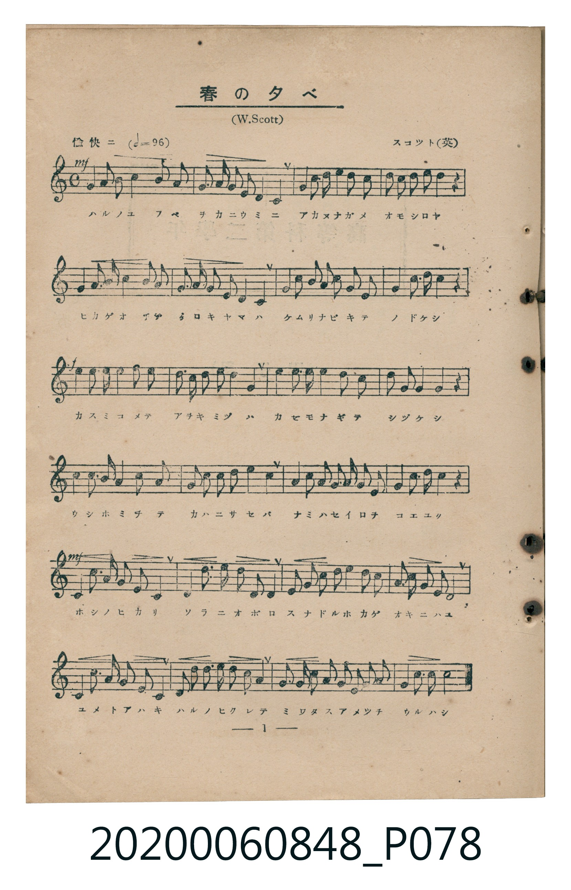
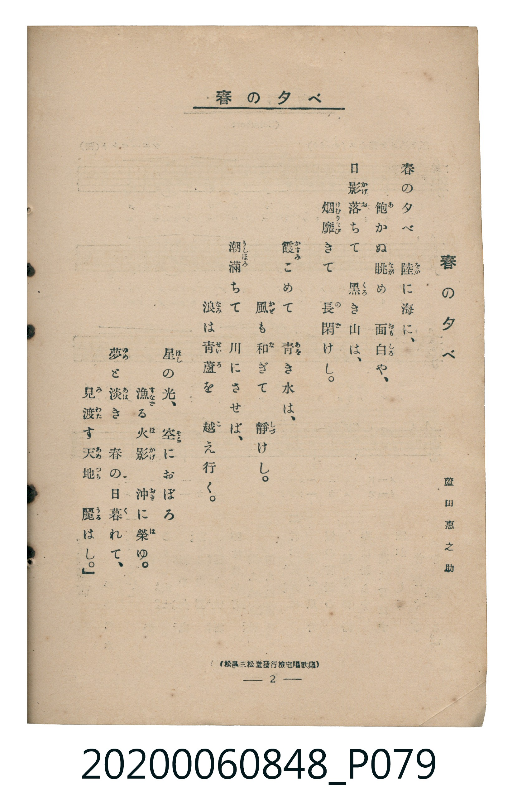

# 春の夕べ

<audio controls src="haru_no_yube.mp3"></audio>

- 詞：蘆田惠之助
- 曲：スコツト（W. Scott，英國）
- 臺灣教育會公認《新定兒童唱歌》高等科男子用（2020.006.0848）

- note

原書資訊與歌詞全文（對應 P078.jpg – P079.jpg，書頁 pp. 1–2，高二第一學期第 1 首）：
調性與拍號：ヘ長調（1 降記號）、4/4 拍（愉快ニ ♩=96）
出處註記：（松邑三松堂發行檢定唱歌集）

## 歌詞

```text
春の夕べ　陸（をか）に海（うみ）に、
飽（あ）かぬ眺（なが）め　面白（おもしろ）や、
日影（ひかげ）落（お）ちて　黒（くろ）き山（やま）は、
烟（けむり）靡（なび）きて　長閑（のど）けし。
霞（かすみ）こめて　青（あを）き水（みづ）は、
風（かぜ）も和（な）ぎて　靜（しづ）けし。
潮滿（うしほみ）ちて　川（かは）にさせば、
浪（なみ）は青蘆（せいろ）を　越（こ）え行（ゆ）く。
星（ほし）の光（ひかり）、　空（そら）におぼろ
漁（すなど）る火影（ほかげ）　沖（おき）に榮（は）ゆ。
夢（ゆめ）と淡（あは）き　春（はる）の日暮（ひく）れて、
見渡（みわた）す天地（あめつち）　麗（うる）はし。
```

## 原書掃描頁





## 調性分析

```text
================================================================================
📊 TMD Song Profile: [ 春の夕べ ]
================================================================================
⏱  Duration:       1:00 (60.0s), 24 measures total
🎼 Key & Tempo:    首調基準 F, != 96.0 BPM, <4/4>
   - 分析範圍：      由實際發聲的音符與和弦推測調性；播放脈絡另行呈現
🎤 人聲音域:    C4 (MIDI 60) – D5 (MIDI 74) [跨度: 14 個半音 / 1.2 個八度, 難度: moderate]
   - 最低音:  C4 in [Main #1 @ m.2, 0:04]
   - 最高音: D5 in [Main #1 @ m.1, 0:01]
   - 適合: soprano, mezzo-soprano, contralto, tenor, baritone, bass
🏛  結構:      Main (60.0s)
⚡ 編曲密度:        Peak 1 軌道同時演奏
🗝  調性診斷：       F 大調（純淨自然大調，未偵測到可信轉調）
   - 風格氣質:    純淨自然大調（陽光明朗、易唱易記，無明顯調外色彩）
   - 轉調歷程:    全曲維持單一推測調性（未偵測到可信轉調）
   - 核心骨幹音:  F, A, C, G, D
   - 調性數值:    F 大調 [相關度: 0.91, 穩定度: High, 自然音純度: 100.0%]
   - 候選調性 (K-S): F 大調 (0.91), D 小調 (0.75), A 小調 (0.62)
   - 五度圈歷程:   -1
   - 各段落調性細節:
     • [Main #1]: F 大調 (r: 0.91, 自然音純度: 100.0%)

  [ 五度圈游移軌跡 ]
               C  
        [F ]*          G  
      Bb               D  
      Eb               A  
         Ab           E  
            Db       B  
               F# 
     (* = active key center)

  [ 十二半音累積音高分佈 ]
     C  : ███████████████████       16.0%
     C# :                            0.0%
     D  : ███████████████           13.0%
     D# :                            0.0%
     E  : █████                      4.3%
     F  : ████████████████████████  20.4%
     F# :                            0.0%
     G  : ████████████████          13.3%
     G# :                            0.0%
     A  : ████████████████████████  20.1%
     A# : ███████████████           12.8%
     B  :                            0.0%
--------------------------------------------------------------------------------
Assignment 軌道音域：
  - Piano         : C4 – D5 (14 個半音 / 1.2 個八度, 140 個音符)
================================================================================
```

## ABC

```abc
X:1
T:春の夕べ
C:曲：スコツト（W. Scott，英國）
M:4/4
L:1/16
Q:1/4=96
K:F

V:V1 name="Piano" snm="Pia"

[V:V1]
!mf! f3 g a4 f4 d2 c2 | b2 a2 g2 f2 e4 c4 | g2 a2 b4 d4 c2 b2 | a2 g2 a2 c2 a4 z4 |
f3 g a4 f4 d2 c2 | b2 a2 g2 f2 e4 c4 | g2 a2 b4 d2 c2 b2 a2 | f4 a2 g2 f4 z4 |
!f! d2 d2 d4 d4 c2 b2 | a2 g2 a2 c2 b4 a4 | d2 d2 d4 d4 c2 b2 | a2 g2 f4 g4 z4 |
f3 g a4 f4 a2 f2 | g2 a2 b2 c2 d4 c4 | g2 a2 b4 b2 d2 c2 a2 | f4 a2 g2 f4 z4 |
!mf! c4 a3 g f2 e2 d4 | c4 c3 b a2 g2 f4 | f2 f2 g2 a2 b4 b2 a2 | g2 a2 g2 e2 c8 |
c4 a3 g f2 e2 d4 | c2 a2 b2 c2 b2 a2 g4 | f2 f2 g2 a2 b2 b2 a2 g2 | f4 e2 g2 f8 |
```

- [主旋律 TMD 檔案](haru_no_yube.tmd)
- [鋼琴伴奏 TMD 檔案](haru_no_yube_piano.tmd)
